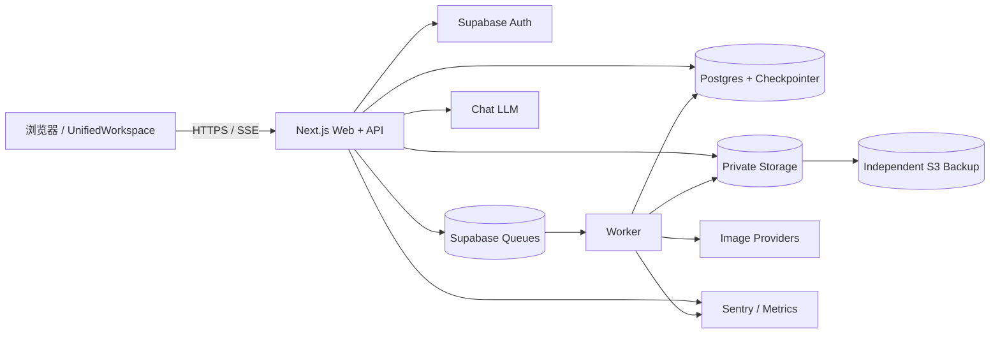
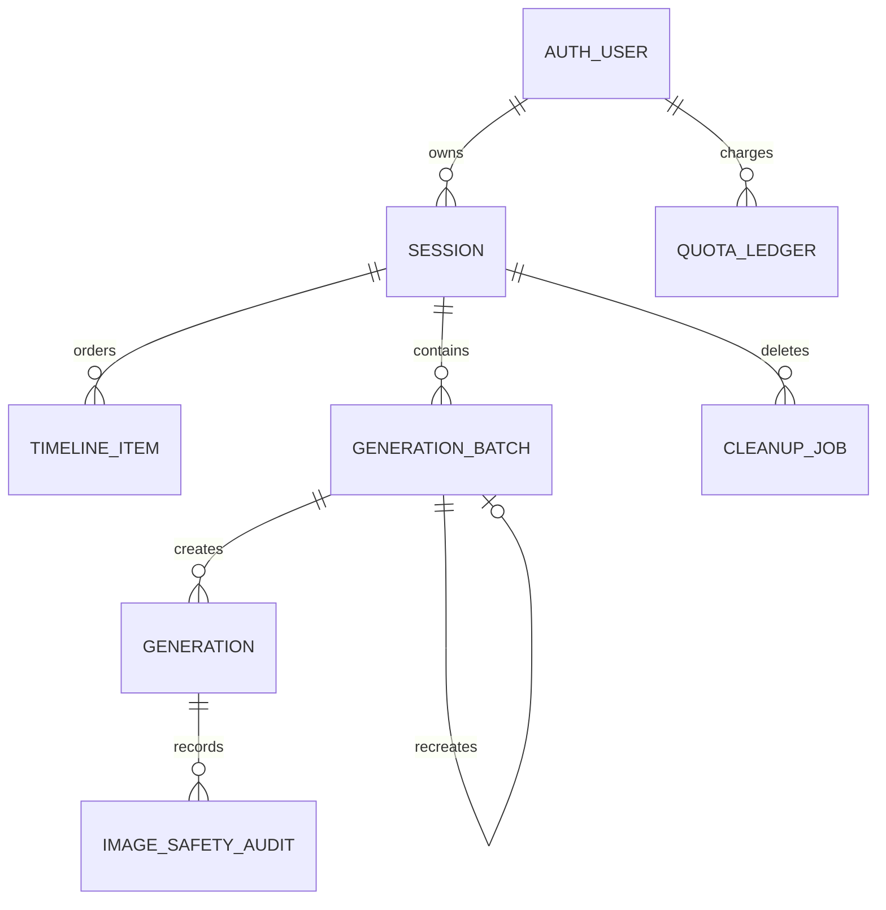
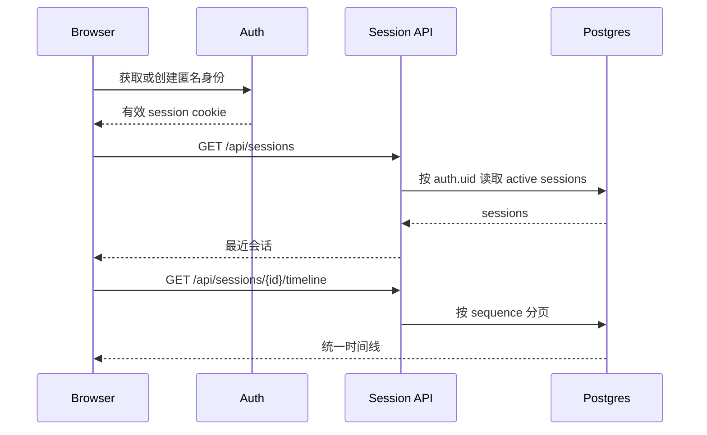
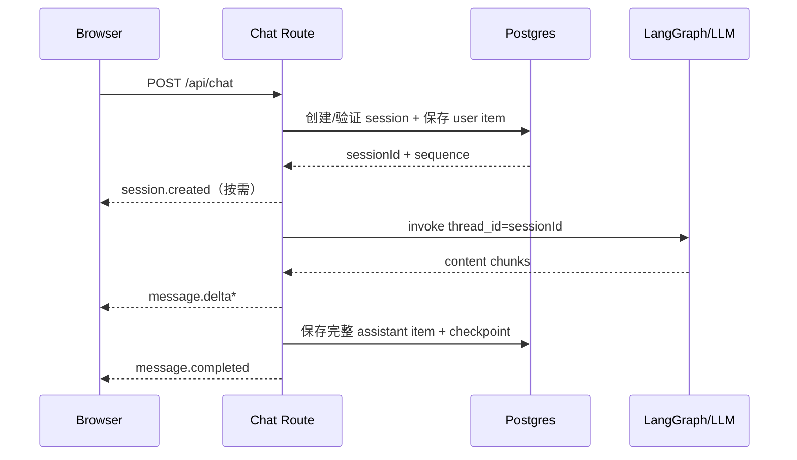
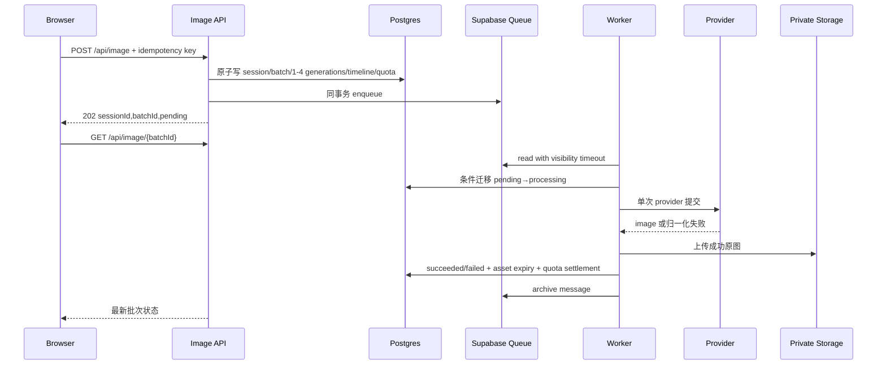
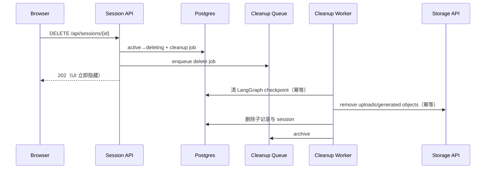
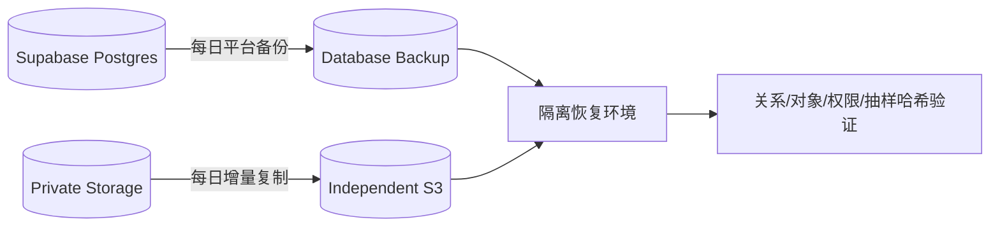
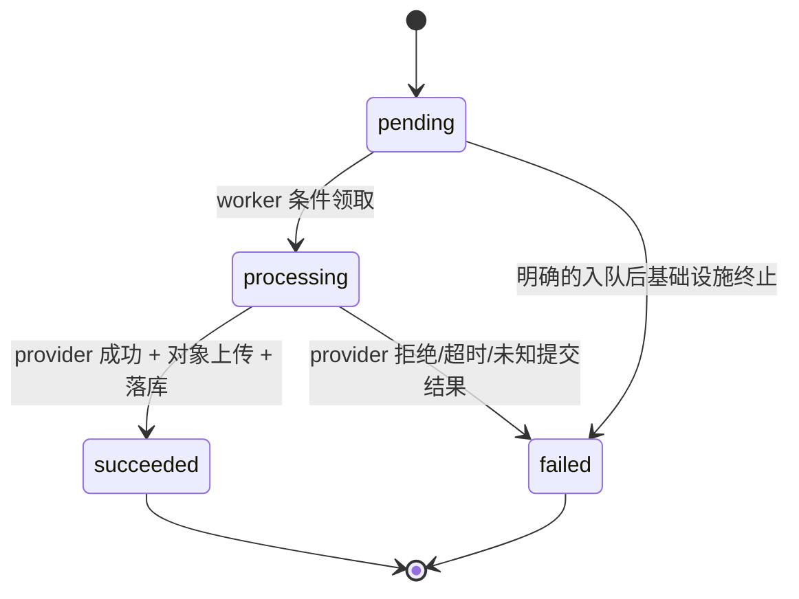
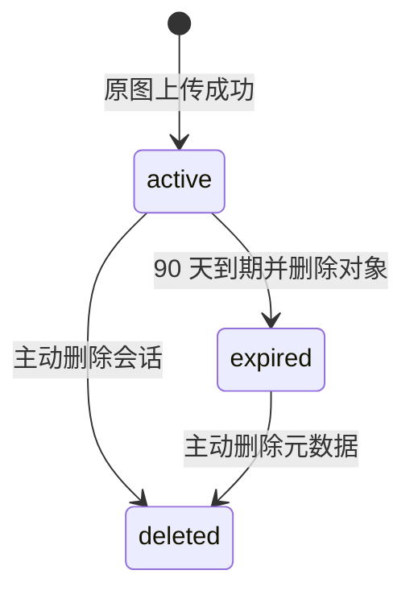
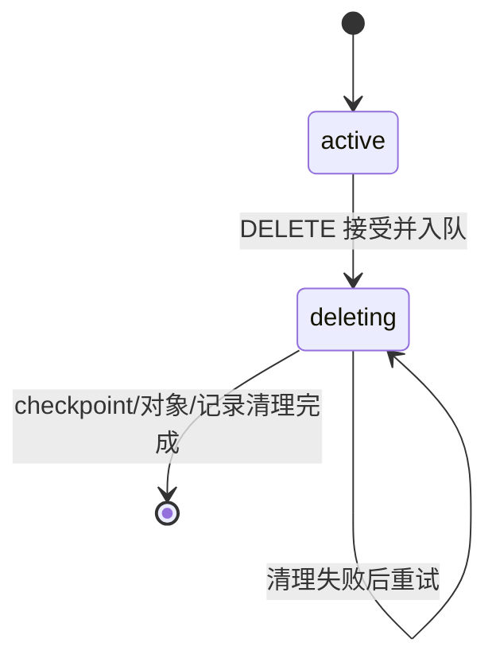

# zimage 架构文档

> **版本**：v1.3
> **状态**：与 `requirements.md`、`tech-selection.md` v1.3 对齐
> **更新日期**：2026-08-21

## 1. 架构目标

系统只有一个用户工作区 `/`，但保留两条不同可靠性语义的执行路径：聊天通过 SSE 在请求内增量返回；直接生图和聊天工具生图都先持久化再进入队列。所有可恢复事实来自 Postgres 与 private Storage，不依赖浏览器缓存、serverless 实例内存或请求结束后的后台工作。

## 2. 模块清单与职责

| 模块 ID | 模块 | 职责与边界 |
| --- | --- | --- |
| M01 | `UnifiedWorkspace` / `SessionSidebar` | `/` 布局、会话选择和匿名恢复提示；旧路径只做重定向。 |
| M02 | `Timeline` / `GenerationCard` | 按 `sequence` 展示文本、批次和错误；承载 SSE 临时增量及生成状态。 |
| M03 | `UnifiedComposer` / `ToolSelector` | 显式聊天/生图模式、草稿、图片工具许可和提交；图片工具默认关闭，不直接调用 provider。 |
| M04 | `GenerationConfigDrawer` | 技能必填字段、可编辑提示词预览、参考图、provider/model、动态参数和降级确认。 |
| M05 | Chat Route + LangGraph | 认证、用户消息持久化、SSE、请求级 workflow/checkpointer、Doubao/MiniMax 与聊天 tool 编排。 |
| M06 | Application API | 会话、生图、重生成、配额、技能、健康和资产 URL 的 Route Handlers。 |
| M07 | Skill Registry | 三个内置技能、版本、指令和 provider/model capability。 |
| M08 | Provider Adapters / Safety Mapper | Doubao/MiniMax 聊天与 Seedream/Gemini 图片 adapter；Gemini 固定稳定模型 `gemini-3-pro-image`；负责参数映射、超时、安全、错误归一化和费用归因。 |
| M09 | Session Service | 会话 CRUD、所有权、`deleting` 状态和列表过滤。 |
| M10 | Timeline / Generation Repository | 原子 sequence、批次/单张状态、配额、安全审计和到期元数据。 |
| M11 | LangGraph Checkpointer | 以 `session.id` 为 `thread_id` 保存可恢复图状态。 |
| M12 | Queue + Generation Worker | 持久消息、幂等领取、provider 调用、状态落库、死信。 |
| M13 | Asset Service | 两个 private bucket、上传校验、signed URL、Storage API 删除和备份读取。 |
| M14 | Provider Health Service | Postgres 5 分钟共享窗口、阈值、用户可见状态。 |
| M15 | Cleanup Worker | 会话删除、90 天到期、步骤审计、重试和告警。 |
| M16 | Auth / RLS Boundary | 匿名身份、cookie/session、`auth.uid()`、显式 GRANT 与 RLS。 |
| M17 | Observability / Backup | Sentry、结构化指标、数据库备份、独立 Storage 备份和恢复演练。 |
| M18 | CI / Release Gate | 类型、lint、测试覆盖率、pgTAP、浏览器矩阵、安全样本与恢复证据。 |

## 3. 部署与信任边界

| 区域 | 可持有内容 | 禁止事项 |
| --- | --- | --- |
| 浏览器 | publishable/anon 凭证、短期 signed URL、UI 缓存 | service role、provider key、永久资产 URL、跨用户数据 |
| Next.js request runtime | 当前用户 JWT、短期 provider 调用上下文、数据库客户端 | 请求结束后继续执行生图/清理、实例内全局健康计数 |
| Worker runtime | service role、provider key、queue 消息、Storage API | 向浏览器暴露 secret、无幂等地重放 provider 请求 |
| Postgres | 业务事实、checkpoint、queue、健康窗口、审计 | 将 RLS 当成 GRANT 的替代；向客户端开放内部 worker 表 |
| Private Storage | 上传与生成原图 | 公开 bucket、可预测长期 URL、直接 SQL 删除对象元数据 |
| Independent S3 | 加密的每日对象备份 | 与主 Storage 共用同一故障域或浏览器凭证 |

## 4. 领域数据模型

### 4.1 表与不变量

| 表 | 关键字段 | 不变量 |
| --- | --- | --- |
| `sessions` | `id, user_id, title, status, created_at, updated_at, deleted_at` | `status ∈ {active,deleting}`；对外列表只返回 active；ID 等于 LangGraph `thread_id`。 |
| `timeline_items` | `session_id, sequence, kind, role, text, batch_id, status` | `(session_id, sequence)` 唯一；同一数据库函数原子分配；generation item 必须指向同 session batch。 |
| `generation_batches` | `session_id, source, provider, model, config, parent_batch_id, skill_id, skill_version` | `source ∈ {direct,chat_tool}`；重生成创建新 batch。 |
| `generations` | `batch_id, provider, model, status, prompt, params, storage_path, asset_status, asset_expires_at, error_code` | `status ∈ {pending,processing,succeeded,failed}`；provider/model 创建后不可改写；`asset_status ∈ {active,expired,deleted}`。 |
| `quota_ledger` | `user_id, batch_id, generation_id, type, amount` | 预占、结算、释放追加写；同一业务动作有唯一键。 |
| `provider_health_windows` | `provider, window_start, total_count, error_count, state` | 5 分钟窗口唯一；服务端计算状态。 |
| `cleanup_jobs` | `job_type, target_id, step, status, attempts, next_run_at` | 每个目标/任务类型唯一；每步可安全重复。 |
| `image_safety_audits` | `generation_id, provider, category, decision, correlation_id` | 最小必要证据；不保存思维链或长期可访问 URL。 |

所有客户端可达表都显式向 `authenticated` 授予最小操作并启用 RLS。queue、checkpoint、健康窗口和清理表仅服务端角色可达。匿名用户也是 `authenticated` 角色，但所有权仍由 `auth.uid()` 限制。

## 5. API 与通信矩阵

| 调用方 → 接收方 | 协议 | 接口 | 一致性与失败语义 |
| --- | --- | --- | --- |
| 浏览器 → M05 | HTTPS/SSE | `POST /api/chat` | 用户消息先提交；SSE 增量仅为临时 UI，完整 assistant 消息成功后成为恢复事实。 |
| 浏览器 → M06 | HTTPS/JSON | `POST /api/image` | batch、generation、timeline、配额和 queue 原子写入；HTTP 202。 |
| 浏览器 → M06 | HTTPS/JSON | `POST /api/image/recreate` | `single\|failed\|all` 创建新批次；HTTP 202。 |
| 浏览器 → M06 | HTTPS/JSON | `GET /api/image/{batchId}` | 轮询当前批次；仅返回所有者数据。 |
| 浏览器 → M09 | HTTPS/JSON | `GET/POST /api/sessions` | 读取 active 会话或新建会话。 |
| 浏览器 → M09 | HTTPS/JSON | `PATCH/DELETE /api/sessions/{id}` | 重命名；删除标记并入队，返回 HTTP 202。 |
| 浏览器 → M10 | HTTPS/JSON | `GET /api/sessions/{id}/timeline` | 按 sequence cursor 分页。 |
| 浏览器 → M13 | HTTPS/JSON | `GET /api/generations/{id}/asset-url` | 验证所有权、未过期与对象状态后签发短期 URL。 |
| 浏览器 → M06/M07/M14 | HTTPS/JSON | `GET /api/skills`、`GET /api/health/providers`、`GET /api/quotas` | 可缓存短时间；服务端仍是提交时权威。 |
| M05 → Chat LLM | Provider SDK/HTTPS | 聊天 completion/tool | 首块前瞬时错误最多重试一次。 |
| M05/M06 → Postgres Queue | SQL/RPC | enqueue | 与业务事务同成败。 |
| M12 → Image Provider | Provider SDK/HTTPS | image generation | 可能已提交后不自动重试。 |
| M12/M15 → M13 | Storage API | upload/remove/sign | 对象删除不直接操作 Storage 内部表。 |
| M17 → Independent S3 | S3 API | daily copy | 对象、大小、抽样哈希校验。 |

应用公开 `GET /api/openapi.json`，规范由代码和契约测试维护；不依赖 Supabase anon 角色的自动 OpenAPI。

三个写入口的请求 schema 分别为：

- `POST /api/chat`：`{ sessionId?, message, tools?, chatModel?, imageProvider?, skillId?, images? }`。
- `POST /api/image`：`{ sessionId?, prompt, provider?, model?, params, skillId? }`。
- `POST /api/image/recreate`：`{ batchId, mode: "single"|"failed"|"all", generationId? }`。

失败响应都满足 `{ code, message, retryable, correlationId, details? }`。基础错误码为 `bad_request`、`unauthorized`、`quota_exceeded`、`provider_error`、`network`、`moderation`；资产过期、删除中等状态使用额外领域码，`details` 只允许脱敏白名单字段。

## 6. 关键数据流

### F01：进入统一首页与恢复

若匿名身份已丢失，系统建立新匿名用户并展示“旧历史可能无法恢复”，不得把旧本地 ID 当作授权凭证。`/chat` 和 `/image` 在读取任何旧状态前重定向到 `/`。

Phase 1 UI 只加载 zh-CN key。`SessionSidebar` 用 50 会话固定夹具验证：收到 API 响应后 200 ms 内完成可交互渲染。

### F02：聊天 SSE

首个内容块前遇到可重试的 LLM 瞬时错误，M05 最多自动重试一次；已有内容输出后失败则发送 `stream.failed` 并结束。未完成的 assistant 临时文本不作为刷新后的持久事实。

图片工具默认不在 `tools` 中。用户主动勾选或选择声明该工具的技能后，M05 才绑定 `generate_image`；开启时明确出图意图必须触发，普通讨论不得创建批次。Doubao 与 MiniMax 分别实现 chat adapter，切换聊天 provider 不改变图片 provider，反之亦然。

### F03：直接生图与持久队列

如果 worker 在 provider 连接前失败，消息可退避重试；若 provider 已接收或结果未知，generation 进入失败/待对账路径，不由系统自动再次提交。重复消费读取终态后直接归档。

M03/M04 在调用 API 前阻止空提示词，并按 capability 展示五种公共比例、1K/2K（默认 2K）。参考图上传状态为 `uploading | ready | error`，只接受 1–4 张 PNG/JPEG/WebP、单张不超过 10 MB；首图可初始化比例/尺寸，只有 ready 引用可以提交。双图片 provider 每次依赖升级各以至少 30 个样本验证成功率不低于 95%，2K 端到端 P95 不超过 60 秒。

### F04：聊天工具生图

LangGraph 的 `generate_image` tool 调用与 F03 相同的领域事务，唯一差异是 `generation_batches.source = chat_tool`。tool 创建批次后立即向聊天流发 `tool.queued { batchId }`，M02 插入同一种生成卡片；worker、Storage、轮询、到期和重生成均与直接生图共用实现。刷新后卡片从 `timeline_items` 恢复，不依赖 SSE 历史。

### F05：重生成与会话删除

重生成请求读取原 batch/generation 的参数快照，按 `single`、`failed` 或 `all` 选择条目，创建带 `parent_batch_id` 的新批次并走 F03。原批次不覆盖。

任一步失败都保留 `cleanup_jobs.step`、增加 attempts、安排下次执行并告警。物理删除前，M09 对 `deleting` 会话拒绝正常读写。

### F06：private signed URL 获取与续签

M02 只持有 `generationId` 和短期 URL。首次预览或 URL 过期时调用资产接口；M13 验证 session 所有权、generation 成功、`asset_status=active`、未过期以及对象路径前缀，随后签发短期 URL。403 不重试，401 先刷新身份一次，过期状态转 F07。

批量下载先筛选 succeeded 且 active 的最多 4 个 generation，逐个取得新 URL；单项签发/下载失败不阻塞其他成功项，并在汇总中返回脱敏错误与 correlation ID。

### F07：90 天到期

M15 定时扫描 `asset_expires_at <= now` 且 active 的 generation，锁定一批记录，经 Storage API 删除对象，成功后设置 `asset_status=expired` 并清空可访问路径。元数据、提示词参数、provider/model、技能版本和批次关系保留到用户主动删除。前端显示到期状态和“按原参数重新生成”，点击后走 F05；不承诺输出相同像素。

reference upload 的 `upload_expires_at` 为上传后 30 天；到期或删除会话时同样经 Storage API 清理。若原参数引用已过期对象，recreate 在入队前返回可行动的“请重新上传参考图”，不得提交缺少输入的付费任务。

### F08：备份与恢复

数据库备份仅恢复 Storage 元数据，必须与 S3 对象备份配套。每季度在隔离环境演练：恢复数据库、恢复对象、重建必要 secret/角色、运行一致性检查和关键流程；总用时不得超过 4 小时，最近可恢复点不得早于 24 小时。

### F09：健康、错误与告警

API/worker 将 provider 结果按 correlation ID 写入共享窗口。M14 对 5 分钟窗口计算：错误率达到 30% 为 warning；超过 50% 且样本不少于 10 为 unavailable。UI 只显示归一化状态和建议，不展示内部错误；选择替代图片 provider 必须由用户确认。

Sentry 接收 API QPS/成功率/错误率/P95、SSE SLO、queue depth/oldest age、配额使用达到 80%、死信、未知提交结果、清理重试、provider unavailable、signed URL 异常和备份失败。Phase 1 不依赖外部即时通讯告警通道。

健康故障回放必须满足 unavailable 告警误报低于 5%、漏报低于 1%；API 所有失败分支必须通过统一错误 schema，不能只在常见路径满足契约。

## 7. 状态机

### 7.1 Generation

批次状态由单张聚合：全 pending 为 pending；任一 processing 为 processing；全部 succeeded 为 succeeded；成功与失败并存为 partial；全部 failed 为 failed。`partial` 是 API 聚合值，不必写入 generation 状态。

### 7.2 Asset

### 7.3 Session

## 8. 失败与降级矩阵

| 场景 | 自动动作 | 用户体验 | 告警/证据 |
| --- | --- | --- | --- |
| Chat LLM 首块前瞬时失败 | 最多重试一次 | 保持等待；最终失败可重发 | correlation ID、attempt |
| Chat 已输出后失败 | 不重放 | 保留本次临时文本到离开页面，标明未完成 | `stream.failed` |
| Image provider 明确拒绝 | 不自动重试 | 单张失败，可主动 recreate | 归一化错误、安全审计 |
| Image provider 提交结果未知 | 不再次提交 | 标记失败/待对账，提示可能计费 | 高优先级事件 |
| Queue worker 崩溃 | 可见性超时后重投 | 卡片继续 processing/pending | oldest age、attempts |
| Queue 死信 | 停止自动处理 | 卡片失败，可人工处置 | Sentry 告警 |
| Storage 上传失败 | 仅在 provider 结果可安全复用时重试上传 | processing 后失败/恢复 | 对象关联 ID |
| signed URL 过期 | 重新签发 | 图片短暂 loading | 签发失败率 |
| Cleanup 失败 | 从记录步骤重试 | 会话保持隐藏 | step、attempt、告警 |
| Provider 高错误率 | 共享状态 warning/unavailable | 展示替代项，费用前确认 | 5 分钟窗口 |
| 数据库备份或 S3 copy 失败 | 当日重跑 | 无前台影响 | 备份任务告警 |

## 9. 安全与隐私控制

1. 所有写请求验证身份、Origin/CSRF、输入 schema、所有权、配额和速率限制。
2. `uploads`、`generated` 均为 private；短期 URL 不写数据库和日志。
3. Storage 对象删除只经 API；成功删除对象后再迁移业务状态，避免孤儿文件。
4. 路径固定为 `{userId}/{sessionId}/{batchId}/{generationId}` 前缀，服务端不接受客户端提供完整对象路径。
5. 上传验证 MIME、扩展名、magic bytes、大小、像素和数量；只接受 PNG/JPEG/WebP，单张不超过 10 MB，拒绝主动内容。
6. client 角色只拥有显式 GRANT；RLS 以 `auth.uid()` 验证所有权；service role 只存在服务端。
7. provider key、service role、S3 凭证由部署 secret 管理并定期轮换。
8. 日志对提示词、URL、token、邮箱和 provider 原始响应脱敏；不保存模型思维链。
9. 内容安全对输入、参考图、技能上下文和输出生效；固定集准确率门槛为 95%。
10. 匿名用户换设备或清理浏览器数据后不承诺恢复；任何本地 ID 都不能绕过服务端身份验证。

## 10. SLO 与容量保护

| 指标 | 目标/阈值 | 保护动作 |
| --- | --- | --- |
| SSE 首内容块 | P95 ≤ 3 秒 | 跟踪 LLM 与应用耗时；首块前有限重试 |
| 生图接收 | 1–4 张请求 1 秒内返回 202 | 事务仅写库/队列，不等待 provider |
| 2K 单张生成 | Seedream/Gemini 各 P95 ≤ 60 秒 | 每路 n≥30，按 API 接收到对象可访问计时 |
| 图片 provider 成功率 | Seedream/Gemini 固定集各 ≥95% | 依赖升级门禁 |
| 匿名配额 | 每日 30 张，额度内连续完成至少 20 张 | 原子账本与 24 小时跑测 |
| 同浏览器恢复 | 100% | 会话、直接生图和工具生图刷新/重开 E2E |
| 侧栏渲染 | 50 会话响应后 ≤200 ms | 固定夹具性能测试 |
| API 错误契约 | 失败分支 100% 可解析 | schema 契约测试 |
| 队列 oldest age | 按计划容量设 warning/critical | 扩 worker、暂停新任务或降级入口 |
| Provider 健康 | 30% warning；>50% 且 n≥10 unavailable | UI 警示、禁止默认选择、用户确认替代 |
| 内容安全 | 固定集 ≥95% | 未达标阻断发布 |
| 测试覆盖率 | 前后端均 ≥70% | CI 阻断 |
| 浏览器 | Chrome/Edge/Safari 最近两版 | 关键 E2E 阻断 |
| 灾备 | RPO ≤24h、RTO ≤4h | 每日双备份、季度演练 |

并发保护按用户/API/provider 分层：速率限制先于队列；配额预占与 batch 创建同事务；worker 有全局与 provider 级并发上限；队列积压达到 critical 时停止接受新的付费图片任务，但聊天和历史读取可继续。

## 11. 实施阶段与完成定义

### Phase 1A：统一首页 mock

- 完成 M01–M04 和 Zustand slices。
- 使用 mock adapter 覆盖聊天 delta、1–4 张 pending/processing/partial/succeeded/failed、expired、删除中和 provider unavailable。
- 覆盖图片工具默认关闭/技能联动、参考图上传状态、技能必填字段、提示词预览、批量下载与 zh-CN key。
- `/chat`、`/image` 重定向到 `/`。
- 完成响应式和三浏览器关键流程。

### Phase 1B：服务接入

- 按 migration 创建 M09–M16 数据与权限；pgTAP 验证显式 GRANT/RLS。
- 接入 F02、F03、F04、F05、F06、F07，完成故障注入。
- 接入 Sentry、共享健康窗口、配额和内容安全固定集。
- 接入 Doubao/MiniMax chat adapter，并验证与 Seedream/Gemini 图片选择相互独立。

### Phase 1C：生产门禁

- 达到 70% 覆盖率、95% 安全准确率与浏览器矩阵。
- 达到 2K P95、provider 成功率、恢复率、错误 schema、告警准确率和侧栏性能门禁。
- 启用每日数据库备份、每日 Storage 外部复制并完成一次联合恢复演练。
- 以 preview 验证后人工 promote 生产；应用可回退上一制品，数据库变更遵循 expand/contract。
- 所有 `requirements.md` 稳定 ID 状态只能为 `covered`、`deferred` 或 `non-goal`；不得存在未决冲突。
- CI 必须通过 secret、env schema、生成数据库类型、migration drift、显式 GRANT/RLS 和负向权限门禁。

### Phase 2 依赖

账号绑定/跨设备同步、外部告警通道、自定义技能平台及其他明确非目标必须重新立项，不得以“基础架构已支持”为由混入 Phase 1。
