# zimage 架构文档

## 2026-10-29 前后端分离目标边界（本地实施中）

目标是同域Nginx分别提供不可变静态前端与 `/api` 常驻Next后端；Supabase Auth/Postgres/Storage/Queues及已有Worker不随前端指针切换，Sharp/原字体继续由后端版本绑定。当前仍是standalone单体，不能把目标结构标成已迁移。

前后端制品、API合同、schema/Worker、资源、配置与入口版本分别记录。前端资源采用构建前确定的namespace，制品摘要在构建后计算，避免hash自引用；新旧页面所需资源保留。联合发布经兼容后端桥接，不能声称跨进程整体原子切换。

后端维护状态必须由受保护控制面跨重启保留；业务流与 `pendingFinalizers` 全部结束才停止进程，候选验收前保持禁写。当前线上旧服务没有这套已验证能力，首次交接证明及真实旧构建RSC/chunk/图片优化/草稿兼容为后续上线门槛；本地阶段0/1不改服务生命周期或生产入口。

> **版本**：v2.1（纳入电商生图 v0.2）
> **状态**：历史架构基线保留；电商 v0.2 目标架构实施中，未宣称验证完成
> **更新日期**：2026-09-08

第 1–11 节保留 Phase 1 架构和验收范围，含匿名身份、旧 Skill、1–4 张直接生图等历史描述，不代表当前运行状态或新增能力已验收。2026-09-06 的 Phase 2 修订覆盖匿名/账号与工作台行为；当前电商结构和授权按第 12 节执行。所有图示是架构说明，完成情况须由主任务的独立验证证据支持。

## 1. 架构目标

系统只有一个用户工作区 `/`，但保留两条不同可靠性语义的执行路径：聊天通过 SSE 在请求内增量返回；直接生图和聊天工具生图都先持久化再进入队列。所有可恢复事实来自 Postgres 与 private Storage，不依赖浏览器缓存、serverless 实例内存或请求结束后的后台工作。

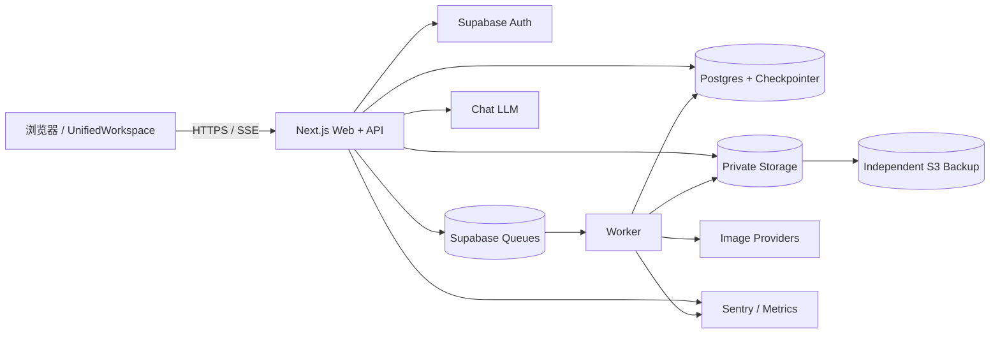

## 2. 模块清单与职责

| 模块 ID | 模块 | 职责与边界 |
| --- | --- | --- |
| M01 | `UnifiedWorkspace` / `SessionSidebar` | `/` 两栏布局、可折叠会话侧栏、会话选择和匿名恢复提示；按 `sessionId` 隔离加载、时间线、流式回复、临时生图回合和忙碌状态，控制骨架加载、后台任务标记、智能跟随与回到底部入口；旧路径只做重定向。 |
| M02 | `Timeline` / `GenerationTurn` / `GenerationCard` | 按 `sequence` 展示文本、批次和错误；承载 SSE 临时增量及生成状态；直接生图组合用户提示词与助手结果，历史工具生图不重复提示词；生成图和 Markdown 图进入统一图片预览组，白名单消息标签分段为只读折叠块并保留原始内容。 |
| M03 | `UnifiedComposer` | 单一草稿和输入框默认发送聊天；图片工具开关仅表示能力许可，普通讨论不生图；旧 Skill 发送按第 12 节先形成方案，明确确认后才入队；Enter 发送、Shift+Enter 换行且尊重输入法合成状态，不直接调用 provider。 |
| M04 | `ImageSettingsPopover` / `SkillPopover` | 输入框上方互斥浮层：图片 provider/model、健康状态和能力驱动参数合并为按需设置面板，Phase 1 技能字段与提示词预览为历史设计，当前使用第 12 节场景向导和逐图方案；窄屏抽屉复用同一状态。参考图由输入框单点维护并进入统一图片预览组，技能封面不进入会话预览。 |
| M05 | Chat Route + LangGraph | 认证、用户消息持久化、SSE、请求级 workflow/checkpointer、Doubao/MiniMax 与聊天 tool 编排。 |
| M06 | Application API | 会话、生图、重生成、配额、技能、健康和资产 URL 的 Route Handlers。 |
| M07 | Skill Registry | 三个旧 Skill 的名称/版本与兼容映射；电商六场景和 12 个原创模板由 M20 管理，模型能力独立登记。 |
| M08 | Provider Adapters / Safety Mapper | Doubao/MiniMax 聊天与 Seedream/Gemini 图片 adapter；Gemini 固定稳定模型 `gemini-3-pro-image`；负责参数映射、超时、安全、错误归一化和费用归因。 |
| M09 | Session Service | 会话 CRUD、所有权、`deleting` 状态和列表过滤。 |
| M10 | Timeline / Generation Repository | 原子 sequence、批次/单张状态、配额、安全审计和到期元数据。 |
| M11 | LangGraph Checkpointer | 以 `session.id` 为 `thread_id` 保存可恢复图状态。 |
| M12 | Queue + Generation Worker | 持久消息、幂等领取、provider 调用、状态落库、死信。 |
| M13 | Asset Service | 两个 private bucket、上传校验、signed URL、Storage API 删除和备份读取。 |
| M14 | Provider Health Service | Postgres 5 分钟共享窗口、阈值、用户可见状态。 |
| M15 | Cleanup Worker | 会话删除、90 天到期、步骤审计、重试和告警。 |
| M16 | Auth / RLS Boundary | 匿名身份、cookie/session、`auth.uid()`、显式 GRANT 与 RLS。 |
| M17 | Observability / Backup | Sentry、结构化指标、数据库备份、独立 Storage 备份和恢复演练。 |
| M18 | CI / Release Gate | 类型、lint、测试覆盖率、pgTAP、浏览器矩阵、安全样本与恢复证据。 |

## 3. 部署与信任边界

| 区域 | 可持有内容 | 禁止事项 |
| --- | --- | --- |
| 浏览器 | publishable/anon 凭证、短期 signed URL、UI 缓存 | service role、provider key、永久资产 URL、跨用户数据 |
| Next.js request runtime | 当前用户 JWT、短期 provider 调用上下文、数据库客户端 | 请求结束后继续执行生图/清理、实例内全局健康计数 |
| Worker runtime | service role、provider key、queue 消息、Storage API | 向浏览器暴露 secret、无幂等地重放 provider 请求 |
| Postgres | 业务事实、checkpoint、queue、健康窗口、审计 | 将 RLS 当成 GRANT 的替代；向客户端开放内部 worker 表 |
| Private Storage | 上传与生成原图 | 公开 bucket、可预测长期 URL、直接 SQL 删除对象元数据 |
| Independent S3 | 加密的每日对象备份 | 与主 Storage 共用同一故障域或浏览器凭证 |

## 4. 领域数据模型

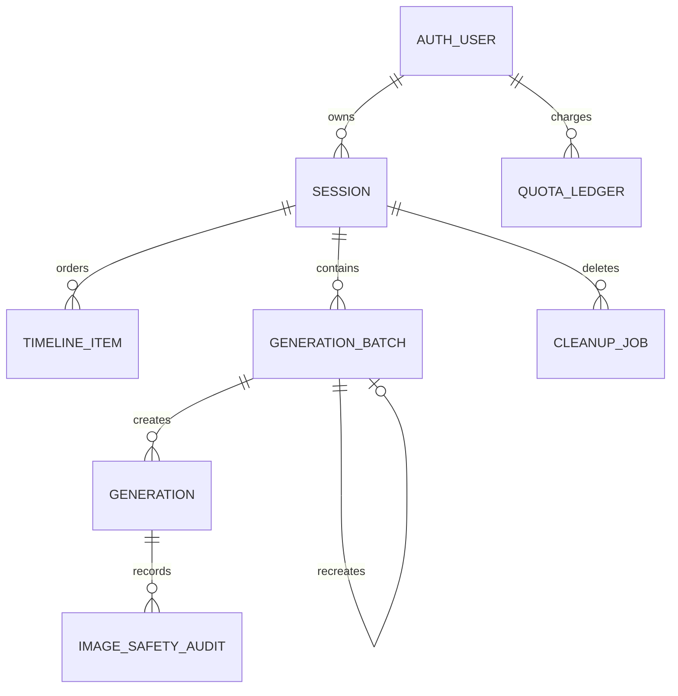

### 4.1 表与不变量

| 表 | 关键字段 | 不变量 |
| --- | --- | --- |
| `sessions` | `id, user_id, title, status, created_at, updated_at, deleted_at` | `status ∈ {active,deleting}`；对外列表只返回 active；ID 等于 LangGraph `thread_id`。 |
| `timeline_items` | `session_id, sequence, kind, role, text, batch_id, status` | `(session_id, sequence)` 唯一；同一数据库函数原子分配；generation item 必须指向同 session batch。 |
| `generation_batches` | `session_id, source, provider, model, config, parent_batch_id, skill_id, skill_version` | `source ∈ {direct,chat_tool}`；重生成创建新 batch。 |
| `generations` | `batch_id, provider, model, status, prompt, params, storage_path, asset_status, asset_expires_at, error_code` | `status ∈ {pending,processing,succeeded,failed}`；provider/model 创建后不可改写；`asset_status ∈ {active,expired,deleted}`。 |
| `quota_ledger` | `user_id, batch_id, generation_id, type, amount` | 预占、结算、释放追加写；同一业务动作有唯一键。 |
| `provider_health_windows` | `provider, window_start, total_count, error_count, state` | 5 分钟窗口唯一；服务端计算状态。 |
| `cleanup_jobs` | `job_type, target_id, step, status, attempts, next_run_at` | 每个目标/任务类型唯一；每步可安全重复。 |
| `image_safety_audits` | `generation_id, provider, category, decision, correlation_id` | 最小必要证据；不保存思维链或长期可访问 URL。 |

所有客户端可达表都显式向 `authenticated` 授予最小操作并启用 RLS。queue、checkpoint、健康窗口和清理表仅服务端角色可达。匿名用户也是 `authenticated` 角色，但所有权仍由 `auth.uid()` 限制。

## 5. API 与通信矩阵

| 调用方 → 接收方 | 协议 | 接口 | 一致性与失败语义 |
| --- | --- | --- | --- |
| 浏览器 → M05 | HTTPS/SSE | `POST /api/chat` | 用户消息先提交；SSE 增量仅为临时 UI，完整 assistant 消息成功后成为恢复事实。 |
| 浏览器 → M06 | HTTPS/JSON | `POST /api/image` | batch、generation、timeline、配额和 queue 原子写入；HTTP 202。 |
| 浏览器 → M06 | HTTPS/JSON | `POST /api/image/recreate` | `single\|failed\|all` 创建新批次；HTTP 202。 |
| 浏览器 → M06 | HTTPS/JSON | `GET /api/image/{batchId}` | 轮询当前批次；仅返回所有者数据。 |
| 浏览器 → M09 | HTTPS/JSON | `GET/POST /api/sessions` | 读取 active 会话或新建会话。 |
| 浏览器 → M09 | HTTPS/JSON | `PATCH/DELETE /api/sessions/{id}` | 重命名；删除标记并入队，返回 HTTP 202。 |
| 浏览器 → M10 | HTTPS/JSON | `GET /api/sessions/{id}/timeline` | 按 sequence cursor 分页。 |
| 浏览器 → M13 | HTTPS/JSON | `GET /api/generations/{id}/asset-url` | 验证所有权、未过期与对象状态后签发短期 URL。 |
| 浏览器 → M06/M07/M14 | HTTPS/JSON | `GET /api/skills`、`GET /api/health/providers`、`GET /api/quotas` | 可缓存短时间；服务端仍是提交时权威。 |
| M05 → Chat LLM | Provider SDK/HTTPS | 聊天 completion/tool | 首块前瞬时错误最多重试一次。 |
| M05/M06 → Postgres Queue | SQL/RPC | enqueue | 与业务事务同成败。 |
| M12 → Image Provider | Provider SDK/HTTPS | image generation | 可能已提交后不自动重试。 |
| M12/M15 → M13 | Storage API | upload/remove/sign | 对象删除不直接操作 Storage 内部表。 |
| M17 → Independent S3 | S3 API | daily copy | 对象、大小、抽样哈希校验。 |

应用公开 `GET /api/openapi.json`，规范由代码和契约测试维护；不依赖 Supabase anon 角色的自动 OpenAPI。

三个写入口的请求 schema 分别为：

- `POST /api/chat`：`{ sessionId?, message, tools?, chatModel?, imageProvider?, skillId?, images? }`。
- `POST /api/image`：`{ sessionId?, prompt, provider?, model?, params, skillId? }`。
- `POST /api/image/recreate`：`{ batchId, mode: "single"|"failed"|"all", generationId? }`。

失败响应都满足 `{ code, message, retryable, correlationId, details? }`。基础错误码为 `bad_request`、`unauthorized`、`quota_exceeded`、`provider_error`、`network`、`moderation`；资产过期、删除中等状态使用额外领域码，`details` 只允许脱敏白名单字段。

## 6. 关键数据流

### F01：进入统一首页与恢复

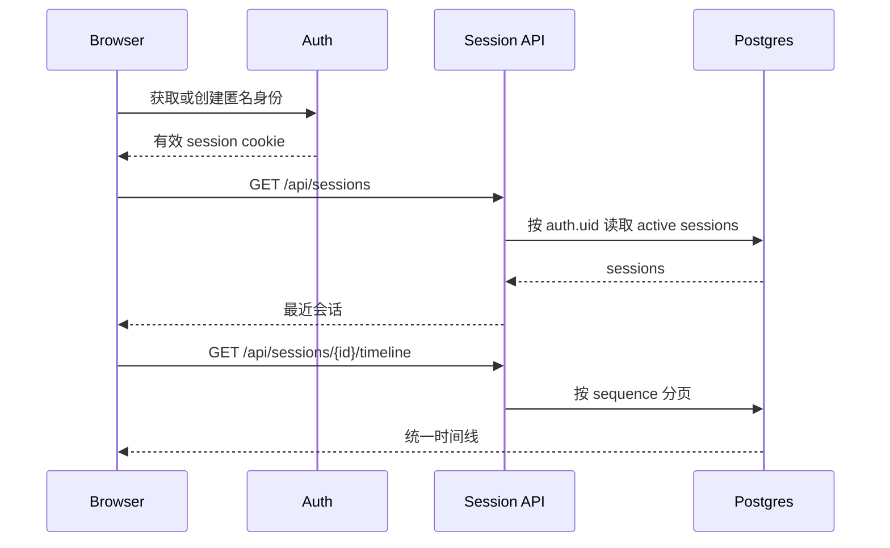

若匿名身份已丢失，系统建立新匿名用户并展示“旧历史可能无法恢复”，不得把旧本地 ID 当作授权凭证。`/chat` 和 `/image` 在读取任何旧状态前重定向到 `/`。

Phase 1 UI 只加载 zh-CN key。`SessionSidebar` 用 50 会话固定夹具验证：收到 API 响应后 200 ms 内完成可交互渲染。

### F02：聊天 SSE

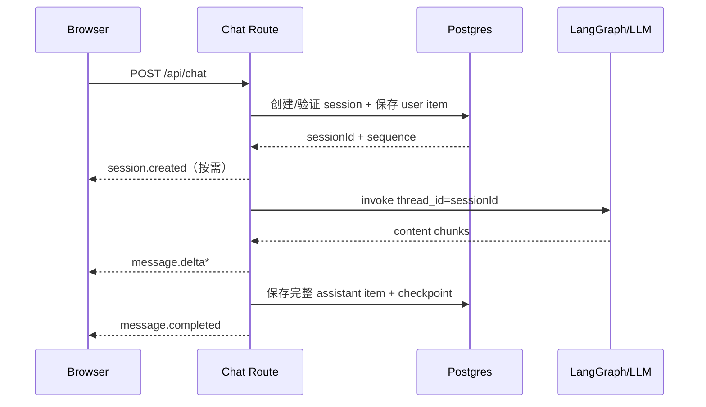

首个内容块前遇到可重试的 LLM 瞬时错误，M05 最多自动重试一次；已有内容输出后失败则发送 `stream.failed` 并结束。未完成的 assistant 临时文本不作为刷新后的持久事实。

M02 仅在展示层识别 `think/reasoning`、`tool/tool_call`、`tool_result/observation`。解析器支持多块、嵌套和跨 SSE 分片；Markdown 围栏代码和行内代码中的标签不解析，未知、错配或流结束时仍残缺的标签按安全 Markdown 文本显示。流式未闭合的已识别块展开显示，收到完成事件后折叠；标签属性只展示经过过滤的 `name/tool/status`，不会触发工具执行、改写持久化正文或改变 HTTP/SSE 契约。真实 `tool.queued` 事件仍由现有生成卡片承载。

图片工具默认不在 `tools` 中。开关只在聊天模式显示；进入生图模式时隐藏但保留用户显式聊天偏好，返回聊天模式后恢复。用户主动勾选或选择声明该工具的技能后，M05 才绑定 `generate_image`；技能要求该工具时聊天开关显示为启用且不可关闭，清除技能只解除强制状态。开启时明确出图意图必须触发，普通讨论不得创建批次。Doubao 与 MiniMax 分别实现 chat adapter，切换聊天 provider 不改变图片 provider，反之亦然。

### F03：直接生图与持久队列

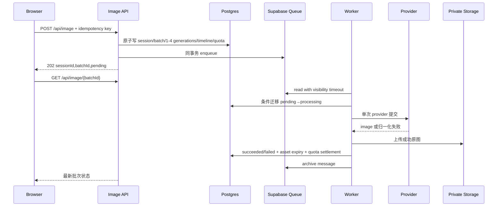

如果 worker 在 provider 连接前失败，消息可退避重试；若 provider 已接收或结果未知，generation 进入失败/待对账路径，不由系统自动再次提交。重复消费读取终态后直接归档。

M03/M04 在调用 API 前阻止空提示词，并按 capability 展示五种公共比例、1K/2K（默认 2K）。参考图上传状态为 `uploading | ready | error`，只接受 1–4 张 PNG/JPEG/WebP、单张不超过 10 MB；首图可初始化比例/尺寸，只有 ready 引用可以提交。双图片 provider 每次依赖升级各以至少 30 个样本验证成功率不低于 95%，2K 端到端 P95 不超过 60 秒。

### F04：聊天工具生图

LangGraph 的 `generate_image` tool 调用与 F03 相同的领域事务，唯一差异是 `generation_batches.source = chat_tool`。tool 创建批次后立即向聊天流发 `tool.queued { batchId }`，M02 插入同一种生成卡片；worker、Storage、轮询、到期和重生成均与直接生图共用实现。刷新后卡片从 `timeline_items` 恢复，不依赖 SSE 历史。

### F05：重生成与会话删除

重生成请求读取原 batch/generation 的参数快照，按 `single`、`failed` 或 `all` 选择条目，创建带 `parent_batch_id` 的新批次并走 F03。原批次不覆盖。

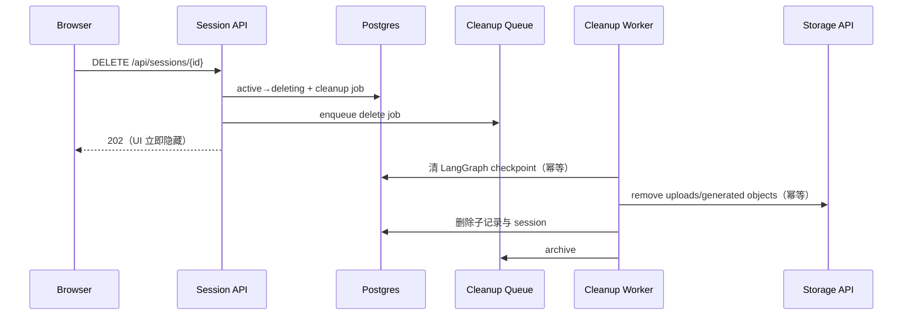

任一步失败都保留 `cleanup_jobs.step`、增加 attempts、安排下次执行并告警。物理删除前，M09 对 `deleting` 会话拒绝正常读写。

### F06：private signed URL 获取与续签

M02 只持有 `generationId` 和短期 URL。首次预览或 URL 过期时调用资产接口；M13 验证 session 所有权、generation 成功、`asset_status=active`、未过期以及对象路径前缀，随后签发短期 URL。403 不重试，401 先刷新身份一次，过期状态转 F07。

Phase 1 通用批量下载先筛选 succeeded 且 active 的最多 4 个 generation；电商按第 12 节冻结 1–8 个 slot 的选图集合，再逐个取得新 URL；单项签发/下载失败不阻塞其他成功项，并在汇总中返回脱敏错误与 correlation ID。

### F07：90 天到期

M15 定时扫描 `asset_expires_at <= now` 且 active 的 generation，锁定一批记录，经 Storage API 删除对象，成功后设置 `asset_status=expired` 并清空可访问路径。元数据、提示词参数、provider/model、技能版本和批次关系保留到用户主动删除。前端显示到期状态和“按原参数重新生成”，点击后走 F05；不承诺输出相同像素。

reference upload 的 `upload_expires_at` 为上传后 30 天；到期或删除会话时同样经 Storage API 清理。若原参数引用已过期对象，recreate 在入队前返回可行动的“请重新上传参考图”，不得提交缺少输入的付费任务。

### F08：备份与恢复

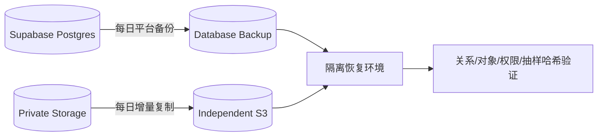

数据库备份仅恢复 Storage 元数据，必须与 S3 对象备份配套。每季度在隔离环境演练：恢复数据库、恢复对象、重建必要 secret/角色、运行一致性检查和关键流程；总用时不得超过 4 小时，最近可恢复点不得早于 24 小时。

### F09：健康、错误与告警

API/worker 将 provider 结果按 correlation ID 写入共享窗口。M14 对 5 分钟窗口计算：错误率达到 30% 为 warning；超过 50% 且样本不少于 10 为 unavailable。UI 只显示归一化状态和建议，不展示内部错误；选择替代图片 provider 必须由用户确认。

Sentry 接收 API QPS/成功率/错误率/P95、SSE SLO、queue depth/oldest age、配额使用达到 80%、死信、未知提交结果、清理重试、provider unavailable、signed URL 异常和备份失败。Phase 1 不依赖外部即时通讯告警通道。

健康故障回放必须满足 unavailable 告警误报低于 5%、漏报低于 1%；API 所有失败分支必须通过统一错误 schema，不能只在常见路径满足契约。

## 7. 状态机

### 7.1 Generation

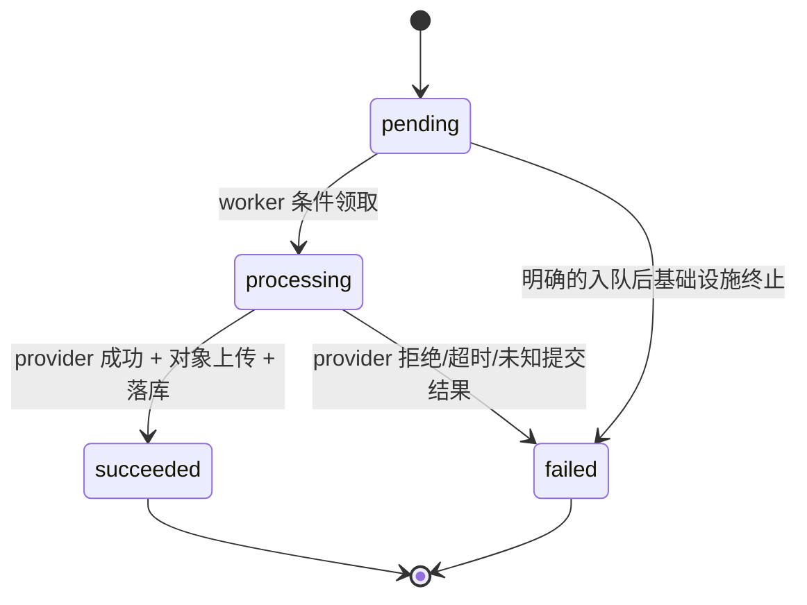

批次状态由单张聚合：全 pending 为 pending；任一 processing 为 processing；全部 succeeded 为 succeeded；成功与失败并存为 partial；全部 failed 为 failed。`partial` 是 API 聚合值，不必写入 generation 状态。

### 7.2 Asset

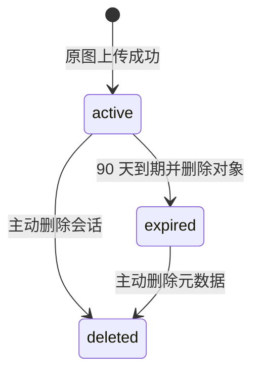

### 7.3 Session

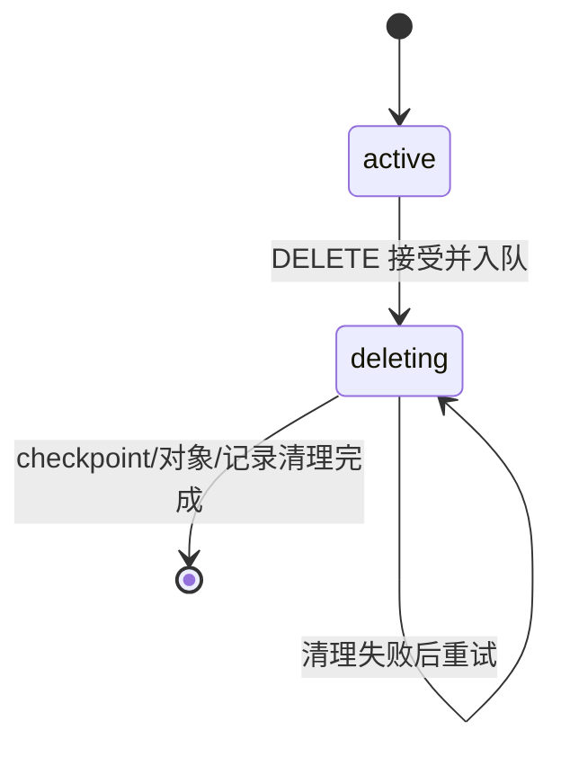

## 8. 失败与降级矩阵

| 场景 | 自动动作 | 用户体验 | 告警/证据 |
| --- | --- | --- | --- |
| Chat LLM 首块前瞬时失败 | 最多重试一次 | 保持等待；最终失败可重发 | correlation ID、attempt |
| Chat 已输出后失败 | 不重放 | 保留本次临时文本到离开页面，标明未完成 | `stream.failed` |
| Image provider 明确拒绝 | 不自动重试 | 单张失败，可主动 recreate | 归一化错误、安全审计 |
| Image provider 提交结果未知 | 不再次提交 | 标记失败/待对账，提示可能计费 | 高优先级事件 |
| Queue worker 崩溃 | 可见性超时后重投 | 卡片继续 processing/pending | oldest age、attempts |
| Queue 死信 | 停止自动处理 | 卡片失败，可人工处置 | Sentry 告警 |
| Storage 上传失败 | 仅在 provider 结果可安全复用时重试上传 | processing 后失败/恢复 | 对象关联 ID |
| signed URL 过期 | 重新签发 | 图片短暂 loading | 签发失败率 |
| Cleanup 失败 | 从记录步骤重试 | 会话保持隐藏 | step、attempt、告警 |
| Provider 高错误率 | 共享状态 warning/unavailable | 展示替代项，费用前确认 | 5 分钟窗口 |
| 数据库备份或 S3 copy 失败 | 当日重跑 | 无前台影响 | 备份任务告警 |

## 9. 安全与隐私控制

1. 所有写请求验证身份、Origin/CSRF、输入 schema、所有权、配额和速率限制。
2. `uploads`、`generated` 均为 private；短期 URL 不写数据库和日志。
3. Storage 对象删除只经 API；成功删除对象后再迁移业务状态，避免孤儿文件。
4. 路径固定为 `{userId}/{sessionId}/{batchId}/{generationId}` 前缀，服务端不接受客户端提供完整对象路径。
5. 上传验证 MIME、扩展名、magic bytes、大小、像素和数量；只接受 PNG/JPEG/WebP，单张不超过 10 MB，拒绝主动内容。
6. client 角色只拥有显式 GRANT；RLS 以 `auth.uid()` 验证所有权；service role 只存在服务端。
7. provider key、service role、S3 凭证由部署 secret 管理并定期轮换。
8. 日志对提示词、URL、token、邮箱和 provider 原始响应脱敏；不保存模型思维链。
9. 内容安全对输入、参考图、技能上下文和输出生效；固定集准确率门槛为 95%。
10. 匿名用户换设备或清理浏览器数据后不承诺恢复；任何本地 ID 都不能绕过服务端身份验证。

## 10. SLO 与容量保护

| 指标 | 目标/阈值 | 保护动作 |
| --- | --- | --- |
| SSE 首内容块 | P95 ≤ 3 秒 | 跟踪 LLM 与应用耗时；首块前有限重试 |
| 生图接收 | 1–4 张请求 1 秒内返回 202 | 事务仅写库/队列，不等待 provider |
| 2K 单张生成 | Seedream/Gemini 各 P95 ≤ 60 秒 | 每路 n≥30，按 API 接收到对象可访问计时 |
| 图片 provider 成功率 | Seedream/Gemini 固定集各 ≥95% | 依赖升级门禁 |
| 匿名配额 | 每日 30 张，额度内连续完成至少 20 张 | 原子账本与 24 小时跑测 |
| 同浏览器恢复 | 100% | 会话、直接生图和工具生图刷新/重开 E2E |
| 侧栏渲染 | 50 会话响应后 ≤200 ms | 固定夹具性能测试 |
| API 错误契约 | 失败分支 100% 可解析 | schema 契约测试 |
| 队列 oldest age | 按计划容量设 warning/critical | 扩 worker、暂停新任务或降级入口 |
| Provider 健康 | 30% warning；>50% 且 n≥10 unavailable | UI 警示、禁止默认选择、用户确认替代 |
| 内容安全 | 固定集 ≥95% | 未达标阻断发布 |
| 测试覆盖率 | 前后端均 ≥70% | CI 阻断 |
| 浏览器（零费内测） | Chromium/Edge/Playwright WebKit | mock 关键 E2E 阻断 |
| 浏览器（生产） | Chrome/Edge/真实 Safari 最近两版 | 后续生产门禁 |
| 灾备 | RPO ≤24h、RTO ≤4h | 每日双备份、季度演练 |

并发保护按用户/API/provider 分层：速率限制先于队列；配额预占与 batch 创建同事务；worker 有全局与 provider 级并发上限；队列积压达到 critical 时停止接受新的付费图片任务，但聊天和历史读取可继续。

## 11. 实施阶段与完成定义

### Phase 1A：统一首页 mock

- 完成 M01–M04 和 Zustand slices。
- 使用 mock adapter 覆盖聊天 delta、1–4 张 pending/processing/partial/succeeded/failed、expired、删除中和 provider unavailable。
- 覆盖受控标签的流式分段与折叠展示、图片工具显隐和技能联动、桌面/窄屏技能列表与配置、参考图上传状态、技能必填字段、提示词预览、批量下载与 zh-CN key。
- `/chat`、`/image` 重定向到 `/`。
- 完成响应式和 Chromium、Edge、Playwright WebKit 三引擎关键流程；不要求真实 Safari。

### Phase 1B：服务接入

- 按 migration 创建 M09–M16 数据与权限；pgTAP 验证显式 GRANT/RLS。
- 接入 F02、F03、F04、F05、F06、F07，完成故障注入。
- 接入 Sentry、共享健康窗口、配额和内容安全固定集。
- 接入 Doubao/MiniMax chat adapter，并验证与 Seedream/Gemini 图片选择相互独立。
- 使用平台无关的本地或 HTTPS Next.js HTTP 服务验收；本轮固定本地生产模式服务，不依赖 Vercel。
- 真实调用限于 Doubao 一次短 SSE、MiniMax 一次显式聊天工具生图和 Seedream 三个 `count=1` 场景；累计第 6 次图片请求必须停止。

### Phase 1C：零费内测门禁

- 该阶段只证明受控内测可用，不代表生产就绪。
- 完成 70% 覆盖率、三引擎 mock E2E、本地 HTTP/RLS/Provider/Storage/cleanup、moderation 故障注入与 Sentry Free 脱敏 replay。
- Gemini 保持 disabled；不升级套餐、不充值、不创建生产部署。

### 后续生产门禁

- 达到 1000 条固定安全集 95% 准确率与真实 Safari 浏览器矩阵。
- 达到 Seedream/Gemini 各 n≥30 的 2K P95/成功率、恢复率、错误 schema、告警准确率和侧栏性能门禁。
- 启用每日数据库备份、每日 Storage 外部复制并完成一次联合恢复演练。
- 完成另立的阿里云 ECS/Docker/TLS/反向代理或其他目标平台方案，再进行生产发布和回滚演练；数据库变更遵循 expand/contract。
- Phase 1 历史矩阵沿用 `covered`、`deferred` 或 `non-goal`；Phase 2 保留 `planned`/`withdrawn`，电商项以第 12 节待验收口径统计；状态不能代替证据。
- CI 必须通过 secret、env schema、生成数据库类型、migration drift、显式 GRANT/RLS 和负向权限门禁。

### Phase 2 依赖（历史范围）

上述是 Phase 1 当时的延后范围。正式账号跨设备恢复后纳入 Phase 2，匿名绑定被撤销；外部告警与自定义 Skill 平台仍不在本次电商范围。电商目录不等同于自定义 Skill 平台。
## Phase 2 架构修订（2026-09-06）

工作区继续使用单一会话时间线与持久图片队列。草稿、参考图、Skill 选择和图片设置按会话隔离；提交使用稳定请求标识，时间线按游标恢复，SSE 无完成事件时保留已收到内容并报告中断。正式账号取代自动匿名身份。该日期的 Skill 设计曾用 awaiting_input、queued、cancelled、replaced，且信息足够时发送直接入队；此授权与单任务模型已由电商 v0.2 第 12 节覆盖，不能继续作为当前自动执行规则。历史记录保留，不新增第二套待补充状态机。

## 12. 电商 v0.2 目标架构（已批准、实施中）

依据 `requirements.md` 第 11 节、D01–D11 与 `plans/2026-09-08-commerce-implementation.md`。采用下列具体对象、接口和事务边界替代研究快照中的建议名称；本节未断言代码、数据库迁移、浏览器或真实 Provider 验证已通过。

### 12.1 入口、模块与事实源

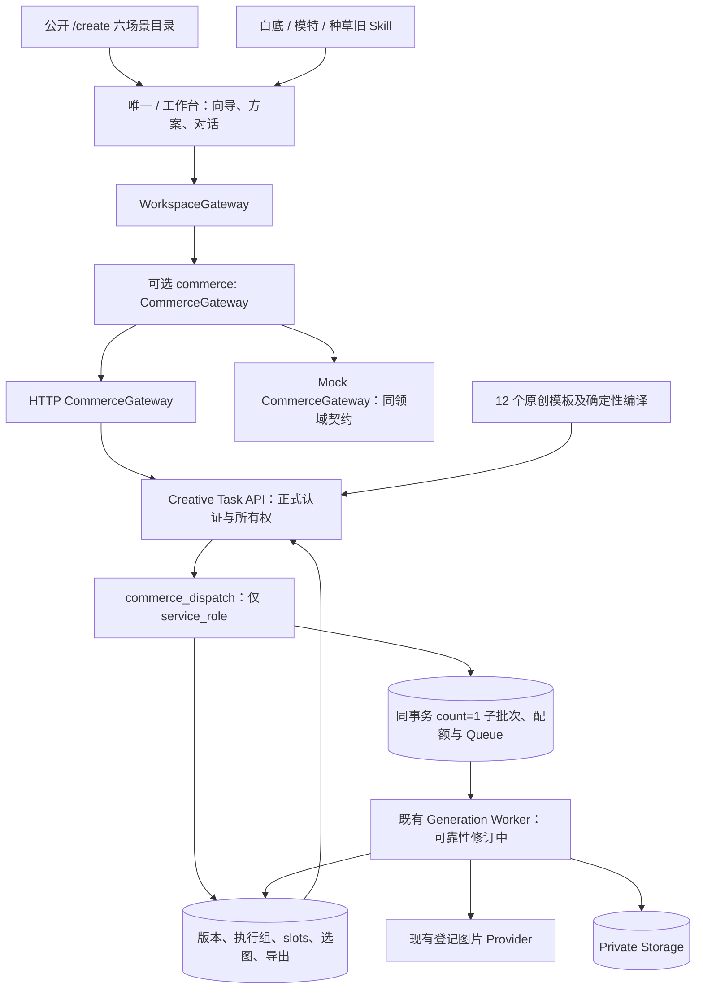

| 模块 ID | 责任与实施边界 |
| --- | --- |
| M19 | `/create` 和 `features/commerce/`：六场景发现、三步向导、逐图方案、任务聚合、对话目标、选图与下载；原工作区承载执行，目录不保存第二份会话。 |
| M20 | `packages/domain/src/commerce.ts`、`commerce-templates.ts`：CommercePlan/Task、schema、确定性规划/编译、12 个原创模板、slot 兼容哈希；模型效果状态独立于模板版本。 |
| M21 | 独立 `CommerceGateway` 挂在 `WorkspaceGateway.commerce?`，HTTP/mock 共享 schema；缺少该可选能力时不可把电商确认降级为旧发送生图。 |
| M22 | `server/commerce/`、`api/creative-tasks/`、`api/creative-templates/`：正式账号校验、可信编译、恢复、幂等请求、原子执行、选择和导出。 |
| M23 | commerce 表、私有编译/操作结果记录与受限 `commerce_dispatch`；复用 M10/M12/M13/M15，补足租约、完成恢复、配额账本和补偿清理。 |

目录场景为 `product-main/product-set/detail/social/style-reference/model`；A+ 与模特专项增强另排期。旧 Skill 映射至同一方案。Zustand/React 只保存表单、未提交草案和请求瞬态，服务端持久版本、执行与选图才是已保存事实；刷新通过 list/get 恢复，不能只依赖 SSE 或本地状态。任务聚合展示需保留子批次关联，避免重复顶层卡片。

### 12.2 领域与持久不变量

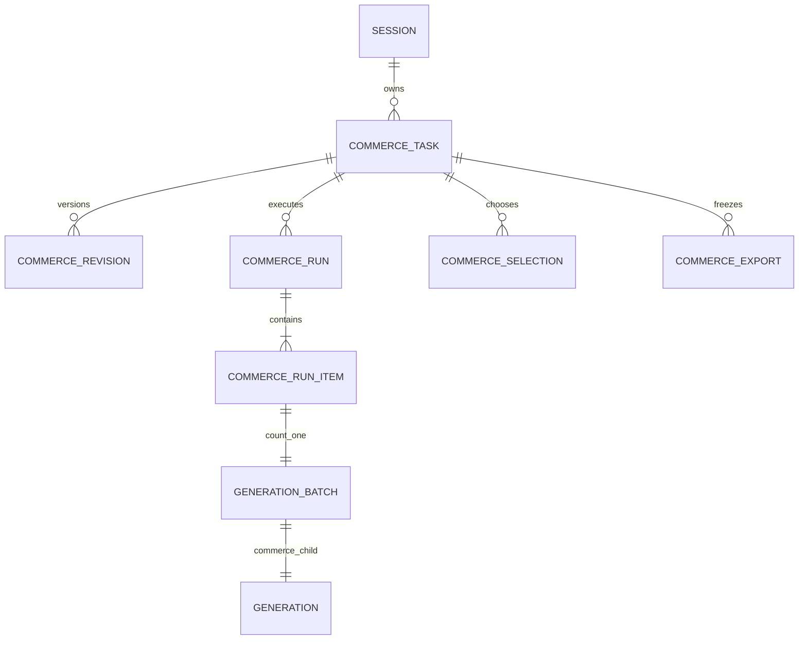

上图的 batch/generation 一对一仅指电商 count=1 子批次，通用直接生图仍可一批 1–4 张。

| 对象/持久结构 | 当前选型与不变量 |
| --- | --- |
| `CommercePlan` | scene、brief、templateId、slots。brief 保存平台、用途、名称、人工确认事实/卖点和 product/style 引用；不声称已有视觉识别。 |
| `CommerceTask` / `commerce_tasks` | Plan 加 id/sessionId/revision、timestamps、runs、selections、`slotHashes`、archived；所有权由正式账号和活动会话校验。 |
| `CommerceSlot` / `commerce_revisions` | 1–8 个稳定 slotId，逐图 role、instruction、exactText、referenceIds、provider/model/aspectRatio/resolution；修改保存新不可变版本，旧执行快照不覆盖。 |
| 私有编译快照 | 服务端解析可信模板/版本，保存逐 slot 编译内容、版本与兼容哈希；`slotHashes` 是当前 slot 哈希映射，不能用全套哈希误使未修改 slot 失效。 |
| `CommerceRun` / `commerce_runs`、`commerce_run_items` | 一次确认一个 run，记录 revision/requestId；每项关联 slot、count=1 batch、generation、兼容哈希、选择版本和重做来源；业务组不额外预占额度。 |
| selections / `commerce_selections` | 保存当前 generation、compatibilityHash、选择版本与最新在途候选关联；新版或手选后迟到结果不得获胜，失败/未知/缺图不覆盖旧选图。 |
| `commerce_exports` | 固定 revision 与有序 slotId/generationId 清单，后续切图或完成不改写；URL 临时签发，持久记录不保存 signed URL。 |
| 私有幂等结果 | 按用户、operation、requestId 及请求内容哈希保存操作结果；同键异内容冲突，同键同内容先恢复原结果再考虑当前版本变化。 |

全任务商品图和风格图合计 ≤4 张，每张 ≤10 MB，仅 PNG/JPEG/WebP；引用必须同用户同会话且未过期。销售主图、套图、详情图至少一个有效 product 引用，风格图不得代替。模型 capability 低于公共上限时优先收紧；通用纯文字生图保留。上传 30 天/生成结果 90 天沿用既有保留语义，实际到期由服务端返回。

历史参考文件采用独立的内部资源上限：同一会话最多保留 64 个，继续执行既有上传及每日字节 guard。该上限用于保存旧草案、切换商品和显式样图采用，不改变单方案/模型输入合计 ≤4 张、每张 ≤10 MB 的限制；模型更低上限仍优先。历史文件数量不能直接作为当前方案所选引用数量。

样图转换由新的参考图迁移及对应实施模块承接：用户明确采用后，服务端验证正式账号、同用户同会话、generation 成功与有效期，幂等生成 reference_upload 并记录 `source_generation_id`。采用前的模型结果不自动变成引用；满四张时必须明确替换当前引用，旧草案所需文件继续受历史上限保护。转换同样执行上传/每日字节 guard，在对象复制前持久登记对象意图，失败、提交被拒或删除竞争通过可恢复补偿清理处理；不得直接把 generationId/signed URL 当成 referenceId。本项是实施目标，不代表迁移或复制清理已验证，也不扩大任何公共付费预算。

### 12.3 API 与授权路径

| 接口 | 当前设计责任 |
| --- | --- |
| `GET /api/creative-templates` | 公开安全模板元数据、版本/来源/审核与模型验证状态，内部执行内容不公开。 |
| `GET /api/creative-tasks?sessionId=…`、`POST /api/creative-tasks` | 正式账号下按会话列出任务；以 requestId/sessionId/plan 创建初始版本，不生图。 |
| `GET /api/creative-tasks/{id}`、`PATCH /api/creative-tasks/{id}` | 恢复 Task；requestId/expectedRevision/plan 保存新版本，冲突拒绝。 |
| `POST /api/creative-tasks/{id}/submit` | requestId/revision/slotIds/recreate?/source?；返回 202 和带 run/item 关联的 Task；明确重做也经此入口。 |
| `POST /api/creative-tasks/{id}/select` | requestId/revision/slotId/generationId/expectedSelectionVersion；版本竞争拒绝，允许明确切回旧候选。 |
| `POST /api/creative-tasks/{id}/export` | requestId/revision/selections；冻结选中映射，返回 export id/revision/createdAt/items。 |
| `POST /api/creative-tasks/{id}/archive` | requestId/revision；返回 CommerceTask，归档后保留历史/导出，阻止新提交，不自动取消在途或删除资产。 |
| `POST /api/creative-tasks/{id}/cancel` | requestId/revision/runId；返回 CommerceTask，只取消指定 run 中 pending 且 not_submitted 的子项，额度释放一次，运行中继续。 |

`CommerceGateway` 除 list/get/create/save/submit/select/export/upload 外，包含 `archive(taskId, {requestId, revision})` 与 `cancel(taskId, {requestId, revision, runId})`，二者返回 `Promise<CommerceTask>`。领域/API/网关与对应 SQL 已接入这两项操作；这不代表运行时验收已通过。`/analyze`、独立 `/quote`、独立 `/recreate`、`PATCH /selection` 仍为研究候选；取消使用本表 task 下的 `/cancel`，不采用研究建议的独立 run 路由。额度估算直接显示确认选中 slot 数，没有可信价格则金额未知。

### F10：确认方案与原子执行（实施中）

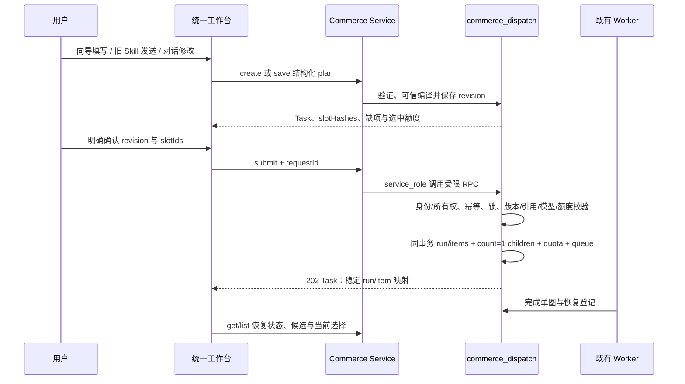

`commerce_dispatch` 公共包装及私有入口只允许 `service_role` 执行，撤销 `PUBLIC/anon/authenticated` 执行权，固定 search_path；服务端身份不能由客户端 userId 冒充。可读 commerce 表最小 GRANT + RLS 校验所有权，浏览器不得直接写入执行/版本表或调用事务入口。

新提交锁定任务和选中 slot，校验当前修订、全部引用、模型/Provider 开关、每日与 preview guard、总额度；同一修订的有效结果/活跃执行不能被不同 requestId 隐式重复。内部单图提交在同一数据库事务执行，第 N 项失败时前 N−1 项、队列和预占全部回滚，不能由前端或服务端循环 HTTP 模拟原子性。source 沿用 direct/chat_tool；通用直接生图仍使用原 F03，电商不能绕过 F10。

### F11：选图、交付与恢复（实施中）

单图重做创建新 run/item。成功时同时核对当前 slotHashes、最新重做关联和选择版本，符合才默认采用新图；否则只进入历史候选。用户手选递增选择版本并阻断旧在途结果覆盖。修改第三张时保留其他四张的有效选择，导出可固定完整 5 张清单。选择旧方案不兼容图片须显示待更新/旧版状态，不能静默冒充新版或整套完整。

Worker 需以领取版本/租约续期避免重复调用，未知提交先核对；对象上传成功但落库失败时使用持久结果登记幂等补写，不重新生图。删除与在途写入协调，拒绝落库的对象进入持久补偿清理；清理任务崩溃后可重领。配额账本不随内容级联删除，删会话不得恢复已消耗额度。这些是本次可靠性目标，不是已通过结论。

归档与取消都经正式身份、所有权、revision 和 requestId 幂等校验及 service_role-only `commerce_dispatch`。归档保留历史/导出，阻止新提交，不改变在途执行。取消验证 run 属于 task，在与 Worker 协调的锁内只处理 `status=pending` 且 `provider_submission_state=not_submitted` 的可取消子项；processing/running 即使尚未调用 Provider 也继续处理，其他 run 不受影响。被取消子项落为 `failed`，子项错误 `user_cancelled`，不能当 Provider 故障统计；按既有账本业务键至多写一次 release，归档对应 queue 消息，清除该子项在途选图关联并刷新批次，原已选结果保留。重复同键请求恢复原操作结果，新的取消请求无可取消项时返回冲突，不重复释放。不能在 UI 把仍运行的整组显示为已停止。

### 12.4 验收与排除项

验收追溯：M19/M21 与 F10 覆盖 EC-01–07、10、17；M22/M23 与 F10/F11 覆盖 EC-08/09/11/15/16，M13/M23 另验证历史 64 上限、显式样图转换及来源/对象意图清理；M20 覆盖 EC-05/06/12/14；整图文字与固定集合交付覆盖 EC-13。按 17 个 EC、9 类原 P2-AT 分别记录，六场景/12 模板是目录覆盖数，不能转写为测试通过数。

AI 整图包含文字，exactText 是确认文案而非独立图层；改字需确认重生成。未验证视觉分析、独立文字排版、长图合成、新 Provider、视频和自动平台发布不在本次实现承诺内。mock、数据库/Worker、隔离 HTTP、浏览器与真实模型效果分别验收；未取得证据前不得把图示或迁移文件称为已部署、已通过或生产就绪。

### 12.8 实施补充：写入预算与请求恢复

- create/save 使用同一个 `commerce_dispatch` 的 `p_compiled = SQL NULL` 只读预检：先校验当前身份、账号、会话与任务所有权，再返回相同 requestId/hash 的已提交结果；没有历史结果时返回 SQL NULL，不创建草案、不记写入额度。随后服务端按当前发布模板编译，正常写入事务再次核对幂等键，关闭预检与写入间的竞争窗口。
- 新的 create/save/select/export/archive/cancel 各计一次现有 `session_update` 写入预算，幂等回放不重复扣减；submit 继续仅按子图片计量，方案本身不消费图片额度。取消释放归属原预占的 UTC 计量日。
- 单个编译提示词最多 8000 个 Unicode 字符，领域函数与服务端均在保存前返回具体图片角色的精简提示，不截断商品事实和确认文案。
- `ZIMAGE_COMMERCE_SUBMIT_ENABLED=false` 只暂停新的电商提交；读取、选图、历史与导出继续可用。数据库原有 generation/provider 开关仍是最终提交约束。
- 浏览预览的签名链接仅作内存短缓存（最多 60 秒，且早于服务端 expiresAt 30 秒），同时请求去重；导出始终重新校验并签名，不将预览缓存用作下载授权。

这些为本地实现契约；数据库并发、真实 Storage 和 Provider 的验证状态见项目进度，不因接口存在而视为已上线。

### 12.9 实施补充：参考转换的资源准入

生成样图转换先检查同源 pending、历史容量及 Storage 可信大小，再在下载前预留上传资源；核对实际字节后只能向下调整仍在预留中的记录。每次实际下载尝试计入请求准入，失败字节补偿不清除该请求限制。已完成引用的原请求回放不重复收费，新 requestId 的复用仍受写入限制。

转换请求绑定保留 24 小时，每用户最多 256 条；同有效请求不能改绑来源，过期记录按每批 200 条清理，账号/任务删除级联移除绑定。负责迟到对象清理的 `reference_write_intents` 保持独立存活，不随请求绑定删除。
