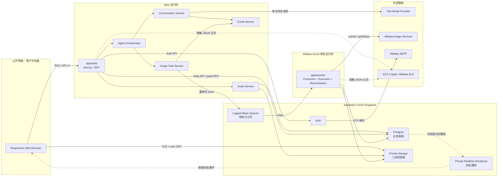
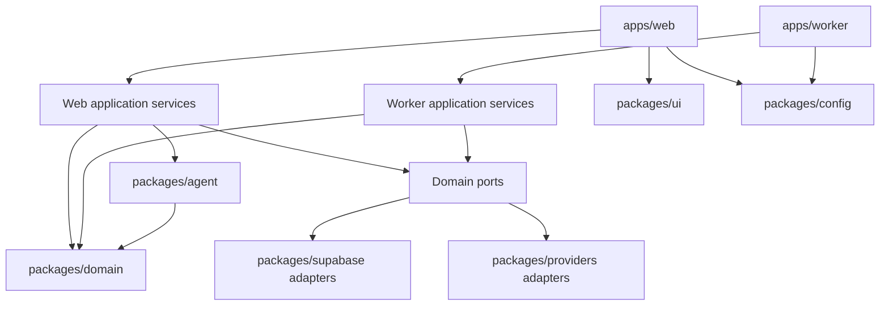
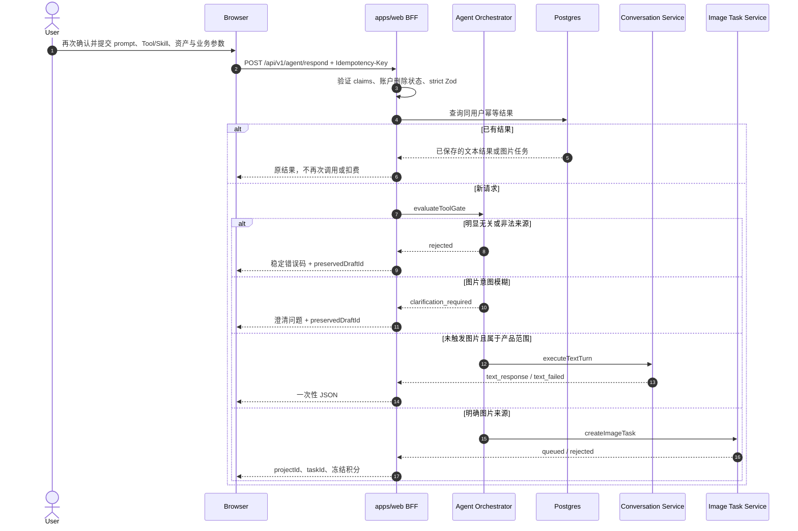
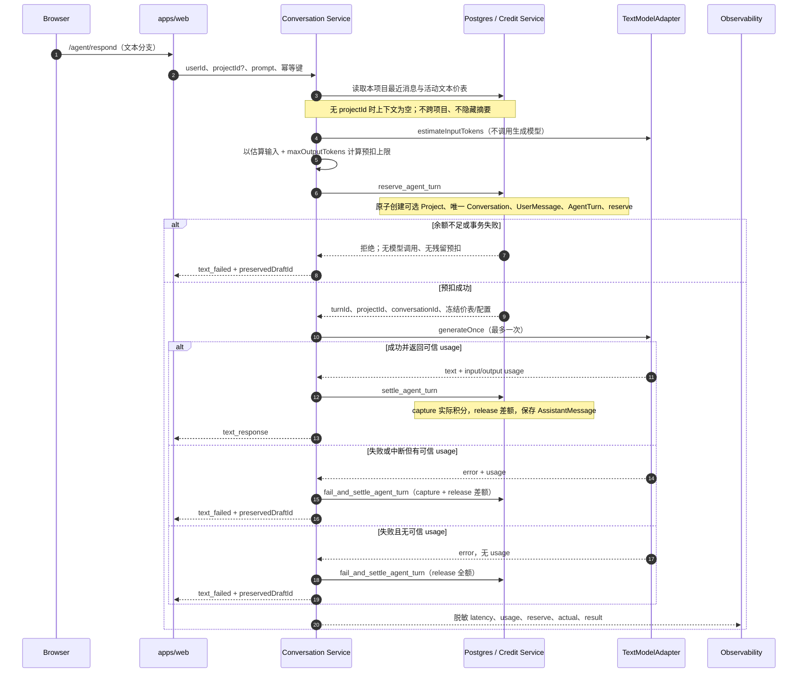
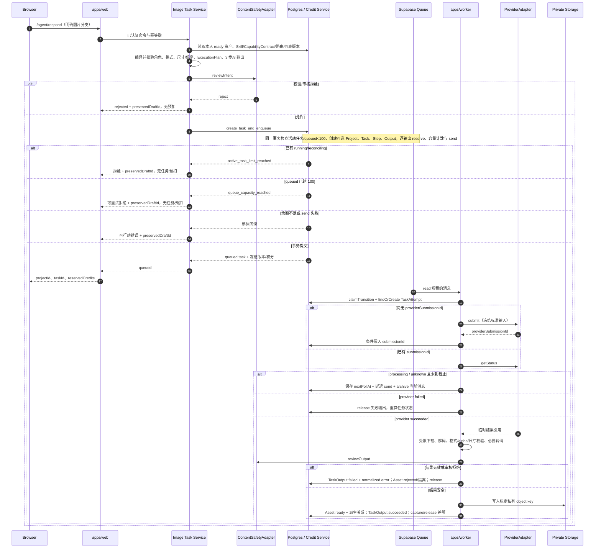
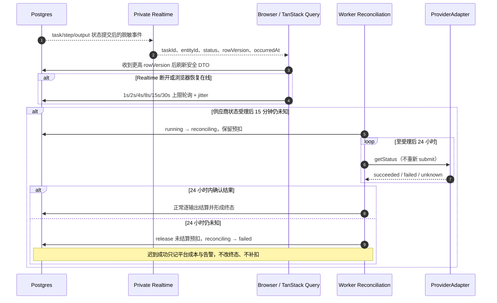
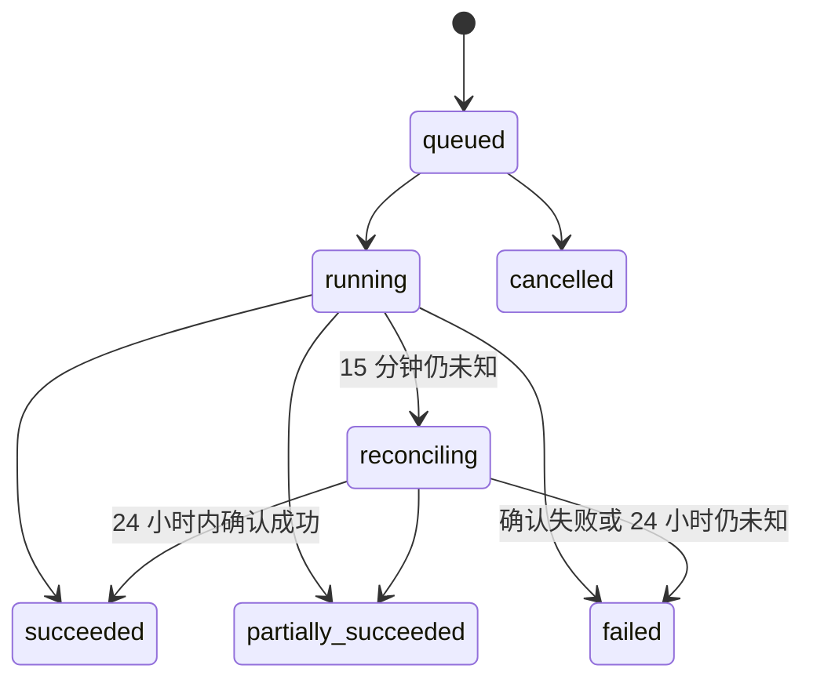

# Zima Phase 1 系统架构

| 字段 | 内容 |
| --- | --- |
| 文档定位 | 面向 AI Agent 与工程师的跨模块实施蓝图 |
| 适用范围 | Phase 1 响应式浏览器 Web |
| 产品真相源 | [`requirements.md`](./requirements.md) |
| 技术实现依据 | [`tech-selection.md`](./tech-selection.md) |
| 技术选型审计 | [`tech-selection-review.md`](./tech-selection-review.md) |
| 修订前架构审计 | [`architecture-review.md`](./architecture-review.md)，保留为本次修订前基线 |
| 工程约束 | [`AGENTS.md`](../AGENTS.md) |
| 最后核对日期 | 2026-08-17 |

## 1. 架构目标与边界

本文件把已批准的产品需求和技术选型组织成可执行的系统边界、运行时数据流、通信契约与降级策略。它不替代 `requirements.md`，也不新增页面、接口、数据库字段、供应商能力或商业规则；发生冲突时以 `requirements.md` 为准。

Phase 1 只交付响应式浏览器 Web：Web 宽屏布局提供完整创作能力，375px 移动 Web 提供登录、项目查看、预览和下载。不得创建 Electron、Windows/macOS、iOS/Android 原生客户端或相应构建目录。

### 1.1 不可破坏的不变量

1. 系统采用 pnpm + Turborepo 模块化单体，`apps/web` 与 `apps/worker` 分进程部署，共享领域包但不共享进程内状态。
2. Supabase Cloud 新加坡承载 Auth、Postgres、私有 Storage、Realtime 和 Queues；阿里云常驻 Node Worker 执行长图片任务。
3. 图片能力只能由本次明确选择的 Tool、本次明确选择且版本冻结的 Skill，或明确图片生成/编辑意图触发。仅上传、咨询、模糊意图和未选择的 Skill 不得触发。
4. 单图片任务最多 3 个 Tool 步骤、8 个计费输出。非透明主图换背景必须显式编译为“抠图 → 换背景”两个可见、可计费步骤。
5. 每个项目只有一个 Conversation；上下文只截取本项目最近消息，不跨项目拼接，不使用隐藏的 LLM 摘要。
6. 同一用户提交最多调用一次文本模型。所有真实 token 消耗都先预扣，再按可信 input/output usage 结算；无 usage 才释放。
7. Skill、能力注册表、供应商路由和价表版本在任务或 AgentTurn 创建时冻结；历史事实不得被后续配置改写。
8. Worker 只执行已保存并校验通过的 ExecutionPlan，不重新解释提示词、不临时添加步骤、不自行选择模型或供应商。
9. Postgres 保存业务真相，账本只追加；Queue、Worker 重投、供应商轮询、文本调用和结算都必须通过唯一键与条件更新实现幂等。
10. 前端不接触 secret/service-role、供应商密钥、模型 ID、内部价格、供应商原始错误或长期图片 URL。
11. 任务受理后 15 分钟仍未知进入 `reconciling`；最多对账到受理后 24 小时，届时仍未知则失败释放，迟到结果不改写终态或补扣用户。
12. Phase 1 不实现图片结果复盘，不进行第二图片供应商或第二文本模型的自动切换。

### 1.2 外部发布门槛

| 依赖 | 当前架构允许的工作 | 未满足时禁止声明 |
| --- | --- | --- |
| EXT-001 发信域名与阿里云 SMTP | 本地 Mailpit、配置校验、Mock | 正式 OTP 邮件可用 |
| EXT-002 百炼/视觉智能账号、配额、审核与成本 | ProviderAdapter、Mock、脱敏契约测试 | 五种生产图片能力或审核链路可用 |
| EXT-003 Supabase 新加坡项目与凭证 | 本地 migration、pgTAP、生成类型 | 生产 Auth、Storage、Queue 或备份能力就绪 |
| EXT-004 ICP、协议、隐私与跨境评估 | 数据流清单、删除/保留设计、发布 gate | 法务与合规审批完成 |
| EXT-005 首版价表与邀请整数额度 | 版本化价表 schema、公式和测试 | 可真实扣费或发放生产邀请 |

## 2. 系统上下文与运行拓扑



信任边界固定如下：浏览器是不可信输入源；`apps/web` 是用户身份、请求 schema 和统一门控入口；Worker 是受信执行端但仍必须校验 Queue 消息和数据库冻结事实；供应商响应、临时 URL、usage 和审核结果均是不可信外部输入，必须归一、验证后才可写入产品状态。

## 3. 模块划分与职责边界

### 3.1 运行时模块

| 模块 | 核心职责 | 明确不负责 | 主要依赖 | 需求来源 |
| --- | --- | --- | --- | --- |
| Browser | RSC 页面、表单交互、本地安全草稿、TUS 上传、私有 Broadcast、轮询兜底 | 任务/账本状态迁移、积分计算、供应商参数、长期 URL | `apps/web`、Storage、Realtime | HOME-001～004、AUTH-005～006、NFR-UX-001～004 |
| `apps/web` | Next.js 页面、Auth 入口、BFF、RSC 查询、同步应用服务组合 | 长图片任务、请求返回后的悬空 Promise、供应商轮询 | application services、Supabase clients | AUTH-001～011、TASK-001～003、NFR-PERF-001 |
| Public Experience | 首页、统一导航、匿名/登录态 RSC 投影、四个快捷 Tool 和最近项目入口 | 直接执行图片任务、伪造匿名历史、保存私有业务真相 | Project Query、Skill Catalog、Curated Community | HOME-001～004、AUTH-005 |
| Draft Restore | 匿名草稿和“用同款”预选草稿的白名单序列化、登录回跳与恢复 | 保存二进制、恢复供应商字段、自动提交、自动预扣 | Browser、Auth、Agent Orchestrator | AUTH-006、COMM-003 |
| Project Query/Command | 项目标题策略、本人项目查询、搜索、最近排序、改名、软删与恢复 | 直接删除对象、绕过 7 天回收、跨用户查询 | Postgres、Asset Service | PROJ-001～003、NFR-PERF-004 |
| Skill Catalog | 官方 Skill 浏览、搜索、分类、启停、发布校验、版本摘要和 retired 过滤 | 执行任意代码、让已启用但未选择的 Skill 生效 | `packages/agent`、管理 RPC | SKILL-001～005 |
| Curated Community | 已发布策展案例的安全 DTO、授权展示资产和“用同款”草稿 | 用户投稿、公开普通私有资产、自动执行 | Skill Catalog、Draft Restore、Asset Service | COMM-001～004 |
| Result Actions | 成功输出预览、下载、软删、反馈和作为新任务主图 | 改写原任务、重算原积分、复盘图片像素 | Asset Service、Project Command、Agent Orchestrator | IMG-006～007、ASSET-006 |
| Web Experience/i18n | zh-CN 消息键、键盘/焦点、完整异步状态和响应式能力矩阵 | 复制两套业务页面、在 JSX 散落产品文案 | `packages/ui`、route metadata | NFR-UX-001～004 |
| Agent Orchestrator | 幂等读取、确定性 Tool 门控、拒绝/澄清/文本/图片分流 | 直接扣积分、绕过 schema、让模型改变门控来源 | domain、agent、Conversation/Image Task Service | AGENT-001～010、TOOL-001～008 |
| Conversation Service | 本项目上下文截取、token 估算、AgentTurn 预扣、一次模型调用、usage 结算、消息持久化 | 跨项目记忆、隐藏摘要、静默换模型、流式响应 | TextModelAdapter、Credit Service、Postgres | AGENT-002～010、CREDIT-003～010 |
| Image Task Service | Skill/能力/素材/审核校验、ExecutionPlan 编译、报价、任务/步骤/输出创建和入队 | 供应商长调用、隐式前置步骤、直接暴露 provider/model | agent、Credit Service、ContentSafetyAdapter、typed RPC | TOOL-001～008、TASK-001～013、IMG-001～005 |
| Asset Service | upload intent、素材授权证据、TUS finalize、真实解码、缩略图、签名 URL、软删恢复 | 信任扩展名/MIME、公开普通私有素材、持久化签名 URL | Storage、Postgres、Sharp | ASSET-001～006、SEC-003、SEC-006 |
| Credit Service | PriceBookVersion、BillableUnit、余额锁、reserve/capture/release、只追加账本 | 接受浏览器账本事件、覆盖历史账本、向用户暴露供应商成本 | Postgres private RPC | CREDIT-001～010 |
| Capability Registry | 五种业务能力的输入角色、尺寸、倍率、格式、路由版本和验证状态 | 向浏览器暴露供应商/模型、运行时猜测未声明能力 | 管理 RPC、ProviderAdapter | ASSET-001～005、IMG-001～005、TASK-013 |
| Capacity Policy | 单用户活动任务条件、全局 queued 容量和 Worker 并发配置 | 设置每日/用户排队上限、依赖进程内计数 | task acceptance RPC、Queue、config | TASK-011～012、NFR-PERF-003 |
| Quality & Release Gate | 授权基准集、自动硬检查、盲评、复核和版本激活阻断 | 替代运行时审核、改变历史冻结版本 | Capability Registry、受控管理函数 | IMG-008～010 |
| Admin Change Service | 邀请、价表、路由、模型、Skill、案例和账本调整的授权、事务与审计 | Dashboard 直改、静默改余额、无理由覆盖历史 | private RPC、audit store | AGENT-007、SEC-005、SEC-009 |
| `apps/worker` | Queue 短推进、TaskAttempt、供应商提交/轮询、输出处理、逐输出结算、reconciling | 重新解释自然语言、重新报价、持有 15 分钟长租约 | Queue、Postgres、Storage、ProviderAdapter | TASK-002～013、IMG-001～010 |
| Observability Pipeline | 统一 Pino 事件、脱敏、SLS 指标与告警 | 以 prompt/图片/邮箱作为关联键、阻塞业务请求 | stdout、ECS Logtail、SLS | NFR-OBS-001～003、SEC-004 |

上述 Service/Policy/Registry 均是 `apps/web` 或 `apps/worker` 进程内的应用模块或端口，不是新增微服务；部署拓扑仍只有 Web、Worker、Supabase 和外部供应商。

### 3.2 页面应用模块与控制面

| 路由/入口 | 页面读模型与命令 | 应用模块 | 失败与安全语义 |
| --- | --- | --- | --- |
| `/` | `HomeViewDTO`、`HomeComposerDraft` | Public Experience、Draft Restore | 匿名只读说明、已发布 Skill/案例；未登录点击执行先保存白名单草稿并进入登录，不上传永久资产、不自动执行 |
| `/skills`、`/skills/[slug]` | 已发布版本摘要、分类/搜索、本人启用状态 | Skill Catalog | 匿名可读；启停要求有效 profile；retired 不出现在新任务选择列表，历史摘要仍可查 |
| `/community`、`/community/[slug]` | `CommunityCaseProjection` | Curated Community | 只读已发布案例与独立授权展示资产；“用同款”只生成预选草稿，匿名用户登录后仍需再次提交 |
| `/auth` | 预约、OTP、回跳草稿标识 | Auth application service、Draft Restore | 邀请/OTP 失败不建立应用资格；恢复内容必须再过服务端 schema、所有权、Skill/能力和余额校验 |
| `/projects` | 本人项目缩略图、标题、更新时间、软删状态 | Project Query/Command | 默认按 `updatedAt desc`；普通列表排除软删；列表 DTO 禁止携带原图 URL |
| `/projects/[projectId]` | Conversation、Task → Step → Output、结果操作 | Agent Orchestrator、Result Actions | 所有命令校验 owner 和项目未删除；唯一 Agent 输入，不存在旁路任务创建入口 |
| `/settings/credits` | `CreditSummaryDTO`、本人账本安全投影 | Credit Service | 只显示预计/实际/余额和统一积分；无充值、套餐、支付或供应商成本 |
| `/settings/account` | 会话退出、删除申请/撤销、保留说明 | Account application service | 删除申请后立即禁止新任务/模型调用；撤销和到期清理由受控状态机处理 |

公共读模型采用显式发布状态与字段白名单；私有读模型必须从 verified user/profile 出发并由 RLS 再次约束。页面查询失败只显示空态或可重试错误，绝不能退化为扩大查询范围、公开私有资产或绕过应用资格。

控制面只通过 `Admin Change Service → private RPC → audit_events` 写入。每次变更必须保存 `actorId`、`occurredAt`、`reason`、`entityType/entityId`、`beforeVersion`、`afterVersion` 和幂等键；余额变化只能追加 `adjustment` 账本事件，不能更新或删除旧账本。Dashboard 仅作只读诊断。

### 3.3 共享包与依赖方向



依赖方向固定为 `apps → application services → domain ports → adapters`：

| 包 | 允许内容 | 禁止内容 |
| --- | --- | --- |
| `packages/domain` | 领域类型、Zod schema、状态机、错误码、query keys | React、Next.js、Supabase SDK、供应商 SDK |
| `packages/agent` | Tool gate、Skill compiler、ExecutionPlan 校验 | 数据库直写、供应商调用、任意 Skill 代码执行 |
| `packages/supabase` | browser/server/internal client、生成类型、repository、typed RPC | 页面组合、供应商参数映射、业务规则复制 |
| `packages/providers` | TextModel/Image/ContentSafety ports 的具体适配器、错误归一 | 前端 DTO、用户积分规则、任务状态真相 |
| `packages/ui` | 无业务状态、可访问的 Tailwind/Radix 组件 | 账本计算、RLS 替代逻辑、供应商选择 |
| `packages/config` | TypeScript、lint、env schema、Pino 脱敏 | 业务实体和用户数据 |

页面、Route Handler 和 Worker consumer 都必须保持薄。任何需要同时理解余额、状态、供应商和 UI 才能修改的模块都表示边界失败，应拆回应用服务与端口。

### 3.4 领域所有权

| 领域 | 核心事实 | 唯一写入边界 |
| --- | --- | --- |
| 身份与邀请 | profile、预约、邀请码核销、账户删除状态 | Auth application service + private RPC |
| 项目与资产 | project、asset、授权确认、派生关系、回收期 | Project/Asset Service + RLS/Storage policy |
| 项目对话 | Conversation、AgentMessage、AgentTurn、TextUsage | Conversation Service + private RPC |
| 图片执行 | Task、TaskStep、TaskOutput、TaskAttempt、ExecutionPlan | Image Task Service / Worker 条件迁移 |
| 积分 | CreditAccount、CreditLedger、BillableUnit、PriceBookVersion | Credit Service + 受控事务函数 |
| Skill 与社区 | immutable SkillVersion、启用关系、策展案例 | 管理 RPC 与只读公共投影 |
| 路由与运维 | capability/route/pricing 版本、系统容量、审计、反馈 | 受控管理函数；浏览器不可直接写 |

### 3.5 核心领域契约

以下类型是跨模块的冻结语义；具体 SQL 列名可以在迁移设计中细化，但不得合并状态或放宽约束。

```ts
type InvitationStatus = 'draft' | 'active' | 'reserved' | 'redeemed' | 'expired' | 'disabled';

interface InvitationCodeFact {
  id: string;
  codeDigest: string; // 不可逆摘要；不得持久化明文
  status: InvitationStatus;
  expiresAt: string;
  initialCredits: number; // 仅可引用已批准的 EXT-005 价表配置
  note?: string;
}

interface InvitationReservationFact {
  invitationId: string;
  normalizedEmail: string;
  challengeDigest: string;
  expiresAt: string; // 创建后 10 分钟
  status: 'active' | 'released' | 'consumed' | 'expired';
}

type ReferenceAssetRole = 'style' | 'scene' | 'composition';
type TaskOutputStatus = 'pending' | 'processing' | 'reconciling' | 'succeeded' | 'failed' | 'deleted';
type AssetStatus = 'pending' | 'ready' | 'rejected' | 'deleted';
type CreditLedgerKind = 'grant' | 'reserve' | 'capture' | 'release' | 'adjustment';
type PriceBookStatus = 'draft' | 'active' | 'retired';

interface CapabilityContract {
  versionId: string;
  capability: 'generate' | 'remove_background' | 'replace_background' | 'outpaint_resize' | 'upscale';
  acceptedMimeTypes: Array<'image/jpeg' | 'image/png' | 'image/webp'>;
  maxInputBytes: 20_971_520;
  primaryAsset: 'required' | 'optional' | 'forbidden';
  maxReferenceAssets: 0 | 3;
  referenceRoles: ReferenceAssetRole[];
  aspectRatios: Array<'1:1' | '3:4' | '4:5' | '16:9'>;
  customSizeSchema?: { minHeight: number; minWidth: number; maxHeight: number; maxWidth: number };
  upscaleFactors: Array<2 | 4>;
  defaultOutputFormat: 'jpeg' | 'png';
  allowedOutputFormats: Array<'jpeg' | 'png'>;
  requiresTransparency: boolean;
}
```

能力规则固定如下：

| 能力 | 主图/参考图 | 尺寸/倍率 | 默认输出与入队前拒绝 |
| --- | --- | --- | --- |
| `generate` | 主图可选；最多三张显式角色参考图 | 四个预设比例或活动能力版本允许的自定义尺寸 | 高质量 JPEG，可选 PNG；中文/英文提示词均进入同一规范化 schema |
| `remove_background` | 一张主图；不接受参考图 | 保持能力版本允许的原始尺寸 | 必须 PNG、透明 alpha；主体或边缘不完整视为质量失败 |
| `replace_background` | 一张主图；文本背景描述；最多三张角色参考图且不得代替主图 | 由活动能力版本限制 | 默认 JPEG、可选 PNG；非透明输入编译成抠图和换背景两步，最多七个最终结果；合格透明 RGBA 才可省略抠图 |
| `outpaint_resize` | 一张主图；参考图按活动契约 | 1:1、3:4、4:5、16:9 或能力版本允许的自定义尺寸 | 默认 JPEG、可选 PNG；不支持的尺寸在报价/入队前返回 `capability_unavailable` |
| `upscale` | 一张主图；不接受参考图 | 2× 或 4× | 默认 JPEG、可选 PNG；活动路由不支持倍率时在入队前返回 `capability_unavailable` |

单任务资产组合最多一张 `primary` 与三张参考图；每张参考图必须冻结唯一角色。SkillVersion 只允许 `draft → published → retired`，发布时校验 `additionalProperties=false`、输入 schema、提示词占位变量、允许/必需能力、步骤依赖、输出契约以及 3 步/8 输出；禁止脚本、SQL、任意代码、任意网络调用或未声明变量。`retired` 版本不得编译新计划，但历史任务通过安全摘要继续展示。

`PriceBookVersion` 按 `draft → active → retired` 受控流转且版本内容不可变；判别联合中的图片项以 `(capability, resolutionTier)` 唯一并保存整数 `creditsPerOutput`，文本项以 `purpose` 唯一并保存每百万 input/output token 的整数积分与 `maxOutputTokens`。图片逐输出向上取整，文本 input/output 分项向上取整。公开 `CreditSummaryDTO` 只包含 `estimatedCredits`、`actualCredits`、`balanceCredits` 和安全账本摘要，不包含供应商、模型、币种或内部成本。Phase 1 只允许邀请 `grant` 和受审计的管理员 `adjustment`，不存在支付入口；邀请额度语义固定为约 50 个标准单步单张输出，具体整数未通过 EXT-005 时生产邀请激活失败。

`CommunityCaseProjection` 只含公开输入说明、结果展示资产、步骤摘要、关联 `skillId/skillVersionId` 和公开参数；展示资产必须属于独立策展资产域并绑定发布授权证据，不能把用户私有 asset 改标为公开。`HomeComposerDraft` 只保存 prompt、Tool/Skill 选择、业务参数和 asset 引用元数据，不保存图片二进制、签名 URL、供应商字段、任务、预扣或执行状态。

## 4. 通信方式与真相源

### 4.1 通信矩阵

| 发起方 → 接收方 | 方式 | 同步性 | 一致性/安全边界 | 失败语义 |
| --- | --- | --- | --- | --- |
| Browser → `apps/web` | HTTPS RSC / `/api/v1/*` JSON | 同步 | Cookie 会话、verified claims、strict Zod、Idempotency-Key | 返回稳定错误码；执行类输入保存在安全草稿 |
| Browser → Public Experience | HTTPS RSC/只读 JSON | 同步 | 仅公开发布投影；匿名角色无写权限 | 查询失败显示公开空态/重试，不扩大数据范围 |
| Browser ↔ Draft Restore | 本地白名单序列化 + 登录回跳标识 | 本地同步 | 不保存二进制、签名 URL、密钥、任务或账本事实 | 无法恢复时保留可解析字段并提示重新选择资产；绝不自动执行 |
| Browser → Storage | TUS + user JWT，6 MiB chunk | 异步、可恢复 | object key 由服务端签发；Storage policy 绑定用户 | 断点续传；未 finalize 的资产不可被任务引用 |
| Browser ← Realtime | private Broadcast | 异步通知 | topic RLS + 脱敏 event + rowVersion | 失败后指数退避轮询权威 DTO |
| `apps/web` → Auth | Supabase Auth API | 同步 | publishable key/服务端 secret 分离；敏感操作验证 claims | 失败关闭，不建立可用 profile |
| `apps/web` → Postgres | Data API 或 typed RPC | 同步 | GRANT 与 RLS 双门槛；私有事务函数撤销 PUBLIC | 事务失败整体回滚，不保留部分账本事实 |
| Conversation Service → TextModelAdapter | 类型化服务端调用 | 单次同步 | 一个活动配置；provider/model/API Key 仅服务端 | 不静默切换；依据可信 usage 结算或释放 |
| Image Task Service → Queue | private `create_task_and_enqueue` 内调用 `pgmq_public.send` | 事务内异步交接 | 与任务、输出、预扣、容量计数同一数据库事务；浏览器角色无 Queue EXECUTE | send 失败导致整笔创建回滚 |
| Worker ← Queue | 服务端角色调用 `pgmq_public.read` 短可见性窗口 | 异步增量消费 | 消息只含 taskId/必要版本；execution token 幂等；默认并发 2 | Worker 崩溃后消息重新可见 |
| Worker → Queue | 服务端角色延迟 `pgmq_public.send` + 当前消息 `pgmq_public.archive` | 事务内异步推进 | 状态写入、下一消息、归档处于受控事务；`anon/authenticated` 均无调用权 | 失败回滚，原消息在窗口后重现 |
| Worker → Image Provider | `submit` + `getStatus` | 外部异步轮询 | ProviderAdapter、超时、Zod、submissionId 唯一 | 临时故障有限 Attempt；未知只查询不重投；未来回调复用同一条件更新和幂等键 |
| Worker → Storage | 受限下载后私有写入 | 同步 I/O | magic bytes、完整解码、格式/alpha/尺寸与审核 | 写入失败不 ready、不 capture，可幂等重放 |
| Worker → Postgres | repository / typed RPC | 同步 | 预期旧状态、rowVersion、ledger idempotency key | 条件更新不为 1 时停止并对账 |
| Postgres → Realtime | 状态提交后 Broadcast trigger | 异步通知 | 只发送安全摘要，不发送 prompt/URL/成本 | 通知失败不回滚业务真相，客户端轮询 |
| Admin Change Service → Postgres | private typed RPC | 同步事务 | 管理身份、原因、幂等键、before/after version；无浏览器直表写 | 任一步失败不切换活动配置、不产生半条审计 |
| Web/Worker → SLS | Pino stdout → ECS Logtail | 异步、非阻塞 | 固定事件与脱敏器 | 采集失败不阻塞业务，保留受限本地输出 |

### 4.2 真相源表

| 信息 | 权威真相源 | 非真相副本/通知 |
| --- | --- | --- |
| 用户身份与会话 | Supabase Auth；应用可用资格还需 profile | 浏览器本地 session 不能单独作为敏感授权事实 |
| 项目、对话、任务、输出元数据 | Postgres | RSC payload、TanStack Query cache、Realtime event |
| 积分余额与结算 | Postgres CreditAccount + 只追加 CreditLedger | 前端余额、报价卡、日志指标 |
| 图片二进制 | 私有 Supabase Storage 的稳定 object key | 签名 URL、供应商临时 URL、浏览器 object URL |
| 待执行/待轮询工作 | Supabase logged Basic Queue | Worker 内存、定时器 |
| 供应商执行身份 | Postgres TaskAttempt.providerSubmissionId + 冻结路由版本 | 供应商控制台、原始响应 |
| 页面草稿 | 浏览器受限 Zustand/local storage | 不是已提交任务、消息或账本事实 |
| 首页/Skill/社区公开内容 | Postgres 已发布安全投影与授权展示资产 | RSC payload、CDN/Query cache |
| 状态通知 | Postgres 状态与 rowVersion | Realtime Broadcast 仅提示客户端刷新 |

## 5. 核心数据流

### 5.1 统一 Agent 输入与确定性分流

首页、工作台和社区复用入口都只能构造同一种 `AgentRespondRequest`。匿名草稿或登录后恢复只执行白名单反序列化：恢复 prompt、`selectedTool`/`selectedSkillVersionId`、业务参数和资产引用元数据；所有永久资产必须重新确认 owner/ready，Skill 必须重新确认 published/未 retired，能力和价表必须读取当前可用于新请求的版本。恢复动作本身不调用门控、不创建项目/turn/task、不预扣；只有用户再次点击提交才进入以下时序。



不存在可绕过该分流的独立 `POST /api/v1/tasks` 创建入口。明确 Tool/Skill 的计划优先确定性编译；若某个图片请求确实调用 TextModelAdapter 生成候选计划，该调用仍必须创建可计费 AgentTurn、遵守一次提交最多一次模型调用和可信 usage 结算，不能成为隐藏免费调用。模型只能提出候选计划，最终仍由服务端 schema、权限、能力、成本和 3 步/8 输出规则校验。

产品层只存在一个电商视觉 Agent，导航、API 或配置均不提供 Agent 创建/切换。文本用途限于项目内需求澄清、视觉方向建议、计划/提示词解释；不读取输出图片像素、不调用多模态模型做结果复盘。门控通过并完成校验后图片任务直接进入原子受理，不弹二次确认；返回的执行卡片安全投影必须展示每个可见步骤、预计积分、输出数和冻结版本摘要。

### 5.2 项目内文本对话与 token 结算



可信 usage 的 input/output 分项向上取整；实际 capture 不能超过预扣上限。若供应商 usage 超出上限，用户只承担冻结上限，差额记为平台成本并告警。同一用户与幂等键只能产生一个 AgentTurn；重放只返回持久化结果。

### 5.3 图片任务创建、异步执行与逐输出结算



一个任务允许不同输出独立成功或失败。三成功一失败只 capture 三个成功输出并 release 一个失败输出，任务进入 `partially_succeeded`。用户重试失败输出创建关联子任务、使用新幂等键和当时活动价表；原任务、成功输出和历史账本不修改。

任务受理事务不设置每日输出上限或用户 queued 数量上限；每个被接受的 queued 任务都对所有 BillableUnit 全额预扣。单用户活动限制只统计 `running/reconciling`，使用数据库条件约束或受控锁在同一事务内检查，不能先查询后插入。Worker 默认并发 2，由服务端环境 schema 校验且只能在容量测试后调整，进程内计数不替代 Queue/Postgres 真相。

CapabilityContract 在报价前完成以下拒绝：多于一张主图或三张参考图、参考角色缺失/非法、文件超过 20 MiB、非 JPEG/PNG/WebP、真实解码失败、尺寸不在能力版本范围、非 2×/4× 放大、格式/透明度不符或能力不可用。非透明换背景固定编译一个计费中间抠图输出和最多七个最终输出；透明 RGBA 是否合格由服务端真实解码和 alpha 检查决定，不能信任文件名或浏览器声明。

### 5.4 状态通知与 15 分钟/24 小时对账



Realtime 是通知优化，不是任务真相源。进入任一终态后客户端停止订阅和轮询；任何旧 rowVersion 事件不得覆盖较新页面状态。

### 5.5 辅助数据流

#### 首页、统一导航与公开访问

1. Public Experience 的 RSC loader 从 verified session 和可用 profile 判定视图分支；不能仅凭浏览器 session 猜测应用资格。
2. 两个分支共享 Home Composer：自然语言输入、一张主图入口、三张角色参考图入口、一个 Skill 选择器，以及“智能抠图/换背景/扩图改尺寸/高清放大”四个快捷 Tool；`generate` 只由明确的中文或英文商品图生成意图进入。
3. 登录且具备 profile 的用户读取本人最近项目缩略图投影；匿名用户只读取产品说明、已发布 Skill 和已发布精选案例，不返回空造的“最近项目”。
4. 首页、工作台、Skill、社区由同一 route metadata 生成主导航、当前区域、返回目标与键盘顺序；移动 Web 复用相同路由和权限，不复制领域流程。
5. 匿名角色对公开投影只有 SELECT，不能永久上传、创建任务、启用 Skill、生成签名 URL或读取任何私有表；点击执行进入邀请/OTP，并按 §5.1 恢复草稿后由用户再次提交。

#### 项目查询与命令

1. 首次文本回合或图片任务缺少 `projectId` 时，受理 RPC 在同一事务创建项目；标题使用经过长度/敏感内容处理的提示词摘要，生成失败或摘要为空时使用本地化日期标题，不额外调用模型。
2. Project Query 只返回本人、未软删项目，默认按 `updatedAt DESC, id DESC` 稳定排序；搜索只匹配安全标题字段，列表仅返回缩略图 object key 的短时派生 URL，不读取原图。
3. 改名、软删除和恢复命令要求 owner、预期 rowVersion 和项目状态。软删立即从普通查询隐藏并阻止 Agent 提交；七天内恢复，超过期限由清理任务删除对象和业务引用。
4. 查询或命令失败返回稳定错误码并刷新权威 DTO；不得用本地乐观状态覆盖服务器删除/恢复事实。

#### Skill Catalog 与精选社区

1. Skill Catalog 公共查询只返回已发布 Skill 和可用于新任务的版本摘要，支持文本搜索和固定分类；本人启用关系要求有效 profile。启用只改变候选列表，不产生执行授权。
2. 发布命令经 Admin Change Service 校验声明式 schema、提示词变量、能力、步骤依赖、输出契约和 3 步/8 输出；任何代码、脚本、SQL、网络调用或未知字段均拒绝并不发布。
3. retired 版本从新任务选择器移除；历史 Task/ExecutionPlan 仍按冻结 `skillVersionId` 读取不可执行的安全摘要。草稿恢复遇到 retired 版本时返回 `skill_version_unavailable`，保留 prompt 和其他参数，不自动替换版本。
4. Curated Community 只读取管理员发布的 `CommunityCaseProjection` 和独立授权展示资产；案例详情显示输入说明、结果、步骤摘要、Skill 与版本，禁止供应商/模型字段。
5. “用同款”只把公开参数和 `selectedSkillVersionId` 写入 HomeComposerDraft；匿名用户先登录，登录后仍需显式提交，服务端重新校验版本、素材、能力、余额和内容安全。

#### 结果操作

1. Result Actions 只接受本人 `TaskOutput.status=succeeded` 且关联 `Asset.status=ready` 的输出；预览/下载按动作生成短时签名 URL，列表和 Realtime 事件均不携带原图 URL。
2. 反馈写入 `output_feedback`，值仅为有用/无用和允许的受限原因；使用 `(userId, outputId)` 幂等更新反馈事实，不改任务状态或账本。
3. 单输出删除进入七天回收期并立即从普通视图隐藏；恢复只恢复资产可见性，原 TaskOutput 和账本仍保持历史事实。
4. “继续加工”只把该成功 Asset 作为新 HomeComposerDraft 的 `primaryAssetId`，必须由用户再次提交并形成新任务、新幂等键、新报价和新预扣；不得重新结算原任务。

#### 素材上传

1. Browser 申请 upload intent，并提交 `rightsConfirmed=true` 与活动政策版本。
2. Asset Service 同一事务创建 pending asset 与不可变授权确认记录，返回用户不可选择的 object key。
3. Browser 使用用户 JWT 向 Storage 专用域名执行 TUS 直传；文件不经过 BFF。
4. finalize 重新检查 owner、真实字节数、magic bytes、完整解码、尺寸、alpha 和帧数；浏览器 MIME 仅是声明。
5. 通过后原图与缩略图分别成为 ready 资产；失败进入 rejected 并安排对象清理。只有本人 ready 且未删除资产可进入任务。
6. 授权证据保存 userId、confirmedAt 和不可变 policyVersion。普通私有素材不得进入训练数据、策展案例或人工浏览队列；需要支持排障时只能使用去内容诊断信息，任何例外人工访问都必须另有明确授权和审计。

#### 邀请码与 OTP

1. 服务端只接收邀请码明文用于本次哈希比较，不持久化或记录；先按 IP、规范化邮箱和邀请码摘要执行独立限流，超限不创建预约也不泄露邀请码是否存在。
2. 发送 OTP 前创建绑定邀请码摘要、规范化邮箱和随机 challenge 的 10 分钟预约；同一邀请码最多一个 active reservation，同一邮箱/challenge 重放返回原结果，不消耗邀请码、不开户、不发积分。
3. Supabase Auth 完成 OTP 后，BFF 从已验证会话读取 uid/email；仅有 Auth user 但没有成功核销产生的 profile 时，私有 RLS 与应用入口仍拒绝访问。
4. private RPC 以 uid、规范化邮箱和 challenge 在一个数据库事务中核销预约和邀请码、创建 profile/积分账户并 grant；任一步失败全部回滚。
5. SMTP/OTP 失败或预约过期只释放预约，不产生可用账户；相同核销幂等键只返回原开户结果。

#### 账户与项目删除

1. 项目或输出软删除后立即从普通视图隐藏并禁止新任务，7 天内可恢复；到期清理图片对象和业务引用。
2. 账户删除申请立即阻止新任务和文本模型调用，进入 7 天冷静期；撤销后恢复使用。
3. 到期先撤销 Auth 会话，再清理图片、缩略图、提示词、Agent 消息、项目和邮箱标识。
4. 去标识积分账本/安全审计默认保留 180 天，脱敏运行日志保留 30 天；法定覆盖必须记录依据。

## 6. 状态、一致性与幂等边界

### 6.1 任务状态



终态不可回到运行态；所有迁移带预期旧状态或 rowVersion。自动重试在同一步骤下创建 TaskAttempt，不重新报价或预扣；用户主动重试失败输出则创建关联子任务和新报价。

Task、TaskStep、TaskOutput 与 Asset 是四个不同状态域：

| 实体 | 允许状态 | 关键规则 |
| --- | --- | --- |
| Task | `queued/running/reconciling/partially_succeeded/succeeded/failed/cancelled` | 由输出终态聚合；`reconciling` 非终态；终态不可被迟到结果改写 |
| TaskStep | `queued/running/reconciling/succeeded/failed/skipped` | 自动 Attempt 属于同一步；依赖失败且不可继续时才 `skipped` |
| TaskOutput | `pending/processing/reconciling/succeeded/failed/deleted` | 只描述计费输出；不得写入 `ready/rejected`；失败保存规范化错误码 |
| Asset | `pending/ready/rejected/deleted` | 只描述二进制资产；只有安全、解码和持久化全部通过才 `ready` |

TaskOutput 的有效推进为 `pending → processing → succeeded|failed`，供应商未知时可以 `processing → reconciling → succeeded|failed`；用户软删除成功输出只把输出投影标记 `deleted` 并把 Asset 进入回收期，不逆转 capture。结果审核明确拒绝时，TaskOutput 写 `failed + policy_rejected`，供应商原始结果 Asset 写 `rejected` 或进入隔离域，不能生成签名 URL。Storage 落盘、Asset/派生关系和 capture 未全部成功前，TaskOutput 不得成为 `succeeded`。

任务聚合规则固定为：所有计费输出成功时 `succeeded`；至少一个成功且至少一个失败时 `partially_succeeded`；没有任何成功输出时 `failed`。每用户活动约束只把 `running/reconciling` 计为活动任务，必须在任务从 queued claim 为 running 的条件迁移及受理容量策略中保持一致，防止并发 claim 同时越界。

### 6.2 原子边界

| 原子边界 | 必须同时成功 | 任一步失败 |
| --- | --- | --- |
| 邀请最终核销 | reservation、invitation、profile、credit account、grant | 全部回滚 |
| 文本回合预扣 | optional project、Conversation、UserMessage、AgentTurn、reserve | 不调用文本模型 |
| 文本回合结算 | usage、AssistantMessage/失败事实、capture/release、turn 终态 | 幂等重放，不产生第二次调用或扣费 |
| 图片任务受理 | 活动任务条件、queued<100、optional project、Task、Steps、Outputs、逐输出 reserve、容量计数、Queue send | 无任务、无预扣、无 Queue 消息；草稿可重试 |
| Worker 延迟推进 | 业务状态、nextPollAt、下一条 delayed message、当前消息 archive | 整体回滚，当前消息重新可见 |
| 图片输出完成 | 稳定 Storage object、Asset/派生关系、output 状态、capture/release | 不 ready、不 capture，允许幂等恢复 |
| Skill/能力/价表版本激活 | 新版本校验、质量证据、旧活动版本退役、新活动指针、审计 | 不改变活动版本，历史任务继续引用旧版本 |
| 管理变更 | 权限、原因、业务变更、before/after version、audit event | 不产生无审计的业务写入或静默余额修改 |
| 项目/输出软删除或恢复 | owner、预期状态、deletedAt/recoverUntil、查询投影版本 | 不改变对象和账本；客户端刷新权威状态 |

### 6.3 幂等键

| 操作 | 幂等依据 |
| --- | --- |
| 统一 Agent 提交 | `(user_id, idempotency_key)` 唯一，返回已保存的 AgentTurn 或 Task |
| 邀请预约/核销 | email/challenge、邀请码有效预约唯一约束、核销幂等键 |
| TUS/finalize | 服务端 assetId/object key、upload fingerprint、资产状态条件 |
| Queue 消费 | messageId、task expected state、execution token |
| 供应商提交 | TaskAttempt.executionToken + providerSubmissionId 条件写 |
| 账本写入 | 每个 grant/reserve/capture/release/adjustment 的业务事件唯一键 |
| Realtime/轮询合并 | entityId + 单调 rowVersion |
| 项目/结果命令 | `(userId, entityId, commandId)` + 预期 rowVersion |
| 反馈 | `(userId, outputId)` 唯一事实；重放返回当前反馈 |
| 管理变更/版本激活 | `(actorId, entityType, idempotencyKey)` + beforeVersion 条件 |

## 7. 关键降级策略

所有安全、身份、计费和所有权边界采用失败关闭；通知、日志和页面缓存可以降级，但不能替代业务真相。

| 故障位置 | 用户表现 | 数据与积分处理 | 恢复方式 | 告警/观测 |
| --- | --- | --- | --- | --- |
| Auth 或 Supabase 核心服务不可用 | 显示可重试错误，执行入口不可用；保留本地安全草稿 | 不创建任务/turn，不扣款；不绕过 profile/RLS | 服务恢复后用户显式重试 | Web/BFF 可用性与依赖错误率 |
| SMTP/OTP 失败 | 显示发送/验证失败，可在限制内重试 | 预约不核销、不开户、不 grant；到期释放 | 重发 OTP 或新预约 | 送达率、限流和预约过期指标 |
| 邀请验证达到 IP/邮箱/摘要限流 | 显示统一的稍后重试提示，不暴露邀请码有效性 | 不创建/延长预约，不写明文邀请码 | 窗口结束后显式重试 | 三维限流命中率和异常枚举模式 |
| 登录后草稿字段失效 | 恢复仍合法的文本/选择，标出需重新选择的资产或 Skill | 不创建任务/turn、不预扣、不自动替换 Skill | 用户修正并再次提交 | 草稿恢复失败类别 |
| 首页/目录/案例只读查询失败 | 显示局部空态或可重试错误，创作草稿仍留本地 | 不扩大查询范围、不回退读取私有表 | 重试 RSC/只读 Query | 页面查询错误率与缓存命中 |
| schema、越权字段或互斥 Tool/Skill | 返回稳定 `invalid_input`/业务拒绝 | 不调用模型、不入队、不预扣 | 用户修正输入 | 安全事件计数，不记录完整内容 |
| 图片意图模糊 | 返回 `clarification_required` 并保留草稿 | 不调用模型、不入队、不预扣 | 用户补充意图后新提交 | 澄清率 |
| 明显无关问题 | 简短拒绝并引导回电商视觉 | 不调用文本/图片模型，不扣积分 | 用户提交范围内问题 | 拒绝率与误判评测 |
| 文本模型配置缺失或调用前失败 | 保留输入，返回可重试提示或明确 Tool 表单 | 已有 reserve 且无 usage 时全额 release；未 reserve 时无账本事件 | 配置恢复后显式重试；不自动换模型 | 配置健康、调用失败 |
| 文本模型失败/中断且有可信 usage | 返回失败与 preservedDraftId | 按 usage capture、release 差额，不能按 HTTP 失败免单 | 用户显式重试，产生新幂等键/回合 | usage、失败类型、实际积分 |
| 文本 usage 超出预扣上限 | 正常返回或失败提示，不追加用户扣款 | capture 最多为冻结上限，差额由平台承担 | 审查 estimator/价表/供应商 usage | 高优先级 usage-over-reserve 告警 |
| 内容前置审核服务临时不可用 | 图片请求暂不可受理，草稿保留 | 无任务、无预扣 | 网络/超时按临时错误有限重试；仍失败则用户重试 | 审核依赖可用性 |
| 明确内容审核拒绝 | 显示稳定政策错误，不泄露规则细节 | 不入队、不产生最终扣款 | 用户修改合法输入；拒绝本身不自动重试 | 拒绝类别与误杀评测 |
| 余额不足 | 显示预计积分和余额不足，输入保留 | 不调用文本模型或图片供应商，不入队、不冻结 | 获得邀请/调整积分后显式重试 | 余额不足率；Phase 1 无支付入口 |
| 同用户已有 `running/reconciling` | 返回 `active_task_limit_reached` 并显示现有活动任务入口 | 新请求无任务、无 Queue 消息、无预扣；已有任务不受影响 | 等现有任务终态后从草稿重试 | 活动限制拒绝率与并发约束冲突 |
| 全局 Queue 达到 100 | 返回 `queue_capacity_reached` | 创建事务回滚，无任务、无预扣 | 容量下降后从草稿重试 | Queue 深度与拒绝率 |
| Skill retired 或发布校验失败 | 新任务选择器不展示或返回 `skill_version_unavailable` | 不自动换版本、不入队、不预扣；历史摘要仍可读 | 用户选择可用版本或管理员发布修复版本 | Skill 生命周期与校验失败 |
| 能力/尺寸/倍率/格式不支持 | 入队前返回 `capability_unavailable` 并保留草稿 | 不创建任务、不预扣、不调用供应商 | 用户选择 CapabilityContract 支持值 | 能力契约拒绝率和路由漂移 |
| Queue send/任务 RPC 失败 | 返回可重试错误 | 项目/任务/输出/reserve/容量计数全部回滚 | 恢复后同幂等键重试 | 事务失败与容量差异告警 |
| Worker 停机或消费中崩溃 | 任务保持 queued/running 状态并可能延迟 | Queue 消息在可见性窗口后重现；唯一键防重复提交/扣款 | Worker 恢复后继续幂等推进 | 心跳、队列年龄、dead-letter |
| Realtime 断开 | 页面显示离线/恢复状态，状态仍可刷新 | 不改变任务真相或账本 | 1s～30s 指数退避轮询，恢复后降低轮询 | 状态可见延迟分报 Realtime/轮询 |
| 图片供应商限流、网络、超时、临时不可用 | 显示处理中/重试状态 | 最多 3 个自动 TaskAttempt，沿用原预扣和冻结版本 | 有限重试；耗尽后失败释放对应输出 | provider_attempt_finished、重试率 |
| 供应商状态未知 | 显示处理中，15 分钟后显示对账中 | 保留预扣，禁止替代 submit | 持续 getStatus 到 24 小时；届时失败释放 | 未知状态与 reconciling 时长告警 |
| 供应商 24 小时后迟到成功 | 用户任务仍保持已形成的 failed | 不改写终态、不补扣；记录平台成本 | 仅受限诊断与供应商追责 | 迟到结果/平台成本告警 |
| 输出解码、格式、alpha 或尺寸不合约 | 对应输出失败，其他结果继续 | 不 ready、不生成签名 URL，release 对应预扣 | 合约错误不盲目重试；修复路由/适配器后新任务 | provider contract failure |
| 结果审核服务临时不可用 | 输出保持不可预览的处理中状态 | 不 ready、不 capture；网络/超时可有限重试 | 重试耗尽后输出失败并 release，供应商成本由平台承担 | safety-check latency/failure |
| 结果审核明确拒绝 | 对应输出显示政策失败 | 隔离并清理原始结果，release 对应预扣；其他成功输出不变 | 拒绝不自动重试 | 结果拒绝率 |
| Storage 输出落盘失败 | 输出保持处理中或可行动失败 | 不建立 ready Asset、不 capture | 依靠稳定输出键与 Queue 重放恢复 | Storage 错误与预扣超时 |
| 结果预览/下载/反馈/继续加工失败 | 单个操作显示可重试错误，不改变其他结果 | 不改原任务状态/账本；签名失败不泄露稳定路径 | 刷新 owner/status 后重试；继续加工保留草稿 | Result Action 错误率 |
| 质量基准或盲评未达门槛 | 管理端显示未通过版本及证据缺口，生产用户继续使用旧活动版本 | 不激活新能力/路由版本，不改历史任务 | 修复适配器/模型后用新冻结候选重跑全门禁 | gate 失败、类别/能力退化告警 |
| 管理变更权限、原因或版本条件失败 | 管理操作被拒绝，显示稳定冲突/权限错误 | 不写业务状态、不静默改余额、不生成半条审计 | 刷新 beforeVersion、补充原因或纠正权限后重试 | 管理拒绝与并发冲突审计 |
| SLS/Logtail 不可用 | 用户业务不受同步阻塞 | 仅使用受限 stdout/容器轮转缓冲；不打印敏感内容 | 采集恢复后继续，不能无限缓存 | 日志管道健康告警 |
| 第二供应商/模型不可用 | 不自动切换 | 历史冻结路由和配置不变 | 返回明确失败，由管理员受控切换仅影响新请求 | 配置切换审计 |

## 8. 安全、隐私与可观测性横切边界

### 8.1 Supabase 安全边界

- 浏览器只使用 publishable key 与用户会话；secret/service-role、SMTP、文本模型和图片供应商凭证只存在于服务端。
- 浏览器可访问表必须同时具备显式 Data API GRANT、RLS 和跨用户负向测试。`TO authenticated` 必须叠加所有权条件；UPDATE 同时使用 `USING` 与 `WITH CHECK`。
- 视图使用 `security_invoker` 或放入未暴露 schema。确需 SECURITY DEFINER 的函数必须位于非暴露 schema、固定 `search_path`、撤销 PUBLIC EXECUTE 并再次验证身份/所有权。
- 私有 Storage 路径与数据库 asset 所有权绑定；签名 URL 短时生成且不入库。
- Queue 消息只含 taskId 和必要版本，不含 prompt、图片 URL、邮箱、邀请码或密钥。迁移必须撤销 `anon`、`authenticated` 与 `PUBLIC` 对 `pgmq_public.read/send/archive` 的 EXECUTE；仅任务受理私有函数和 Worker 服务端角色获得最小权限，并以 T-DATAAPI-01/T-IDEMP-01 验证浏览器无法直接入队、读队列或归档消息。
- 自定义业务表、函数和 Broadcast trigger 位于业务/内部 schema，不在 Supabase 锁定的 `realtime` schema 创建或修改对象；只允许按官方方式为 `realtime.messages` 建立私有 topic 授权策略。
- 匿名角色只可读取已发布 Skill/案例安全投影和产品说明；永久 Storage 上传、user_skills 写入、任务/turn 创建、签名 URL 与全部私有业务数据均要求已验证 session、有效 profile 和所有权。
- 邀请、价表、路由、文本模型配置、Skill、案例和账本调整只可由 Admin Change Service 调用受控函数；每次保存操作者、时间、原因、前后版本和幂等键。管理员没有默认私有素材浏览权，素材不得用于训练或公开案例。
- 人物商品图只允许常规抠图、换背景、扩图/尺寸和放大；换脸、身份仿冒、专门面部重塑、裸露及针对特定真人的生成在任务受理前确定性拒绝。运行时前置意图审核与结果审核均失败关闭，但不能替代发布质量门禁。

### 8.2 日志与指标

固定事件至少包括 `task_accepted`、`task_state_changed`、`provider_attempt_finished`、`credit_settled`、`agent_turn_started`、`agent_turn_finished`、`output_feedback_recorded`、`quality_gate_finished` 和 `admin_change_committed`。日志使用 request/task/step/output/turn ID 关联，不使用用户内容作为关联键。

脱敏器必须删除或替换完整 prompt、邮箱、邀请码、OTP、Authorization、Cookie、API Key、图片 URL query、供应商原始 body 和图片二进制。必须告警：账本幂等冲突、未知状态超时、dead-letter、预扣长时间未结算、输出契约失败、文本 usage 超预扣和容量计数不一致。

### 8.3 SLI 架构测点

| 指标 | 起点 | 终点 | 最小样本/目标 |
| --- | --- | --- | --- |
| 图片任务受理 | BFF 收到已认证请求 | 返回 queued/clarification/rejected | 预热后至少 1,000；p95 ≤ 3 秒，不含上传/供应商时间 |
| 状态可见 | Postgres 提交 rowVersion | 浏览器首次渲染同版本 | 至少 500；Realtime/轮询分报，合并 p95 ≤ 5 秒 |
| Web/BFF 可用性 | 每 5 分钟计划探测 | 健康端点与只读 BFF 结果 | 原始目标 99.0%；维护/第三方故障标注但不从原始数据删除 |
| 文本调用 | reserve_agent_turn 提交 | 一次性 JSON 完成 | 分成功/失败记录 latency、usage、reserve、actual |
| 任务三层指标 | 冻结测试窗口 | 技术终态/成功/明确有用 | 按能力、价表、路由、客户端版本分组；零分母为无数据 |
| Worker 并发与持久性 | Queue 可见消息 | 状态条件提交/下一消息 | 默认并发 2；100 个 queued 压测、强制重启后消息丢失为 0 |
| 项目列表图片负载 | `/projects` 请求开始 | 首屏列表稳定 | DTO/网络中原图请求为 0；仅预览或下载动作可请求原图签名 URL |

### 8.4 Web Experience 与本地化边界

- `packages/ui` 提供可见焦点、焦点圈、Dialog/Popover 焦点捕获与恢复、跳转链接和键盘激活原语；页面模块不得自行删除 outline 或绕过焦点管理。首页输入、Tool/Skill 选择、主导航、结果预览/下载/删除/反馈和确认弹窗都必须通过键盘完成。
- `Web Experience/i18n` 只从版本化 zh-CN 消息文件解析 i18n key；React/Route Handler 不散落用户可见中英文常量。缺失 key 在 CI 失败，不能在生产显示内部 key。提示词字段按 Unicode 接受中文和英文，不因语言触发额外隐藏模型调用。
- 统一 UI 状态模型为 `empty/queued/processing/partially_succeeded/succeeded/failed/offline_recovering`，由 Task/Step/Output 安全 DTO 派生；组件不得把 Realtime 事件直接当终态。部分成功同时展示成功结果与失败输出的独立重试入口。
- Web 宽屏展示完整 Home Composer 和“左侧创作坞 + 右侧任务流”；375px 移动 Web 以抽屉/底部面板提供登录、项目查看、结果预览和下载，不承诺移动端完整创作。两种布局共享相同查询、命令、RLS 和 i18n key。
- T-NFR-UX-01 同时执行键盘人工路径、可见焦点审查、自动无障碍扫描、zh-CN key 扫描、中英文输入和七种异步/离线状态；任一关键路径失败阻止 Phase 1 发布。

### 8.5 Quality & Release Gate

Quality & Release Gate 属于控制面发布事务，不在用户请求时临时运行。候选证据绑定不可变的 capability contract、provider route、适配器构建和供应商价格/模型快照；只有整组证据通过，Admin Change Service 才能把候选版本设为 active。

1. Quality Dataset Registry 至少登记 60 组有授权证据的商品素材，覆盖服饰、鞋包、美妆、家居和小商品；每项能力至少 20 个适用样例，同一素材可计入多个能力但每个运行结果独立记录。
2. 自动基准对每个结果检查完整解码、实际格式、透明通道、尺寸/比例、输出数量、父资产/步骤/输出派生关系；同一冻结窗口的所有硬检查总体通过率必须 ≥95%。
3. 每个基准结果由至少两名设计师在不知道供应商/模型/候选版本身份的情况下独立给 1～5 分；每项能力平均分必须 ≥4.0，任一“重大主体破坏”即失败。两人评分差异 >2 分时必须由第三名设计师复核并保存最终裁决。
4. 门禁产物至少含 datasetVersion、授权清单、样例到能力映射、自动报告、盲评分、复核、主体破坏清单、执行时间和候选版本哈希。产物不可被活动版本覆盖。
5. 未达到样本数、硬检查、平均分或零破坏任一条件时，版本激活事务失败且旧活动版本保持不变；EXT-002 未满足时只能运行 Mock/离线管线，不得宣称生产五种能力通过。

T-QUALITY-01 验证上述五项，并与 T-PROVIDER-01 的真实账号能力契约共同构成生产路由激活条件。运行时的格式校验和内容审核仍独立执行，不能因发布门禁通过而省略。

### 8.6 扩大内测门禁

Phase 1 开发和最多 30 名用户封闭验证明确不承诺自动每日备份、RPO 或 RTO。扩大内测前，Release Gate 必须同时读取并验证：支持自动每日备份的 Supabase 套餐证据、一次真实恢复演练记录、已批准的 RPO/RTO 及实际结果、EXT-004 法务/ICP/跨境材料，以及重新评估后的供应商并发、全局 Queue、Worker 资源和用户限额结论。任何证据缺失时 T-EXPANSION-GATE-01 失败并阻止扩容；不得仅修改状态文字。

## 9. 实现导航与需求映射

本表是架构内的逐需求实质追踪，不以 ID 范围或跨文档引用代替设计证据。`covered` 只表示本文件已有实现路径；外部账号、审批或生产证据仍按最后一列保持 `external-gated`。

| 需求 ID | 架构状态 | 模块与章节 | 接口/事务路径 | 状态、失败与恢复 | 测试 ID | 外部门槛 |
| --- | --- | --- | --- | --- | --- | --- |
| AUTH-001 | `covered` | Identity/Invitation，§3.5、§5.5 邀请 | InvitationCodeFact + reservation | 状态、过期、整数额度、备注；明文不落库 | T-AUTH-01、T-AUTH-02 | EXT-005 |
| AUTH-002 | `covered` | Auth application service，§6.2 | finalize invitation private RPC | 核销、profile、credit account、grant 同事务；失败全回滚 | T-AUTH-01、T-AUTH-02 | EXT-005 |
| AUTH-003 | `covered` | Auth/Credit，§5.5、§6.3 | OTP 后幂等核销 | OTP 失败释放预约；重放返回原开户和 grant | T-AUTH-01、T-AUTH-02 | EXT-001 |
| AUTH-004 | `covered` | Supabase Auth/SMTP，§2、§5.5 | Auth OTP + verified session | 自定义 SMTP 失败不建立应用资格 | T-AUTH-04 | EXT-001、EXT-003 |
| AUTH-005 | `covered` | Public Experience，§3.2、§5.5、§8.1 | 公开 RSC 投影 + RLS | 匿名只读；上传、任务、Skill 启用和私有读取失败关闭 | T-RLS-01、T-AUTH-05 | EXT-003 |
| AUTH-006 | `covered` | Draft Restore，§3.1、§5.1 | 白名单草稿恢复 + 再次提交 | 恢复不创建事实、不预扣、不自动执行 | T-AUTH-04 | — |
| AUTH-007 | `covered` | Invitation Rate Limit，§5.5、§7 | IP/邮箱/摘要三维限流 | 不持久化明文；超限统一响应且不创建预约 | T-AUTH-05 | — |
| AUTH-008 | `covered` | Auth/profile eligibility，§4.2、§5.5 | verified Auth + profile RLS | 仅有 Auth user 无 profile 时拒绝私有访问 | T-RLS-01、T-AUTH-05 | EXT-003 |
| AUTH-009 | `covered` | Invitation reservation，§3.5、§5.5 | 10 分钟 reservation | 绑定摘要、邮箱、challenge；不核销、不开户、不 grant | T-AUTH-03 | — |
| AUTH-010 | `covered` | Invitation reservation，§5.5、§6.3 | active reservation 唯一约束 | 同邀请码仅一个有效预约；过期/失败安全释放 | T-AUTH-03 | — |
| AUTH-011 | `covered` | Auth application service，§5.5、§6.2 | uid/email/challenge private RPC | 身份绑定和开户原子完成；任一步失败整体回滚 | T-AUTH-03 | EXT-003、EXT-005 |
| HOME-001 | `covered` | Public Experience/Home Composer，§3.2、§5.5 | `/` RSC + HomeComposerDraft | 输入、主图、三角色参考、Skill、四 Tool；执行仍走统一入口 | T-HOME-01 | — |
| HOME-002 | `covered` | Home Tool Catalog，§5.5、§3.5 | 四快捷 Tool → ImageCapability | 抠图/换背景/扩图改尺寸/放大显式选择；generate 需明确文本意图 | T-HOME-01 | — |
| HOME-003 | `covered` | Home Read Model，§3.2、§5.5 | session/profile 分支 RSC | 登录读本人最近项目；匿名只读说明与精选案例 | T-HOME-01 | — |
| HOME-004 | `covered` | App Navigation，§5.5、§8.4 | 统一 route metadata | 首页/工作台/Skill/社区共享当前区、返回目标和键盘顺序 | T-HOME-01 | — |
| PROJ-001 | `covered` | Project Query/Command，§5.5、§6.2 | 首次 turn/task 原子建项目 | 提示词安全摘要命名；失败或空摘要用本地化日期，不额外调用模型 | T-PROJECT-01、T-AGENT-CHAT-01 | — |
| PROJ-002 | `covered` | Project Query/Command，§3.2、§5.5 | owner + rowVersion 命令/查询 | 改名、搜索、稳定最近排序、软删和七天恢复 | T-PROJECT-01、T-DELETE-01 | — |
| PROJ-003 | `covered` | Project/Asset cleanup，§5.5、§6.2 | soft delete + scheduled purge | 立即隐藏/禁新任务；七天后清对象和引用 | T-PROJECT-01、T-DELETE-01 | — |
| ASSET-001 | `covered` | Asset Service/CapabilityContract，§3.5、§5.3 | AgentRespondRequest 资产校验 | 最多一主图、三参考；每张冻结 style/scene/composition 角色 | T-ASSET-01、T-RLS-01 | — |
| ASSET-002 | `covered` | Asset Service，§3.5、§5.5 上传 | upload intent + TUS finalize | JPEG/PNG/WebP、20 MiB、真实解码与能力尺寸；失败 rejected | T-ASSET-01、T-RLS-01 | EXT-003 |
| ASSET-003 | `covered` | Asset domain，§3.4、§5.3 | 输出完成事务 | 原图、输出、缩略图独立 object；记录父资产和 TaskOutput | T-ASSET-01、T-RLS-01 | EXT-003 |
| ASSET-004 | `covered` | Asset/Storage，§4.2、§8.1 | owner 校验 + 短时 signed URL | 私有稳定 object key；过期 URL 不入库 | T-ASSET-01、T-RLS-01 | EXT-003 |
| ASSET-005 | `covered` | OutputFormatPolicy，§3.5、§5.3 | CapabilityContract + 输出校验 | 抠图强制 PNG；其余默认 JPEG、可选 PNG | T-ASSET-02、T-DELETE-01 | EXT-002 |
| ASSET-006 | `covered` | Result Actions，§5.5、§6.1 | 单输出软删/恢复/清理 | 七天隐藏与恢复；到期清对象，保留去标识账本/审计 | T-ASSET-02、T-DELETE-01 | — |
| AGENT-001 | `covered` | Agent Orchestrator，§3.1、§5.1 | 单一 `/agent/respond` | 无 Agent 创建、选择或切换 API/配置路径 | T-AGENT-01 | — |
| AGENT-002 | `covered` | Conversation Service，§5.1、§5.2 | 项目内 TextModelRequest | 只做澄清、视觉建议、计划/提示词解释；无图片像素复盘 | T-AGENT-01 | — |
| AGENT-003 | `covered` | Deterministic Policy，§5.1、§7 | rejected 分支 | 明显无关时不调用模型/Tool、不预扣，返回范围引导 | T-AGENT-01 | — |
| AGENT-004 | `covered` | Agent/ExecutionPlan，§5.1、§5.3 | 服务端 schema/权限/能力/成本/上限校验 | 非法计划拒绝且不入队 | T-PLAN-01、T-API-01 | — |
| AGENT-005 | `covered` | Orchestrator/Credit/Provider 分层，§3.1、§3.3 | domain ports | Agent 无供应商、模型、扣款或绕策略写权限 | T-PLAN-01、T-API-01 | — |
| AGENT-006 | `covered` | Conversation/TextModelAdapter，§3.1、§4.1 | 一个活动服务端配置 | provider/model/key 前端不可见 | T-TEXT-01 | EXT-002 |
| AGENT-007 | `covered` | Admin Change Service，§3.2、§7 | 文本配置受控切换事务 | 审计且只影响新请求；失败不静默换模型 | T-TEXT-01 | EXT-002 |
| AGENT-008 | `covered` | Conversation/Credit，§5.2、§8.2 | reserve/settle AgentTurn | 真实模型调用均预扣；有 usage 按实结算，无 usage 释放 | T-TEXT-01、T-TEXT-BILLING-01 | EXT-005 |
| AGENT-009 | `covered` | Agent Orchestrator，§5.1 | 唯一 `/api/v1/agent/respond` | 文本/图片/澄清/拒绝确定性分流；一次提交最多一次模型调用 | T-AGENT-CHAT-01 | — |
| AGENT-010 | `covered` | Conversation Service，§5.2、§5.5 删除 | reserve_agent_turn/settle | 每项目唯一会话、最近上下文、RLS、无跨项目/隐藏摘要 | T-AGENT-CHAT-01、T-ACCOUNT-DELETE-01 | EXT-003 |
| TOOL-001 | `covered` | Tool Gate，§1.1、§5.1 | evaluateToolGate | 只接受明确 Tool、选中 Skill、明确图片意图三来源 | T-GATE-01 | — |
| TOOL-002 | `covered` | Tool Gate，§5.1、§7 | text/clarification 分支 | 仅上传、咨询、模糊、未选 Skill 均不执行图片 | T-GATE-01 | — |
| TOOL-003 | `covered` | Agent/Image Task，§5.1、§5.3 | 校验后原子受理 | 无二次确认；执行卡展示步骤、输出与预计积分 | T-GATE-01 | — |
| TOOL-004 | `covered` | ExecutionPlan Validator，§1.1、§5.3 | 服务端 3 步/8 BillableUnit 约束 | 超限整体拒绝；不得隐藏子任务或步骤 | T-GATE-01、T-PLAN-01 | — |
| TOOL-005 | `covered` | Credit/Image Task，§5.3、§7 | create_task_and_enqueue | 余额不足无任务/入队/预扣并保留草稿 | T-GATE-01 | EXT-005 |
| TOOL-006 | `covered` | Policy/ContentSafety，§8.1、§5.3 | 入队前人物策略 + reviewIntent | 常规四类允许；高风险人物意图拒绝且不预扣 | T-GATE-01、T-POLICY-01 | EXT-002、EXT-004 |
| TOOL-007 | `covered` | Agent schema，§5.1、§7 | strict discriminated request | Tool/Skill 互斥且一次一个；提示词不形成隐藏第二来源 | T-GATE-01、T-PLAN-01 | — |
| TOOL-008 | `covered` | Skill compiler/CapabilityContract，§3.5、§5.3 | 非透明两步 ExecutionPlan | 抠图中间输出计费并占上限，最多七最终结果；合格 RGBA 可省略 | T-REPLACE-01 | EXT-002、EXT-005 |
| IMG-001 | `covered` | Capability Registry/Worker，§3.5、§5.3、§8.5 | remove_background contract + output validation | PNG/alpha/主体边缘；失败保留输入并 release | T-IMG-01、T-QUALITY-01、T-PROVIDER-01 | EXT-002 |
| IMG-002 | `covered` | Capability Registry，§3.5、§5.3 | replace_background contract | 文本背景、最多三角色参考；主图和参考绑定分离 | T-IMG-01、T-QUALITY-01、T-PROVIDER-01 | EXT-002 |
| IMG-003 | `covered` | Capability Registry，§3.5 | outpaint_resize contract | 四预设比例或版本允许自定义尺寸；不支持则入队前拒绝 | T-IMG-01、T-QUALITY-01、T-PROVIDER-01 | EXT-002 |
| IMG-004 | `covered` | Capability Registry，§3.5、§7 | upscale contract | 仅 2×/4×；路由不支持返回 capability_unavailable | T-IMG-01、T-QUALITY-01、T-PROVIDER-01 | EXT-002 |
| IMG-005 | `covered` | Home/Capability Registry，§3.5、§5.5 | generate normalized input | 中文/英文同契约；输出计入八个上限 | T-IMG-01、T-QUALITY-01、T-PROVIDER-01 | EXT-002 |
| IMG-006 | `covered` | Result Actions，§3.2、§5.5 | signed URL/feedback/new draft | 预览、下载、删除、反馈、继续加工；不改原账本 | T-RESULT-01 | EXT-003 |
| IMG-007 | `covered` | Result Actions/Task aggregate，§5.3、§6.1 | 单输出删除和关联子任务 | 不删除、重算或重收费其他成功输出 | T-PARTIAL-01 | — |
| IMG-008 | `covered` | Quality Dataset Registry，§8.5 | 候选版本数据集门禁 | 至少 60 组授权素材、五类商品、每能力至少 20 例 | T-QUALITY-01 | EXT-002、EXT-004 |
| IMG-009 | `covered` | Quality & Release Gate，§8.5 | 自动冻结基准报告 | 解码/格式/alpha/尺寸/数量/派生总体通过率 ≥95% | T-QUALITY-01 | EXT-002 |
| IMG-010 | `covered` | Blind Review Gate，§8.5 | 双人盲评 + 第三人复核 | 每能力均分 ≥4.0、零重大破坏；差异 >2 必须复核 | T-QUALITY-01 | EXT-002 |
| SKILL-001 | `covered` | Skill Catalog/Admin Change，§3.2、§3.5 | 声明式 schema 发布 | 脚本、网络、SQL、代码和未知字段拒绝 | T-SKILL-01 | — |
| SKILL-002 | `covered` | SkillVersion，§3.5、§5.3 | 发布版本 + frozen skillVersionId | 后续更新不改变历史 ExecutionPlan | T-SKILL-01 | — |
| SKILL-003 | `covered` | Skill Catalog，§3.2、§5.5 | browse/search/category/user enable | 启停仅控制候选；只有本次明确选择影响门控 | T-SKILL-01 | — |
| SKILL-004 | `covered` | Skill Publisher，§3.5、§5.5 | 管理发布校验事务 | schema、变量、步骤、输出、允许/必需能力不合格则不发布 | T-SKILL-01 | — |
| SKILL-005 | `covered` | Skill lifecycle，§3.5、§5.5 | published → retired | retired 不用于新任务；历史安全摘要继续可见 | T-SKILL-01 | — |
| COMM-001 | `covered` | Curated Community，§3.2、§5.5 | 管理发布 + 公共只读投影 | 无用户投稿/写入口，仅 published 可见 | T-COMM-01 | — |
| COMM-002 | `covered` | CommunityCaseProjection，§3.5、§5.5 | 案例详情 DTO | 输入、结果、步骤、Skill/版本；无供应商/模型 | T-COMM-01 | — |
| COMM-003 | `covered` | Draft Restore/Use-the-same，§5.1、§5.5 | 公开参数 → HomeComposerDraft | 只预选不执行；匿名先登录，之后仍需再次提交 | T-COMM-01 | — |
| COMM-004 | `covered` | Curated Community/Asset，§3.5、§8.1 | 独立展示资产 + 授权证据 | 普通私有 asset 不可改标公开 | T-COMM-01 | EXT-004 |
| TASK-001 | `covered` | Agent Orchestrator，§5.1、§6.3 | `(userId,idempotencyKey)` 唯一 | 重放返回同一 Task/Turn，不重复执行/扣费 | T-IDEMP-01、T-CRASH-01 | — |
| TASK-002 | `covered` | Image Task/Credit，§5.3、§6.2 | create_task_and_enqueue | 报价、余额、预扣、记录、容量、send 同事务 | T-IDEMP-01、T-CRASH-01 | EXT-003、EXT-005 |
| TASK-003 | `covered` | Queue boundary，§4.1、§8.1 | private send wrapper | 消息只含 taskId/必要版本；浏览器无 Queue 权限 | T-IDEMP-01、T-CRASH-01 | EXT-003 |
| TASK-004 | `covered` | Worker/Queue，§4.1、§6.3 | read visibility + conditional claim | 执行令牌防并发提交；崩溃后消息重现 | T-IDEMP-01、T-CRASH-01 | EXT-003 |
| TASK-005 | `covered` | Worker error policy，§7 | TaskAttempt 分类 | 参数/鉴权/审核不重试；临时故障最多三次 | T-IDEMP-01、T-RECON-01 | EXT-002 |
| TASK-006 | `covered` | Worker reconciliation，§5.3、§5.4 | submissionId + getStatus | unknown 只查不重提；十五分钟/二十四小时对账 | T-IDEMP-01、T-RECON-01 | EXT-002 |
| TASK-007 | `covered` | Realtime/Query cache，§5.4、§7 | private Broadcast + backoff polling | rowVersion 合并；断线恢复，终态停止 | T-RESULT-01 | EXT-003 |
| TASK-008 | `covered` | Result Actions，§5.3、§6.1 | retryOfOutputId 子任务 | 只重试失败输出，保留原任务/输出审计 | T-PARTIAL-01、T-ATTEMPT-01 | — |
| TASK-009 | `covered` | Image Task/Credit，§5.3、§6.1 | 新键、新价、新 reserve | 原失败预扣已 release；成功输出预扣不复用 | T-PARTIAL-01、T-ATTEMPT-01 | EXT-005 |
| TASK-010 | `covered` | Worker TaskAttempt，§5.3、§6.3 | findOrCreate attempt + submissionId | 每次提交/自动重试唯一；已提交 unknown 不建替代提交 | T-ATTEMPT-01、T-RECON-01 | EXT-002 |
| TASK-011 | `covered` | Capacity Policy，§3.1、§5.3、§6.1 | 活动条件锁 + claim 条件 | 每用户最多一个 running/reconciling；queued 不设用户上限且全额预扣 | T-CAPACITY-01 | — |
| TASK-012 | `covered` | Capacity Policy，§5.3、§7 | queued<100 原子检查 | 满载返回 queue_capacity_reached；无任务/预扣，草稿保留 | T-CAPACITY-01 | — |
| TASK-013 | `covered` | ProviderAdapter，§4.1、§5.4 | submit + getStatus 必需轮询 | Phase 1 不依赖回调；未来回调复用条件更新/幂等/归一 | T-IDEMP-01、T-PROVIDER-01、T-RECON-01 | EXT-002 |
| CREDIT-001 | `covered` | Credit Service，§3.5、§4.2 | integer CreditAccount + append-only ledger | 余额约束；旧事件不可更新/删除 | T-LEDGER-01、T-TEXT-BILLING-01 | EXT-005 |
| CREDIT-002 | `covered` | CreditSummaryDTO，§3.2、§3.5 | settings/credits 安全投影 | 只显预计、实际、余额、统一积分；无成本/模型 | T-LEDGER-01、T-TEXT-BILLING-01 | — |
| CREDIT-003 | `covered` | Credit Service，§5.2、§5.3、§6.2 | 每 BillableUnit reserve/capture/release | 图片逐输出、文本按 usage；失败/取消释放并释放差额 | T-LEDGER-01、T-PARTIAL-01、T-TEXT-BILLING-01 | EXT-005 |
| CREDIT-004 | `covered` | Credit Service，§5.2、§7 | frozen cap 条件 | actual 不超 reserve；超额平台承担并告警 | T-LEDGER-01、T-TEXT-BILLING-01 | EXT-005 |
| CREDIT-005 | `covered` | Credit ledger，§6.3、§8.2 | 每账本事件业务唯一键 | 消息/轮询/回调/人工重放不产生第二笔扣款 | T-LEDGER-01、T-IDEMP-01 | — |
| CREDIT-006 | `covered` | Credit/Admin，§3.2、§3.5 | invitation grant/admin adjustment | Phase 1 无充值、套餐或支付入口 | T-LEDGER-01、T-TEXT-BILLING-01 | EXT-005 |
| CREDIT-007 | `covered` | PriceBookVersion，§3.5、§5.2 | 图片/文本判别价表 + frozen version | 图片能力/分辨率/输出与文本 purpose/token 计价不可变 | T-PRICE-01 | EXT-005 |
| CREDIT-008 | `covered` | Invitation/Credit，§3.5、§8.6 | invitation grant config gate | 约五十个标准输出；具体整数缺失时禁止生产邀请 | T-PRICE-01 | EXT-005 |
| CREDIT-009 | `covered` | PriceBook/Credit，§3.5、§5.3 | 逐输出 ceil + versioned quote | 新价只影响新请求；Attempt 不重报价，用户重试重报价 | T-PRICE-01 | EXT-005 |
| CREDIT-010 | `covered` | Conversation/Credit，§5.2、§6.2 | estimate + reserve + usage settle | input/output 分项 ceil；有 usage 结算，无 usage release；余额/幂等保护 | T-TEXT-BILLING-01、T-PRICE-01 | EXT-005 |
| SEC-001 | `covered` | Supabase security，§8.1 | explicit GRANT + RLS migration | 每个浏览器表先 RLS/所有权负向测试 | T-RLS-01、T-DATAAPI-01 | EXT-003 |
| SEC-002 | `covered` | Runtime secrets，§1.1、§8.1 | browser publishable key | service-role/供应商/SMTP 只在服务端且扫描阻断 | T-SECURITY-01 | EXT-001、EXT-002、EXT-003 |
| SEC-003 | `covered` | Asset/Storage，§4.2、§8.1 | owner path + signed URL | 私有路径不可伪造；短时 URL 不入库 | T-RLS-01、T-DATAAPI-01 | EXT-003 |
| SEC-004 | `covered` | Observability，§8.2 | Pino redaction | 二进制、长期 URL、完整 prompt、OTP、邮箱、邀请、密钥、原始响应禁记 | T-SECURITY-01 | — |
| SEC-005 | `covered` | Admin Change Service，§3.2、§6.2 | actor/time/reason/before/after audit | 管理失败全回滚；余额只能 adjustment，不能静默改 | T-ADMIN-01 | — |
| SEC-006 | `covered` | Asset authorization，§5.5、§8.1 | upload intent 授权事实 | 保存用户/时间/政策版本；不训练、不公开、不默认人工浏览 | T-SECURITY-01 | EXT-004 |
| SEC-007 | `covered` | ContentSafety/Worker，§5.3、§7 | reviewIntent + reviewOutput | 任一拒绝无最终扣款；结果不得 ready/签名 | T-POLICY-01 | EXT-002 |
| SEC-008 | `covered` | Expansion Gate，§1.2、§8.6 | release evidence checklist | 法务/协议/ICP/跨境缺失阻止扩大内测 | T-EXPANSION-GATE-01 | EXT-004 |
| SEC-009 | `covered` | Admin Change Service，§3.2、§8.1 | controlled RPC/service functions | 邀请/价表/路由/模型/Skill/案例/调整均审计，Dashboard 不直改 | T-ADMIN-01 | EXT-003 |
| SEC-010 | `covered` | Data API security，§8.1 | minimum GRANT + RLS + safe view | 未授权对象不可达；view 用 security_invoker 或未暴露 schema | T-RLS-01、T-DATAAPI-01 | EXT-003 |
| SEC-011 | `covered` | Account application service，§3.2、§5.5 | deletion request state machine | 立即禁新任务/模型；七天撤销；到期先撤会话再清数据 | T-ACCOUNT-DELETE-01 | EXT-003 |
| SEC-012 | `covered` | Retention cleanup，§5.5、§8.2 | scheduled purge + legal override audit | 账本/安全审计去标识 180 天、日志 30 天，法定覆盖留依据 | T-ACCOUNT-DELETE-01 | EXT-004 |
| NFR-PERF-001 | `covered` | SLI，§8.3 | BFF ingress → queued/clarified/rejected | 预热后至少 1,000 样本；p95 ≤3s，不含上传/供应商 | T-PERF-01 | — |
| NFR-PERF-002 | `covered` | Realtime/SLI，§5.4、§8.3 | DB commit → browser same rowVersion | 至少 500 样本，Realtime/轮询分报，合并 p95 ≤5s | T-PERF-01 | EXT-003 |
| NFR-PERF-003 | `covered` | Capacity Policy/Worker，§3.1、§5.3、§8.3 | Queue 100 + configurable concurrency | 默认并发 2；重启后消息丢失为 0 | T-PERF-01 | EXT-002、EXT-003 |
| NFR-PERF-004 | `covered` | Project Query/Result Actions，§3.2、§5.5、§8.3 | thumbnail-only list DTO | 项目列表原图请求为 0；仅预览/下载取签名原图 | T-PERF-01 | EXT-003 |
| NFR-REL-001 | `covered` | SLI，§8.3 | 五分钟 Web/BFF probe | 月目标 99.0%；维护/三方故障单列但不删除原始数据 | T-NFR-REL-01 | — |
| NFR-REL-002 | `covered` | Expansion Gate，§8.6 | 套餐/备份/恢复/RPO-RTO 证据 | 最多 30 人阶段不承诺；缺任一证据阻止扩容 | T-EXPANSION-GATE-01 | EXT-003 |
| NFR-REL-003 | `covered` | Queue/Worker，§4.2、§7 | visibility timeout + conditional resume | Worker 重启从 Queue/Postgres 恢复，不依赖内存 | T-NFR-REL-01 | EXT-003 |
| NFR-REL-004 | `covered` | Degradation/Observability，§7、§8.2 | normalized provider failure | 显示明确状态并保留任务、输入、账本和 Attempt 证据 | T-NFR-REL-01 | EXT-002 |
| NFR-UX-001 | `covered` | Web Experience，§1、§8.4 | 单一响应式 Web | 宽屏完整创作；375px 登录/项目/预览/下载；无原生构建 | T-NFR-UX-01 | — |
| NFR-UX-002 | `covered` | `packages/ui`，§8.4 | 键盘/焦点组件契约 | 导航、输入、选择、结果、弹窗可键盘操作且焦点可见 | T-NFR-UX-01 | — |
| NFR-UX-003 | `covered` | Web Localization，§8.4 | versioned zh-CN message keys | 缺 key CI 失败；提示词支持中英文且不触发隐藏调用 | T-NFR-UX-01 | — |
| NFR-UX-004 | `covered` | Async UI model，§8.4、§5.4 | DTO + rowVersion → UI state | 空/排队/处理/部分成功/成功/失败/离线恢复明确 | T-NFR-UX-01 | — |
| NFR-OBS-001 | `covered` | Observability，§8.2、§8.3 | 固定业务事件 → SLS 指标 | 受理、排队、供应商、成功、错误、重试、积分差异、反馈及三层指标可计算 | T-NFR-OBS-01、T-METRIC-01 | — |
| NFR-OBS-002 | `covered` | Observability，§8.2 | request/task/step/output/turn IDs | 不用用户内容关联，敏感字段由统一脱敏器移除 | T-NFR-OBS-01 | — |
| NFR-OBS-003 | `covered` | Alerting，§7、§8.2 | ledger/recon/dead-letter/reserve alerts | 重复扣款、未知状态、死信、长预扣均触发告警 | T-NFR-OBS-01 | — |

开始实现任何模块前，先读取该行需求和测试，再读取 `tech-selection.md` 的接口、伪代码和建议文件范围。实现者不得把多个模块合并进 Route Handler、React 组件、Supabase client 调用或无界 JSON 字段；EXT-001～005 未取得证据时，相关行虽然具备架构路径，生产能力仍保持 `external-gated`。

## 10. 架构验收检查

- [ ] Browser、Web、Worker、Supabase 和外部供应商之间的每条通信都有同步性、授权、真相源和失败语义。
- [ ] 统一 `/api/v1/agent/respond` 是唯一创作提交入口，没有可绕过 Tool gate 的直接图片任务创建 API。
- [ ] 匿名草稿和社区“用同款”只恢复白名单字段，用户再次提交前不执行、不预扣；公开与私有读模型严格分离。
- [ ] 文本上下文只来自本项目；不存在跨项目读取、隐藏摘要或第二次文本模型调用。
- [ ] 文本与图片 BillableUnit 都具备预扣、可信实际结算、差额释放、上限和幂等键。
- [ ] ExecutionPlan 冻结 Skill、能力、路由和价表版本，并在服务端强制 3 步/8 输出。
- [ ] 五种 CapabilityContract 的主图/参考角色、20 MiB、格式、四比例、自定义尺寸、2×/4×、透明度和换背景七结果边界均有中英文契约测试。
- [ ] 每用户最多一个 `running/reconciling`、全局 queued<100、queued 全额预扣、无用户排队/每日上限及 Worker 默认并发 2 在同一容量策略中保持一致。
- [ ] Queue 只使用官方 `pgmq_public.read`、延迟 `pgmq_public.send`、`pgmq_public.archive` 语义；状态、下一消息与当前消息归档具有事务边界，浏览器角色无 Queue 函数权限。
- [ ] TaskOutput 只使用 pending/processing/reconciling/succeeded/failed/deleted，Asset 只使用 pending/ready/rejected/deleted；结果审核拒绝归一为 `failed + policy_rejected`。
- [ ] 输出在 Storage 持久化、真实格式校验和结果审核完成前，Asset 不能 ready、TaskOutput 不能 succeeded、账本不能 capture。
- [ ] Realtime 仅作通知，断线时轮询能够从 Postgres 恢复权威状态。
- [ ] 15 分钟/24 小时对账、部分成功、自动 Attempt 和用户子任务重试互不混淆。
- [ ] Skill 发布拒绝任意代码/网络/SQL，retired 不用于新任务；案例仅引用独立授权展示资产，“用同款”不自动执行。
- [ ] 项目查询/命令和 Result Actions 覆盖标题降级、搜索排序、软删恢复、预览下载、反馈和继续加工，且不改原任务账本。
- [ ] Quality & Release Gate 具备 60 组授权素材、每能力 20 例、硬检查 ≥95%、双设计师均分 ≥4.0、分歧复核和零重大主体破坏；失败阻止版本激活。
- [ ] zh-CN i18n key、中文/英文提示词、键盘/可见焦点、七种异步状态、缩略图列表和 375px 移动 Web 降级都有测试门禁。
- [ ] 所有安全/计费故障失败关闭；所有降级均明确用户表现、账本结果、恢复路径和告警。
- [ ] 显式 GRANT 与 RLS 同行；自定义业务对象不进入锁定的 realtime schema；管理变更含 actor/time/reason/before/after 且不能静默改余额。
- [ ] 前端、日志、Broadcast、Queue 和公开 DTO 不包含供应商/模型、secret、完整 prompt 或长期图片 URL，私有素材不训练、不公开、不默认人工浏览。
- [ ] §9 恰好逐项列出 111 个唯一需求 ID，全部具有实质路径并引用当前 44 个测试 ID；不存在范围引用充当覆盖证据。
- [ ] EXT-001～005 未被描述为已完成；扩大内测前的每日备份套餐、真实恢复演练、批准 RPO/RTO 和合规门槛仍然有效。

## 11. 官方参考

- [Supabase API Keys](https://supabase.com/docs/guides/getting-started/api-keys)
- [Supabase Data API Security](https://supabase.com/docs/guides/api/securing-your-api)
- [Supabase Row Level Security](https://supabase.com/docs/guides/database/postgres/row-level-security)
- [Supabase Storage Access Control](https://supabase.com/docs/guides/storage/security/access-control)
- [Supabase Resumable Uploads](https://supabase.com/docs/guides/storage/uploads/resumable-uploads)
- [Supabase Realtime Broadcast](https://supabase.com/docs/guides/realtime/broadcast)
- [Supabase Realtime Authorization](https://supabase.com/docs/guides/realtime/authorization)
- [Supabase Realtime schema locked down](https://supabase.com/changelog/realtime-schema-locked-down-against-modification)
- [Supabase Queues](https://supabase.com/docs/guides/queues)
- [Supabase Queues API](https://supabase.com/docs/guides/queues/api)
- [Supabase Custom SMTP](https://supabase.com/docs/guides/auth/auth-smtp)
