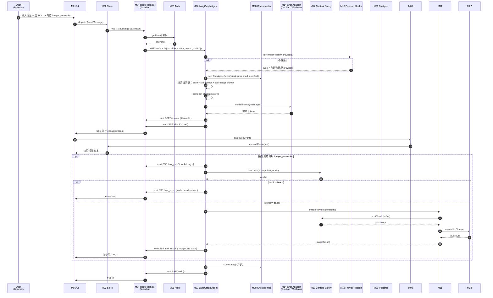
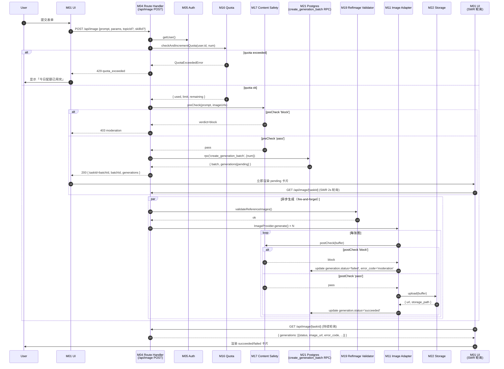

# zimage 架构文档

> ZImage — 面向设计师的电商图片处理工作台的运行时架构与故障应对手册。
>
> 本文档定位为**架构全景 + 故障应对手册**，面向三类读者：① 系统架构师（评审整体设计）② 新入职工程师（30 分钟内建立心智模型）③ Code Reviewer（评估 PR 是否破坏既有边界）。所有架构决策的来源已在 `requirements.md §1.4` 决策记录、`tech-selection.md §3.x` 技术选型、`doc/review-report-requirements-vs-tech.md` 审查报告中锁定，本文不复述决策理由。

---

## 0. 与既有文档的关系

| 主题 | requirements.md §4.1 | tech-selection.md §3.x | **本 architecture.md** |
|---|---|---|---|
| 高层架构图 | ✅ 粗粒度 3 层 | — | ✅ 细粒度 5 层 × 23 模块 |
| 模块职责边界 | — | — | ✅ **核心新增** |
| 数据流时序图 | 粗流程（聊天 + 工作台两条） | — | ✅ **7 个场景详细时序** |
| 通信方式 | — | 分散 | ✅ **统一通信矩阵** |
| 降级策略 | 风险表 §5.2 列出 | §3.13a 部分 | ✅ **8 场景应对路径** |
| 库 / 版本选型 | — | ✅ | — |
| 数据模型 / SQL | §4.3 | — | —（仅在 §2 L6 Persistence 层 M21-M23 简述） |

**阅读建议**：
- 想了解「系统在做什么」→ 先读 §1 模块总览 + §3 核心数据流
- 想了解「某模块如何工作」→ 直接跳到 §2 对应小节
- 想了解「上游出错会怎样」→ §5 降级策略
- 想了解「为什么要这样做」→ 回查 requirements.md / tech-selection.md / review-report

---

## 1. 模块总览

### 1.1 模块清单（23 个细粒度模块）

zimage 系统划分为 **5 层 × 23 模块**。每个模块有明确的「职责 / 输入 / 输出 / 失败模式」四要素（详见 §2）。

| 层 | 模块 ID | 名称 | 职责一句话 | 对应技术栈 |
|---|---|---|---|---|
| **L1 Browser** | M01 | Client UI | 渲染聊天 / 工作台 / 首页 UI | Next.js Client Components + @lobehub/ui + antd |
| | M02 | Client Store | 全局状态（聊天流 / 生图配置 / 技能选择） | zustand slices |
| | M03 | Client SSE Parser | 解析 `/api/chat` 的 SSE 事件流 | `packages/fetch-sse` |
| **L2 API Gateway** | M04 | Route Handler | Next.js API 路由入口与 SSE 流写入 | Next.js App Router (Node runtime) |
| | M05 | Auth Middleware | 鉴权 / anon 自动登录 / RLS 上下文注入 | `@supabase/ssr` + AuthBootstrap |
| | M06 | Error Handler | 6 个错误码枚举 → HTTP 状态映射的统一构造 | `packages/shared/errors.ts` |
| **L3 LangGraph** | M07 | LangGraph Agent | 每请求 compile StateGraph + 工具调度 | `@langchain/langgraph` |
| | M08 | LangGraph Checkpointer | 聊天历史持久化（`thread_id` = `sessions.id`） | `@skroyc/langgraph-supabase-checkpointer` |
| | M09 | Tool Registry | 四类工具注册表（custom / langchain / mcp / canvas） | `apps/web/agent/config/unified-tools.config.ts` |
| **L4 Provider** | M10 | Image Provider 抽象 | ImageProvider interface + 参数归一 | `packages/image-providers/src/types.ts` |
| | M11 | Image Adapter: Seedream | 调用火山方舟 Ark API 生图 | 火山方舟 SDK |
| | M12 | Image Adapter: Gemini | 调用 `@google/genai` 生图 | `@google/genai` |
| | M13 | Chat Provider 抽象 | ChatProvider interface + 模型归一 | `packages/chat-providers/src/types.ts` |
| | M14 | Chat Adapter: Doubao | 字节火山聊天模型（OpenAI 兼容） | `@langchain/openai` |
| | M15 | Chat Adapter: MiniMax | MiniMax 聊天模型（Anthropic 兼容） | `@langchain/anthropic` |
| **L5 Middleware** | M16 | Quota Middleware | 配额扣减（30 张/日 UTC）+ 原子事务 | `apps/web/middleware/quota.ts` |
| | M17 | Content Safety Middleware | preCheck + postCheck 双层校验 | `apps/web/middleware/content-safety.ts` |
| | M18 | Provider Health Monitor | 5 分钟滚动窗口错误率监控 | `apps/web/monitoring/provider-health.ts` |
| | M19 | Reference Image Validator | 上传图片 MIME + 大小（10MB）校验 | `packages/image-providers/src/validate.ts` |
| | M20 | Logger + Sentry | 结构化日志 + 错误埋点 | `pino` + `@sentry/nextjs` |
| **L6 Persistence** | M21 | Supabase Postgres | 5 张业务表 + 2 个 cron job + RLS | Supabase Cloud |
| | M22 | Supabase Storage | generated-images 90 天 / uploads 30 天 | Supabase Cloud |
| | M23 | Supabase Auth | 匿名登录 + Phase2 OAuth PKCE | `@supabase/ssr` |

> **注**：L5 Middleware 与 L2 API Gateway 在物理位置上都位于 Next.js Route Handler 内，但逻辑上 Middleware 是**横向可复用的处理环节**（Quota 可被 `/api/image` 与 `/api/chat` 共用），而 API Gateway 是**纵向入口层**。本文按"功能模块"而非"代码物理位置"分层。

### 1.2 架构分层图

```
┌─────────────────────────────────────────────────────────────────────────────┐
│ L1 Browser (Next.js Client Components)                                       │
│   ┌──────────┐  ┌──────────┐  ┌──────────┐                                   │
│   │ M01 UI   │←→│ M02 Store│  │ M03 SSE  │                                   │
│   └────┬─────┘  └──────────┘  │  Parser  │                                   │
│        │            ↑          └────┬─────┘                                   │
└────────┼────────────┼───────────────┼─────────────────────────────────────────┘
         │ fetch / SSE stream │ 解析后回填 Store
         ▼            │            │
┌─────────────────────────────────────────────────────────────────────────────┐
│ L2 API Gateway (Next.js Route Handler, Node runtime)                         │
│   ┌──────────────┐  ┌──────────────┐  ┌──────────────┐                       │
│   │ M04 Route    │  │ M05 Auth     │  │ M06 Error    │                       │
│   │  Handler     │→ │  Middleware  │→ │  Handler     │                       │
│   └──────┬───────┘  └──────────────┘  └──────────────┘                       │
└──────────┼──────────────────────────────────────────────────────────────────┘
           │
           ▼
┌─────────────────────────────────────────────────────────────────────────────┐
│ L3 LangGraph Agent (每请求 compile)                                          │
│   ┌──────────────┐  ┌──────────────┐  ┌──────────────┐                       │
│   │ M07 Agent    │←→│ M08 Check-   │  │ M09 Tool     │                       │
│   │  (StateGraph)│  │  pointer     │  │  Registry    │                       │
│   └──────┬───────┘  └──────────────┘  └──────┬───────┘                       │
└──────────┼─────────────────────────────────────┼──────────────────────────────┘
           │                                     │ bindTools(toolIds)
           ▼                                     ▼
┌─────────────────────────────────────────────────────────────────────────────┐
│ L4 Provider Layer                                                            │
│   ┌──────────────────────────────────────────┐                               │
│   │ L4a Image Generation                     │                               │
│   │  M10 ImageProvider                       │                               │
│   │   ├─ M11 Seedream Adapter (火山方舟)      │                               │
│   │   └─ M12 Gemini Adapter (@google/genai)  │                               │
│   └──────────────────────────────────────────┘                               │
│   ┌──────────────────────────────────────────┐                               │
│   │ L4b Chat LLM                             │                               │
│   │  M13 ChatProvider                        │                               │
│   │   ├─ M14 Doubao Adapter (OpenAI 兼容)    │                               │
│   │   └─ M15 MiniMax Adapter (Anthropic 兼容)│                               │
│   └──────────────────────────────────────────┘                               │
└──────────┬───────────────────────────────────────────────────────────────────┘
           │
           ▼
┌─────────────────────────────────────────────────────────────────────────────┐
│ L5 Middleware (横向处理环节，可在多个 API 路径复用)                          │
│   ┌──────────────┐ ┌──────────────┐ ┌──────────────┐ ┌──────────────┐        │
│   │ M16 Quota    │ │ M17 Content   │ │ M18 Provider │ │ M19 RefImage │ ...    │
│   │              │ │   Safety     │ │   Health    │ │   Validator  │        │
│   └──────────────┘ └──────────────┘ └──────────────┘ └──────────────┘        │
│   ┌──────────────┐                                                         │
│   │ M20 Logger + │                                                         │
│   │   Sentry     │                                                         │
│   └──────────────┘                                                         │
└──────────┬───────────────────────────────────────────────────────────────────┘
           │
           ▼
┌─────────────────────────────────────────────────────────────────────────────┐
│ L6 Persistence (Supabase Cloud)                                              │
│   ┌──────────────────┐  ┌──────────────────┐  ┌──────────────────┐          │
│   │ M21 Postgres     │  │ M22 Storage      │  │ M23 Auth         │          │
│   │  5 表 + RLS +    │  │  generated-      │  │  anon + Phase2   │          │
│   │  2 cron jobs     │  │  images/uploads  │  │  OAuth PKCE      │          │
│   └──────────────────┘  └──────────────────┘  └──────────────────┘          │
└─────────────────────────────────────────────────────────────────────────────┘
```

### 1.3 模块依赖关系（粗略）

- **L1 → L2**：fetch（HTTP/SSE）
- **L2 → L3**：API 路由调用 LangGraph agent（仅 `/api/chat`）；`/api/image` 与 `/api/skills` 等直调 L4 + L5 + L6
- **L3 → L4**：bindTools / model.invoke
- **L4 → L5**：每次生成调用 Quota + Content Safety + RefImage Validator
- **L5 → L6**：DB 读写、Storage 上传、Auth 校验
- **L5 ↔ L6**：Provider Health Monitor 写入内存桶；Sentry 上报 Sentry Cloud（外部）
- **L1 → L5**：前端配额卡片轮询 `/api/quotas`；Provider 健康检查轮询 `/api/health/providers`

> **关键不变量**：L1 与 L3/L4 之间不直接通信（必须经 L2）；L4 抽象层之间不互相调用（Image 与 Chat 解耦）。

---

## 2. 模块详解

> 每个模块包含：**职责** / **输入** / **输出** / **失败模式** / **关键代码位置**。

### L1 Browser Layer

#### M01 Client UI

- **职责**：渲染三个页面（首页 chat hero、`/image` 工作台、聊天页）；触发用户交互事件
- **输入**：用户点击 / 输入 / 拖拽上传；来自 M02 Store 的 state
- **输出**：调用 M02 的 action；触发 fetch/SSE 调 M04
- **失败模式**：组件崩溃由 Sentry `ErrorBoundary` 捕获；UI 降级为骨架屏
- **关键代码**：`apps/web/app/{page.tsx, image/page.tsx}` + `src/features/{Home,ImageWorkspace,Chat}/*`

#### M02 Client Store

- **职责**：全局状态管理（聊天消息流 / 生图配置 / 技能选择 / 配额计数）
- **输入**：组件 dispatch action；SSE 解析回填（M03 → M04 → M02）
- **输出**：组件 `useStore(selector)` 订阅；触发 fetch/SSE
- **失败模式**：状态不一致时由 `devtools` 时间旅行调试；zustand 持久化（Phase2）可恢复
- **关键代码**：`apps/web/src/store/{image,chat,skill}/slices/*`（参考 lobehub-canary 分层）

#### M03 Client SSE Parser

- **职责**：解析 `/api/chat` 返回的 SSE 流（6 类事件：`session` / `chunk` / `tool_calls` / `tool_result` / `tool_error` / `end`，详见 tech-selection §2.9）
- **输入**：ReadableStream 二进制块
- **输出**：`onMessage(data, event)` 回调，由 useChatMessages hook 处理
- **失败模式**：
  - **行截断**：缓存残余，下一轮合并
  - **心跳**：忽略（`:heartbeat` 注释行）
  - **连接中断**：见 §5.7 降级策略
- **关键代码**：`packages/fetch-sse/src/index.ts`（从 lobehub-canary `@lobechat/fetch-sse` 抽出）

---

### L2 API Gateway Layer

#### M04 Route Handler

- **职责**：所有 `/api/*` 路由的入口；SSE 流的写入器
- **输入**：HTTP 请求（fetch / multipart / JSON）
- **输出**：JSON 响应 / SSE 流 / HTTP 错误
- **失败模式**：
  - Vercel serverless 60s 超时（`maxDuration = 60`）→ 长任务降级
  - 多实例下 module-level cache 失效 → LangGraph 每请求 compile 解决
- **关键代码**：`apps/web/app/api/{chat,image,skills,topics,health,quotas}/route.ts`

#### M05 Auth Middleware

- **职责**：每个受保护路由鉴权；匿名登录态注入 RLS 上下文
- **输入**：请求 cookies / headers
- **输出**：`auth.uid()`（anon uuid）；RLS 自动按 uid 隔离
- **失败模式**：
  - JWT 过期 → 自动重新 anon signInAnonymously
  - 浏览器首次访问 → AuthBootstrap 静默 anon 登录
- **关键代码**：`apps/web/src/components/AuthBootstrap.tsx` + `libs/supabase/{server,browser}.ts`

#### M06 Error Handler

- **职责**：统一 6 个错误码（`bad_request` / `unauthorized` / `quota_exceeded` / `provider_error` / `network` / `moderation`）→ HTTP 状态码映射（400/401/429/502/503/403）
- **输入**：业务代码抛出的 Error 或显式 code
- **输出**：`Response.json({ error: { code, message } }, { status: ERROR_STATUS[code] })`
- **失败模式**：未捕获异常 → fallback `provider_error` 502 + Sentry 上报
- **关键代码**：`packages/shared/errors.ts`

---

### L3 LangGraph Agent Layer

#### M07 LangGraph Agent

- **职责**：每请求 compile StateGraph；拼系统消息（base + skill prompt + tool usage prompt）；调度模型与工具
- **输入**：聊天消息 + toolIds + skillId + model 选择
- **输出**：SSE 事件流（M07 → M04 → L1）
- **失败模式**：
  - LLM 调用超时 → 上限重试 1 次 → 失败返回 `provider_error`
  - 工具调用失败 → 走 `tool_error` 事件，前端渲染 `<ErrorCard>`
  - 模型选择器变更 → 自动跳过 unhealthy provider（见 §5.1）
- **关键代码**：`apps/web/agent/chatbot.ts`（每请求 `buildChatGraph({ provider, toolIds, userId })`）

#### M08 LangGraph Checkpointer

- **职责**：聊天历史持久化（key: `thread_id = sessions.id`，value: LangGraph state）
- **输入**：`StateGraph.compile({ checkpointer: new SupabaseSaver(client, undefined, userId) })`
- **输出**：DB 表 `checkpoints`（按 `@skroyc/langgraph-supabase-checkpointer` 库 schema）
- **失败模式**：
  - 写入失败 → 主流程 warn + Sentry（不阻塞回复用户）
  - 读取失败 → 返回空 state（新会话）
  - 删除失败 → §5.4 降级策略
- **关键代码**：`@skroyc/langgraph-supabase-checkpointer` 库 + `supabase/migrations/0003_checkpointer.sql`

#### M09 Tool Registry

- **职责**：四类工具注册表（custom / langchain / mcp / canvas）；按 `toolIds` 选择性 `bindTools`
- **输入**：前端传入 `tools: string[]`（`image_generation` 等）
- **输出**：LangChain `tools` 数组
- **失败模式**：未知 toolId → 静默忽略（不报错）
- **关键代码**：`apps/web/agent/config/unified-tools.config.ts` + `tools/image-generation.ts`

---

### L4 Provider Layer

#### M10 Image Provider 抽象

- **职责**：定义 `ImageProvider` interface；归一不同 provider 的参数/错误/响应
- **输入**：`ImageGenerationParams`（prompt / provider / model / aspectRatio / resolution / imageUrls / num / providerSpecificParams）
- **输出**：`ImageResult[]`（{ url, storagePath, width, height }）
- **失败模式**：归一失败 → 抛 `bad_request`
- **关键代码**：`packages/image-providers/src/types.ts`

#### M11 Image Adapter: Seedream

- **职责**：调用火山方舟 Ark API（`POST /api/v3/images/generations`）；鉴权用 `ARK_API_KEY`
- **输入**：`ImageGenerationParams`
- **输出**：`ImageResult[]`（从火山方舟响应 `.data[]` 映射）
- **失败模式**：
  - HTTP 5xx → `provider_error` 502
  - HTTP 429 → `quota_exceeded`（上游配额耗尽）
  - HTTP 4xx → `bad_request` 400
  - 网络中断 → `network` 503
- **关键代码**：`packages/image-providers/src/seedream.ts`（tech-selection §3.7）

#### M12 Image Adapter: Gemini

- **职责**：调用 `@google/genai` SDK 的 `models.generateContent`（model=`gemini-3-pro-image-preview`，`responseModalities=['IMAGE']`）
- **输入**：`ImageGenerationParams`
- **输出**：`ImageResult[]`
- **失败模式**：与 M11 类似；Gemini 健康检查失败时由 M18 标记为 unhealthy
- **关键代码**：`packages/image-providers/src/gemini.ts`

#### M13 Chat Provider 抽象

- **职责**：定义 `ChatProvider` interface；归一不同 LLM 的 `BaseChatModel`
- **输入**：`provider: 'doubao' | 'minimax'`
- **输出**：`BaseChatModel` 实例（LangChain 标准）
- **失败模式**：未知 provider → 抛 `bad_request`
- **关键代码**：`packages/chat-providers/src/types.ts`

#### M14 Chat Adapter: Doubao

- **职责**：字节火山聊天模型（OpenAI 兼容 baseURL），使用 `ARK_API_KEY`
- **输入**：模型 ID（`process.env.DOUBAO_MODEL ?? 'doubao-pro'`）
- **输出**：`ChatOpenAI` 实例
- **失败模式**：与 LLM 调用相同（详见 M07）
- **关键代码**：`packages/chat-providers/src/doubao.ts`

#### M15 Chat Adapter: MiniMax

- **职责**：MiniMax 聊天模型（Anthropic 兼容 baseURL `https://api.minimaxi.com/anthropic`）
- **输入**：`MINIMAX_MODEL`（接入时确认）
- **输出**：`ChatAnthropic` 实例
- **失败模式**：与 M14 类似；Phase1 实测前不确定
- **关键代码**：`packages/chat-providers/src/minimax.ts`

---

### L5 Middleware Layer

#### M16 Quota Middleware

- **职责**：每个匿名用户每天 30 张配额（UTC 日）；原子扣减；越界返回 `quota_exceeded` HTTP 429
- **输入**：`user_id` + 增量数（默认 1）
- **输出**：`{ used, limit, remaining }` 或抛 `QuotaExceededError`
- **失败模式**：
  - DB 锁冲突 → RPC 重试
  - 越界 → `QuotaExceededError` → `errorResponse(QUOTA_EXCEEDED)` 含 `Retry-After: 86400`
- **关键代码**：`apps/web/middleware/quota.ts` + `supabase/migrations/0006_quotas.sql` + `0007_increment_quota_rpc.sql`

#### M17 Content Safety Middleware

- **职责**：调用国内内容安全供应商（数美 / 火山 / 阿里云绿网 任选其一）；preCheck 文本 + postCheck 图像
- **输入**：`prompt: string` + `imageUrls?: string[]`（preCheck）/ `imageBuffer: ArrayBuffer`（postCheck）
- **输出**：`{ verdict: 'pass' | 'block' | 'review', reasons: string[] }`（preCheck）/ `boolean`（postCheck）
- **失败模式**：
  - 供应商不可用 → 主流程 warn + Sentry；fallback 默认 `review`（保守拒绝）
  - verdict='block' → 立即抛 `moderation` 403
- **关键代码**：`apps/web/middleware/content-safety.ts`（tech-selection §3.12）

#### M18 Provider Health Monitor

- **职责**：5 分钟滚动窗口统计各 provider 错误率；错误率 > 50% 标记 unhealthy
- **输入**：每次 provider 调用的 success/error 信号
- **输出**：`isProviderHealthy(provider) → boolean`；API endpoint `/api/health/providers`
- **失败模式**：
  - 样本不足（<10 calls/5min）→ 默认健康（避免冷启动误判）
  - 告警写日志 + Sentry，**不阻塞主流程**
- **关键代码**：`apps/web/monitoring/provider-health.ts`（tech-selection §3.13a）

#### M19 Reference Image Validator

- **职责**：参考图上传校验——MIME ∈ {png, jpeg, webp} + sizeBytes ≤ 10MB + 最多 4 张
- **输入**：`imageUrls: string[]`
- **输出**：通过 / 抛 `ReferenceImageValidationError`
- **失败模式**：不通过 → `bad_request` HTTP 400
- **关键代码**：`packages/image-providers/src/validate.ts`（tech-selection §3.7）

#### M20 Logger + Sentry

- **职责**：结构化 JSON 日志（pino）+ Sentry 错误埋点；脱敏（不打印 prompt / apiKey 全量）
- **输入**：所有模块调用 `logger.info/warn/error()` + `Sentry.captureException()`
- **输出**：本地日志（PM2 兜底）/ Sentry Cloud
- **失败模式**：Sentry 上报失败 → 主流程不受影响（异步非阻塞）
- **关键代码**：`apps/web/libs/logger.ts` + `sentry.{client,server}.config.ts`

---

### L6 Persistence Layer

#### M21 Supabase Postgres

- **职责**：5 张业务表（topics / generation_batches / generations / sessions / image_safety_audits）+ 配额表（quotas）+ checkpointer 表 + 3 个 cron job
- **输入**：所有 L2-L5 的 DB 操作（RLS 自动按 `auth.uid()` 隔离）
- **输出**：rows / RPC 返回值
- **失败模式**：
  - 连接失败 → 上层 retry 1 次 → 失败 5xx
  - 迁移漂移 → `supabase db diff` CI 校验
- **关键代码**：`supabase/migrations/*.sql`（11 个迁移文件）

#### M22 Supabase Storage

- **职责**：两个 bucket（`generated-images` public 90 天 / `uploads` private 30 天）
- **输入**：上传 buffer / 删除 path 列表
- **输出**：public URL / signed URL
- **失败模式**：
  - 上传失败 → generation.status='failed' + `provider_error`
  - 删除失败 → §5.4 / tech-selection §3.5a cron 兜底
- **关键代码**：`apps/web/services/storage.service.ts` + `supabase/migrations/0009_storage_lifecycle.sql`

#### M23 Supabase Auth

- **职责**：匿名登录（Phase1）+ OAuth PKCE（Phase2）；JWT 颁发；anon uuid 持久化到浏览器 cookie
- **输入**：`signInAnonymously()` / OAuth callback
- **输出**：`{ user: { id }, session }`
- **失败模式**：登录失败 → 5xx 错误，前端显示重试
- **关键代码**：`@supabase/ssr` + `AuthBootstrap.tsx`

---

## 3. 核心数据流

> 本节给出 7 个关键场景的时序图。每个场景展示：从触发到结束的完整调用链 + 失败分支点。
> 时序图采用 mermaid sequenceDiagram 语法 + 关键节点文字注解的混合形式，确保可读性与完整性。

### 3.1 聊天链路（核心场景）

**触发条件**：用户在首页 / `/chat` 输入文本并提交，含技能选择 + 工具勾选。



**关键节点注解**：
- 节点 8（Provider Health）：每次请求前查询，不健康时自动切换到另一 provider（见 §5.1）
- 节点 14（系统消息拼装）：base + skill.triggers.providerHints 触发的 skill prompt + toolIds 触发的 tool usage prompt
- 节点 17（preCheck）：仅文本校验；postCheck 在 M11 内调用
- 节点 21（save）：checkpointer 写入失败仅 warn，不阻塞 SSE 'end' 发送

**失败分支**：
- 模型调用失败 → 自动重试 1 次（同 provider）→ 失败 `provider_error` 502 + `<ErrorCard>`
- preCheck 'block' → 立即中断模型流 → SSE 'tool_error' → 前端 ErrorCard
- postCheck 'block' → generation.status='failed' + error_code='moderation'

---

### 3.2 工作台批量生图（核心场景）

**触发条件**：用户在 `/image` 工作台提交 prompt + 配置（provider/model/aspect/resolution/num 1-4）。



**关键节点注解**：
- 节点 5（Quota）：用 RPC 原子事务（`increment_quota`）保证并发越界保护
- 节点 11（pending generations）：同步建 batch + N 条 generations（status='pending'）后立即返回；前端 SWR 轮询
- 节点 16（async fire-and-forget）：`process.nextTick` 派发；不阻塞 200 响应
- 节点 18-22（per-generation loop）：每张图独立状态，失败不影响其他

**失败分支**：
- Quota 越界：429 → 前端禁用重试按钮
- preCheck block：403 → 前端显示违规提示
- postCheck block：单张 generation.status='failed'，其他张继续
- Provider 5xx：generation.status='failed', error_code='provider_error'

---

### 3.3 工具调用生图（聊天内生图）

**触发条件**：在聊天中，模型判断需调用 `image_generation` 工具（基于工具描述 + 用户意图）。

```
[L3 LangGraph Agent]
  ├─ 模型输出含 tool_calls [{ name: 'image_generation', args: { prompt, ... } }]
  ├─ emit SSE 'tool_calls' 事件
  ├─ 调 image_generation handler:
  │    ├─ L19 校验 imageUrls (10MB/MIME)
  │    ├─ L11 Seedream/Gemini.generate()
  │    ├─ L17 postCheck(buffer)
  │    ├─ L22 Storage.upload()
  │    ├─ 写 generations 表 (status='succeeded', image_url, storage_path)
  │    └─ 返回 ImageCard 数据 (URL + 元信息)
  ├─ emit SSE 'tool_result' { toolId, result: ImageCard }
  └─ 继续模型生成（拼 ImageCard 到回复上下文）
```

**与 §3.2 工作台链路的区别**：
- 工作台走 M04 `/api/image` 直调，**不经 L3 LangGraph**
- 工具调用走 L3 LangGraph 内 `ToolNode`，结果通过 SSE `tool_result` 事件回传 L1
- 工作台生成图片落 DB（generations 表）；工具调用生成的图**不落 DB**（仅供当前聊天流展示）—— Phase1 设计选择，避免污染历史库

---

### 3.4 SKILL.md 加载与模板填充

```
[L1 M01] 选中技能 (e.g. 'white-bg') 
  ↓
[L1 M02] dispatch(setActiveSkill('white-bg'))
  ↓
[L2 M04] GET /api/skills → 返回 Skill[] (meta + promptTemplate)
  ↓
[L1 M01] <SkillRequiredFields> 显示 params: ['imageUrls']
  ↓
[L1 M01] 用户填必填字段 → 表单校验通过
  ↓
[L3 M07] chatbotNode:
  1. loadSkill('white-bg') - 读 packages/skills/skills/white-bg/SKILL.md
  2. parseSkill(raw) - 拆 frontmatter (yaml) + body
  3. renderSkillPrompt(skill, { prompt, imageUrls }) - 替换 {prompt}/{imageUrls} 占位符
  4. 拼系统消息: [base system] + [rendered skill prompt] + [tool usage prompt]
  5. effectiveProvider = skill.triggers.providerHints[0] ?? 'seedream'
  6. enabledTools = skill.triggers.tools // 自动 bindTools
```

**关键设计**：
- 技能切换是**纯前端 + LangGraph 系统消息层**的事情，**不经 M04 后端 API**
- SKILL.md 在 Phase1 是文件加载（`packages/skills/skills/`），Phase2 才考虑 DB 化
- 必填字段缺失由 L1 表单标红（`getMissingFields()`），不阻塞发送但在 L3 内做兜底校验

---

### 3.5 配额扣减（原子事务）

```sql
-- supabase/migrations/0007_increment_quota_rpc.sql
BEGIN;
  -- UPSERT 当日 quota 行 + SELECT FOR UPDATE
  INSERT INTO quotas (user_id, quota_date, used_count)
  VALUES (p_user_id, p_quota_date, 0)
  ON CONFLICT DO NOTHING;

  SELECT used_count INTO v_used
  FROM quotas WHERE user_id = p_user_id AND quota_date = p_quota_date
  FOR UPDATE;

  IF v_used + p_increment > p_limit THEN
    RETURN QUERY SELECT v_used, 'exceeded'::text;
    -- 不 COMMIT，事务回滚
  END IF;

  UPDATE quotas SET used_count = used_count + p_increment, last_reset_at = now()
  WHERE user_id = p_user_id AND quota_date = p_quota_date;

  RETURN QUERY SELECT v_used + p_increment, 'ok'::text;
COMMIT;
```

**调用点**：
- `/api/image` POST：扣 `body.params.num`
- `/api/chat` 调用 `image_generation` 工具：扣 1
- `/api/image/recreate` POST：扣选中目标数

**关键设计**：
- `FOR UPDATE` 行锁避免并发越界（同一 uid 多次并发请求安全）
- 越界时 `RETURN ... 'exceeded'` 而非抛异常，事务回滚后 L16 抛 `QuotaExceededError`

---

### 3.6 Provider 健康检查（5 分钟滚动窗口）

```
[L11 Seedream Adapter] 或 [L12 Gemini Adapter]
  ↓ generate() 返回成功/失败
[L18 Provider Health Monitor]
  ├─ recordProviderCall(provider, isError)
  │    └─ buckets.set(`${provider}:${windowStart}`, { totalCalls++, errorCalls++ })
  ├─ 清理过期桶（保留最近 1 个完整窗口）
  └─ isProviderHealthy(provider)
       ├─ sampleSize < 10 → 默认 true（冷启动保护）
       └─ errorRate > 0.5 → false

[L1 M01 /image ConfigPanel] 60s 轮询 GET /api/health/providers
  ↓ 返回 { providers: [{ name, healthy, errorRate, sampleSize }] }
[L1 M01] ModelSwitchPanel:
  ├─ unhealthy provider → 显示「限上」Tag + disabled
  └─ 当前选中变 unhealthy → 顶部 toast「X 不可用，已自动切换 Y」

[L1 M01 useAutoDegrade hook] 监听 unhealthy，自动切到健康 provider
```

**告警写日志**（Phase2 才外发 Lark/钉钉/PagerDuty）：
- `logger.warn({ provider, errorRate, sampleSize }, 'provider unhealthy')`
- `Sentry.captureMessage(...)`

---

### 3.7 内容安全（preCheck + postCheck 双层）

```
[L4 M11/M12 Image Adapter] generate(prompt, imageUrls)
  ↓
[L5 M17 Content Safety.preCheck(prompt, imageUrls)]
  ├─ 调供应商 POST /text-check
  │    └─ 入参: { text: prompt, image_urls: [...] }
  ├─ 返回 verdict ∈ { 'pass', 'block', 'review' }
  └─ block → 抛 moderation (立即拒绝，不调模型)

[pass] ↓
[L4 M11/M12] ImageProvider.generate()
  ↓ 返回 buffer
[L5 M17 Content Safety.postCheck(imageBuffer)]
  ├─ 调供应商 POST /image-check
  │    └─ 入参: imageBuffer (multipart/form-data)
  ├─ 返回 verdict ∈ { 'pass', 'block' }
  └─ block → generation.status='failed', error_code='moderation'

[pass] ↓
[L6 M22 Storage] upload(buffer)
  ↓ 落 generations.status='succeeded'
```

**供应商选型**：数美 / 火山 / 阿里云绿网 任选其一（Phase1 第三周确认，详见 §7）。

**降级行为**：供应商不可用 → 主流程 warn + Sentry + 默认 verdict='review'（保守拒绝，避免漏过违规内容）。

---

## 4. 模块间通信矩阵

> 列出 23 个模块之间的主通信路径。共约 25 条路径，覆盖所有用户场景。

### 4.1 通信方式分类

| 方式 | 协议 | 同步性 | 用途 |
|---|---|---|---|
| **HTTP REST** | fetch / `openapi-fetch` | 同步（请求-响应） | UI ↔ API Gateway、表单提交、状态查询 |
| **SSE 流** | ReadableStream + text/event-stream | 异步（服务端推送） | `/api/chat` 长连接 |
| **DB 直查** | `@supabase/ssr` + RLS | 同步（单次 RPC） | 配额扣减、状态轮询 |
| **DB RPC** | PostgreSQL `FUNCTION` + transaction | 同步（事务保证） | 配额原子扣减、batch 事务创建 |
| **LangChain Tool** | `model.bindTools()` + `ToolNode` | 异步（agent 调度） | LangGraph 工具调用 |
| **Memory** | 进程内 Map | 同步（进程局部） | Provider Health 桶、in-memory cache |
| **3rd-party API** | fetch + 各 provider SDK | 同步（请求-响应） | 火山方舟 / Gemini / Doubao / MiniMax / 内容安全 |
| **Storage** | `@supabase/supabase-js` upload | 异步（流式上传） | 图片 buffer 落 Storage |
| **Sentry** | `@sentry/nextjs` SDK | 异步（非阻塞） | 错误埋点、性能监控 |

### 4.2 通信矩阵

| # | 源模块 | 目标模块 | 方式 | 协议 / 端点 | 同步性 | 关键约束 |
|---|---|---|---|---|---|---|
| 1 | M01 UI | M02 Store | In-process | zustand action dispatch | 同步 | — |
| 2 | M01 UI | M04 Route Handler | HTTP | `POST /api/chat` (SSE) | 异步推送 | ReadableStream 心跳 15s |
| 3 | M01 UI | M04 Route Handler | HTTP | `POST /api/image` | 同步（≤500ms） | 返回后 SWR 轮询 |
| 4 | M01 UI | M04 Route Handler | HTTP | `GET /api/image/[taskId]` | 同步（轮询 2s） | SWR `refreshInterval: 2000` |
| 5 | M01 UI | M04 Route Handler | HTTP | `GET /api/skills` | 同步 | — |
| 6 | M01 UI | M04 Route Handler | HTTP | `GET /api/health/providers` | 同步（轮询 60s） | Provider 状态轮询 |
| 7 | M01 UI | M04 Route Handler | HTTP | `GET /api/quotas` | 同步（轮询 30s） | 配额卡片实时显示 |
| 8 | M01 UI | M04 Route Handler | HTTP | `POST /api/image/safety-check` | 同步 | 实时预览违规检测 |
| 9 | M01 UI | M04 Route Handler | HTTP | `DELETE /api/chat/sessions/[id]` | 同步 | 同步清 checkpointer + storage |
| 10 | M01 UI | M04 Route Handler | HTTP | `POST /api/image/recreate` | 同步（≤500ms） | 三模式重生成 |
| 11 | M03 SSE Parser | M02 Store | In-process | `onMessage` callback | 同步（解析后） | 行截断 + 心跳容错 |
| 12 | M04 Route Handler | M05 Auth | DB | `supabase.auth.getUser()` | 同步（≤100ms） | cookie JWT 解码 |
| 13 | M04 Route Handler | M07 LangGraph | In-process | `buildChatGraph().invoke()` | 异步（SSE） | 每请求 compile |
| 14 | M04 Route Handler | M11/M12 Image Adapter | In-process | `imageProvider.generate()` | 同步（最长 60s） | maxDuration=60 |
| 15 | M04 Route Handler | M16 Quota | DB RPC | `increment_quota(...)` | 同步（事务） | FOR UPDATE 行锁 |
| 16 | M04 Route Handler | M17 Content Safety | 3rd-party HTTP | `POST /text-check` | 同步（≤1s） | 供应商 API |
| 17 | M04 Route Handler | M21 Postgres | DB | `INSERT/UPDATE/SELECT` | 同步（≤500ms） | RLS 自动按 uid |
| 18 | M04 Route Handler | M22 Storage | DB | `storage.upload()` | 异步（流式） | 失败回滚 generation |
| 19 | M04 Route Handler | M20 Logger | In-process | `logger.info/warn/error` | 异步（非阻塞） | 脱敏 prompt/apiKey |
| 20 | M07 LangGraph | M08 Checkpointer | DB | `SupabaseSaver` 自动 | 异步（状态保存） | 失败仅 warn |
| 21 | M07 LangGraph | M09 Tool Registry | In-process | `createLangChainTools(toolIds)` | 同步（按需加载） | — |
| 22 | M07 LangGraph | M11/M12 Image Adapter | LangChain Tool | `model.invoke(tool_call)` | 异步 | 含 preCheck + postCheck |
| 23 | M07 LangGraph | M14/M15 Chat Adapter | LangChain | `model.invoke(messages)` | 异步（SSE chunk） | 增量 tokens |
| 24 | M11/M12 Image Adapter | M22 Storage | DB | `storage.upload(buffer)` | 异步 | 失败 → generation='failed' |
| 25 | M11/M12 Image Adapter | M18 Provider Health | In-process | `recordProviderCall()` | 同步（内存写入） | 5 分钟桶 |
| 26 | M11/M12 Image Adapter | 火山方舟 / @google/genai | 3rd-party HTTP | `POST /images/generations` | 同步（≤60s） | maxDuration=60 |
| 27 | M14/M15 Chat Adapter | Doubao / MiniMax | 3rd-party HTTP | OpenAI / Anthropic 兼容 | 异步（SSE） | — |
| 28 | M17 Content Safety | 内容安全供应商 | 3rd-party HTTP | 数美 / 火山 / 阿里云绿网 | 同步（≤2s） | 失败默认 review |
| 29 | M19 RefImage Validator | Storage 对象 | HTTP HEAD | `fetch(url, { method: 'HEAD' })` | 同步 | MIME + size 校验 |
| 30 | M20 Logger + Sentry | pino / Sentry Cloud | In-process + 3rd-party | — | 异步（非阻塞） | — |

### 4.3 通信模式总结

- **同步链路**：UI 表单提交、配额扣减、内容安全校验、provider 健康检查 → 都是**请求-响应模式**，超时需明确上限
- **异步链路**：聊天 SSE 流、生图 async fire-and-forget、checkpointer 状态保存 → 都是**单向推送 / 后台处理**
- **关键异步边界**：M04 `/api/image` POST 在 N+1 张图场景下，**只同步建 batch + generations 记录，立即返回 200**，实际生成在 `process.nextTick` 后台跑；前端通过 SWR 轮询感知进度。这一边界是 Phase1 区分「同步 API」与「异步队列」的过渡设计（v1.2 改为 Supabase Edge Function 队列后接口不变）。

---

## 5. 降级策略（8 个故障场景）

> 本节定义系统对各类故障的应对路径。覆盖**用户感知**（UI 显示什么）与**系统行为**（自动 / 手动降级、是否阻塞主流程）两个维度。

### 5.1 Provider 不健康（Gemini 不可用）

**触发**：M18 Provider Health Monitor 检测到 provider 在 5 分钟窗口内错误率 > 50%（样本数 ≥ 10）

**用户感知**：
- `<ModelSwitchPanel>` 中不健康 provider 项**显示禁用态 + 「限上」红色 Tag + tooltip「近 5 分钟错误率 XX%，限上不可用」**
- 当前聊天正在用的 provider 若变为 unhealthy，**顶部 toast 提示「Gemini 不可用，已自动切换 Seedream」**

**系统行为**：
1. M18 `recordProviderCall()` 累计 → `isProviderHealthy()` 返回 false
2. M04 写入 Sentry（`provider unhealthy: gemini, errorRate=0.62, sampleSize=23`）
3. M01 轮询 `/api/health/providers` 拿到新状态
4. M01 `useAutoDegrade` hook：若当前选中 provider 变 unhealthy → 自动 `onSwitch(其他健康 provider)`
5. 下一次聊天请求：M07 在 `buildChatGraph` 前查询 M18，跳过 unhealthy provider

**降级等级**：**自动 + 无缝**（用户无感，仅看到 toast）

---

### 5.2 配额耗尽

**触发**：M16 `increment_quota` RPC 返回 `'exceeded'`

**用户感知**：
- 前端 `<ErrorCard>` 显示「今日配额已用完（30/30）」+ HTTP 429 错误码 + `Retry-After: 86400`
- **重试按钮被禁用**（quota 错误码走 ERROR_STATUS 429，UI 判断禁用重试）
- 配额卡片显示 `0 / 30 剩余`

**系统行为**：
1. M04 捕获 `QuotaExceededError` → 调 `errorResponse(QUOTA_EXCEEDED, ...)`
2. M20 logger 记录 `quota_exceeded: user=xxx, used=30, limit=30`
3. M02 Store 更新 `quotaRemaining = 0`
4. M01 禁用所有生图按钮直到 UTC 日切（每日 0 点 reset）

**降级等级**：**硬阻断**（不可重试，等待配额 reset）

---

### 5.3 内容安全拦截

**触发**：M17 Content Safety.preCheck 或 postCheck 返回 `verdict='block'`

**用户感知**：
- preCheck block：聊天流立即中断 → `<ErrorCard code='moderation'>` 显示「内容违规：[reasons[0]]」
- postCheck block：工作台单张图卡片显示「内容违规」徽章 + `<ErrorCard>`（其他张继续）

**系统行为**：
1. preCheck block：M07 → SSE `tool_error` 事件 → 立即结束本次流
2. postCheck block：M11 → 写 `generations.status='failed', error_code='moderation'`
3. M20 logger + Sentry 上报（**不打印原始 prompt，仅记错误码 + 首 80 字符**）
4. M21 `image_safety_audits` 写入审计（verdict + reasons）

**降级等级**：**软阻断**（仅当次拒绝，可改写 prompt 再试）

---

### 5.4 LangGraph checkpointer 删除失败

**触发**：DELETE `/api/chat/sessions/[id]` 时 M08 checkpointer 删除失败（外键约束 / DB 锁等）

**用户感知**：
- 主流程成功：session 从列表消失
- 顶部黄色警告 toast：「部分资源清理失败，已上报」

**系统行为**（4 阶段清理，按 tech-selection §3.11a 实现）：
1. 阶段 1：删 checkpointer 失败 → `warnings[]` 记录 → M20 warn + Sentry
2. 阶段 2：删 Storage 对象失败 → 同上
3. 阶段 3：删 DB `sessions` 行（**关键，最后删**）→ 失败直接返回 `provider_error` 502
4. 阶段 4：返回 `{ ok: true, warnings: [...] }`

**兜底清理**：`supabase/migrations/0008_orphan_cleanup.sql` cron job 每日扫孤儿数据

**降级等级**：**主流程优先 + 异步兜底**（用户感知"成功"，孤儿数据后台清理）

---

### 5.5 上游 provider 5xx / 网络中断

**触发**：M11 Seedream / M12 Gemini 调用返回 HTTP 5xx / 网络中断 / 超时

**用户感知**：
- 单张 generation 显示 `<ErrorCard code='provider_error'>` + 「生图服务异常，请稍后重试」+ 重试按钮
- 聊天流工具调用失败 → SSE `tool_error` → `<ErrorCard>` 含重试按钮

**系统行为**：
1. M11/M12 catch → 调 `classifyError(err)` → 映射到 6 错误码之一
2. M18 `recordProviderCall(provider, true)` 累计错误
3. M20 logger + Sentry 上报（含 provider 名 + status code）
4. 工作台路径：写 `generations.status='failed', error_code='provider_error'`
5. 聊天路径：SSE `tool_error` 事件

**自动重试**：Phase1 **不自动重试**（避免增加 latency + 不必要的 provider 配额消耗）；用户点重试按钮触发新请求

**降级等级**：**单次失败 + 需手动重试**

---

### 5.6 鉴权失败 / JWT 过期

**触发**：M05 `supabase.auth.getUser()` 返回 null 或 JWT 过期

**用户感知**：
- 自动重新 `signInAnonymously()` 静默登录
- 若重登失败：顶部红色 toast「登录失效，请刷新页面重试」

**系统行为**：
1. AuthBootstrap 在首次访问 / 每次请求失败时尝试 anon 登录
2. 重新登录成功后：`auth.uid()` 更新 → 后续请求带新 cookie
3. 重登失败：返回 `unauthorized` 401 + 前端强制刷新

**降级等级**：**自动恢复**（通常无感）

---

### 5.7 SSE 连接中断

**触发**：M03 Client SSE Parser 在解析过程中遇到网络中断（fetch 抛 AbortError / chunked stream 异常终止）

**用户感知**：
- 当前消息气泡显示「连接中断，点击重连」按钮
- 已接收的 chunk 不丢失（按行截断缓存）

**系统行为**：
1. M03 检测到 stream 异常 → 触发 `onError` callback
2. M02 Store 标记当前消息状态为 `incomplete`
3. M01 显示重连按钮
4. 用户点击：M01 用 `last-event-id` 重新发起请求（Phase1 简化：直接重发整条消息，未做 event-id 续传）
5. LangGraph 会话延续（依赖 M08 checkpointer 的 thread_id 状态）

**降级等级**：**手动恢复**（用户感知但不自动重连，避免反复失败）

> **Phase2 优化**：引入 EventSource + `Last-Event-ID` 头实现自动续传（依赖 tech-selection §3.13 升级 LangGraph 版本支持）

---

### 5.8 Storage 上传失败

**触发**：M22 `storage.upload(buffer)` 抛错（网络 / 配额 / RLS 拒绝）

**用户感知**：
- 单张 generation 显示 `<ErrorCard code='provider_error'>` 「图片上传失败」
- 已成功上传的其他张不受影响

**系统行为**：
1. M11 catch → 写 `generations.status='failed', error_code='provider_error'`
2. M20 logger + Sentry 上报（含 storage path + error message）
3. **不重试**（重试会重复消耗 provider 配额）

**降级等级**：**单张失败 + 需手动 recreate**

---

### 5.9 降级策略总览表

| 故障场景 | 模块 | 触发条件 | 用户感知 | 系统行为 | 降级等级 |
|---|---|---|---|---|---|
| Provider 不健康 | M18 | 5min 错误率 > 50% | UI 禁用 + 自动切 | 自动切到健康 provider | 自动无缝 |
| 配额耗尽 | M16 | used + n > 30 | 429 + 禁用重试 | 等 UTC 日切 reset | 硬阻断 |
| 内容违规 | M17 | verdict='block' | 错误卡片 + 可改写 | 写 moderation 错误码 | 软阻断 |
| Checkpointer 删除失败 | M08 | DB 操作失败 | warn toast | 主流程成功 + cron 兜底 | 主流程优先 |
| Provider 5xx / 网络 | M11/M12 | HTTP 5xx / timeout | 错误卡片 + 重试 | 写 provider_error | 手动重试 |
| 鉴权失败 | M05 | JWT 过期 | 自动 anon 重登 | 静默恢复 | 自动恢复 |
| SSE 中断 | M03 | fetch 异常 | 重连按钮 | 用户手动触发 | 手动恢复 |
| Storage 上传失败 | M22 | storage 抛错 | 错误卡片 | 单张 generation 失败 | 单张失败 |

---

## 6. 关键时序约束（QoS / SLO）

| 指标 | 目标 | 测量方法 | 涉及模块 |
|---|---|---|---|
| 单张生图 p95 端到端延迟（2K） | ≤ 60 s | Seedream 2G / Gemini 2G 各 n ≥ 30 样本分统计 | M04 + M11/M12 + M22 |
| 聊天流首 token 时间（TTFT） | ≤ 2 s | 从 `POST /api/chat` 到首个 SSE 'chunk' 事件 | M04 + M07 + M14/M15 |
| `/api/image` POST 返回延迟 | ≤ 500 ms | 从请求到 `taskId` 返回（lambda 同步部分） | M04 + M16 + M21 |
| `/api/image/[taskId]` GET 轮询响应 | ≤ 200 ms | DB 单条 batch + N 条 generations 查询 | M04 + M21 |
| Provider 健康检查 API 响应 | ≤ 100 ms | 内存桶读取 | M04 + M18 |
| 配额越界响应 | ≤ 100 ms | RPC 返回 | M04 + M16 |
| 配额扣减 RPC 原子性 | FOR UPDATE 行锁 | 并发测试：同一 uid 50 并发扣减仅越界一次 | M16 + M21 |
| Provider 健康检查窗口 | 5 分钟 | `Math.floor(now / 5min) * 5min` 对齐 | M18 |
| 内容安全拦截率 | ≥ 99% | 1000 条已知违规样本日回归 | M17 |
| Provider 健康检查告警准确率 | 误报 < 5% / 漏报 < 1% | 人工验证 + 边界值测试 | M18 |
| 备份 RPO / RTO | RPO ≤ 1h / RTO ≤ 4h | Supabase 自动备份 + 季度恢复演练 | M21 |
| LangGraph 每请求 compile 开销 | ≤ 50ms | benchmark 测试 | M07 |
| Vercel serverless 超时 | maxDuration=60 | 长任务降级 | M04 |

**性能基准（目标）**：
- 简单聊天（无工具调用）：p95 ≤ 3s 完成
- 单张生图（无参考图）：p95 ≤ 60s（含 provider 调用 + postCheck + upload）
- 4 张批量生图：p95 ≤ 90s（provider 并行可优化，Phase1 串行）
- 配额扣减 RPC：p95 ≤ 100ms（含行锁等待）

---

## 7. 假设与已知风险

### 7.1 架构假设

| 假设 | 影响 | 失效应对 |
|---|---|---|
| 单租户 + 匿名登录（每浏览器实例独立 anon uid） | 跨设备历史不同步属预期 | Phase2 引入 OAuth PKCE + 邮箱绑定 |
| Vercel serverless 单实例最长 60s | 长任务需降级 | maxDuration=60 显式声明；v1.2 改 Edge Function 队列 |
| 国内访问 Gemini 需代理 | Gemini 不可达风险 | Phase1 末确认代理方案；UI 已实现降级 UI |
| 每浏览器实例一个 anon uid | 同一用户多设备视为不同用户 | Phase2 引入 OAuth 后合并 |
| Phase1 仅 web 端 | 响应式 Web 即可，不做移动 / 桌面 | Phase2+ 评估 |
| LangGraph 每请求 compile 性能可接受 | 约 +50ms/请求；多次并发实例安全 | Phase2 评估是否引入 Map 缓存 |
| 内容安全供应商（数美 / 火山 / 阿里云绿网）任选其一 | 选型未最终确认 | Phase1 第三周锁定 |
| 单一 Next.js 全栈部署（Vercel / 自托管 PM2） | 不分离前后端 | 自托管兜底 |

### 7.2 已知架构风险

| 风险 | 概率 | 影响 | 缓解 |
|---|---|---|---|
| Seedream 4K 单张 ≥ 60s 与 p95 ≤ 60s 冲突 | 取消（4K 已挪 Phase2） | — | Phase1 仅 2K |
| Gemini 国内访问受限 | 高 | 中 | M18 健康检查 + 自动降级 |
| Seedream 服饰效果未达可用率 80% | 中 | 高 | SKILL.md 模板调优回归 |
| 无登录被薅羊毛 | 中 | 中 | 30 张配额 + UA/IP 软限速 |
| 内容合规（国内上线） | 高 | 高 | Phase1 必接供应商；违规告警 P0 |
| serverless 长任务超时 | 低 | 中 | maxDuration=60 + 同步生成 |
| checkpointer 删 thread 失败 | 低 | 低 | 主流程 warn + cron 兜底 |
| parametersSchema 与 provider 版本漂移 | 中 | 中 | schema 入仓 + CI 校验 |
| 监控告警误报 / 漏报 | 中 | 中 | 阈值季度回归 |
| 备份恢复失败 | 低 | 高 | 季度演练 |
| 迁移文件漂移 | 中 | 中 | `supabase db diff` CI 校验 |
| 密钥泄漏 | 低 | 高 | 预提交钩子 + secret scanning |
| LangGraph 每请求 compile 50ms 开销 | 中 | 低 | 已确认可接受；Phase2 评估缓存 |

---

## 8. 附录：US ↔ Architecture 交叉索引

> 将 `requirements.md §2.2` 的 7 条 US 映射到 architecture.md 的章节，方便追溯。

| US | 标题 | 主要涉及模块 | 架构章节 |
|---|---|---|---|
| US1 | 通用文生图 | M04 /api/image + M11/M12 + M22 + M16 + M17 | §3.2、§5.2、§5.3、§5.5 |
| US2 | 通用图生图（图生图） | + M19 RefImage Validator | §3.2、§3.7、M19 |
| US3 | 服饰技能出图 | + L3 M07 SKILL.md 注入 + L1 SkillSelector | §3.4、M07 LangGraph Agent |
| US4 | 聊天内置生图 | M07 + M09 + M03 SSE + Tool 路径 | §3.1、§3.3、§5.1、§5.7 |
| US5 | 工作台批量与重生成 | M04 /api/image + /api/image/recreate + M16 | §3.2、§3.6 recreate API、§5.2 |
| US6 | 持久化与历史 | M21 + M22 + M08 + DELETE endpoint | §3.1 checkpointer、tech-selection §3.11a DELETE、§5.4 |
| US7 | 模型切换 | M18 + M11/M12 + M13/M14/M15 | §3.6、§5.1 |

### 8.1 决策对齐索引

| 决策 ID | 决策 | 架构章节 |
|---|---|---|
| Q1 | 人工盲评可用率 | 不涉及（属运营流程） |
| Q2 | 极简集 7 字段 + provider 透传带 | M10 Image Provider 抽象 |
| Q3 | Phase1 Gemini 双 provider 验收 | M11 + M12 + M18 健康检查 |
| Q4 | 错误码 6 个（API 权威） | M06 Error Handler + §5 降级策略 |
| Q5 | taskId = batchId 复用 | M04 `/api/image` 响应 + M21 schema |
| Q6 | sessions.id = thread_id | M08 Checkpointer + M21 sessions 表 |
| Q7 | 简化版 parametersSchema | M10 Image Provider schema 加载 |
| Q8 | 4K 挪 Phase2 | M11/M12 supportedResolutions=['1K','2K'] |
| Q9 | 监控/备份纳入 MVP | M18 + M20 + §7.2 RPO/RTO |
| Q10 | workflow 每请求 compile | M07 LangGraph Agent |
| Q11 | 内容安全 Phase1 必接 | M17 Content Safety Middleware |
| Q12 | 聊天 LLM = Doubao + MiniMax | M14 + M15 Chat Adapter |
| D1 | 借鉴范围（@lobehub/ui + 自建） | L1 Browser UI |
| D2 | 工具注册表四类 | M09 Tool Registry |
| D3 | 删会话同步清理 | §5.4 4 阶段清理 + cron |
| D4 | SSE 事件名（chunk） | M03 SSE Parser + M07 emit* |
| D5 | SKILL.md triggers.tools/providerHints | M09 Tool Registry + L1 SkillSelector |
| D6 | 重生成三模式 | M04 `/api/image/recreate` + §5.5 |
| D7 | snake_case + bucket 路径 | M21 + M22 |
| D8 | 术语统一 | 全文 |
| D9 | generations.provider 冗余 | M21 schema |
| D10 | 90 / 30 天保留 | M22 Storage + §3.5a cron |
| D11 | i18n 仅 zh-CN | L1 UI |
| D12 | OAuth PKCE Phase2 | M23 Supabase Auth |
| D13 | 禁 any | tech-selection §1.3 + §1.4 |
| Q-C1 | 聊天 LLM 锁定 Doubao + MiniMax | M14 + M15 |
| Q-C2 | parametersSchema 数据格式锁定 JSON Schema | M10 + tech-selection §3.8 |
| C-1 | Seedream env 命名统一 ARK_* | M11 + tech-selection §1.7 |

### 8.2 Review Report 修复索引

| GAP / 冲突 | 修复位置 |
|---|---|
| GAP-1（10MB/MIME 校验） | M19 RefImage Validator + L1 表单 |
| GAP-2（SKILL.md loader） | M07 LangGraph + §3.4 |
| GAP-3（Gemini 降级 UI） | M18 + L1 useAutoDegrade hook |
| GAP-4（recreate 三模式） | M04 `/api/image/recreate` |
| GAP-5（删会话同步清理） | §5.4 + tech-selection §3.11a |
| GAP-6（配额 30 张 + HTTP 429） | M16 + §5.2 |
| GAP-7（Provider 健康检查） | M18 + §5.1 |
| GAP-12（SSE 事件名映射） | M03 + M07 emit* + §3.1 |
| GAP-13（HTTP 状态码映射） | M06 Error Handler |
| GAP-15（Storage 90/30 天 cron） | M22 + tech-selection §3.5a |
| C-1（env 命名冲突） | tech-selection §1.7 已统一 ARK_* |

---

## 9. 文档元信息

| 字段 | 值 |
|---|---|
| 文档版本 | 1.0 |
| 生成日期 | 本会话 |
| 关联文档 | `requirements.md`（PRD） / `tech-selection.md`（技术选型） / `review-report-requirements-vs-tech.md`（审查报告） |
| 模块粒度 | 细粒度（5 层 × 23 模块） |
| 受众 | 架构师 / 新入职工程师 / Code Reviewer |
| 下次更新触发 | Phase1 编码进入稳定期后（约第 4 周），补充实际部署拓扑与监控 dashboard 配置 |