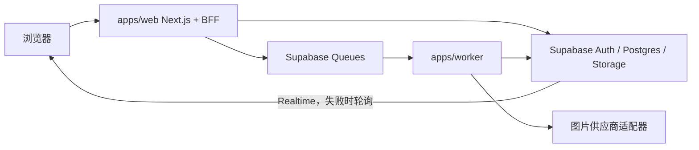

# Zima 产品需求与技术约束

> 文档版本：1.2
>
> 状态：重大修订后待复审
>
> 最后更新：2026-08-17
>
> 产品真相源：本文件

## 1. 文档目的

本文定义 Zima Phase 1 的产品范围、业务规则、内部接口边界、技术约束、验收方法和后续路线。设计、开发、测试与 AI Agent 必须以本文件为产品和验收真相源；任何未写入本文的功能不得被默认纳入 Phase 1。

### 1.1 产品定位

Zima 是面向中国大陆电商设计师的 AI 商品图生产工作台。用户用自然语言、明确选择的图片工具或官方 Skill 发起任务，系统自动执行图片处理工作流，并在项目中保存输入、步骤、输出、派生关系和积分记录。

Zima 不是通用聊天机器人，也不是自由画布式图片编辑器。Phase 1 的文本对话只服务于项目内的电商视觉咨询、澄清、提示词解释和执行计划，不扩展为跨项目通用助手；核心目标仍是验证“用户能否稳定得到可下载、可继续加工的商品图”。

### 1.2 LobeHub 研究范围与使用边界

本需求基于对 LobeHub 仓库以下纵向链路的只读研究：

- 首页的启动入口、最近内容与响应式结构；
- `/image` 页面、生成主题、批次流、参考图上传、模型参数、逐图状态和结果复用；
- 内置图片 Tool 的 manifest、system role、执行 runtime 和 Tool 启用条件；
- 图片任务创建、异步处理、对象存储、逐图结算与失败对账；
- Skill 浏览、版本、安装/选择语义及社区精选内容；
- 账户、权限、工作区和商业计费的边界。

主要研究位置包括：

- `C:\Users\yao.zhao\workspace\lobehub-canary\src\routes\(main)\(create)\image`
- `C:\Users\yao.zhao\workspace\lobehub-canary\packages\builtin-tool-image-generation`
- `C:\Users\yao.zhao\workspace\lobehub-canary\apps\server\src\routers\async\image.ts`
- `C:\Users\yao.zhao\workspace\lobehub-canary\packages\database\src\schemas\generation.ts`
- `C:\Users\yao.zhao\workspace\lobehub-canary\src\features\Home`
- `C:\Users\yao.zhao\workspace\lobehub-canary\src\routes\(main)\community`

LobeHub 使用 [LobeHub Community License](C:/Users/yao.zhao/workspace/lobehub-canary/LICENSE)，商业衍生发行需要取得许可。Zima 必须独立实现，不得复制 LobeHub 代码、数据库结构、视觉资产或专有商业占位实现。研究结果只用于理解产品行为、风险与验收模式。

### 1.3 业务目标

| ID | 目标 | Phase 1 衡量方式 |
| --- | --- | --- |
| OBJ-001 | 降低商品图处理的启动成本 | 用户可从首页直接上传素材并发起任务 |
| OBJ-002 | 形成可持续迭代的图片生产记录 | 每次输出都可追溯到项目、任务、步骤和输入资产 |
| OBJ-003 | 在隐藏模型复杂度的同时控制成本 | 用户只看到业务工具和统一积分，平台保留可审计账本 |
| OBJ-004 | 验证商品图结果是否真实可用 | 完成任务中至少 60% 有结果被下载或标记“有用” |

### 1.4 Phase 1 非目标

- 多 Agent、用户自建 Agent 或 Agent 团队；
- 多 SKU、CSV 批处理、批量命名或 ZIP 导出；
- 自由画布、图层、蒙版笔刷和像素级手动编辑；
- 用户选择供应商、模型或提交自有 API Key；
- 用户创建或执行任意代码型 Skill；
- 用户发布案例、评论、评分及社区审核体系；
- 独立运营后台；
- 充值、订阅、支付、发票或退款；
- 团队空间、多人协作和细粒度组织权限；
- Electron、Windows/macOS 原生桌面客户端、iOS/Android 原生应用；
- 图片结果的多模态 Agent 复盘；
- 换脸、身份仿冒、专门面部重塑、裸露或针对特定真人的生成。

### 1.5 目标用户

主要用户是负责淘宝、天猫、京东、抖音或小红书商品视觉的设计师及小型电商团队成员。Phase 1 仅交付响应式浏览器 Web：Web 宽屏布局提供完整创作能力；宽度 375px 的移动 Web 只要求安全登录、浏览项目、预览结果和下载图片，不要求完整生产效率。

### 1.6 成功与进入 Phase 2 的门槛

必须同时满足以下条件，才可将 Phase 1 判定为完成验证：

1. 至少 30 名受邀用户各创建过一个非主动取消的已受理图片任务；
2. 15 分钟技术收敛率不低于 95%；
3. 非主动取消终态任务的任务成功率不低于 90%；
4. 成功任务的明确有用率不低于 60%；
5. 不存在未关闭的 Critical 安全、跨账户访问、丢单或重复扣款缺陷。

指标定义：

- **有效用户**：至少创建一个非主动取消、已被服务端受理的图片任务的受邀用户；
- **15 分钟技术收敛率**：受理后 15 分钟内进入 `partially_succeeded`、`succeeded` 或 `failed` 的任务数 / 非用户主动取消的已受理任务数；进入 `reconciling` 的任务在 15 分钟指标中计为未收敛；
- **任务成功率**：至少有一个成功输出的 `partially_succeeded` 或 `succeeded` 任务数 / 非用户主动取消且已进入终态的任务数；
- **明确有用任务**：成功任务至少有一个输出被用户明确标记为“有用”；
- **明确有用率**：明确有用任务数 / 至少有一个成功输出的任务数；
- **下载率**：成功输出被下载的比例，只作为行为观察指标，不替代明确有用反馈；
- **重大主体破坏**：商品主体被截断、关键结构或品牌识别元素被错误增删、透明边缘出现明显缺失，或商品身份被改变到无法用于原目标商品的结果。

所有指标按同一已冻结版本的事件定义计算，并同时报告分子、分母、排除项和 95% 置信区间；分母为 0 时指标记为“无数据”，不得按 100% 处理。

## 2. 术语与统一命名

| 术语 | 定义 |
| --- | --- |
| 项目（Project） | 同一商品或视觉目标的长期容器，归组素材、任务和结果 |
| 项目会话（Conversation） | 每个项目唯一的文本咨询上下文容器，不得跨项目读取或拼接消息 |
| Agent 回合（Agent Turn） | 用户一次提交及其最多一次文本模型调用、回复、usage 和计费事实 |
| 计费单元（Billable Unit） | 拥有独立预扣句柄的图片输出或文本 Agent 回合 |
| 资产（Asset） | 用户上传的主商品图、参考图或系统生成的结果图片 |
| 任务（Task） | 一次用户意图对应的完整执行单元 |
| 步骤（Task Step） | 任务中一次具体能力调用，最多 3 个 |
| 输出（Task Output） | 某一步骤生成的一张可独立成功或失败的图片，单任务最多 8 个计费输出 |
| 尝试（Task Attempt） | 某一步骤对供应商的一次提交及查询事实；自动重试产生新 Attempt，但不产生新的用户任务或重复预扣 |
| 对账中（Reconciling） | 供应商提交结果未知且不能安全重投时的非终态；后台继续查询，最长 24 小时 |
| 图片工具（Tool） | 可被 Agent 调用的原子图片能力 |
| Skill | 官方发布的版本化声明式工作流，不包含可执行代码 |
| 安装 Skill | 将 Skill 加入用户可用列表，不代表本次请求自动使用 |
| 选择 Skill | 用户在本次输入中明确指定一个 Skill 版本 |
| 统一积分 | Zima 对用户展示的成本单位，与供应商和模型标识解耦 |
| 能力价表版本（Price Book Version） | 同时定义图片输出价格与文本输入/输出 token 价格的不可变版本 |
| 预扣（Reserve） | 图片任务创建或文本模型调用前暂时冻结的积分上限 |
| 结算（Capture） | 图片输出成功，或文本调用产生可信 usage 后，从预扣中正式扣除的积分 |
| 释放（Release） | 图片输出失败/取消、文本调用没有可信 usage，或实际积分低于预扣时返还的积分 |
| 能力路由 | 服务端按能力、优先级、成本和健康状态选择供应商实现 |

## 3. Phase 1 产品范围

### 3.1 信息架构与路由

| 区域 | 建议路由 | 登录要求 | 内容 |
| --- | --- | --- | --- |
| 首页 | `/` | 否 | 产品说明、任务输入、四个快捷工具、最近任务占位、精选案例 |
| Skill 列表 | `/skills` | 否 | 官方 Skill 搜索、分类与详情入口 |
| Skill 详情 | `/skills/[slug]` | 否 | 版本说明、输入要求、步骤摘要、预期输出 |
| 精选案例 | `/community` | 否 | 管理员策展的只读案例 |
| 案例详情 | `/community/[slug]` | 否 | 输入/结果、步骤摘要及“用同款 Skill 创建” |
| 登录 | `/auth` | 否 | 一次性邀请码、邮箱 OTP、会话建立 |
| 项目列表 | `/projects` | 是 | 最近项目、状态、搜索、软删除与恢复入口 |
| 项目工作台 | `/projects/[projectId]` | 是 | 项目资产、任务流、Agent 输入和结果操作 |
| 积分记录 | `/settings/credits` | 是 | 余额、发放、预扣、结算和释放记录 |
| 账户设置 | `/settings/account` | 是 | 邮箱、会话退出和数据删除说明 |

Zima 不另设与首页竞争的通用 `/image` 入口。LobeHub `/image` 的核心行为被吸收到首页启动流程和项目工作台中。

### 3.2 主流程

1. 匿名用户可浏览首页、Skill 和精选案例。
2. 用户输入提示词，或明确选择快捷工具/Skill，并可添加一张主商品图与最多三张参考图。
3. 匿名用户点击执行时，系统将未上传二进制文件以外的草稿保存在本地，要求邀请码与邮箱 OTP；登录成功后恢复草稿，由用户再次提交。
4. 同一创作输入由服务端确定性门控自动分流：明确 Tool、明确 Skill 或明确图片生成/编辑意图进入图片分支；其余电商视觉咨询进入项目内文本分支；模糊图片意图先澄清。
5. 文本分支在项目内创建 Agent 回合，按冻结价表预扣 token 积分，最多调用一次活动文本模型，按可信 usage 结算并保存消息；没有项目时自动创建项目。
6. 图片分支生成并校验结构化执行计划，报价、冻结图片积分、创建项目/任务并入队。
7. Worker 逐步骤、逐输出执行。工作台实时展示状态，断线后轮询恢复。
8. 用户预览、下载、反馈或从某个成功输出继续创建派生任务。

## 4. 功能需求

### 4.1 邀请与认证

| ID | 优先级 | 要求 | 验收方法 |
| --- | --- | --- | --- |
| AUTH-001 | P0 | Phase 1 使用一次性邀请码控制准入；邀请码包含状态、过期时间、初始积分和可选备注 | API/数据库集成测试 |
| AUTH-002 | P0 | 邀请码核销、绑定邮箱账户、创建积分账户和发放初始积分必须在同一数据库事务中完成 | 事务回滚与并发核销测试 |
| AUTH-003 | P0 | OTP 发送或验证失败不得消耗邀请码；同一核销幂等键重试不得重复开户或发放积分 | 故障注入与幂等测试 |
| AUTH-004 | P0 | Supabase Auth 负责邮箱 OTP 和会话；正式内测使用阿里云邮件推送自定义 SMTP | 配置审查与真实邮箱送达测试 |
| AUTH-005 | P0 | 未登录用户可以浏览公开内容，但不得上传到永久存储、创建任务、启用 Skill 或读取任何私有数据 | E2E 与 RLS 测试 |
| AUTH-006 | P0 | 登录成功后只恢复本地文本、选择和引用元数据；用户必须再次提交后才执行或扣积分 | E2E 测试 |
| AUTH-007 | P0 | 邀请码不得以明文持久化；服务端保存不可逆摘要，并对验证请求按 IP、邮箱和邀请码摘要限流 | 数据审查、枚举与限流测试 |
| AUTH-008 | P0 | 没有有效邀请码的邮箱即使产生了 Supabase Auth 记录，也不得建立可用 profile、积分账户或读取私有应用数据 | Auth/RLS 集成测试 |
| AUTH-009 | P0 | 发送 OTP 前创建 10 分钟邀请码预约，绑定邀请码摘要、规范化邮箱、随机 challenge 和过期时间；预约不消耗邀请码、不开户、不发积分 | 并发预约与过期释放测试 |
| AUTH-010 | P0 | 同一邀请码同时只能有一个有效预约；同一邮箱/challenge 的重复请求返回原预约结果，过期或 OTP 失败后预约可安全释放 | 唯一约束与幂等测试 |
| AUTH-011 | P0 | OTP 成功后，服务端以已验证的 `auth.uid()`、规范化邮箱和 challenge 在一个数据库事务中核销预约与邀请码、创建 profile/积分账户并发放积分；任一步失败必须整体回滚 | 事务、身份绑定与故障注入测试 |

### 4.2 首页与导航

| ID | 优先级 | 要求 | 验收方法 |
| --- | --- | --- | --- |
| HOME-001 | P0 | 首页首屏必须提供自然语言输入、主商品图入口、参考图入口、Skill 选择和四个快捷工具 | UI/E2E 测试 |
| HOME-002 | P0 | 四个快捷工具为智能抠图、换背景、扩图/改尺寸、高清放大；通用商品图生成通过明确文本意图进入 | UI 与门控测试 |
| HOME-003 | P0 | 登录用户下方展示最近项目；匿名用户展示产品说明和精选案例，不伪造用户历史 | 状态组合测试 |
| HOME-004 | P1 | 首页、工作台、Skill 和社区使用统一导航，当前区域和返回目标明确 | 键盘与导航测试 |

### 4.3 项目与资产

| ID | 优先级 | 要求 | 验收方法 |
| --- | --- | --- | --- |
| PROJ-001 | P0 | 未指定项目的首次图片任务或文本 Agent 回合自动创建项目；默认标题由提示词生成，失败时退化为日期标题 | 服务集成测试 |
| PROJ-002 | P0 | 项目可改名、查询、按最近更新时间排序、软删除及在 7 天内恢复 | CRUD/RLS/E2E 测试 |
| PROJ-003 | P0 | 软删除项目后立即对普通项目列表隐藏并停止新任务；7 天后清理私有对象和业务引用 | 定时清理与恢复测试 |
| ASSET-001 | P0 | 单任务最多一张主商品图和三张参考图；每张参考图必须显式标注为风格、场景或构图参考 | 客户端与服务端校验测试 |
| ASSET-002 | P0 | 支持 JPEG、PNG、WebP；单文件最大 20 MiB。系统必须验证真实媒体类型、可解码性和能力级尺寸约束 | 上传安全测试 |
| ASSET-003 | P0 | 原始上传、生成输出和缩略图均为独立资产；每个派生资产记录父资产和产生它的任务输出 | 数据完整性测试 |
| ASSET-004 | P0 | 所有用户资产默认私有；下载与预览使用短时签名 URL，数据库不得持久化过期签名 URL | Storage/RLS 测试 |
| ASSET-005 | P1 | 透明抠图默认导出 PNG；其他能力默认高质量 JPG，可选 PNG | 端到端格式检查 |
| ASSET-006 | P1 | 单个输出删除进入 7 天回收期并立即从普通视图隐藏；到期后删除图片对象和业务引用，但保留去标识账本与安全审计 | 输出恢复与清理测试 |

### 4.4 Agent 文本边界

| ID | 优先级 | 要求 | 验收方法 |
| --- | --- | --- | --- |
| AGENT-001 | P0 | Phase 1 只有一个电商视觉 Agent，不允许用户创建或切换 Agent | UI/API 测试 |
| AGENT-002 | P0 | Agent 可做项目内商品图需求澄清、视觉方向建议和提示词解释；Phase 1 不读取图片像素做结果复盘 | 对话评测集与能力负向测试 |
| AGENT-003 | P0 | 明显无关问题必须由确定性策略简短拒绝并引导回电商视觉任务，不调用文本模型或图片 Tool，也不扣积分 | 对话、账本与 Tool trace 评测 |
| AGENT-004 | P0 | Agent 产出的执行计划必须是结构化数据，并通过服务端 schema、权限、能力、成本和上限校验 | 单元与对抗测试 |
| AGENT-005 | P0 | Agent 不得直接决定供应商、模型、积分扣款或绕过服务端策略 | Tool trace 与接口测试 |
| AGENT-006 | P0 | 文本能力通过供应商中立 `TextModelAdapter` 调用；Phase 1 后台只允许一个活动的 provider/model/API Key 配置，前台始终隐藏供应商与模型 | 配置、API 与密钥扫描测试 |
| AGENT-007 | P0 | 管理员切换文本模型配置必须写审计且只影响新请求；活动模型失败时保留输入并返回可重试提示或退化为明确工具表单，不得静默换模型 | 配置切换与降级 E2E |
| AGENT-008 | P0 | 文本咨询、澄清和计划生成只要调用大模型就必须在调用前预扣，并按可信 input/output token usage 结算；成功、失败或中断均遵循同一规则，同时记录去标识 usage、延迟、错误和平台内部成本 | 文本计费、故障注入与指标检查 |
| AGENT-009 | P0 | 首页和项目工作台使用同一创作输入；服务端先执行确定性 Tool 门控，图片分支复用图片任务服务，未触发图片且属于电商视觉范围时进入文本分支；一次用户提交最多调用一次文本模型 | 自动分流、调用次数与接口契约测试 |
| AGENT-010 | P0 | 每个项目只有一个文本会话；消息、回合状态、usage 和计费关联持久化且只在本项目可见；模型上下文按冻结 token 预算从最近消息截取，不跨项目拼接，也不调用隐藏的模型摘要 | 会话隔离、上下文预算、RLS 与删除测试 |

### 4.5 图片 Tool 门控

允许的业务能力枚举固定为：

```ts
type ImageCapability =
  | 'generate'
  | 'remove_background'
  | 'replace_background'
  | 'outpaint_resize'
  | 'upscale';
```

| ID | 优先级 | 要求 | 验收方法 |
| --- | --- | --- | --- |
| TOOL-001 | P0 | 只有三种条件可以启用图片 Tool：明确选择工具；本次明确选择的 Skill 要求该能力；提示词明确要求图片生成/编辑 | 门控决策表测试 |
| TOOL-002 | P0 | 仅上传图片、询问设计建议、模糊表达或仅安装未选择的 Skill 不得启用图片 Tool | 负向门控测试 |
| TOOL-003 | P0 | 满足门控并通过服务端校验后自动执行，不弹二次确认；执行卡片展示步骤和预计积分 | E2E 测试 |
| TOOL-004 | P0 | 单任务最多 3 个 Tool 步骤、8 个计费输出；任一上限超出时不得拆成隐藏子任务绕过 | schema 与对抗测试 |
| TOOL-005 | P0 | 预计积分不得超过可用余额；余额不足时不入队、不冻结积分，并保留用户输入 | 事务与 E2E 测试 |
| TOOL-006 | P0 | 人物商品图只允许常规抠图、背景、扩图和放大；高风险人物意图必须在入队前拒绝 | 安全评测集 |
| TOOL-007 | P0 | `selectedTool` 与 `selectedSkillVersionId` 互斥且一次最多选择一个；提示词可作为补充参数，但不得同时形成第二条隐藏执行来源 | schema、UI 与对抗测试 |
| TOOL-008 | P0 | 非透明主图执行 `replace_background` 时，计划必须显式包含 `remove_background` 和 `replace_background` 两个可见、可计费步骤；前置抠图产生 1 个计费中间输出并计入 8 输出上限，因此该路径最多请求 7 个换背景结果；合格透明 RGBA 主图可省略前置抠图 | 计划、报价、上限与派生关系测试 |

门控基准矩阵：

| 输入 | 是否执行 | 原因 |
| --- | --- | --- |
| 选择“智能抠图”并上传商品图 | 是 | 明确选择工具 |
| 选择“白底商品图”Skill 并提供主图 | 是 | 本次选择的 Skill 明确要求能力 |
| “把这双鞋放进浅灰影棚背景”并上传主图 | 是 | 明确编辑意图 |
| 仅上传一张鞋图 | 否 | 没有执行意图 |
| “这张图的构图怎么样？” | 否 | 设计咨询，不是编辑请求 |
| 已安装“白底商品图”Skill，但本次未选择 | 否 | 安装不等于授权执行 |
| “帮我处理得更好看” | 否 | 意图和结果不可验证，先澄清 |

### 4.6 图片能力

| ID | 优先级 | 要求 | 验收方法 |
| --- | --- | --- | --- |
| IMG-001 | P0 | `remove_background` 输出透明背景图片，保留主体完整边缘；失败时保留输入资产 | 代表性商品集视觉验收 |
| IMG-002 | P0 | `replace_background` 支持文本背景描述和最多三张参考图，不得把参考图误当主商品 | 集成与人工视觉验收 |
| IMG-003 | P0 | `outpaint_resize` 支持 1:1、3:4、4:5、16:9 及供应商能力 schema 允许的自定义尺寸 | 参数化集成测试 |
| IMG-004 | P0 | `upscale` 支持 2×、4×；若供应商不支持某倍率，必须在入队前返回能力错误 | 能力发现与集成测试 |
| IMG-005 | P0 | `generate` 支持中文或英文商品图提示词，输出数量计入 8 张总上限 | 中英文端到端测试 |
| IMG-006 | P0 | 每个结果可预览、下载、删除、标记有用/无用，或作为新任务主图继续加工 | E2E 测试 |
| IMG-007 | P0 | 删除或重试单个失败输出不得删除、重算或重新收费其他成功输出 | 部分成功回归测试 |
| IMG-008 | P0 | 发布前维护至少 60 组已授权商品素材，覆盖服饰、鞋包、美妆、家居和小商品等主要类别；每项能力至少有 20 个适用样例，同一素材可覆盖多个能力 | 数据集清单与授权审查 |
| IMG-009 | P0 | 基准集必须检查文件可解码、格式、透明通道、尺寸/比例、输出数量和派生关系，所有硬检查总体通过率不低于 95% | 自动基准测试报告 |
| IMG-010 | P0 | 每个基准结果由至少两名设计师独立进行 1～5 分盲评；每项能力平均分不低于 4.0，且重大主体破坏为零；评分分歧超过 2 分时由第三人复核 | 盲评记录与复核报告 |

### 4.7 Skill

```ts
type JsonSchema = {
  type: 'object';
  additionalProperties: false;
  properties: Readonly<Record<string, JsonSchemaProperty>>;
  required: string[];
};

type JsonSchemaProperty =
  | { type: 'string'; enum?: string[]; maxLength?: number; minLength?: number }
  | { type: 'integer'; maximum?: number; minimum?: number }
  | { type: 'boolean' }
  | { type: 'array'; items: { type: 'string' }; maxItems?: number };

type SkillParameterValue = string | number | boolean | string[];

interface SkillStep {
  capability: ImageCapability;
  inputBindings: string[];
  parameters: Readonly<Record<string, SkillParameterValue>>;
  outputCount: number;
}

interface SkillOutputContract {
  minOutputs: number;
  maxOutputs: number;
  allowedFormats: Array<'jpeg' | 'png' | 'webp'>;
  requiresTransparency?: boolean;
}

interface SkillVersion {
  id: string;
  skillId: string;
  version: number;
  inputSchema: JsonSchema;
  allowedCapabilities: ImageCapability[];
  requiredCapabilities: ImageCapability[];
  steps: SkillStep[];
  outputContract: SkillOutputContract;
  status: 'draft' | 'published' | 'retired';
}
```

| ID | 优先级 | 要求 | 验收方法 |
| --- | --- | --- | --- |
| SKILL-001 | P0 | Phase 1 只允许管理员发布官方声明式 Skill，不得包含脚本、网络调用、SQL 或任意代码 | schema 与安全测试 |
| SKILL-002 | P0 | Skill 支持版本化发布；任务必须保存执行时的具体版本 ID，后续更新不得改变历史任务 | 数据与回归测试 |
| SKILL-003 | P0 | 用户可浏览、搜索、分类、启用/停用 Skill；只有本次明确选择的 Skill 可影响执行计划 | E2E 与门控测试 |
| SKILL-004 | P0 | 发布前校验步骤数、输出数、输入 schema、允许/必需能力和提示词占位变量 | 管理数据校验测试 |
| SKILL-005 | P1 | 已退休版本不可用于新任务，但历史任务仍可展示版本摘要 | 状态迁移测试 |

建议首批官方 Skill：白底商品图、影棚场景主图、多平台尺寸套图、商品图高清增强。每个 Skill 仍受 3 步/8 输出硬上限约束。

### 4.8 精选社区

| ID | 优先级 | 要求 | 验收方法 |
| --- | --- | --- | --- |
| COMM-001 | P0 | 社区只展示管理员策展且已发布的案例，不接受用户投稿 | RLS/UI 测试 |
| COMM-002 | P0 | 案例详情展示输入说明、结果、步骤摘要、关联 Skill 和版本，不展示供应商/模型 | 内容快照测试 |
| COMM-003 | P0 | “用同款 Skill 创建”只预选 Skill 并带入公开参数，不得自动执行；匿名用户执行时进入登录流程 | E2E 测试 |
| COMM-004 | P0 | 案例只能引用已获授权的展示资产，不能直接公开普通用户私有项目图片 | 数据约束与审核检查 |

### 4.9 任务、状态与积分

任务状态：

```ts
type TaskStatus =
  | 'queued'
  | 'running'
  | 'reconciling'
  | 'partially_succeeded'
  | 'succeeded'
  | 'failed'
  | 'cancelled';

type TaskStepStatus = 'queued' | 'running' | 'reconciling' | 'succeeded' | 'failed' | 'skipped';
type TaskOutputStatus =
  | 'pending'
  | 'processing'
  | 'reconciling'
  | 'succeeded'
  | 'failed'
  | 'deleted';

type NormalizedProviderErrorCode =
  | 'invalid_input'
  | 'policy_rejected'
  | 'rate_limited'
  | 'timeout'
  | 'unavailable'
  | 'unknown';

type TaskAttemptStatus =
  | 'created'
  | 'submitted'
  | 'polling'
  | 'reconciling'
  | 'succeeded'
  | 'failed';

interface TaskAttempt {
  id: string;
  taskStepId: string;
  attemptNumber: number;
  status: TaskAttemptStatus;
  providerRouteVersionId: string;
  providerSubmissionId?: string;
  submittedAt?: string;
  nextPollAt?: string;
  experienceDeadlineAt: string;
  reconciliationDeadlineAt: string;
  normalizedErrorCode?: NormalizedProviderErrorCode;
}
```

状态规则：

- `queued` 可取消并全额释放预扣；
- `running` 在 Phase 1 不承诺供应商侧取消，用户可离开页面但任务继续；
- 受理后 15 分钟仍无法确认成功或失败的任务进入非终态 `reconciling`，保留预扣并禁止直接重投；
- `reconciling` 最长持续到受理后 24 小时。确认成功时正常结算，确认失败时释放；到期仍未知则标记失败并释放，后续供应商迟到成本由平台承担且不得改写终态或补扣用户；
- 所有输出成功为 `succeeded`；
- 至少一个输出成功且至少一个失败为 `partially_succeeded`；
- 没有任何输出成功为 `failed`；
- 瞬时故障的自动重试在原步骤下创建新 `TaskAttempt`，沿用原任务报价和预扣；
- 用户对失败输出发起重试时创建新的关联子任务、幂等键、报价和预扣，并通过 `retryOfOutputId` 指向原输出；
- 终态不可被普通重试、轮询结果或迟到供应商结果覆盖。

| ID | 优先级 | 要求 | 验收方法 |
| --- | --- | --- | --- |
| TASK-001 | P0 | 创建任务必须使用客户端生成的幂等键；同一用户、同一键、同一请求只能创建一个任务 | 并发与重放测试 |
| TASK-002 | P0 | 报价、余额校验、积分预扣、项目/任务记录和入队动作必须形成可恢复的一致性边界 | 事务与故障注入测试 |
| TASK-003 | P0 | Supabase Queue 消息只包含任务 ID 和必要版本号，不包含图片 URL、提示词、邮箱或密钥 | 队列内容审计 |
| TASK-004 | P0 | Worker 必须使用可见性窗口、条件状态更新和幂等执行令牌，防止并发消费重复调用或扣款 | worker 重投测试 |
| TASK-005 | P0 | 参数、鉴权和审核错误不得自动重试；限流、网络、超时和临时不可用最多自动尝试 3 次 | 错误分类测试 |
| TASK-006 | P0 | 供应商结果未知时先查询/对账，不能直接重新提交可能已成功的任务 | 超时与未知状态测试 |
| TASK-007 | P0 | 前端优先通过 Realtime 接收状态；断线或订阅失败时指数退避轮询，终态后停止 | 网络恢复 E2E 测试 |
| TASK-008 | P0 | 用户可只重试失败输出；新执行引用原任务和输出，不修改原始审计事实 | 部分失败测试 |
| TASK-009 | P0 | 重试失败输出时使用新幂等键重新报价和预扣；原失败输出的预扣必须先释放，且重试不得沿用已结算成功输出的预扣 | 重试账本测试 |
| TASK-010 | P0 | 每次供应商提交和自动重试必须创建唯一 `TaskAttempt`；已记录 `providerSubmissionId` 的未知结果先轮询对账，不得创建替代提交 | Attempt 唯一约束与未知状态测试 |
| TASK-011 | P0 | 每用户同时最多一个 `running` 或 `reconciling` 任务；不设置每日输出或用户排队数量上限，所有排队任务仍必须全额预扣 | 并发受理与余额测试 |
| TASK-012 | P0 | 全局排队任务达到 100 时，新请求不得入队或保留预扣；服务端返回可重试的 `queue_capacity_reached` 并保留草稿 | 容量与事务回滚测试 |
| TASK-013 | P0 | Phase 1 供应商结果获取以轮询为必需契约，不要求供应商回调；将来接入回调时必须复用同一状态条件与幂等键 | 轮询重放测试与接口审查 |

积分账本事件固定为：

```ts
type CreditLedgerKind = 'grant' | 'reserve' | 'capture' | 'release' | 'adjustment';
```

| ID | 优先级 | 要求 | 验收方法 |
| --- | --- | --- | --- |
| CREDIT-001 | P0 | 积分使用整数存储；账本只追加不更新，余额由受约束的账户汇总维护 | 数据约束测试 |
| CREDIT-002 | P0 | 前台只显示统一积分、预计消耗、实际消耗和余额，不显示供应商、模型或原始美元成本 | UI/API 契约测试 |
| CREDIT-003 | P0 | 每个计费单元拥有独立预扣句柄：图片输出成功时 `capture`、失败/取消时 `release`；文本回合按可信 usage `capture`，没有可信 usage 时 `release`；实际较低时均释放差额 | 图片输出与文本回合账本测试 |
| CREDIT-004 | P0 | 任一图片任务或文本回合的实际结算不得超过调用前展示并冻结的积分；供应商成本或 usage 超出预扣上限的差额由平台承担并告警 | 图片价格漂移与文本 usage 超限测试 |
| CREDIT-005 | P0 | 任一业务事件的账本写入必须带唯一幂等键；消息重投、轮询结果重复、可选回调重复和人工重放不得产生第二笔扣款 | 并发与重放测试 |
| CREDIT-006 | P0 | Phase 1 只有邀请码发放和管理员调整，不存在充值、套餐或支付入口 | UI/API 负向测试 |
| CREDIT-007 | P0 | 用户价格来自不可变 `PriceBookVersion`：图片按能力、成功输出数和必要分辨率档查价，文本按用途及每百万 input/output token 的整数积分查价；任务和 Agent 回合保存报价时的价表版本 | 价表版本与历史重放测试 |
| CREDIT-008 | P0 | 每个邀请码初始积分约等于 50 个“标准单步、单张输出”的基准价值；具体整数必须由已核验供应商成本和首版价表决定，未批准前不得伪造默认值 | 邀请额度与配置检查 |
| CREDIT-009 | P0 | 新价表只影响新任务；任务报价按输出逐项向上取整，自动 Attempt 不重复报价，用户发起的失败输出重试按当时活动价表重新报价 | 取整、版本切换与重试测试 |
| CREDIT-010 | P0 | 文本回合预扣使用完整组装上下文的估算输入 token 与冻结的最大输出 token；可信 usage 按 input/output 分项向上取整结算，失败或中断有 usage 仍结算、无 usage 全额释放；余额不足时不得调用模型并保留输入，同一幂等键不得产生第二次模型调用或扣款 | 文本预扣、usage、余额、失败和幂等测试 |

LobeHub 的公开代码以 `1 USD = 1,000,000 Credits` 计算模型成本，并按图片数量、定价参数或 token usage 归一成本；公开套餐按月提供额度。Zima 仅将此作为 usage 计量与预扣/结算模式的研究基准，不复制其套餐、倍率或未公开商业实现。LobeHub 公共仓库中的商业文本计费 hook 是空占位，不能作为 Zima 的实现依据。

Phase 1 不把 Zima 积分固定映射为美元或人民币，也不向用户展示供应商成本。首个 `PriceBookVersion` 与邀请码具体整数属于 EXT-005；其批准不改变上述账本、版本冻结和“不超过报价”不变量。

## 5. 内部接口与数据边界

### 5.1 创建任务接口

Phase 1 不提供第三方公共 API。浏览器只调用受会话保护的内部 BFF。创建任务的规范化请求至少包含：

```ts
type AspectRatioPreset = '1:1' | '3:4' | '4:5' | '16:9';
type OutputFormat = 'jpeg' | 'png';

interface ReferenceAssetInput {
  assetId: string;
  role: 'style' | 'scene' | 'composition';
}

type CreateTaskParameters =
  | {
      kind: 'generate';
      aspectRatio?: AspectRatioPreset;
      customSize?: { height: number; width: number };
      outputFormat?: OutputFormat;
    }
  | { kind: 'remove_background'; outputFormat: 'png' }
  | {
      kind: 'replace_background';
      backgroundPrompt: string;
      outputFormat?: OutputFormat;
    }
  | {
      kind: 'outpaint_resize';
      aspectRatio?: AspectRatioPreset;
      customSize?: { height: number; width: number };
      outputFormat?: OutputFormat;
    }
  | { kind: 'upscale'; factor: 2 | 4; outputFormat?: OutputFormat }
  | {
      kind: 'skill';
      values: Readonly<Record<string, SkillParameterValue>>;
    }
  | {
      kind: 'prompt';
      aspectRatio?: AspectRatioPreset;
      customSize?: { height: number; width: number };
      outputFormat?: OutputFormat;
    };

interface CreateTaskRequest {
  idempotencyKey: string;
  projectId?: string;
  prompt: string;
  selectedTool?: ImageCapability;
  selectedSkillVersionId?: string;
  primaryAssetId?: string;
  referenceAssets: ReferenceAssetInput[];
  parameters: CreateTaskParameters;
  requestedOutputCount: number;
}

interface QueuedTaskResponse {
  outcome: 'queued';
  projectId: string;
  taskId: string;
  status: 'queued';
  estimatedCredits: number;
  reservedCredits: number;
  executionPlanVersion: 1;
}

interface ClarificationRequiredResponse {
  outcome: 'clarification_required';
  clarificationCode: 'ambiguous_image_intent' | 'missing_primary_asset' | 'missing_skill_input';
  message: string;
  preservedDraftId: string;
}

interface RejectedTaskResponse {
  outcome: 'rejected';
  errorCode:
    | 'invalid_input'
    | 'policy_rejected'
    | 'insufficient_credits'
    | 'capability_unavailable'
    | 'active_task_limit_reached'
    | 'queue_capacity_reached';
  message: string;
  preservedDraftId: string;
}

type CreateTaskResponse =
  | QueuedTaskResponse
  | ClarificationRequiredResponse
  | RejectedTaskResponse;

interface AgentRespondRequest extends CreateTaskRequest {
  conversationVersion?: number;
}

interface TextUsage {
  totalInputTokens: number;
  totalOutputTokens: number;
}

type AgentRespondResponse =
  | CreateTaskResponse
  | {
      outcome: 'text_response';
      projectId: string;
      conversationId: string;
      turnId: string;
      text: string;
      reservedCredits: number;
      actualCredits: number;
      usage: TextUsage;
    }
  | {
      outcome: 'text_failed';
      projectId: string;
      turnId: string;
      errorCode: 'model_unavailable' | 'model_timeout' | 'usage_unavailable' | 'internal_error';
      retryable: boolean;
      reservedCredits: number;
      actualCredits: number;
      usage?: TextUsage;
      preservedDraftId: string;
    };
```

请求不得包含供应商 ID、模型 ID、API Key、账本事件或任意 Skill 脚本。服务端必须忽略或拒绝越权字段，而不是透传。

`selectedTool` 与 `selectedSkillVersionId` 必须互斥。`parameters.kind` 必须与明确选择来源一致；若两者都不存在，只允许 `kind: 'prompt'`。服务端只能在提示词具有明确图片生成/编辑意图时生成 `explicit_prompt` 计划；意图模糊时返回 `clarification_required`，不创建任务、不预扣积分。

首页和工作台调用统一的 `POST /api/v1/agent/respond`。服务端先复用同一确定性门控：图片分支调用创建任务应用服务并返回 `CreateTaskResponse`；电商视觉文本分支创建项目内 Agent 回合并返回一次性 JSON，不使用流式响应。没有项目时，文本回合与项目、会话和第一条用户消息在同一业务事务中创建。同一用户和幂等键必须返回已保存结果，不得再次调用模型。明显无关拒绝和不调用模型的确定性澄清不产生预扣。

### 5.2 执行计划

```ts
type NormalizedCapabilityInput =
  | {
      capability: 'generate';
      prompt: string;
      referenceAssetIds: string[];
      aspectRatio?: AspectRatioPreset;
      customSize?: { height: number; width: number };
      outputFormat: OutputFormat;
      outputCount: number;
    }
  | {
      capability: 'remove_background';
      primaryAssetId: string;
      outputFormat: 'png';
      outputCount: 1;
    }
  | {
      capability: 'replace_background';
      transparentPrimaryAssetId: string;
      backgroundPrompt: string;
      referenceAssetIds: string[];
      outputFormat: OutputFormat;
      outputCount: number;
    }
  | {
      capability: 'outpaint_resize';
      primaryAssetId: string;
      aspectRatio?: AspectRatioPreset;
      customSize?: { height: number; width: number };
      outputFormat: OutputFormat;
      outputCount: number;
    }
  | {
      capability: 'upscale';
      primaryAssetId: string;
      factor: 2 | 4;
      outputFormat: OutputFormat;
      outputCount: 1;
    };

interface ExecutionPlanStep {
  id: string;
  input: NormalizedCapabilityInput;
  dependsOnStepIds: string[];
}

interface ExecutionPlan {
  version: 1;
  source: 'explicit_tool' | 'selected_skill' | 'explicit_prompt';
  selectedSkillVersionId?: string;
  steps: ExecutionPlanStep[];
  priceBookVersionId: string;
  providerRouteVersionIds: string[];
  estimatedCredits: number;
}
```

执行计划只能由服务端创建和保存。Worker 读取已经通过策略校验的计划，不重新解释原始自然语言，也不得扩展步骤或输出数。

### 5.3 供应商适配器

```ts
interface ProviderCapability {
  capability: ImageCapability;
  schemaVersion: number;
  supportedMimeTypes: Array<'image/jpeg' | 'image/png' | 'image/webp'>;
  maxInputBytes: number;
  minWidth: number;
  minHeight: number;
  maxWidth: number;
  maxHeight: number;
  supportedAspectRatios: string[];
  supportedUpscaleFactors: Array<2 | 4>;
  maxReferenceImages: number;
  maxOutputs: number;
}

interface ProviderQuote {
  internalCostMinor: number;
  internalCurrency: 'CNY' | 'USD';
  pricingSnapshotId: string;
}

interface ProviderSubmission {
  providerSubmissionId: string;
  status: 'submitted' | 'processing' | 'succeeded';
  completedResult?: ProviderResult;
}

interface ProviderOutput {
  sourceUrl: string;
  mimeType: 'image/jpeg' | 'image/png' | 'image/webp';
  width: number;
  height: number;
}

interface ProviderResult {
  status: 'processing' | 'succeeded' | 'failed' | 'unknown';
  outputs: ProviderOutput[];
  error?: NormalizedProviderError;
}

interface NormalizedProviderError {
  code: NormalizedProviderErrorCode;
  retryable: boolean;
  safeMessage: string;
}

interface ProviderAdapter {
  providerId: string;
  getCapabilities(): Promise<ProviderCapability[]>;
  quote(input: NormalizedCapabilityInput): Promise<ProviderQuote>;
  submit(input: NormalizedCapabilityInput): Promise<ProviderSubmission>;
  getStatus(submissionId: string): Promise<ProviderResult>;
  normalizeError(error: unknown): NormalizedProviderError;
}
```

Phase 1 的唯一生产适配器是阿里云百炼及其所需的阿里云图像服务能力。产品层只依赖能力枚举。能力路由表保存在 Supabase，由受控管理函数维护优先级、启用状态、价格版本和健康状态；浏览器不可读取密钥或内部路由详情。

版本化能力注册表至少保存：业务能力、内部适配器、地域、内部模型/API 引用、输入输出 schema、文件限制、并发/限流、轮询策略、内容安全能力、供应商价格快照、健康状态和验证时间。每个任务必须保存实际使用的路由版本，活动路由变化不得改变历史任务。

首个阿里云映射必须通过真实账号联调确认，不能只凭文档假定：`remove_background` 可能使用独立图像分割服务；`replace_background` 需要透明 RGBA 主图；`outpaint_resize` 与 `upscale` 可由图像编辑能力实现。具体模型 ID、Endpoint 和供应商参数只存在于受限注册表与适配器中。

Phase 1 的 `ProviderAdapter` 以 `submit` + `getStatus` 轮询为必需契约，不要求供应商提供回调。若后续增加回调，它只能作为状态通知优化，并必须经过与轮询相同的幂等、条件更新和结果归一逻辑。

### 5.4 价表与文本模型适配器

```ts
type PriceBookEntry =
  | {
      kind: 'image';
      capability: ImageCapability;
      resolutionTier: 'standard' | 'high' | 'ultra' | 'not_applicable';
      creditsPerOutput: number;
    }
  | {
      kind: 'text';
      purpose: 'consultation' | 'clarification' | 'plan' | 'prompt_explanation';
      inputCreditsPerMillionTokens: number;
      outputCreditsPerMillionTokens: number;
      maxOutputTokens: number;
    };

interface PriceBookVersion {
  id: string;
  version: number;
  status: 'draft' | 'active' | 'retired';
  entries: PriceBookEntry[];
  effectiveAt: string;
}

interface TextModelRequest {
  purpose: 'consultation' | 'clarification' | 'plan' | 'prompt_explanation';
  systemPolicyVersion: string;
  userText: string;
  contextMessages: Array<{
    role: 'user' | 'assistant';
    text: string;
  }>;
  assetMetadata: Array<{
    height: number;
    mimeType: 'image/jpeg' | 'image/png' | 'image/webp';
    role: 'primary' | 'style' | 'scene' | 'composition';
    width: number;
  }>;
}

interface TextModelResult {
  text?: string;
  plan?: ExecutionPlan;
  usage: TextUsage;
  latencyMs: number;
}

interface TextModelAdapter {
  configurationId: string;
  estimateInputTokens(input: Omit<TextModelRequest, 'projectId'> & { projectId?: string }): Promise<number>;
  invoke(input: TextModelRequest): Promise<TextModelResult>;
}
```

任一时刻只能有一个活动文本模型配置；其 provider、model 和 API Key 仅服务端可见。配置切换写入审计并只影响切换后创建的请求。价表与文本模型配置不得由浏览器直接读写。

每个已发布价表版本的 `entries` 不得为空；图片条目的 `(capability, resolutionTier)` 和文本条目的 `purpose` 必须分别唯一。激活新版本与停用旧版本必须由同一受控管理事务完成。历史任务和 Agent 回合只引用不可变版本，不复制活动价表语义。

文本预扣以完整组装后的 `TextModelRequest` 为输入：先调用活动适配器的 token 估算，结合价表的 `maxOutputTokens` 计算整数积分上限。模型返回可信 usage 时，无论调用成功、失败或中断，均按 `ceil(inputTokens × inputRate / 1_000_000) + ceil(outputTokens × outputRate / 1_000_000)` 结算并释放差额；结算最多为预扣上限。没有可信 usage 时全额释放并记录平台成本风险。Phase 1 不做缓存 token 折扣，不暴露供应商 token 单价。

统一错误类别：

- `invalid_input`
- `policy_rejected`
- `insufficient_credits`
- `provider_rate_limited`
- `provider_timeout`
- `provider_unavailable`
- `storage_error`
- `internal_error`

用户错误信息必须可行动，但不得暴露供应商原始响应、内部路由、密钥、堆栈或审核规则细节。

### 5.5 项目会话与文本计费事实

```ts
interface Conversation {
  id: string;
  projectId: string;
  userId: string;
  version: number;
}

interface AgentMessage {
  id: string;
  conversationId: string;
  role: 'user' | 'assistant';
  text: string;
  turnId: string;
  createdAt: string;
}

type AgentTurnStatus = 'reserved' | 'running' | 'succeeded' | 'failed';

interface AgentTurn {
  id: string;
  conversationId: string;
  idempotencyKey: string;
  purpose: 'consultation' | 'clarification' | 'plan' | 'prompt_explanation';
  status: AgentTurnStatus;
  priceBookVersionId: string;
  textModelConfigurationId: string;
  estimatedInputTokens: number;
  maxOutputTokens: number;
  usage?: TextUsage;
  reservedCredits: number;
  actualCredits?: number;
}

type BillableUnit =
  | { kind: 'image_output'; outputId: string }
  | { kind: 'agent_turn'; turnId: string };
```

上下文组装只读取当前项目会话，从最新消息向前装入冻结 token 预算，必须保留当前用户消息和系统策略；超出预算的旧消息直接不带入，不调用模型生成摘要。用户消息先与回合和预扣事实持久化，模型结果再以条件更新完成；服务进程在供应商响应前崩溃且无法取得可信 usage 时，回合失败并释放预扣，同一幂等键不得再次调用模型，用户显式重试必须使用新幂等键。

## 6. 技术架构约束

### 6.1 Monorepo

使用 pnpm workspace 与 Turborepo。目标边界如下：

```text
apps/
  web/          # Next.js App Router、公开页面、工作台、BFF
  worker/       # 常驻 Supabase Queue 消费者
packages/
  ui/           # Tailwind + Radix 封装的设计系统
  domain/       # 领域类型、Zod schema、状态机
  agent/        # Agent、Tool 门控、Skill 计划校验
  supabase/     # 客户端工厂、生成类型、查询边界
  providers/    # 能力接口与供应商适配器
  config/       # lint、TypeScript、环境变量 schema
supabase/
  migrations/
  seed.sql
  tests/
```

路由文件保持薄，只处理路由参数、权限入口和页面组合；领域规则不得放入 React 组件、Route Handler 或 Supabase 客户端调用处。

`apps/web` 是 Phase 1 唯一用户界面交付物；不得新增 Electron、原生桌面或原生移动应用目录。响应式布局不能通过复制两套业务页面实现，Web 宽屏与 375px 移动 Web 必须复用同一领域服务和权限边界。

### 6.2 运行拓扑



- 阿里云 2C4G/40G 服务器以 Docker 运行 `web` 与 `worker`；Worker 默认并发度为 2，必须可配置；
- Supabase Cloud 新加坡承载 Auth、Postgres、私有 Storage、Realtime 和 Queues；
- 不使用 Next.js 请求返回后的悬空 Promise 执行计费任务；
- 不把长图片任务主要放入有墙钟、CPU 和内存限制的 Edge Functions；
- 上线前必须完成中国移动、联通、电信真实网络的上传、下载、OTP 和 Realtime 验证。

### 6.3 建议数据域

具体 SQL 在技术设计阶段确定，但不得偏离以下领域所有权：

| 数据域 | 核心实体 | 所有权/可见性 |
| --- | --- | --- |
| 账户 | profiles、invitation_codes、invitation_reservations、account_deletion_requests | 用户只读本人；邀请码及预约仅受控服务端函数核销 |
| 积分 | credit_accounts、credit_ledger、price_book_versions、price_book_entries | 用户只读本人账本和当前产品价；写入仅受控服务端函数 |
| 项目资产 | projects、assets | 用户仅访问本人；管理员无默认内容浏览权 |
| 项目会话 | conversations、agent_messages、agent_turns | 用户仅访问本人项目内消息；模型配置、usage 原始字段和内部成本使用安全投影隔离 |
| 执行 | tasks、task_steps、task_outputs、task_attempts | 用户只读本人产品状态；供应商提交字段仅 BFF/Worker 可读写 |
| Skill | skills、skill_versions、user_skills | 已发布 Skill 公开读；启用关系仅本人 |
| 社区 | community_cases | 已发布案例公开读；写入仅管理员 |
| 路由 | provider_capability_versions、provider_routes、provider_pricing、text_model_configurations | 浏览器不可读写；管理变更通过受控函数并审计 |
| 反馈审计 | output_feedback、audit_events | 用户创建本人反馈；审计仅服务端写 |

## 7. 安全、隐私与合规

| ID | 优先级 | 要求 | 验收方法 |
| --- | --- | --- | --- |
| SEC-001 | P0 | 每张浏览器可访问的表在开放 Data API 前必须启用 RLS，并有跨用户负向测试 | SQL/RLS 测试 |
| SEC-002 | P0 | 浏览器只使用 Supabase publishable key 和用户会话；legacy anon key 仅允许存量兼容，secret/service-role、百炼密钥、SMTP 凭证只存在于服务端运行环境 | 构建产物、环境变量与密钥扫描 |
| SEC-003 | P0 | 私有 Storage 路径必须带不可伪造的用户所有权关系；签名 URL 短时有效且不写入数据库 | Storage 策略测试 |
| SEC-004 | P0 | 日志不得记录图片二进制、长期图片 URL、完整提示词、OTP、邮箱、邀请码、密钥或供应商原始响应 | 日志快照与扫描 |
| SEC-005 | P0 | 所有管理性数据变更记录操作者、时间、原因和前后版本；不得直接静默改余额 | 审计测试 |
| SEC-006 | P0 | 用户必须确认拥有或获准处理上传素材；上传意图必须记录用户、确认时间和不可变政策版本。普通私有素材不得用于训练、公开案例或人工浏览 | UI、持久化证据与数据流审查 |
| SEC-007 | P0 | 内容安全必须在入队前审核用户意图，并在结果可供预览/下载前执行供应商结果检查或等价安全处理；任一阶段拒绝均不产生最终扣款 | 安全与账本集成测试 |
| SEC-008 | P0 | 正式扩大内测前完成隐私政策、用户协议、ICP/域名要求和跨境数据流评估 | 发布检查清单 |
| SEC-009 | P0 | 管理邀请码、价表、路由、文本模型配置、Skill、案例和账本调整必须经过受控 RPC/服务函数；禁止依赖 Dashboard 直接改表绕过原因、权限或审计 | 权限、函数与审计测试 |
| SEC-010 | P0 | 浏览器访问表必须同时具有显式 Data API schema/table grant 和 RLS；只授予 `anon`/`authenticated` 所需最小操作，视图必须使用 `security_invoker` 或置于未暴露 schema | GRANT、RLS 与视图安全测试 |
| SEC-011 | P0 | 账户删除申请立即禁止新任务和文本模型调用并进入 7 天冷静期；撤销申请可恢复使用，期满先撤销 Auth 会话，再删除图片、缩略图、提示词、Agent 消息、项目和邮箱标识 | 删除、会话与恢复 E2E |
| SEC-012 | P0 | 账户删除后，积分账本和安全审计去标识保留 180 天，脱敏运行日志保留 30 天，之后自动清理；法定保留义务可覆盖默认期限但必须记录依据 | 保留策略与定时清理测试 |

## 8. 非功能需求

### 8.1 性能与容量

| ID | 要求 | 验收方法 |
| --- | --- | --- |
| NFR-PERF-001 | 不含文件上传和供应商执行时间，创建任务 BFF p95 响应时间不超过 3 秒 | 预发布负载测试 |
| NFR-PERF-002 | 从任务状态写入数据库到前端可见的 p95 延迟不超过 5 秒 | Realtime/轮询监测 |
| NFR-PERF-003 | Phase 1 支持至少 100 个排队任务且不丢失消息；Worker 默认同时处理 2 个任务并可配置 | 队列负载与重启测试 |
| NFR-PERF-004 | 缩略图用于列表，原图只在预览或下载时加载，避免项目流一次加载全部原图 | 网络请求审查 |

### 8.2 可靠性与恢复

| ID | 要求 | 验收方法 |
| --- | --- | --- |
| NFR-REL-001 | Web/BFF 月度可用性目标为 99.0%，计划维护和第三方供应商故障单独标注 | 可用性监控 |
| NFR-REL-002 | Phase 1 开发与最多 30 名用户的封闭验证暂不承诺自动每日备份、RPO 或 RTO；扩大内测前必须升级到支持自动每日备份的 Supabase 套餐并完成一次恢复演练 | 阶段门槛与演练记录 |
| NFR-REL-003 | Worker 重启后可继续处理可见消息；不得依赖进程内状态恢复账本或任务真相 | 进程终止测试 |
| NFR-REL-004 | 外部供应商故障必须显示明确状态并保留任务、输入和账本证据 | 故障注入测试 |

### 8.3 可用性、无障碍和国际化

| ID | 要求 | 验收方法 |
| --- | --- | --- |
| NFR-UX-001 | 仅交付响应式浏览器 Web，不开发原生客户端；Web 宽屏布局可完成全部创作，宽度 375px 的移动 Web 可完成登录、查看项目、预览和下载 | 响应式 E2E 与构建范围审查 |
| NFR-UX-002 | 关键导航、输入、工具选择、结果操作和弹窗支持键盘操作及可见焦点 | WCAG 2.1 AA 自动/人工检查 |
| NFR-UX-003 | 简体中文为首发语言；文案通过 i18n key 管理，提示词输入支持中文和英文 | i18n 扫描与 E2E |
| NFR-UX-004 | 异步界面必须区分空、排队、处理中、部分成功、成功、失败和离线恢复状态 | 组件状态快照 |

### 8.4 可观测性

| ID | 要求 | 验收方法 |
| --- | --- | --- |
| NFR-OBS-001 | 记录任务受理、排队时长、供应商时长、成功率、错误类别、重试、积分差异和可用反馈 | 指标检查 |
| NFR-OBS-002 | 日志通过 request/task/step/output ID 关联，但不得依赖用户内容进行关联 | 日志审查 |
| NFR-OBS-003 | 重复扣款、未知供应商状态、死信任务、预扣超过阈值未结算必须触发告警 | 告警演练 |

### 8.5 指标测量口径

- 性能测试从阿里云生产同地域 Web/BFF 发起，预热后至少包含 1,000 次任务受理请求；p95 使用成功和可预期业务拒绝响应计算，不把文件上传与供应商执行时间计入 NFR-PERF-001；
- 状态可见延迟从数据库状态提交时间到浏览器首次显示相同版本状态计算，至少采集 500 次 Realtime/轮询样本并分别报告；
- 月度可用性以 5 分钟探测为基础，计划维护和已确认第三方供应商故障单独报告但不得从原始可用性数据中删除；
- 文本模型调用另行记录受理到响应完成的延迟、可信 input/output usage、预扣、实际积分和失败类别；供应商执行时间不混入任务受理 p95；
- 图片质量、三层成功指标、供应商错误和主动取消必须按能力、价表版本、路由版本和客户端版本分组，避免版本变化掩盖退化；
- 所有阈值均以同一冻结测试窗口判断；样本不足时只能报告趋势，不得宣称达标。

## 9. 验收与测试计划

### 9.1 必测场景

| 测试 ID | 场景 | 关联需求 |
| --- | --- | --- |
| T-AUTH-01 | 两个请求并发核销同一邀请码，只有一个成功且只发一次积分 | AUTH-001～003 |
| T-AUTH-02 | OTP 失败后邀请码仍可使用；成功后重复完成请求不重复开户 | AUTH-002～004 |
| T-AUTH-03 | 同一邀请码并发创建预约时只有一个 10 分钟预约生效；过期释放后可再次预约，OTP 成功后核销/开户/发积分原子完成 | AUTH-009～011 |
| T-AUTH-04 | 正式环境使用自定义 SMTP 完成真实邮箱 OTP；登录后只恢复本地草稿且不会自动执行或扣费 | AUTH-004、AUTH-006 |
| T-AUTH-05 | 数据库不存在邀请码明文，验证限流生效；无有效预约的邀请码邮箱即使存在 Auth user 也不能访问应用私有数据 | AUTH-007～008 |
| T-RLS-01 | 用户 A 无法读取、修改或签名访问用户 B 的项目、资产、任务和账本 | AUTH-005、SEC-001～003 |
| T-DATAAPI-01 | 未显式 GRANT 的表不可从 Data API 访问；已授权表仍受 RLS 所有权限制，视图不绕过 RLS | SEC-001、SEC-010 |
| T-HOME-01 | 匿名与登录首页分别验证输入/素材/Skill/快捷工具、最近项目/精选案例、统一导航、键盘与返回路径 | HOME-001～004 |
| T-PROJECT-01 | 首次图片任务或文本回合自动建项目并验证标题降级；项目改名、排序、软删除、7 天恢复和到期清理形成闭环 | PROJ-001～003 |
| T-ASSET-01 | 主图/参考图数量和角色、真实媒体类型、20 MiB 限制、解码、派生关系、私有路径和短时签名 URL 均受服务端约束 | ASSET-001～004 |
| T-ASSET-02 | 抠图与其他能力的默认格式正确；单输出删除后 7 天内可恢复，到期清理对象而不破坏去标识审计 | ASSET-005～006 |
| T-AGENT-01 | 只展示一个电商视觉 Agent；设计咨询不调用图片 Tool；无关问题由确定性策略拒绝且不调用模型、不扣积分；不存在图片结果复盘入口 | AGENT-001～003 |
| T-AGENT-CHAT-01 | 同一输入分别路由到文本、澄清和图片任务；首次文本回合自动建项目，每项目仅一个会话，跨项目/RLS 隔离有效，token 窗口截断不触发隐藏摘要，一次提交最多一次模型调用 | PROJ-001、AGENT-009～010 |
| T-GATE-01 | 逐项执行 Tool 门控基准矩阵，验证正向与负向 trace | TOOL-001～006 |
| T-PLAN-01 | Agent 试图生成 4 步、9 输出、未知能力或供应商字段时被服务端拒绝 | AGENT-004～005、TOOL-004 |
| T-REPLACE-01 | 非透明主图换背景生成两个显式步骤并分别报价，7 个最终结果通过而 8 个因总输出为 9 被拒绝；透明 RGBA 主图只生成换背景步骤 | TOOL-008、CREDIT-007 |
| T-IMG-01 | 五种图片能力在中文、英文、预设尺寸和允许的自定义尺寸下完成 | IMG-001～005 |
| T-QUALITY-01 | 60 组授权基准集完成硬检查和双设计师盲评，验证每项能力样本数、通过率、平均分和零重大主体破坏 | IMG-008～010 |
| T-RESULT-01 | 输出可预览、下载、反馈、作为新任务输入；Realtime 断线后轮询恢复，终态停止订阅和轮询 | IMG-006、TASK-007 |
| T-PARTIAL-01 | 四个输出中三成功一失败，只结算三项，失败项可独立重试 | IMG-007、TASK-008、CREDIT-003 |
| T-SKILL-01 | 官方声明式 Skill 的创建、校验、发布、搜索、启停、明确选择、版本冻结和退休状态均符合 schema 与门控规则 | SKILL-001～005 |
| T-COMM-01 | 仅策展案例可见，授权资产与 Skill 版本快照正确；“用同款”只预选，匿名用户先登录且不会自动执行 | COMM-001～004 |
| T-IDEMP-01 | 创建请求、队列消息和相同轮询结果各重复三次，仍只有一组任务、一次供应商提交与一次结算 | TASK-001～006、TASK-013、CREDIT-005 |
| T-ATTEMPT-01 | 自动重试创建新 Attempt 但不重复预扣；用户重试失败输出创建关联子任务和新报价 | TASK-008～010、CREDIT-009 |
| T-RECON-01 | 15 分钟未知状态进入对账中且不能重投；24 小时内成功/失败正确结算，届时仍未知则失败释放且迟到结果不改写终态 | TASK-006、TASK-010～013 |
| T-CRASH-01 | Worker 在提交前、提交后未记账、上传后未结算三个位置退出，恢复后无丢单或重复扣款 | TASK-002～006、NFR-REL-003 |
| T-CAPACITY-01 | 单用户第二个活动任务被拒绝；全局 100 个排队任务时新请求不入队、不保留预扣且草稿可恢复 | TASK-011～012 |
| T-PRICE-01 | 图片与文本价表切换只影响新任务/回合，历史事实按冻结版本重放，50 张基准额度未配置时阻止发放生产邀请码 | CREDIT-007～010 |
| T-LEDGER-01 | 账本只追加且余额一致；前台不泄露成本；图片输出与文本回合、取消、价格漂移、管理员调整和 Phase 1 无支付入口均符合约束 | CREDIT-001～006、CREDIT-010 |
| T-TEXT-01 | 后台只有一个活动文本模型，切换只影响新请求；模型失败时保留输入、不静默换模型，并返回稳定失败状态 | AGENT-006～008 |
| T-TEXT-BILLING-01 | 文本调用前按估算输入与最大输出预扣；成功、失败和中断有可信 usage 时按 input/output 分项结算，无 usage 时释放，超上限由平台承担；余额不足和幂等重放均不调用第二次模型 | AGENT-008、CREDIT-003～005、CREDIT-007、CREDIT-009～010 |
| T-PROVIDER-01 | 五种能力均有真实账号验证的版本化路由、输入限制、轮询、价格和错误归一；浏览器看不到内部模型字段 | IMG-001～005、AGENT-005、TASK-013 |
| T-API-01 | 创建任务三种响应分支和五种能力 discriminated union 通过契约测试；越权供应商/模型字段被拒绝且冻结版本完整 | 5.1～5.4 |
| T-POLICY-01 | 高风险人物意图在入队前拒绝；供应商审核拒绝时释放预扣 | TOOL-006、SEC-007 |
| T-DELETE-01 | 项目软删除、7 天内恢复、到期清理对象及保留非图片账本审计 | PROJ-002～003、SEC-005 |
| T-ACCOUNT-DELETE-01 | 账户删除申请立即停止新任务和文本模型调用，7 天内可撤销；到期撤销 Auth 会话并清理 Agent 消息，按 7/30/180 天规则清理或去标识 | SEC-011～012、AGENT-010 |
| T-ADMIN-01 | Dashboard 角色无法直接静默改余额、价表或路由；受控函数要求原因并生成前后版本审计 | SEC-005、SEC-009 |
| T-SECURITY-01 | 构建和日志扫描只允许 publishable key，不含 secret/service-role、敏感内容或长期 URL；素材授权保存用户、确认时间、政策版本及非训练/非公开证据 | SEC-002、SEC-004、SEC-006 |
| T-PERF-01 | 100 个排队任务下验证受理 p95、状态可见 p95、消息无丢失和列表只加载缩略图 | NFR-PERF-001～004 |
| T-NFR-REL-01 | 可用性探测、Worker 强制退出和供应商故障注入分别验证目标、可恢复真相源和可行动失败状态 | NFR-REL-001、NFR-REL-003～004 |
| T-NFR-UX-01 | Web 宽屏、375px 移动 Web、键盘、焦点、i18n 及全部异步/离线状态完成自动与人工可访问性验收；构建不包含原生客户端 | NFR-UX-001～004 |
| T-NFR-OBS-01 | 指标、关联 ID、日志脱敏和四类关键告警通过固定事件与告警演练验证 | NFR-OBS-001～003 |
| T-EXPANSION-GATE-01 | 扩大内测前检查每日备份套餐、恢复演练、已批准 RPO/RTO 及法务/ICP/跨境数据证据，缺一项即阻止扩容 | SEC-008、NFR-REL-002、9.4 |
| T-METRIC-01 | 固定事件集验证三层指标分子/分母、主动取消排除、对账中未收敛和零分母“无数据”处理 | 1.6、8.5 |

### 9.2 需求追踪规则

- 每个 P0/P1 需求必须映射至少一个具体测试 ID；范围表达仅用于阅读，不能替代逐项追踪记录；
- 每条追踪记录包含需求 ID、测试 ID、自动/人工类型、环境、负责人、最近结果和证据产物路径；
- 图片人工盲评、真实邮箱、真实供应商、三网和恢复演练允许人工证据，其余关键状态机、安全和账本要求必须有自动化回归测试；
- 原始需求审查矩阵只有在对应需求与测试均可追踪时才能标记 `covered`；已定义技术边界但外部账号、审批或生产证据未满足时保持 `external-gated`。

下表是本版本的规范追踪基线。第一列逐字列出每个需求 ID，不使用范围省略；同一行中的每个需求都必须执行第二列列出的测试，测试运行记录再补充负责人、环境、结果和证据路径。

| 需求 ID（逐项列举） | 测试 ID |
| --- | --- |
| AUTH-001, AUTH-002, AUTH-003 | T-AUTH-01, T-AUTH-02 |
| AUTH-004, AUTH-006 | T-AUTH-04 |
| AUTH-005, AUTH-008 | T-RLS-01, T-AUTH-05 |
| AUTH-007 | T-AUTH-05 |
| AUTH-009, AUTH-010, AUTH-011 | T-AUTH-03 |
| HOME-001, HOME-002, HOME-003, HOME-004 | T-HOME-01 |
| PROJ-001 | T-PROJECT-01, T-AGENT-CHAT-01 |
| PROJ-002, PROJ-003 | T-PROJECT-01, T-DELETE-01 |
| ASSET-001, ASSET-002, ASSET-003, ASSET-004 | T-ASSET-01, T-RLS-01 |
| ASSET-005, ASSET-006 | T-ASSET-02, T-DELETE-01 |
| AGENT-001, AGENT-002, AGENT-003 | T-AGENT-01 |
| AGENT-004, AGENT-005 | T-PLAN-01, T-API-01 |
| AGENT-006, AGENT-007 | T-TEXT-01 |
| AGENT-008 | T-TEXT-01, T-TEXT-BILLING-01 |
| AGENT-009 | T-AGENT-CHAT-01 |
| AGENT-010 | T-AGENT-CHAT-01, T-ACCOUNT-DELETE-01 |
| TOOL-001, TOOL-002, TOOL-003, TOOL-005 | T-GATE-01 |
| TOOL-004, TOOL-007 | T-GATE-01, T-PLAN-01 |
| TOOL-006 | T-GATE-01, T-POLICY-01 |
| TOOL-008 | T-REPLACE-01 |
| IMG-001, IMG-002, IMG-003, IMG-004, IMG-005 | T-IMG-01, T-QUALITY-01, T-PROVIDER-01 |
| IMG-006 | T-RESULT-01 |
| IMG-007 | T-PARTIAL-01 |
| IMG-008, IMG-009, IMG-010 | T-QUALITY-01 |
| SKILL-001, SKILL-002, SKILL-003, SKILL-004, SKILL-005 | T-SKILL-01 |
| COMM-001, COMM-002, COMM-003, COMM-004 | T-COMM-01 |
| TASK-001, TASK-002, TASK-003, TASK-004 | T-IDEMP-01, T-CRASH-01 |
| TASK-005, TASK-006 | T-IDEMP-01, T-RECON-01 |
| TASK-007 | T-RESULT-01 |
| TASK-008, TASK-009 | T-PARTIAL-01, T-ATTEMPT-01 |
| TASK-010 | T-ATTEMPT-01, T-RECON-01 |
| TASK-011, TASK-012 | T-CAPACITY-01 |
| TASK-013 | T-IDEMP-01, T-PROVIDER-01, T-RECON-01 |
| CREDIT-001, CREDIT-002, CREDIT-004, CREDIT-006 | T-LEDGER-01, T-TEXT-BILLING-01 |
| CREDIT-003 | T-LEDGER-01, T-PARTIAL-01, T-TEXT-BILLING-01 |
| CREDIT-005 | T-LEDGER-01, T-IDEMP-01 |
| CREDIT-007, CREDIT-008, CREDIT-009 | T-PRICE-01 |
| CREDIT-010 | T-TEXT-BILLING-01, T-PRICE-01 |
| SEC-001, SEC-003, SEC-010 | T-RLS-01, T-DATAAPI-01 |
| SEC-002, SEC-004, SEC-006 | T-SECURITY-01 |
| SEC-005, SEC-009 | T-ADMIN-01 |
| SEC-007 | T-POLICY-01 |
| SEC-008 | T-EXPANSION-GATE-01 |
| SEC-011, SEC-012 | T-ACCOUNT-DELETE-01 |
| NFR-PERF-001, NFR-PERF-002, NFR-PERF-003, NFR-PERF-004 | T-PERF-01 |
| NFR-REL-001, NFR-REL-003, NFR-REL-004 | T-NFR-REL-01 |
| NFR-REL-002 | T-EXPANSION-GATE-01 |
| NFR-UX-001, NFR-UX-002, NFR-UX-003, NFR-UX-004 | T-NFR-UX-01 |
| NFR-OBS-001, NFR-OBS-002, NFR-OBS-003 | T-NFR-OBS-01 |

### 9.3 Phase 1 发布检查

- 单元、集成、RLS、Storage、Worker 重投和关键 E2E 全部通过；
- 数据库迁移可从空库执行，并能在本地 Supabase 环境重复创建；
- 生成的 Supabase TypeScript 类型与迁移一致；
- 生产构建不包含 service-role、百炼或 SMTP 凭证；
- 阿里云 SMTP 域名完成 SPF、DKIM、DMARC 和真实邮箱送达测试；
- 三网完成上传、下载、Realtime 和 OTP 测试；
- 已明确告知 Phase 1 封闭验证不承诺自动每日备份、RPO 或 RTO；
- 官方 Skill 和精选案例均有素材授权记录；
- 发布负责人确认所有 Critical 缺陷关闭，且本节每项有证据记录。

### 9.4 扩大内测前硬门槛

- Supabase 升级到支持自动每日备份的套餐，并完成一次满足已批准 RPO/RTO 的恢复演练；
- 完成隐私政策、用户协议、ICP/域名要求和跨境数据流评估；
- 重新评估供应商并发、全局队列、Worker 资源和用户级限额；
- 所有外部依赖从 `uncovered` 更新为有证据的 `covered`，不得只修改状态文本。

## 10. 路线图

### Phase 2：生产规模化

进入条件为第 1.6 节全部达标，并完成第 9.4 节扩大内测前硬门槛。优先顺序固定为：

1. 多 SKU 批处理、CSV 映射、部分失败管理、批量命名和 ZIP 导出；
2. 接入第二供应商，同能力健康检查和自动故障切换；
3. 独立运营后台，管理邀请码、Skill、案例、能力路由、死信任务和账本调整。

### Phase 2 后半段：内容生态

- UGC 案例发布、审核、评论和评分；
- 用户声明式 Skill 创建、版本治理、回滚和举报；
- Skill 质量、成本和安全评测。

### 后续阶段：商业化与团队

- 充值、订阅、套餐、支付与发票；
- 团队空间、成员、角色、共享项目和审计；
- 更完整的供应商成本优化与企业合规能力。

## 11. 原始需求审查矩阵

状态定义：

- `covered`：已形成明确、可实现和可测试的要求；
- `partial`：已确定方向，但仍有需要在技术文档补齐的实现机制；
- `uncovered`：没有形成有效覆盖；
- `conflicting`：原始表达存在冲突，已记录最终裁决。
- `external-gated`：需求和技术边界已定义，但生产可用性依赖外部账号、审批或基础设施证据。

| 原始需求/决策 | 状态 | 覆盖位置或裁决 |
| --- | --- | --- |
| 面向设计师，主要做电商图片处理 | covered | 1.1、1.5、4.6 |
| 图片作为 Tool，只在选择、Skill 或提示词规定时使用 | covered | 4.5 门控规则与测试矩阵 |
| 首页保持 LobeHub 类似体验并参考 `/image` | covered | 1.2、3.1、4.2；只借鉴行为，不复制视觉 |
| 后端基于 Supabase，优先官方能力 | covered | 6.2、6.3、7；Auth/Postgres/Storage/Realtime/Queues |
| React monorepo 架构 | covered | 6.1；Next.js、pnpm、Turborepo、Tailwind、Radix |
| 包含社区、Skill，并决策 MVP 与后续 | covered | 4.7、4.8、10 |
| Phase 1 可不做登录 | conflicting | 后续决策覆盖原建议：Phase 1 使用邀请码 + 邮箱 OTP，见 4.1 |
| 单一设计 Agent，不做多 Agent | covered | 4.4 |
| 平台托管供应商密钥，不做 BYOK | covered | 4.4、5.3、7 |
| 供应商中立且前台隐藏模型 | covered | 4.4、5.1～5.3 |
| Phase 1 单主供应商 | covered | 5.3；阿里云百炼，第二供应商进入 Phase 2 |
| 统一积分和逐图结算 | covered | 4.9 |
| 小范围封闭测试 | covered | 1.6、4.1、9 |
| 中国大陆优先、简体中文优先 | covered | 1.5、6.2、8.3 |
| 阿里云 2C4G/40G + Supabase 新加坡 | covered | 6.2、8.1；三网测试为发布门槛 |
| 用户资产长期私有，删除后清理 | covered | 4.3、7；7 天恢复窗口 |
| 三层 Phase 1 指标与 15 分钟窗口 | covered | 1.6、4.9、8.5、T-METRIC-01 |
| 图片质量基准与设计师盲评 | covered | IMG-008～010、T-QUALITY-01 |
| 未知供应商状态 24 小时对账 | covered | 4.9、TASK-010～013、T-RECON-01 |
| 非透明主图换背景显式两步 | covered | TOOL-008、T-REPLACE-01 |
| 邀请码 10 分钟预约 | covered | AUTH-009～011、T-AUTH-03 |
| 文本模型后台单一活动配置、前台隐藏 | covered | AGENT-006～008、5.4 |
| 仅交付响应式 Web，不开发原生桌面/移动客户端 | covered | 1.4、1.5、NFR-UX-001 |
| 同一输入自动分流文本与图片 | covered | 3.2、AGENT-009、5.1 |
| 文本咨询为项目内多轮且不跨项目 | covered | AGENT-010、5.5 |
| Phase 1 不做图片结果复盘 | covered | 1.4、AGENT-002 |
| 文本大模型 token 预扣并按可信 usage 结算 | covered | AGENT-008、CREDIT-003～010、5.4～5.5 |
| 用户以积分为主要配额且最多一个活动任务 | covered | TASK-011～012、T-CAPACITY-01 |
| 账户删除与分层数据保留 | covered | SEC-011～012、T-ACCOUNT-DELETE-01 |
| 发信域名与阿里云邮件推送账号 | external-gated | EXT-001，正式内测前必须准备并验证 |
| 阿里云百炼生产账号、配额和密钥 | external-gated | EXT-002，适配器联调前必须准备 |
| Supabase Cloud 项目 | external-gated | EXT-003，开发环境初始化前准备；自动每日备份套餐在扩大内测前完成 |
| ICP、隐私政策、用户协议与跨境数据评估 | external-gated | EXT-004，扩大内测前完成，见 SEC-008 |
| 首版能力价表与邀请码具体积分 | external-gated | EXT-005，生产邀请码发放前批准，不在需求中虚构价格 |

外部依赖：

| ID | 负责人 | 完成条件 |
| --- | --- | --- |
| EXT-001 | 产品/运维 | 已验证发信域名、SMTP 凭证、SPF/DKIM/DMARC 和送达率 |
| EXT-002 | 产品/后端 | 文本与图片所需阿里云服务开通，五种图片能力真实账号联调通过，配额、地域、限流、内容安全和成本表经确认 |
| EXT-003 | 后端/运维 | Supabase 新加坡项目、Queues、私有 Storage 和环境凭证就绪；扩大内测前升级自动每日备份套餐并完成恢复演练 |
| EXT-004 | 产品/法务 | 域名/ICP 路径、隐私与用户协议、跨境数据流有书面结论 |
| EXT-005 | 产品/财务/后端 | 基于已核验成本批准首个 `PriceBookVersion`、标准分辨率档、取整规则和约 50 张基准邀请码的具体整数 |

## 12. 需求修订与审批状态

本版本已落实 2026-08-17 独立评审及后续交互决策中识别的成功指标、图片质量、未知状态、计价、邀请事务、项目内文本会话、响应式 Web 范围、数据保留、管理审计和追踪缺口。需求文档不再对自身给出质量分数，也不以“已写验收方法”替代实际可执行测试；独立审计结论见 [`tech-selection-review.md`](./tech-selection-review.md)。

当前审批状态为 **Pending independent review**：

- 可以开展不依赖外部生产账号的领域建模、状态机测试、RLS 设计和适配器契约开发；
- 在独立评审确认需求、术语、接口和测试映射一致前，不得把状态改为“Phase 1 决策已冻结”；
- EXT-001～005 保持 `external-gated`，必须按各自完成条件关闭；未完成 EXT-002/005 时不得声称真实供应商与生产积分已经可用；
- Phase 1 最多 30 名用户的封闭验证明确接受暂时没有自动每日备份的风险，不得宣称满足 RPO/RTO；扩大内测必须先完成第 9.4 节；
- 任何后续新增 Critical/Major 问题必须回到本节列出责任人、关闭条件和证据，不能只修改自评分数。

独立复审至少重新评价完整性、清晰度、一致性、可测试性、可追溯性和可行性，并核对每个 P0/P1 需求的具体测试映射。只有所有 Critical 关闭、Major 有明确关闭计划且不存在相互冲突的产品不变量时，才可批准进入完整实现。

## 13. 参考资料

- [LobeHub 方案与定价](https://lobehub.com/zh/pricing)
- [Supabase Row Level Security](https://supabase.com/docs/guides/database/postgres/row-level-security)
- [Supabase Data API Security](https://supabase.com/docs/guides/api/securing-your-api)
- [Supabase Storage Access Control](https://supabase.com/docs/guides/storage/security/access-control)
- [Supabase Queues](https://supabase.com/docs/guides/queues)
- [Supabase Edge Functions Limits](https://supabase.com/docs/guides/functions/limits)
- [Supabase Custom SMTP](https://supabase.com/docs/guides/auth/auth-smtp)
- [Supabase Database Backups](https://supabase.com/docs/guides/platform/backups)
- [阿里云图像背景生成 API](https://help.aliyun.com/zh/model-studio/wanx-background-generation-api-reference)
- [阿里云万相通用图像编辑 API](https://help.aliyun.com/zh/model-studio/wanx-image-edit-api-reference)
- [阿里云通用图像分割 API](https://help.aliyun.com/zh/viapi/developer-reference/api-k8cs8t)
