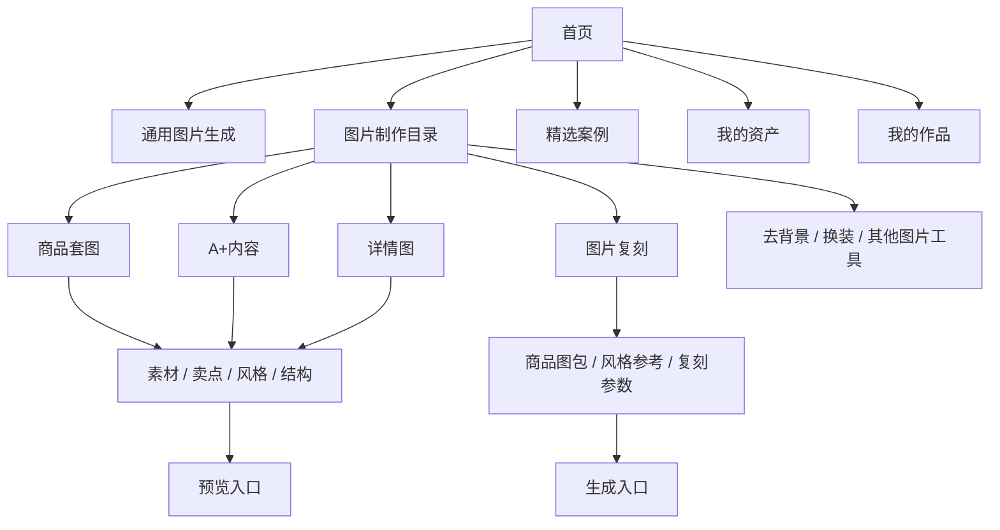
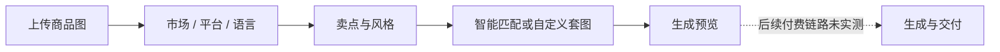

# Senyu 产品文档：电商图片创作

版本：调研版 v0.1。调研日期：2026-09-07（洛杉矶）。范围：图片相关产品功能；视频只作为站点信息架构背景，不展开分析。

本文还原用户界面可观察的产品设计，不代表 Senyu 官方 PRD。标记含义：**已观察**是实际进入页面看到的内容；**待验证**是未实际完成的操作或无法从空数据状态确认的行为；**分析**是本次产品判断。

## 1. 产品定位与用户任务

Senyu 首页将自身定位为电商领域的 AIGC 平台。图片功能同时提供自由输入式生成、业务场景向导和案例驱动创作。其核心用户任务是把商品素材转为主图、套图、详情页和营销图片，而不是要求卖家先掌握提示词工程。[首页](https://senyu.quantv.com/dashboard)

| 用户角色 | 主要任务 | 所需产品支持 |
| --- | --- | --- |
| 店铺运营/卖家 | 为商品快速准备上架和推广图片 | 平台/市场配置、商品图上传、卖点整理、整套输出 |
| 电商设计师 | 批量尝试视觉方向，复用已有版式 | 参考图、风格控制、模型和比例配置 |
| 内容运营 | 为小红书、抖音等创作图文素材 | 场景模板、案例发现、生活方式图片、中文文案 |

这些角色是根据功能归纳的目标用户，不是实际访谈或业务数据结论。没有获得活跃用户、转化率、留存、收入或生成成功率数据。

## 2. 信息架构

左侧导航还包含无限画布、提取需求、使用手册、主题和通知；顶部包含余额、积分商城、会员和设置。无限画布和提取需求仅观察入口，本次未进入验证，不能据此确认其编辑器或需求提取能力。

## 3. 通用图片生成

**已观察**：首页可切换到“图片生成”，输入想生成或修改的内容；提示支持上传参考图后通过 `@` 引用。具有本地添加素材、从资产库选择、展开编辑、模型和尺寸配置、生成按钮以及“我生成的图片”入口。

| 配置项 | 本次页面观察 |
| --- | --- |
| 输入长度提示 | `0/2000` |
| 当前默认显示 | 智能图片G2臻享版；`1K · 自适应` |
| 模型菜单 | 智能图片G2臻享版、智能图片image、即梦5.0pro、智能图片NaPro、即梦5.0、千问3.0pro |
| 生成成本 | 界面展示随当前选择而定的消耗数值；本次未验证扣费 |

上述模型名称是站点显示名称，不能直接等同于某家厂商的确切 API 型号、版本或官方能力。未验证模型输出效果、最大参考图数、实际响应时长及退款规则。

## 4. 图片制作目录与案例发现

图片制作以分类和卡片组织场景，顶部重点入口包括商品套图、A+ 内容、详情图、图片复刻、去除背景、AI 换装。目录还覆盖电商专区、创意应用、游戏动漫、人像摄影、建筑室内、图片编辑和绘画模型。

电商相关卡片包括白底图、商品场景展示、产品展示批量图、商品多角度、包装设计、卖点识别、详情页复刻、商品精修、模特穿搭和图文翻译等。**仅确认入口和描述存在，不将卡片数量视为独立可用能力数量。**

首页精选案例提供分类筛选、搜索、查看详情和“一键同款”。搜索框当次显示“293+作品”，这是页面提示，不是本次遍历得出的总量，也不代表全部是图片案例。

分析：场景卡片降低了选工具的门槛，案例提供视觉预期。但目录较长、近似功能较多，部分标题与描述不一致，因此 ZImage 应优先按最终产物整理少量稳定场景。

## 5. 商品套图

入口：[商品套图](https://senyu.quantv.com/image-creation?tool=product-listing-set)。页面左侧是配置，右侧为历史/示例。示例呈现白底主图、品牌主视觉、核心卖点、材质结构、工艺细节、规格信任、真实场景、收官价值等图片角色。

| 区块 | 字段与规则 | 证据状态 |
| --- | --- | --- |
| 商品素材 | 最多 6 张；JPG/JPEG/PNG；单张不超过 10 MB；点击、拖拽、资产库选择 | 已观察，未上传实测 |
| 市场 | 中国、美国、欧洲、东南亚、日本、韩国、南非、新加坡 | 已观察选项 |
| 平台 | 中国市场下显示淘宝、抖音、小红书、拼多多、京东 | 已观察选项 |
| 语言 | 简体中文、English、日语等 | 已观察选项 |
| 卖点 | 多行编辑、放大编辑、AI 生成；页面标示按图计费 | 已观察控件 |
| 风格 | AI 推荐、参考排版、自定义要求和风格分析入口 | 已观察控件 |
| 智能配置 | AI 分析商品图，匹配套图结构 | 已观察说明，分析结果未验证 |
| 自定义结构 | 白底图、场景图、卖点图、其他；有数量增减 | 已切换并观察 |
| 自定义初始数量 | 白底 1、场景 3、卖点 3、其他 0，共 7 张；显示至少 7 张 | 已观察 |
| 预览 | “生成预览”；无商品图时禁用，提示先上传 | 已观察 |

页面价格快照：一键解析 0.20 积分，卖点 AI 生成 0.10 积分/张，风格推荐或分析 0.10 积分，生成预览 0.10 积分。价格可能随模型、身份和配置变化，不能累加后当作整套生成价格；未验证重复执行、失败返还和预览后计费。

## 6. A+ 内容

从首页“A+内容”进入。具有素材、市场、平台、语言、核心卖点、风格和内容模块配置，支持最多 6 张图片。卖点输入引导填写产品名称、核心卖点、适用人群、期望场景和尺寸参数。

16 个可选内容模块：首屏主视觉、核心卖点、使用场景、多角度、场景氛围、商品细节、品牌故事、尺寸/容量/尺码、效果对比、规格参数、工艺制作、配件赠品、系列展示、商品成分、售后保障、使用建议。初始计数显示 `已选 0/16`；不能根据按钮文本中的勾号断言模块已选中。

**市场联动实测**：从中国切换到美国后，平台选项变为 TikTok Shop、Amazon、Temu、阿里国际站，而语言仍保持简体中文。这说明市场与平台存在联动，语言没有在该次操作中自动切换。

**分析**：虽然使用“A+”名称，页面同时提供国内平台。它更接近模块化商品内容生成器，不能据此认定输出完全符合 Amazon 官方 A+ 模块规格，亦未观察到直接发布至 Amazon 的功能。

预览按钮前校验商品图及基础信息；右侧示例包含功能总览、技术细节、生活方式、品牌主视觉、场景、品牌故事。未验证模块选择后的输出数量、版式尺寸、可编辑程度和整套下载。

## 7. 详情图

从首页“详情图”进入。使用与 A+ 类似的素材、市场、平台、语言、卖点和风格配置，但本次页面没有展示同样的 16 模块选择区。

页面明确说明交付形态是**单张竖版长图**，并给出销售转化、场景情感、极简信任、产品规格等示例。无商品图时“生成预览”禁用。

待验证：长图实际像素、是否分块生成后合成、文字是否可单独编辑、局部修改是否重做整图、长图导出是否分切。界面上看到长图不能证明模型原生支持任意长宽比。

## 8. 图片复刻

入口：[图片复刻](https://senyu.quantv.com/image-creation?tool=image-clone)。该场景明确区分商品图与风格参考图，是本次最值得复用的数据建模方式。

| 项目 | 已观察行为 |
| --- | --- |
| 商品图 | 最多 4 张，作为一组商品参考；支持资产库选择 |
| 风格参考 | 最多 20 张；上传或链接导入；支持资产库选择 |
| 核心卖点 | 必填标记；支持编辑和 AI 生成入口 |
| 参考排版 | 参考构图、背景与人物关系，按商品设计配色 |
| 高度复刻 | 参考构图、版式、配色与细节，替换商品和卖点 |
| 附加要求 | 统一复刻要求文本框 |
| 平台环境 | 市场、平台、文案语言 |
| 模型 | 当前页面固定显示“智能图片image”，选择控件禁用 |
| 分辨率 | 1K、2K、4K |
| 比例 | 15 种固定比例：1:1、3:2、2:3、16:9、9:16、5:4、4:5、4:3、3:4、21:9、9:21、1:3、3:1、2:1、1:2；加上自适应共 16 项 |
| 输出说明 | 按风格参考图数量批量输出商品图片 |

生成按钮本次显示 0.60 积分，未验证单图/整批计价语义。商品图为空时按钮禁用。

待验证：链接抓取限制、不同参考图尺寸处理、逐张失败策略、同商品在多图间的保真程度。复刻能力不能代替使用者对参考图使用权的判断。

## 9. 资产与作品

用户明确授权后只读查看；当前账号均为空数据。

| 功能 | 观察 |
| --- | --- |
| 我的资产 | 弹窗式资产库；按名称搜索、查询、上传；全部/图片/视频/音频筛选；容量展示与购买空间入口 |
| 资产保存 | 页面提示附件保留 30 天，到期自动清除 |
| 我的作品 | [作品页](https://senyu.quantv.com/my?view=works)，分图片创作与视频制作；已完成/生成中/失败状态筛选；批量操作入口 |
| 作品保存 | 页面提示服务器保留 7 天，应及时下载 |
| 当前限制 | 无作品，未实测作品预览、批量下载、重新生成或删除 |

资产 30 天与作品 7 天分别对应页面上的两类对象，不能混为一个统一保存期限；实际清理策略未从后台核验。

## 10. 体验结构与改进启示

| 值得借鉴 | ZImage 可采用的方式 |
| --- | --- |
| 先选业务场景，再填资料 | 新增电商生图入口，用商品套图、详情图、种草图等成品名称组织 |
| 商品与风格参考分离 | 为引用标注角色，不将全部图片当作相同权重的附件 |
| 卖点、风格、输出结构分层 | 先确认商品事实，再选择视觉方向，再编辑每张图片任务 |
| 生成前展示消耗 | 明确区分方案分析与图片生成费用，提交后不暗中增图 |
| 示例与历史并列 | 空状态展示经过许可的案例，已有任务展示真实结果 |
| 有任务状态和保存期限 | 在 ZImage 时间线直接显示逐图状态和服务端到期时间 |

不宜直接照搬：强制至少 7 张、几十个同级入口、所有模板都能适配所有模型的暗示、平台名称等同平台合规的暗示，以及在数据为空时无法评估的付费行为。

## 11. 本次无法得出的结论

未实际生成图片，因此没有证据证明商品保真、文字准确率、成功率、耗时、并发规模或价格优势。未验证预览之后的操作、队列恢复、失败退款、私有链接授权与平台发布。这些是后续实测项目，不应写成已完成能力。
