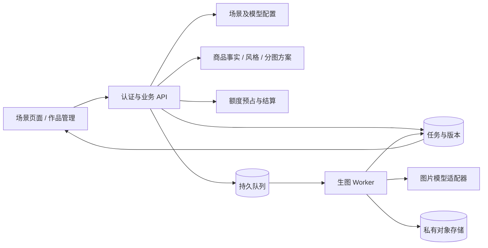

# Senyu 技术文档：观察证据与参考架构

版本：调研版 v0.1。范围：图片生成与相关管理功能。本文没有 Senyu 源码仓库、服务端日志、数据库或官方 API 文档访问权，因此不是内部架构说明书。

## 1. 证据分级

| 等级 | 含义 | 本文用法 |
| --- | --- | --- |
| E1 | 浏览器实际页面或交互 | 字段、选项、校验、路由、作品分类 |
| E2 | 页面公开引用的前端资源 | 模块拆分、框架标记、静态资源来源 |
| H | 根据行为提出的实现假设 | 服务职责、业务实体、异步生成设计 |
| U | 未知或未验证 | 数据库、后端语言、队列产品、真实 Provider、鉴权方案 |

E1/E2 是本次读到的版本快照，不代表持续不变。H 部分仅用于设计类似能力；不能称其为“已发现 Senyu 使用的技术”。

## 2. 已验证的前端线索

| 观察 | 证据 | 可支持的结论 |
| --- | --- | --- |
| 应用页面 | `https://senyu.quantv.com/dashboard`；内容挂载在 app 容器 | 存在浏览器端应用界面 |
| 商品套图路由 | `/image-creation?tool=product-listing-set` | 同一路径可通过 tool 参数选择业务场景 |
| 复刻路由 | `/image-creation?tool=image-clone` | 与套图共享路径形态；不证明共享同一个组件 |
| 作品路由 | `/my?view=works` | 存在独立作品管理视图 |
| 入口脚本 | `https://cdn.quantv.com/site/models/front/assets/index-CPW6JsUT.js` | 脚本通过独立 CDN 域名分发，文件名有构建散列 |
| 构建标记 | 入口出现 `__vite__mapDeps`、`modulepreload` | 有 Vite 产物特征；未取得构建配置和准确 Vite 版本 |
| 框架标记 | 公开 runtime 中出现 `__v_isReactive`、`__vue_app__`，入口包含 `createApp` 与 `data-v-app` | 可以识别 Vue 3 运行时特征 |
| 版本线索 | 相同 runtime 的框架代码邻近出现 `3.5.33` | 与 Vue 3.5.33 运行时特征相符，未由源码依赖清单交叉验证 |
| 模块拆分 | 入口引用 App、runtime-config、router 等独立 JS 资源 | 存在分块加载；具体组件边界未知 |
| 样式 | 独立 index 与 router CSS | 页面样式单独构建；未确认具体 UI 库 |

公开资源：[入口 JS](https://cdn.quantv.com/site/models/front/assets/index-CPW6JsUT.js)、[运行时 JS](https://cdn.quantv.com/site/models/front/assets/runtime-config-BfK95_ZS.js)。资源名可能在后续发布时失效。

不能由这些证据推导“使用 React/Next.js”“后端是 Java/Node”“数据库是 MySQL/Postgres”“队列是 Redis/BullMQ”“存储是某家 OSS”。CDN 域名也不能证明实际云供应商。

## 3. 从页面可观察到的业务边界

| 边界 | E1 事实 | H：类似系统需要的能力 |
| --- | --- | --- |
| 场景配置 | 套图/A+/详情/复刻字段与上传上限不同 | 按场景提供版本化 schema 和可用参数 |
| 市场与平台 | A+ 切换市场会更新平台选项 | 配置化市场/平台映射及独立输出语言 |
| 商品理解 | 卖点生成、解析、风格分析是独立按钮 | 分离分析任务与图片任务、分别记录消耗 |
| 方案预览 | 多个场景有付费预览入口 | 可持久化、可修订的创作方案；具体实现未验证 |
| 图片模型 | 通用生图有多个别名；复刻模型选择被固定 | 按能力与场景限制模型选择 |
| 任务 | 作品分生成中/已完成/失败 | 异步状态与结果管理；轮询/SSE/WebSocket 未知 |
| 素材 | 商品参考和风格参考不同；有资产库 | 引用角色、素材生命周期、所有权验证 |
| 商业化 | 显示积分、会员和消费入口 | 费用估算、授权、结算与失败补偿；内部机制未知 |

本次未调用后台接口，也未捕获付费生成网络请求，因此没有可用于第三方接入的 Senyu API 契约。**不建议以抓取私有 API 或自动代操作 Senyu 作为 ZImage 的运行依赖。**

## 4. 参考架构（H，非内部事实）

下面是重建类似图片功能时建议采用的职责拆分：

最低必要对象：用户、素材、场景配置、模板版本、创作方案、逐图任务、执行尝试、作品、额度流水。这里没有必要预先引入微服务或独立工作流产品；模块可以先在同一应用与数据库中实现。

## 5. 建议的数据与状态模型

| 对象 | 建议字段 | 设计原因 |
| --- | --- | --- |
| 商品资料 | 名称、类别、SKU、颜色/材质、已确认卖点、规格、来源 | 把商品事实与模型猜测区分 |
| 素材引用 | assetId、角色、排序、所有者、到期时间 | 商品保真图与版式参考不能互相替代 |
| 场景模板 | ID、版本、适用产物、输入要求、模块结构 | 场景升级不应改变历史任务 |
| 方案 | revision、逐图目标、文字、比例、统一风格、模型 | 预览确认后执行可重现的快照 |
| 单图任务 | slotId、generationId、状态、结果、失败原因 | 部分失败只补相应图片 |
| 计费动作 | reservation、settlement、release、幂等键 | 重复请求不重复扣费 |

产品层“生成中”可映射多个内部状态；建议至少区分排队、处理中、成功、明确失败和提交结果未知。不能把网络超时一律当作未提交，否则可能重试造成重复消耗。

## 6. 三个关键实现问题

### 6.1 套图不是同一 prompt 的 N 次采样

套图需要共享商品事实、配色、字体与参考图，同时为主图、卖点、场景、规格等图片分别定义目标。每张图应能独立验收和重做；整套只负责组织、进度与费用汇总。

Senyu 的表单显示这种业务结构，但没有证明其内部如何编排多图。ZImage 的建议实现见[融合技术方案](./zimage-commerce-technical.md)。

### 6.2 详情长图不能仅靠放大生成比例

建议将详情内容分模块组织，先生成必要视觉，再用可控排版合成长图。价格、规格、售后等精确文本可用确定性排版处理。应提供模块重做和最终长图预览；不能把上采样当作更高原生生成分辨率。

这是一项实现建议，不是对 Senyu 当前长图算法的断言。

### 6.3 图片数量、引用数量和模型能力分别约束

复刻页可添加的参考图数量，并不意味着单次模型请求可以同时输入那么多图。它可能按输出拆分请求、选择子集或使用其他编排，但本次没有证据。

ZImage 应分别声明：商品素材库上限、本次方案引用上限、每个模型请求的引用上限、整套产物上限，不能用一个 `count` 表达所有含义。

## 7. 非功能需求建议

以下是构建类似产品的建议验收要求，不是 Senyu 已通过的指标：

- 所有任务和资产读取验证当前用户与归属，状态轮询不能绕过鉴权。
- 已确认方案与生成任务持久化；刷新、切换页面后可恢复。
- 资产引用到期和生成结果到期分别处理，界面显示真实到期时间。
- 生成费用在提交前确认；方案变更使旧报价失效；部分失败按明确规则释放未消耗额度。
- 预览、生成、作品管理的错误状态必须有可执行的下一步。
- 上传检查文件内容、类型、大小和图像维度；不能只检查扩展名。
- 平台规则和模型能力均应版本化，以免历史任务被新规则悄然改写。

## 8. 未验证清单

| 项目 | 缺少的证据 |
| --- | --- |
| 生成链路 | 有预算的商品分析、预览、出图和失败测试 |
| 性能 | 模型/图片数量维度的耗时分布和并发实验 |
| 存储 | 非空资产的授权、签名 URL、到期与下载验证 |
| 作品 | 非空结果预览、重做、批量下载的交互记录 |
| 队列 | 断网、刷新、服务故障后的任务恢复证据 |
| 服务端技术栈 | 官方文档、源码、部署说明或经授权的服务端证据 |
| 商业结算 | 价格配置、失败补偿、重复提交和最终账单 |

本次只读调研无需为了填写这些未知项而充值或制造线上任务；文档明确保留证据边界。
