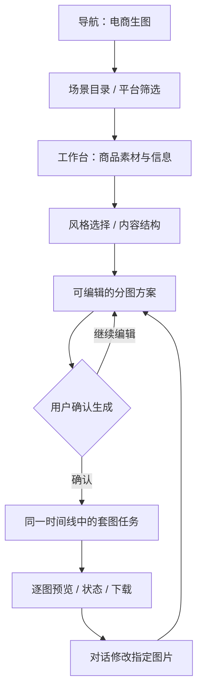

# ZImage 电商生图产品需求

版本：待评审 v0.1。日期：2026-09-07（洛杉矶）。本次交付仅为文档，未实施。

依据：[用户决策](./README.md)、[Senyu 产品分析](./senyu-product.md)、awesome 数据及 ZImage 当前代码。正式立项时将批准内容合入现有 `doc/requirements.md`，本文件作为方案快照保留。

## 1. 产品目标

在 ZImage 中新增“电商生图”入口，使淘宝、抖音、小红书卖家能够选择场景、提供商品素材、编辑分图方案，生成并修改商品图片。用 Senyu 的场景化操作降低输入难度，用 awesome 的模板方法提高方案质量，用现有工作台保存完整创作过程。

核心闭环：**选择场景 → 提供商品资料 → 确认商品事实 → 编辑分图方案 → 确认生成 → 查看逐图结果 → 对话修改 → 下载。**

第一版复用当前登记的图片模型。导入 awesome 的内容方法不等于新增 GPT-Image-2，也不意味着现有模型可以达到上游示例的效果。

## 2. 方案比较与选择

| 方案 | 收益 | 代价 | 建议 |
| --- | --- | --- | --- |
| 只增加模板卡片 | 最快扩充可发现内容 | 不能解决商品资料、分图规划和批量一致性 | 不作为完整目标 |
| 新增场景入口，共用工作台 | 类似 Senyu 的发现体验；向导和对话协作；复用现有可靠性基础 | 需要新增方案与成组执行能力 | 推荐；符合用户确认方向 |
| 复制独立图片应用 | 界面可全面接近 Senyu | 重复会话、状态、接口与历史维护成本高 | 暂不采用 |

## 3. 新入口与导航

**必须新增入口，不仅调整原有 Skill 菜单。**

| 位置 | 行为 |
| --- | --- |
| 桌面侧栏/工作区导航 | 增加“电商生图”，与现有会话入口清晰区分 |
| 移动导航 | 同名入口；不用要求用户打开高级设置后寻找 |
| 入口页（建议 `/create`） | 展示场景卡片、平台筛选、精选风格和“继续最近创作” |
| 场景卡片 | 展示用途、输入要求、产物示例、建议张数；点击后进入对应向导 |
| 工作台执行 | 在现有 `/` 中打开场景向导和当前任务；共用会话与时间线 |
| 已有 Skill 页 | 继续承担白底图、模特图、种草图的说明与发现；关联电商场景，不重复维护执行逻辑 |

`/create` 是场景目录，不维护第二套会话。建议用 `/?scene=product-set` 等可分享的**场景选择参数**进入工作台；参数不得包含提示词、商品资料、图片地址或访问凭证。已有任务通过经所有权校验的 taskId 恢复。

目录和经许可的示例可公开浏览；上传、保存方案、查看历史与生成仍遵守 ZImage 正式登录门禁。登录后返回用户所选场景。

## 4. 页面结构

桌面：保留会话侧栏；工作区显示任务时间线；向导使用可收起的配置面板。移动端：分步展示素材、内容、方案，底部显示当前步骤操作，结果仍回到时间线。方案未提交前切换页面可恢复已保存内容。

建议场景页采用 ZImage 现有视觉规范和原创示例，借鉴 Senyu 的功能层级与布局逻辑；不要求复制其深色皮肤、品牌素材或所有工具卡片。

## 5. 第一版范围与优先级

P0 为第一版目标，按技术方案中的阶段逐步落地；不是“第一周全部完成”。

| 场景 | 首次建议配置 | 第一版交付 | 优先级 |
| --- | --- | --- | --- |
| 商品主图/白底图 | 1 张，突出商品外观 | 无营销文字的主图或棚拍图；复用白底 Skill | P0 |
| 商品套图 | 建议 5 张，可选 1–8 张 | 主图、卖点、细节、场景、规格等角色组成的独立图片 | P0 |
| 详情图 | 建议 5 个模块，可选 1–8 个 | 模块图片、可编辑文案、单张合成长图 | P0 |
| 种草图文 | 建议 3 张，可选 1–8 张 | 封面/使用场景/细节；可用于小红书及抖音图文 | P0 |
| 参考风格创作 | 建议 1 张 | 用商品图保真，用风格参考控制构图和氛围 | P0，排在套图闭环之后 |
| 品牌内容组图（A+ 结构） | 品牌、卖点、场景、规格等模块 | 复用详情与套图底座，适配国内品牌表达 | P1 |
| 模特/穿搭增强 | 复用现有模特 Skill | 专项商品保真与姿态验证后扩充 | P1 |

1–8 是建议的**业务产物上限**，不等于单次模型请求 8 张，也不继承 Senyu“至少 7 张”的要求。默认数量只帮助启动，确认前可减少；不能默认追加付费结果。

不纳入第一版：视频、无限画布、完整图层编辑器、自动发布到电商平台、Amazon 专属 A+、会员/充值系统、直接调用 Senyu 私有服务、全量收录 541 个案例、自动升级新图片 Provider。

## 6. 商品资料与参考图

### 6.1 输入字段

| 字段 | 规则 |
| --- | --- |
| 平台 | 淘宝、抖音、小红书；抖音需区分商品展示与图文内容用途 |
| 语言 | 第一版简体中文；多语言字段预留，暂不展示未验收语言承诺 |
| 商品名称/类别 | 必填，可人工输入或从分析结果确认 |
| 商品图 | 销售用商品主图/套图要求至少 1 张清晰图；纯文字创意保留原工作台能力，并注明不是原商品还原 |
| 商品事实 | 颜色、材质、外形、可见标识；机器识别结果必须可修正 |
| 卖点 | 可填 1–3 个核心卖点；没有时先生成待确认建议 |
| 规格与价格 | 仅使用用户确认信息；不知道则留空或移除相应模块，不编造 |
| 风格参考 | 可选，单独标记；不能覆盖商品事实和原有标识 |
| 约束 | 不可改变项、禁用元素、统一色调、文字要求 |

第一版商品图与风格图**合计最多 4 张**，每张不超过 10 MB，支持 PNG/JPEG/WebP，沿用当前安全边界。建议商品图占 1–3 张，风格图占 0–1 张；只有模型已验证支持时才提交对应组合。扩大素材数是后续独立变更。

### 6.2 商品分析与追问

分析结果分为“从素材观察到”“用户已确认”“待确认推测”。容量、认证、效果、材质成分等不能仅因视觉看起来相似而确认为事实。

优先追问会阻止生成或引起事实错误的一个问题；例如“规格图需要容量，这个杯子是多少毫升？”用户回答后再处理下一项。可跳过的装饰风格使用可修改默认值，不连续要求用户填写完整问卷。

手工填写必须可完成流程。视觉分析不可用时，保留资料并说明状态，不静默用无图分析替代已承诺的商品识别。

## 7. 场景向导与分图方案

### 7.1 向导步骤

1. **商品资料**：上传、平台用途、商品名称与已知事实。
2. **风格与结构**：选择模板方向；调整图片角色和数量。
3. **方案确认**：显示每张图的目标、参考、文案和尺寸，允许修改和取消部分图片。

第一版先通过人工输入与确定性模板生成方案；接通经验证的视觉分析后再提供“一键分析”。不把分析按钮与付费生图按钮合并为同一个模糊操作。

### 7.2 逐图方案卡

每张卡显示：序号与角色、商品主体、使用场景、布局/风格、准确文案、图片比例与分辨率、引用素材、选用模型、是否参与本次生成。整套方案显示统一配色、保真约束、模板版本和预计消耗的图片额度。

方案可以先生成首张样图，也可以生成全部选中项。首张只是普通的单图生成，会明确消耗对应额度；后续生成“剩余图片”时排除已成功项，不重复计数。首张不自动成为后续参考图，采用时需要在新方案中显示其引用及额外约束。

### 7.3 示例：同一商品的三种用途

以下是原创规划示例，商品数据须由用户输入，非平台官方规范：

| 用途 | 图片/模块组成 | 默认视觉方向 |
| --- | --- | --- |
| 淘宝商品套图 | 白底主图、卖点、细节、使用场景、已确认规格 | 商品识别清晰、信息分层 |
| 抖音图文推广 | 首图、场景、细节 | 首图主体醒目，文字精简 |
| 小红书种草 | 封面、日常场景、细节说明 | 生活化构图、可读标题、留白 |

上述方向是产品默认偏好，不是平台强制图片规则。建议先使用当前模型支持的 1:1 或 3:4；没有核实平台官方要求前，不标注“平台审核保证通过”。

## 8. 生成、结果与对话修改

| 用户动作 | 预期行为 |
| --- | --- |
| 点击确认生成 | 只生成当前版本中选中的图片；显示额度估算与提交状态 |
| 重复点击/网络重发 | 恢复同一次任务，不新增重复图片或重复预占 |
| 刷新或切换会话 | 根据服务端事实恢复方案、任务与逐图状态 |
| 一部分失败 | 保留成功图片；展示失败原因和单图重做入口 |
| 说“第三张背景换成米色” | 明确第三张所属任务/版本，生成修改方案，仅对确认的图片执行 |
| 说“这一套改成暖色” | 展示会影响的所有图片及新增额度，确认后创建新版本 |
| 普通讨论/询问建议 | 只讨论，不因启用图片工具就创建生成任务 |
| 改变商品或切换场景 | 保留原草稿；明确替换/新建，不覆盖已提交任务 |
| 下载 | 支持单张和选中集合；长图支持完整图与组成模块；显示到期状态 |

任务展示分为“待补充、待确认、已排队、生成中、已完成、部分失败、失败”。用户取消尚未提交的方案不会产生图片消耗；已提交请求的取消不能承诺一定停止上游或退回费用，须按实际状态处理。

第一版“对话修改图片”指有上下文和目标定位的重新生成，不承诺已有蒙版局部编辑、图层编辑或确定性像素保留。对商品本体要求严格的场景，优先使用已验证的商品保真能力。

## 9. 详情长图交付

内容结构先确定，再逐模块生成视觉并排版；规格、标题和卖点采用可编辑的文本层数据，最终导出为图片。生成产物仍为栅格图，不把内部文本层描述为完整设计编辑器。

确认时展示模块顺序、每模块文案、总长度预估和图片消耗。支持移除无事实依据的参数/认证模块。替换一个模块后重新合成，未修改模块无需再生图。

文字过长、缺字体、模块未成功、输出超出处理尺寸时，阻止导出并指向具体问题。不得拉伸商品来凑长图；不得将缺失模块静默填为空白后宣称完成。

## 10. awesome 内容如何进入产品

用户看到的是“极简棚拍、生活方式、卖点排版、品牌主视觉”等可理解的视觉方向，不必阅读上游 Skill 文件或技术 prompt。模板详情展示适合做什么、需要什么素材、可修改内容、已验证模型及来源。

首批建议精编 12 个模板：白底主图、柔光棚拍、材质特写、核心卖点、参数版式、日常使用场景、手持展示、品牌主视觉、小红书封面、生活方式拼贴、详情首屏、详情模块。它们是基于多项方法重新设计的 ZImage 模板，不是声称上游恰好有这 12 个同名模板。

上游示例图和第三方提示词不能因仓库有 MIT 文件就自动用于商业展示。每个上线模板记录来源与审核状态；首版封面优先使用原创或权利明确的素材。默认只发布经过筛选、可完整填参、经现有模型评测的内容。

## 11. 验收要求

| ID | 验收条件 |
| --- | --- |
| EC-01 | 桌面与移动均可从导航进入电商生图目录，返回原工作台不丢失草稿。 |
| EC-02 | 目录包含 P0 场景；每张卡明确输入、输出、是否需要商品图。 |
| EC-03 | 淘宝、抖音、小红书与产物用途分别保存；切换用途保留商品资料并更新建议结构。 |
| EC-04 | 上传角色可辨；第 5 张/超 10 MB/不支持文件被拒绝，合法引用不因切换面板丢失。 |
| EC-05 | 模型推测与确认事实区分；缺关键资料一次只问一题，用户可选择删除依赖该资料的模块。 |
| EC-06 | 1–8 个产物具有独立 slotId、目标、文字、引用和设置；数量与选中项一致。 |
| EC-07 | 方案生成和普通讨论不入生图队列；确认的版本/选中项与实际任务完全一致。 |
| EC-08 | 重复确认、刷新后重试或并发标签页提交，同一幂等请求只创建一个执行组。 |
| EC-09 | 生成中刷新可恢复；成功、失败和提交结果未知分别呈现，不能盲目重试未知提交。 |
| EC-10 | 修改第 3 张仅影响明确选中的图片；目标不明确时先追问。 |
| EC-11 | 失败重做创建新记录并保留来源；已成功图片保留，不重复计入此次额度。 |
| EC-12 | 当前模型不支持的比例、分辨率或参考组合在提交前被阻止，不能静默替换。 |
| EC-13 | 长图只包含已确认模块，准确文字可编辑；改文字或顺序不触发无关生图。 |
| EC-14 | 模板有来源、版本、审核及模型验证信息；下架不影响历史记录，但禁止新建引用。 |
| EC-15 | 任务、上传和生成结果按正式账号隔离；过期图片提示失效，不泄露其他用户资源。 |
| EC-16 | 未获取可靠费用时明确显示可核实的图片额度，不伪造金额或显示为免费。 |
| EC-17 | 原工作台聊天、白底/模特/种草 Skill、会话恢复与认证行为保持可用。 |

## 12. 成功指标与采集

目前没有新流程使用数据。以下是上线后需采集的指标与**建议验收目标**：

| 指标 | 计算口径/建议目标 |
| --- | --- |
| 首次方案完成率 | 创建商品资料后到达可确认方案的用户数/创建商品资料的用户数；先建立基线 |
| 方案确认耗时 | 从进入向导到首次确认，排除离线停留；用中位数/P90 而非假设固定耗时 |
| 图片可用率 | 人工检查后可交付的图片数/已成功生成图片数；同时报告失败生成数 |
| 商品保真 | 颜色、轮廓、主要结构、可见标识四项都通过才算通过；建议首批非敏感样本 ≥90%，不作对外保证 |
| 关键文字 | 确认的规格、价格和标题应逐字一致；确定性合成路径目标 100%，任何事实错误均不合格 |
| 修改成本 | 一次被接受的单图修改产生的生成次数和额度 |
| 恢复可靠性 | 受控刷新、断网恢复、重复提交测试不丢任务、不重复执行 |
| 交付使用 | 下载率、每任务选中交付图片数；不能把下载直接等同于真实销售转化 |

## 13. 实施顺序与评审边界

先完成入口与手工方案；再实现逐图队列、版本确认和恢复；然后加入智能资料提取与模板匹配；最后交付长图合成和专项图片质量验收。具体依赖见[技术方案](./zimage-commerce-technical.md)。

本次已确认的是方向与入口，尚未批准的是本 PRD 的具体路径、数量上限、首批模板和质量目标。审阅本方案后，再进入代码实施与正式需求同步。生产价格、真实 Provider 验收预算和模板商用来源需要在相应实现阶段逐项确定，不预先编造结论。
