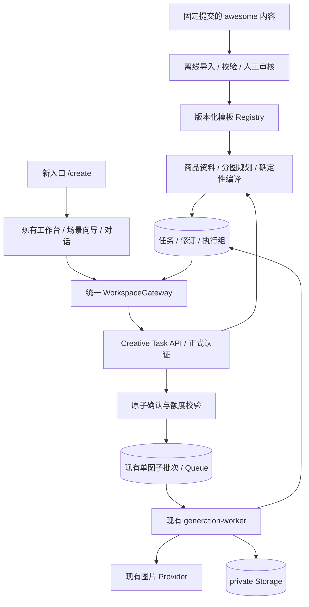
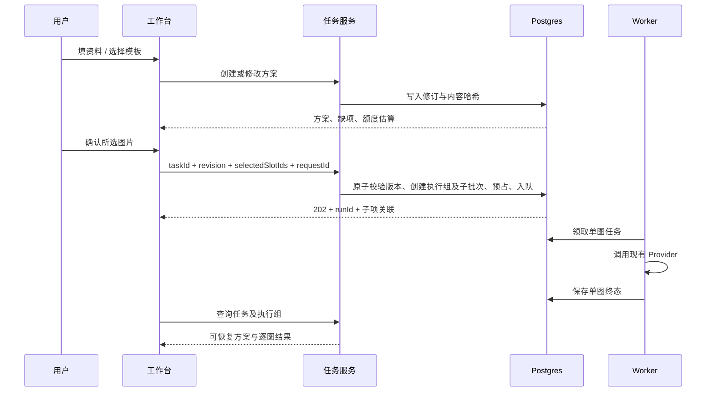

# ZImage 电商生图融合技术方案

版本：待评审 v0.2。日期：2026-09-07（洛杉矶）。配套：[产品需求](./zimage-commerce-prd.md)。本文件是可评审设计，不是已实现或已验收报告。

## 1. 技术结论

新增电商场景目录与工作台向导，建立“商品资料 → 版本化方案 → 逐图执行”的服务端模型。接入 awesome 的内容数据和提示词组织方法，保留 ZImage 的 Next.js、Supabase、队列、Worker 与私有 Storage。Senyu 用作产品参考，不作为运行时依赖。

第一版继续使用现有登记模型。模板名称中的 GPT-Image-2 不应成为模型路由条件；模型能力和模板内容分别版本化。任何现有 Provider 的可用性与效果仍需独立验收。

## 2. 当前 ZImage 代码核实

研究基线：`f2e81edf1f856051dfbe8d6ad6ed687fa1a58476`；本轮审查：`bc05783d49645976cbfc54882c4ec8f7ae078e28`，其间为文档提交。路径相对于项目根目录。

| 模块 | 已读代码事实 | 对新功能的影响 |
| --- | --- | --- |
| Web | `apps/web/package.json`：Next 16.3.0、React 19.2.7、TypeScript 6.0.3、Zustand、Zod、Sharp | 沿用技术栈，不迁入 awesome 的 Vite 应用 |
| 工作台 | `features/workspace/UnifiedWorkspace.tsx`：单一时间线、图片配置、按会话草稿、Skill 方案编辑 | 新入口负责发现，向导与结果复用该边界 |
| 官方 Skill | `packages/domain/src/official-skills.ts`：白底、模特、种草，均 v2.0.0 | 三个能力统一映射场景方案；D08 改为先方案后确认，历史数据继续可读 |
| 当前方案编译 | `UnifiedWorkspace.tsx` 将 Skill 默认值或用户覆盖文本与用户输入拼接 | 需要服务端结构化编译，不能只增加更多字符串 |
| HTTP 图片网关 | `gateways/http-workspace-gateway.ts`：上传参考、缓存提交体、幂等键、请求单一 prompt | 可复用上传与幂等，但不支持每张不同目标的业务套图 |
| HTTP 聊天网关 | `streamChat` 未序列化 proposal、imageSettings、taskId/taskRevision、requestId 等领域字段 | 仅修改类型不会使流程实际接通 |
| 聊天生图 | `server/chat/chat-service.ts`：显式图片意图分支使用用户原文；固定 1:1、2K、1 张 | 必须使用已确认方案和可见参数，不能继续套用固定默认值 |
| 图片服务 | `server/image/image-service.ts`：校验模型与参数、识别 Skill、计算 requestHash；prompt 仍来自请求 | 补充可信模板版本解析、方案与编译快照校验 |
| 任务契约 | `skill-contracts.ts` 有 SkillTask；`api-contracts.ts` 有 activeTasks 和 task.updated | 是契约草案，不等于持久化、网关恢复或 UI 展示已实现 |
| 图片限制 | `imageParamsSchema`：1–4 张、最多 4 个 referenceId；5 种比例，1K/2K | 业务组图扩展不能简单放宽模型单次 count |
| 模型登记 | Gemini `gemini-3-pro-image`；Seedream `seedream-4.5`，后者登记仅 2K | 不允许页面静默展示其不支持的 1K/4K 或任意长比例 |
| 数据库生图 | `20260824063746_phase1_generation_queue.sql`：原子入队，每张 generation；同批次使用同一 prompt | 用多个单图子批次组成方案执行组，复用单图 Worker |
| 资产 | 上传检查类型/魔数/尺寸，private buckets，signed URL | 不复制上游公开结果 URL 作为永久资产 |
| 账号 | API 使用 `requireVerifiedUserId` 与来源检查 | 新受保护入口同样使用正式账号守卫 |

进度账本较新的“整站回归与浅色毛玻璃优化”记录已有 Domain 27、Web 209 项通过及 E2E 40 项通过/20 项条件跳过；不能把更早的失败当作当前失败。真实注册、全部 Provider、数据库隔离及远端发布等仍有证据缺口。本轮尝试定向测试因缺少 Vitest 未能启动，未得到新的通过结论。

[本轮审查](./critical-review.md)另外确认：当前 UI 以工具开关直接分流生图；额度账本级联删除、清理与在途写入竞争、队列租约和完成恢复均存在代码缺口。下文“复用”须以这些前置修复为条件，不表示当前底座已经满足新流程可靠性要求。

## 3. awesome 项目实读结论

上游：[freestylefly/awesome-gpt-image-2](https://github.com/freestylefly/awesome-gpt-image-2)。本次开始和结束均读到提交 `b477278bb2a36d4c59655eb0daa4ce48e8dbc4c4`。

### 3.1 内容与代码不是同一层

| 上游文件/目录 | 本次读到的内容 | 采用方式 |
| --- | --- | --- |
| `data/style-library.json` | version=1；13 分类、19 风格、10 场景、22 模板 | 优先作为内容索引与映射参考 |
| `data/cases.json` | totalCases=541；实际数组 541 条，ID 唯一；最大编号 544，缺号 12/169/170 | 保留 ID，不重编号；不能把最大 ID 当条数 |
| `docs/templates.md` | 文本与 JSON 示例，以及各类布局/材质/文字约束方法 | 人工编译为结构化 ZImage 模板 |
| `agents/skills/gpt-image-2-style-library/SKILL.md` | 按类别、风格、场景、案例匹配；组织六类 prompt 区块 | 用作方法参考，不把外部 Skill 当作生产系统指令直接执行 |
| `scripts/generate-site-data.mjs` | 从文档整理出站点案例数据的脚本 | 参考解析思路；导入器需独立校验，不在生产执行上游脚本 |
| `src/main.jsx`、`package.json` | 仓库有 React/Vite 站点；依赖包含 Supabase 与支付集成 | 不迁移整站或第二套账号系统 |
| `api/generate-image.js`、`shared/apimart.js` | 先预占，调用 APIMart，保存 task ID，返回 202；默认单张、1:1、1k、gpt-image-2 | 仅作异步生命周期参考；不是可直接搬来的多参考套图能力 |
| `api/_lib/generation.js` | 状态查询、终态结果、预占结算相关逻辑 | 不替换 ZImage 现有队列/配额实现 |

数据链接：[模板索引](https://github.com/freestylefly/awesome-gpt-image-2/blob/b477278bb2a36d4c59655eb0daa4ce48e8dbc4c4/data/style-library.json)、[案例数据](https://github.com/freestylefly/awesome-gpt-image-2/blob/b477278bb2a36d4c59655eb0daa4ce48e8dbc4c4/data/cases.json)、[模板方法](https://github.com/freestylefly/awesome-gpt-image-2/blob/b477278bb2a36d4c59655eb0daa4ce48e8dbc4c4/docs/templates.md)。

模板索引含 `id/anchor/cover/title/description/category/styles/scenes/tags/useWhen/guidance/pitfalls/exampleCases`，但**没有完整的参数校验 schema 和可执行 prompt 模板字段**。案例记录含 `id/title/image/sourceLabel/sourceUrl/prompt/promptPreview/category/styles/scenes/featured/githubUrl`。必须增加中间转换与人工审核，不能把这两种对象混作一个 Skill。

### 3.2 与电商的匹配

商品与电商分类共有 42 条，但标签不全都准确，仍需按实际内容筛选。第一批建议参考：

| 上游对象 | 可借鉴内容 | 不应照搬的部分 |
| --- | --- | --- |
| `product-commerce-visual` | 商品、卖点、材质、场景、光线、版块的分离 | 将模板描述当成已完成的参数引擎 |
| `poster-layout-system`、`infographic-engine` | 标题层级、信息区、留白、卖点组织 | 未经核实的规格与功效内容 |
| `realistic-photography` | 主体、镜头、光照与背景控制 | 把写实风格当成真实商品保真保证 |
| `brand-identity-package` / `brand-touchpoint-board` | 跨图统一视觉语言 | 自动使用第三方品牌标识 |
| Case 373、313 | 商品主视觉结构；外形、材质、构图和灯光拆分 | 示例品牌、标语、任意“8K”描述 |
| Case 519 | 明确锁定商品外观细节的约束思路 | “100%保留”的模型效果承诺 |
| Case 485、532 | 多画面视觉一致性与内容编排 | 拼贴一张图等同多个可独立交付图片 |
| Case 178、194、189 | A+/详情/服饰的场景线索 | 原 prompt 很短，不足以作为生产模板 |
| Case 301、449 | 模块化规格与结构展示方法 | 虚构 IP 商品、未证实内部结构和规格 |

### 3.3 许可与上线内容

仓库有 [MIT LICENSE](https://github.com/freestylefly/awesome-gpt-image-2/blob/b477278bb2a36d4c59655eb0daa4ce48e8dbc4c4/LICENSE)，但其[声明](https://github.com/freestylefly/awesome-gpt-image-2/blob/b477278bb2a36d4c59655eb0daa4ce48e8dbc4c4/docs/disclaimer.md)另行说明第三方案例与图片不保证可商用。因此分别记录代码许可、提示词来源和预览图权利信息，不能用单一 `license: MIT` 覆盖全部案例。

首批采用自写参数化模板与原创/授权预览图；参考案例保留作者及原帖链接。未知权利项进入待审核集合，不在公开目录自动展示。对已明确允许复用的代码保留必要版权/许可文本。本次未将任何上游图片或完整第三方提示词复制到应用目录。

## 4. 目标架构

保持 `/` 为唯一执行工作台；`/create` 只是目录。按官方规则保留 `/chat`、`/image` 的兼容重定向，不以 `/image` 新建另一套工作台。无需引入新的 SaaS、图数据库或向量库完成首版筛选。

## 5. 领域对象设计

| 对象 | 关键字段 | 持久化建议 |
| --- | --- | --- |
| `CommerceTemplate` | id、version、scene、inputSchema、slotBlueprints、styleRules、negativeRules、providerValidation、source | 首版受版本控制的服务端 registry；公开元数据与执行内容分开 |
| `ProductBrief` | name、category、platform、placement、locale、facts、claims、referenceRoles | 作为任务方案快照保存；首版不新建跨会话商品资产库 |
| `CreativeTask` | id、userId、sessionId、sceneId、currentRevision、lifecycle、createdAt | 新表，任务身份与当前方案指针 |
| `CreativeRevision` | taskId、revision、brief、slots、style、templateVersion、compiledPrompts、compilerVersion、hash | 新表，不可变快照；修改创建新版本 |
| `CreativeRun` | id、taskId、revision、selectedSlotIds、requestId、requestHash、status、quotaEstimate | 新表，一次用户确认对应一个执行组 |
| `CreativeRunItem` | runId、slotId、batchId、generationId、parentItemId | 新表，连接本次批次与单图；重做通过 parentItemId 关联原结果；唯一 `(runId, slotId)` |
| `CreativeSelection` | taskId、revision、slotId、generationId、selectionVersion、compatibilityHash | 新表或等价持久结构，记录当前交付选择；与候选历史分开 |
| `CreativeExport` | taskId、revision、orderedSelections、manifestHash、state、expiresAt | 记录单图集合导出快照；首版不创建 CompositeAsset |

`ProductBrief.facts` 每项含 `value`、`origin=user|vision|derived`、`confirmed`；模型置信度不能代替确认。`referenceRoles` 明确 `product|style`，引用现有 `reference_uploads.id`。采用已生成样图时，由受保护服务验证 generation 所有权、同会话、成功与有效期，幂等转换为上传引用并记录 sourceGenerationId；复制流程须有对象登记与失败清理。不得把 generationId 或签名 URL 直接当 referenceId。样图计入合计 4 张上限，满额时先让用户明确替换引用。引用图必须归同用户、同会话且未过期。

每个 slot 至少含：`id/order/role/objective/referenceIds/exactText/aspectRatio/resolution/provider/model/templateId`。首版每 slot 产出 1 张，方案含 1–8 slot；多候选以后另加 `variants`，不复用同一个 count 混淆含义。

已有 `SkillTask` 契约只定义草案状态且未接通持久化；开发时应制定明确的兼容转换：旧 Skill 的任务映射到同一个 `CreativeTask` 体系，扩展 `activeTasks` 和 `task.updated`，不要另建两套待补充任务状态。前后端及 mock 同批升级契约版本，旧返回结构在转换期间继续可读。

## 6. 生命周期与方案确认

任务生命周期用于规划：`draft → awaiting_input → ready → archived`；没有缺项时可直接进入 ready。`CreativeRun` 单独使用 `pending/processing/succeeded/partial/failed/cancelled`。界面依据“当前修订是否已有执行组”显示待确认或执行进度，不把旧执行组的成功状态冒充新方案已执行。

方案、模板、参数或引用变化后必须创建新 revision 并重算估算。确认请求仅引用服务端已存版本；不接收任意客户端 prompt 来冒充已审核方案。老版本/过期报价返回冲突，重新显示最新方案。

首次生成样图和后续生成剩余图分别形成执行组。新请求不得再次包含同一修订下已成功或仍活跃的 slot，除非走明确的“重做”动作；数据库锁定任务及 slot，防止两个不同 requestId 在并发点击时意外重复提交。

修改已生成的第 3 张时，创建新修订并带上明确的原 generationId，只执行该 slot；原图仍保留。按 D10 默认采用新成功图，允许切回；前端展示新旧版本关系。任务仍在生成时允许编辑下一版本，但不得覆盖已入队执行快照。

### 6.1 当前结果选择与导出快照

slotId 在未删除该产物角色时保持稳定；新 revision 继承未受影响 slot 的选择，记录来源 revision。以商品事实、引用、模板、文案和设置计算每 slot 的兼容哈希；受变更影响的旧图保留，但标为待更新，不冒充符合新版要求。

同一 slot 重做成功后默认更新 CreativeSelection。更新需校验该 slot 的当前方案哈希、最新重做请求和 selectionVersion；有更晚的重做或用户手动切图时，迟到结果仅加入候选历史。失败/未知结果不覆盖已有选择。新 revision 的“生成剩余项”依据有效选择和活跃执行共同判断，不能只扫描本 revision 的成功 run。

导出冻结 orderedSelections 中每项的 slotId、generationId、来源 revision、实际尺寸及文案快照。所有权、有效期和方案兼容性校验后生成固定清单；待更新项需明确提示并允许用户决定是否导出旧版本，缺图不能静默冒充完整套图。后续结果完成不改写已有导出。

### 6.2 三个旧 Skill 的统一入口

按 D08，将旧 skillId 转换为对应 scene/template。向导、Skill 自然语言和对话修改均先创建/修改同一方案；只有引用明确服务端 revision 与选中 slot 的确认动作能够入队。图片开关只表示能力可用，不能成为执行授权。缺关键商品资料时追问一次，普通讨论只输出文字。D11 要求销售用主图/套图/详情图至少包含一张有效 product 引用；纯文字创作走通用生图入口，不可通过选旧 Skill 绕过该条件。

同步修订正式需求中 P2-US2-AC02/04/05/06/07、P2-SC03 及对应测试；兼容旧 Skill 链接和作品读取，不保留旧自动执行授权。当前 runChat 的字段、网关序列化、服务端规划和 task.updated 消费须贯通，不能只改前端按钮。

## 7. 模板导入与编译

### 7.1 离线导入流程

1. 固定仓库提交，保存导入 manifest：repo、commit、path、contentHash、retrievedAt。
2. 校验对象 schema、唯一 ID、引用案例是否存在；空 prompt 或损坏记录拒绝导入。
3. 保留案例缺号，不生成虚构案例；将 `Product/Products`、`Character/Characters` 等不一致标签映射到自有规范词表，并保留原值。
4. 先筛 `Products & E-commerce` 和相关版式/摄影模板，再人工核对语义；不能仅按标签自动发布。
5. 转为本地内容草案，补齐输入要求、变量、逐图结构、负面约束和目标模型验证状态。
6. 确认提示词与图片权利、可访问来源和预览素材，完成质量评测后发布新版本。
7. 上游更新只产生候选差异，不热更新线上执行 prompt；历史任务保留旧模板和编译快照。

### 7.2 编译器

输入：已确认 ProductBrief + 选定模板版本 + slot 参数 + 模型能力快照。

输出区块：商品与任务、构图与布局、风格与材质、准确文字、输出参数、不可改变项/负面约束。使用确定性函数拼装并记录 `compilerVersion`、`compiledPromptHash`。用户编辑的文案、商品标签与描述按数据处理；任何上游文本都不能授权调用工具或上传私有资料。

明确冲突优先级：商品事实与用户保真约束 → 已确认的产物/文字 → 平台用途配置 → 风格模板 → 可选装饰。模板要求“改商品颜色”而用户禁止时，保留商品颜色并在方案中说明冲突，不能静默覆盖。

上游 prompt 中“8K/4K”等自然语言不决定实际 API 分辨率；根据当前模型能力校验并以界面确认参数为准。文本太长时提示精简或调整模块，不自动删除关键规格。

### 7.3 第一版检索

使用场景、产物角色、风格与素材条件进行确定性筛选。候选多个时展示 2–3 个有差异的视觉方向。规模小于几十个精编模板时，不需要先建设向量数据库或复杂自动推荐系统。

## 8. API 增量（建议契约）

下列均为待实现接口，已有 `/api/image` 等保持兼容。错误继续使用 `{code,message,retryable,correlationId,details?}`。

| 接口 | 输入/输出关键内容 | 行为 |
| --- | --- | --- |
| `GET /api/creative-templates` | scene/platform/cursor；公开元数据及版本 | 仅返回已发布模板，无私有执行指令 |
| `POST /api/creative-tasks` | requestId、sessionId、sceneId、brief | 创建 task 和初始修订；不生图 |
| `GET /api/creative-tasks/{id}` | task、当前 revision、缺项、runs、单图关联 | 所有权验证；刷新恢复事实源 |
| `PATCH /api/creative-tasks/{id}` | requestId、expectedRevision、结构化 patch | 乐观锁；新建不可变修订，冲突 409 |
| `POST /api/creative-tasks/{id}/analyze` | requestId、revision、分析目标 | 后续视觉分析入口；单独预算、权限和任务状态 |
| `POST /api/creative-tasks/{id}/quote` | revision、selectedSlotIds | 计算图片额度；有可靠计价时才返回金额及有效期 |
| `POST /api/creative-tasks/{id}/submit` | requestId、revision、selectedSlotIds、quoteId | 原子确认，返回 202 + runId；重复请求返回原执行组 |
| `POST /api/creative-tasks/{id}/recreate` | requestId、revision、目标 slot/generationId | 显式重做，关联原结果；新执行组 |
| `POST /api/creative-runs/{id}/cancel` | requestId、目标未派发项 | 取消可确认尚未提交的项；不保证上游可取消 |
| `POST /api/creative-tasks/{id}/export` | revision、selectionVersion、结果选择 | 冻结单图集合清单；返回持久化导出记录 |
| `PATCH /api/creative-tasks/{id}/selection` | requestId、revision、slotId、generationId、expectedSelectionVersion | 选择旧图/新图，所有权与兼容性验证，冲突 409 |

quote 在首版主要表示图片额度估算：`generationUnits = selectedSlotIds.length`。当前额度以图片数量计量，不引入第二套人民币计费。若后续启用收费分析，分开显示 `analysisEstimate`；没有可靠单价时 monetary estimate 为未知，不能返回 0 冒充免费。

幂等范围至少为 `(userId, operation, requestId)`；相同键但不同内容哈希返回 409。快照、引用到期、额度、正式账号状态在提交时再次校验，不能仅依赖 quote 时的结果。

扩展 `WorkspaceGateway` 提供这些能力；mock 与 HTTP 同一契约。`getTimeline` 当前只返 items，应升级为包含 items、activeTasks、游标的统一恢复结果，并一次性修改调用方，避免 activeTasks 已定义却被丢弃。聊天网关也要补齐与任务有关的字段和事件处理。

## 9. 原子入队与既有 4 张限制

业务方案允许 1–8 个不同目标，但现有批次只支持同一个 prompt 的 1–4 张。建议**每个 slot 复用一个 count=1 的现有批次**，新增执行组关联所有子批次。保持底层 Worker 一张图一个领取单位。

实现新的受限数据库事务入口，按以下顺序执行：

1. 验证调用方身份、任务所有权与活跃会话。
2. 先查幂等请求：相同键与内容返回原执行组，即使当前修订后来已变化也不再次执行；同键异内容返回冲突。
3. 对新的提交锁定任务/目标 slot，校验修订、quote、全部引用、模型参数、数量和总额度，拒绝隐式重复生成。
4. 创建 CreativeRun、各 CreativeRunItem、子批次/单图和队列消息。
5. 全部提交或全部回滚，返回稳定映射。

尽量复用现有内部提交逻辑，但应在**同一个数据库事务**中调用，不能由客户端循环请求 8 次。第 N 张创建失败必须让前 N−1 张的批次、额度和队列一同回滚。

额度只在实际单图子任务层预占一次；执行组保存汇总，不重复扣额度。全组预检应沿用现有配额锁，避免并发方案透支。新增操作同样通过当前 preview usage guard、Provider 启用开关和 emergency stop，不能成为绕过既有限额的旁路。

批次 `source` 继续保留 `direct|chat_tool`：向导确认属 direct，对话中明确确认属 chat_tool；增加可选 task/run/slot 关联，不把 `commerce` 加进 source 来混淆入口与执行来源。

时间线建议增加创作任务聚合项，与同一 session 的子批次建立关系。子图仍复用原 GenerationCard 和状态逻辑；有关联的子批次不再重复显示一组顶层卡片。需要同步领域 union、数据库 kind 约束、序列分配、恢复与 mock；不能只改 UI 隐藏重复项。

## 10. Worker、失败与恢复

| 状态 | 策略 |
| --- | --- |
| 尚未提交 Provider | 队列可按现有幂等规则重新领取；取消可释放对应预占 |
| 明确拒绝且未消费 | 记录安全错误，按现有语义释放；修正后由用户确认新请求 |
| Provider 已接受/结果未知 | 记录 attempt 与 requestId，先核对，不自动重新生图或释放全部额度 |
| 图片生成成功但上传失败 | 保留能够恢复的产物引用/尝试信息；只重试存储步骤，不默认再次调用模型 |
| 上传成功但完成落库失败 | 已知 storagePath/Provider request ID 持久保存；幂等补写完成，不能当成普通失败再次调用模型 |
| 执行租约到期 | 续租、领取版本与有界超时控制；先核对在途执行，不因固定 120 秒过去便直接终态失败 |
| 部分失败 | 成功项永久关联原 slot；重做只选择失败或用户点选项 |
| 旧 run 完成时用户已编辑新版 | 更新旧 run 状态；不覆盖当前 revision 或当前显示的待确认方案 |

当前 adapter 返回最终图片，而非统一异步 task ID 协议，首版不为引入 awesome 强行改成 APIMart 调用。若未来引入异步 Provider，应另增 submit/poll/result 接口与持久化尝试状态，在单独设计中处理未知结果和回调鉴权。

取消未派发项需要新增原子状态转换，与 Worker 开始提交 Provider 争用同一执行锁/领取版本：只有能确定尚未提交的项才归档并释放一次预占。已提交或状态未知时保留核对状态；不能通过前端隐藏任务实现取消。

任务状态从数据库聚合；浏览器内存与 SSE 增量仅用于即时显示。事件丢失后按 task/run 查询恢复，不能依赖断线重放成功才能继续。

## 11. 首版整图文字与图片集合导出

D09 确认首版由 AI 同时生成视觉与文字。exactText 表示用户确认、要求模型尽量准确绘制的内容，不代表独立文本层。修改文案会创建新 revision 并重新生成受影响 slot；不能用 Sharp 叠字宣称旧文字已清除或商品像素未改变。

只支持登记并验证的模型尺寸和比例。详情场景交付独立图片集合，按 CreativeExport 固定清单下载；不加入 Node 长图合成 Worker、字体布局、CompositeAsset 或 100% 准确文字承诺。集合下载需能报告部分文件失效/失败，不把缺图包标为完整交付。

确定性排版与单张长图作为后续候选，若立项再设计无营销文字底图、包装原有标识保护、独立文字区、排版版本、持久合成队列、像素限制和清理。当前不把该系统算入首版工程量。

## 12. 资产、账号与数据安全

沿用项目上传 30 天、生成结果 90 天的代码语义；不套用 Senyu 的作品 7 天规则。具体过期展示以服务端返回时间为准。首版素材限定会话范围，避免未经新所有权模型设计就建设跨会话共享资产库。

新增公开 schema 表必须设置最小 GRANT 与 RLS，用户只能读取自己的任务、修订和执行组；服务端写入也验证所有权及正式账号状态。服务角色密钥不能进入浏览器。[Supabase RLS 文档](https://supabase.com/docs/guides/database/postgres/row-level-security)

数据库写入口原则上复用现有受限服务角色边界；业务内部函数放 private schema，撤销 PUBLIC 执行权。不得用一个公开 SECURITY DEFINER 函数替代所有授权检查。测试必须覆盖同账号跨会话错误引用、跨账号任务/资产、注销或过期登录状态。

Storage 继续使用私有 bucket，经鉴权后生成短期下载链接。[Supabase 私有文件下载](https://supabase.com/docs/guides/storage/serving/downloads) 新导出接口检查结果所有权、状态和到期时间，不将上游原始 URL 直接透传作为永久地址。

遥测只保存 taskId、revision、scene、templateVersion、provider、阶段、耗时、状态和脱敏错误码；不记录完整提示词、商品参考图、用户文案、登录凭证或签名 URL。模板预览图与用户图片使用不同公开策略。

## 13. 实施文件与责任边界

以下新路径是建议，不是当前已存在文件：

| 位置 | 计划改动 |
| --- | --- |
| `apps/web/app/create/page.tsx` | 场景目录与平台筛选 |
| `apps/web/features/commerce/` | Wizard、ProductBriefForm、TemplatePicker、PlanEditor、RunSummary |
| `apps/web/features/workspace/` | 导航入口、场景启动、任务聚合卡、选图对话修改 |
| `packages/domain/src/` | CommerceTemplate/Task/Revision/Run、schema、编译与 Gateway 契约 |
| `apps/web/server/commerce/` | 场景 registry、模板执行内容、规划、任务服务、引用验证 |
| `apps/web/app/api/creative-*/` | 受保护任务 API、公开模板元数据 API |
| `apps/web/gateways/` | mock/HTTP 的统一行为、任务恢复与事件 |
| `supabase/migrations/` | 新表、索引、约束、RLS、原子提交、清理关联 |
| `supabase/functions/` | 兼容逐图任务、必要的执行组状态及清理扩展 |
| `scripts/` 或专用内容工具目录 | 固定版本的离线导入、schema 检查、manifest 和审核报告 |
| `doc/requirements.md` 等正式文档 | 在方案批准后同步正式需求、技术选型、架构与进度 |

不要在 `UnifiedWorkspace.tsx` 继续堆叠全部向导实现；新组件只处理自己的表单与视图，通过 Gateway 使用同一个任务事实源。Zustand 只管理 UI/未提交草稿，不能成为另一份已确认方案数据库。

## 14. 分阶段交付

| 阶段 | 交付范围 | 前置与退出条件 | 粗估开发量 |
| --- | --- | --- | --- |
| M0 | 本文档包、决策与设计评审 | 用户审阅并确认具体需求；本次到此为止 | 文档已交付，不计开发 |
| M1 | 新入口、三个 Skill 统一接入、手工商品资料、模板草案、方案编辑 | 完整 mock 流程；D08 授权规则与正式需求同步 | 待拆分重估 |
| M2 | 服务端修订、原子执行组、选图、恢复、补图、对话目标定位、集合导出 | 底座修复闭环；权限/幂等/事务/HTTP 验收；手填可完成全流程 | 待拆分重估 |
| M3 | 可选视觉分析、风格匹配、参考风格及各场景质量验收 | 先补视觉消息协议与实测；不可用时不开放分析按钮 | 待验证模型与样本成本 |
| 后续候选 | 单张长图、独立文字排版、模特增强 | 另行确认范围；不属于首版 | 不计入 |

v0.1 的 19–30 人日估算撤回：D08 增加旧流程迁移，D09 移除排版合成，本轮又发现底层修复前置项，不能只减去原 M4 工时得出新排期。实施前按修复、流程开发、内容与模型验收分别拆分估算。

先完成审查列出的底座修复，再推进首版 M1–M3；其中视觉分析可在未验收时关闭，手填与对话修改闭环必须完整。中途可内测入口与单图，但不可将仅完成页面称为电商生图功能已交付。

## 15. 测试与验收证据

| 维度 | 必需测试 | 对应 PRD |
| --- | --- | --- |
| 模板 | 固定输入编译确定性、变量缺失、商品事实优先级、下架/版本恢复、标签映射 | EC-05/06/12/14 |
| Gateway | mock/HTTP 等价、proposal/settings/任务字段完整传递、分页后 activeTasks 不丢失 | EC-07/09/17 |
| 事务 | 第 N 个子任务失败全回滚、额度不双扣、并发不同 requestId 不隐式重复、旧 revision 拒绝 | EC-07/08/11/16 |
| 权限 | 任务、修订、引用、结果和导出跨账号/跨会话拒绝；注销/过期登录拒绝 | EC-04/15 |
| UI | 新入口、登录返回、向导恢复、一次一题、只改第三张、移动端 | EC-01/02/03/05/10 |
| Worker/清理 | 租约续期、未知提交、上传后落库失败恢复、在途删除、账号清理崩溃重领、删会话额度不恢复 | EC-08/09/11/15/16 |
| 导出与选图 | 单图重做后整套完整、切回旧图、迟到结果不覆盖、固定清单、部分失效、改字重新生图 | EC-10/11/13/15 |
| 回归 | 原聊天/直接生图/Skill/会话/登录/注销不退化 | EC-17 |

开发完成后按仓库门禁运行 `pnpm lint`、`pnpm typecheck`、`pnpm test:run`、`pnpm build`、`pnpm e2e`，另运行相关 pgTAP、Worker 测试及隔离 HTTP 验收。按实际测试配置区分 mock 与正式账号 HTTP 验收，不用较早的匿名测试失败替代最新状态；新增统一 Skill 授权的正反例。

真实图片评测建议先准备 12 个经授权商品素材包，覆盖六类外观/材质，每类 2 个。首轮按三个重点场景形成至少 36 个评测任务，再明确每任务张数、启用 Provider、预算及停止条件后执行；这只是样本方案，不是本次授权消费。逐项记录商品保真、文字、布局、实际消耗、耗时、失败与人工评分。

数据库、mock、真实 Provider、部署验收分别记录；不能以“模板导入通过”替代“图片可商用交付”。本轮定向测试因缺少 Vitest 未能启动，不声称任何新增能力已通过。

## 16. 发布与回退

新增入口与执行 API 分别设置功能开关；关闭新提交时仍允许查看和下载既有任务。迁移先采用增量表和可空关联，旧路径可继续运行。模板发布按版本，回退时切换新任务默认版本，历史任务保留原快照。

执行链故障时关闭新的 commerce submit，保留进行中任务的状态核对和原 Worker 的安全处理；不要通过删除表、清空队列或重放未知 Provider 请求来回退。达到相应门禁后才在 `doc/project-progress.md` 更新完成状态。

## 17. 复核用内容指纹

| 文件 | 本次读取内容的 SHA-256 |
| --- | --- |
| `data/style-library.json` | `80f5cae039d0d6f312f0e2de2c9b3fc8a806640b0d517c120d704a71c5e4aa72` |
| `data/cases.json` | `a9ef652dffdac0802c656e4770f9793315292fa78e955d3e8c6e0e6346eb7da8` |
| `docs/templates.md` | `f8e5009821d2099da51e23ab467ec9e938fdab34856e439ac36138c155eec926` |

这些指纹用于检查来源漂移，不替代许可证和单项内容审核。
