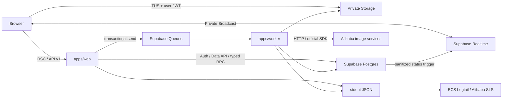
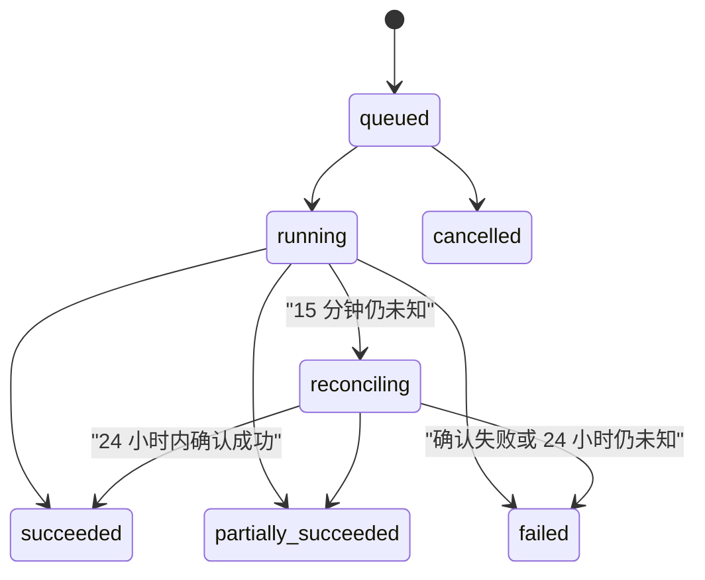

# Zima Phase 1 技术选型与页面实现指南

| 属性 | 值 |
| --- | --- |
| 文档状态 | 技术方案基线，待实现与外部依赖核验 |
| 适用阶段 | Phase 1，最多 30 名封闭验证用户 |
| 基准日期 | 2026-08-17 |
| 产品真相源 | [`requirements.md`](./requirements.md) |
| 独立审计 | [`tech-selection-review.md`](./tech-selection-review.md) |
| 工程约束 | [`AGENTS.md`](../AGENTS.md) |
| 目标读者 | 后端、前端、基础设施工程师与 AI Agent |

## 1. 文档定位与决策边界

### 1.1 需求优先级

本文件回答“如何实现”，不能修改 `requirements.md` 中的产品范围、状态机、积分语义、安全规则或验收阈值。发生冲突时，以 `requirements.md` 为准并暂停实现；不得通过技术选型悄悄扩大 Phase 1。

本文件中的接口名、目录和伪代码是后续实现基线，不代表仓库已经具备这些能力。数据库 SQL、供应商模型 ID、Endpoint、价格和地域只有在 EXT-002、EXT-003、EXT-005 完成后才能固化为生产配置。

### 1.2 LobeHub 使用边界

`C:\Users\yao.zhao\workspace\lobehub-canary` 仅作为行为和信息架构的只读研究源。其 `LICENSE` 要求商业衍生发行取得许可，因此 Zima：

- 可以借鉴“输入区 + 异步结果流”、逐图状态、项目入口、Skill 浏览和使用记录的信息组织；
- 不复制源代码、数据库 schema、视觉样式、图标、文案、提示词或商业计费实现；
- 不使用 LobeHub 的 BetterAuth、供应商选择、模型选择、多 Agent 或 UGC 社区作为 Zima Phase 1 实现；
- 所有本文出现的 LobeHub 路径都只说明研究对象，不是依赖或可直接移植的模块。

### 1.3 外部依赖门槛

| 外部依赖 | 技术影响 | 未完成时允许做什么 | 禁止伪装成已完成的能力 |
| --- | --- | --- | --- |
| EXT-001 | 阿里云邮件推送、自定义 SMTP、SPF/DKIM/DMARC | 本地 Mailpit、Auth 契约和失败测试 | 正式邮箱送达率 |
| EXT-002 | 百炼/视觉智能账号、地域、配额、限流、审核、成本 | ProviderAdapter、Mock、脱敏契约测试 | 五种生产能力可用或具体模型映射 |
| EXT-003 | Supabase 新加坡项目、Queues、私有 Storage、凭证 | 本地 Supabase migration、pgTAP、生成类型 | 生产环境就绪；扩大内测前的备份恢复能力 |
| EXT-004 | 域名、ICP、隐私协议、跨境数据评估 | 数据流图、删除与保留机制 | 法务或上线审批完成 |
| EXT-005 | 首版价表、取整规则、邀请额度整数 | 价表 schema、版本切换、未配置时阻断 | 猜测默认积分或生产邀请码额度 |

## 2. 技术选型总览

### 2.1 运行时与框架

| 领域 | 选型 | 版本策略 | 需求来源 | 决策依据与备选方案 |
| --- | --- | --- | --- | --- |
| JavaScript 运行时 | Node.js 24 LTS | 固定 24.x，镜像与 CI 使用相同 minor | NFR-REL-001、NFR-REL-003 | Node 24 为当前 LTS；Supabase JS 已停止支持 Node 20。Node 26 当前版不用于生产基线 |
| Monorepo | pnpm workspace + Turborepo | pnpm 版本写入 `packageManager`，提交 lockfile | 6.1、SEC-002 | 与既定模块化单体一致；不引入 Nx 的额外项目模型 |
| Web | Next.js 16.2 Active LTS、React 19.2、App Router | 仅交付响应式浏览器 Web；固定安全修复版本，不使用 preview 功能 | HOME-001～004、NFR-UX-001～004 | Web 宽屏提供完整创作，375px 移动 Web 提供关键只读路径；不开发 Electron 或原生移动应用 |
| 语言与校验 | TypeScript strict + Zod | 使用 Next.js 与 Supabase 支持的稳定 TypeScript，依赖精确锁定 | AGENT-004～005、TOOL-004、T-API-01 | TypeScript 负责静态约束，Zod负责浏览器、LLM、数据库 RPC 和供应商响应的运行时边界 |
| 样式与组件 | Tailwind CSS 4.x + Radix Primitives，封装在 `packages/ui` | 不允许业务页直接形成第二套组件系统 | HOME-004、NFR-UX-001～003 | 自有组件体系便于无障碍和品牌独立；不复制 `@lobehub/ui` |
| i18n | `next-intl`，Phase 1 只发布 `zh-CN` 消息目录 | URL 不增加 locale 前缀；所有文案仍使用稳定 key | NFR-UX-003 | 保留未来语言扩展能力，避免为单一首发语言复制路由树 |
| 服务端状态 | RSC 初始读取 + TanStack Query 客户端缓存 | Query key 由领域包定义 | TASK-007、NFR-PERF-002、NFR-UX-004 | 比纯 Server Actions 更适合 Realtime、轮询和 Mutation；比 SWR + 大型 Store 更清晰地区分远端状态 |
| 本地交互状态 | 局部 state；仅未提交创作草稿使用小型 Zustand store | 不持久化二进制文件和签名 URL | AUTH-006、TOOL-005、TASK-012 | 避免把任务真相复制进全局 Store；浏览器恢复只包含文本、选择和资产引用元数据 |
| BFF | `/api/v1/*` Route Handler + 共享 Zod 契约 | 未知字段严格拒绝，Mutation 使用 `Idempotency-Key` | TASK-001～003、T-API-01 | 比 tRPC 更显式、易做故障注入；比 Server Actions 更易统一错误码、幂等头和契约测试 |

版本事实以官方资料为准：[Node.js Releases](https://nodejs.org/en/about/previous-releases)、[Next.js Releases](https://nextjs.org/blog)、[Tailwind CSS Releases](https://tailwindcss.com/blog)。脚手架创建时必须再次核对安全版本并提交精确 lockfile。

### 2.2 Supabase 与数据访问

| 能力 | 选型 | 需求来源 | 决策依据与备选方案 |
| --- | --- | --- | --- |
| Auth | Supabase Auth 邮箱 OTP + `@supabase/ssr` Cookie 会话 | AUTH-001～011 | 不引入 BetterAuth；BFF 保护路径使用已验证 claims，不以未经验证的本地 session 当授权事实 |
| Postgres | SQL migration + 生成的 Supabase TypeScript 类型 + 非暴露 typed RPC | TASK-002、CREDIT-001～010、SEC-001、SEC-009～010 | 不引入 Drizzle/Prisma；Web/Worker 仅以服务端连接调用私有事务函数，避免第二套 schema、迁移和权限真相源 |
| 浏览器数据 | Supabase publishable key + 用户 JWT + 显式 GRANT + RLS | AUTH-005、SEC-001～003、SEC-010 | 新 publishable key 替代新项目中的 legacy anon key；secret/service-role 永不进入浏览器 |
| Storage | 私有 bucket + TUS resumable upload + 短时签名 URL | ASSET-001～006、SEC-003 | 20 MiB 和不稳定网络适合断点续传；不经 BFF 双倍转发文件 |
| Realtime | 私有 Broadcast + RLS 授权；TanStack Query 轮询兜底 | TASK-007、NFR-PERF-002 | 比 Postgres Changes 更少暴露物理行和受限列；比纯轮询请求量更低 |
| Queue | Supabase Queues/pgmq；数据库事务内入队，短租约增量消费 | TASK-002～006、TASK-010～013、NFR-PERF-003 | 不使用 Next.js 返回后的 Promise，不把长任务放进 Edge Function |

Supabase 2026 年变更要求新表通过显式 `GRANT` 才能进入 Data API；`GRANT` 与 RLS 是两个独立门槛。迁移必须同时声明最小表权限、RLS、策略和视图的 `security_invoker` 属性。参考：[Securing your Data](https://supabase.com/docs/guides/database/secure-data)、[Data API 变更](https://supabase.com/changelog/45329-breaking-change-tables-not-exposed-to-data-and-graphql-api-automatically)。

### 2.3 图片供应商、测试与可观测性

| 领域 | 选型 | 需求来源 | 决策依据与备选方案 |
| --- | --- | --- | --- |
| 百炼图像 | 原生 `fetch` + Zod 响应校验 + 异步 `submit/getStatus` | IMG-001～005、TASK-006、TASK-013 | 官方支持生产自行实现 HTTP；Node 无需增加 Python 侧车 |
| 视觉智能抠图 | 阿里云官方 Node.js SDK，隐藏在 ProviderAdapter 中 | IMG-001、TOOL-008、T-PROVIDER-01 | SDK 负责 OpenAPI 签名；不自行维护签名算法 |
| 图片元数据 | Sharp，仅在受信服务端进行 magic bytes、解码、尺寸、alpha 与缩略图检查 | ASSET-002、IMG-009 | 浏览器 MIME 和扩展名都不是安全事实 |
| 单元/组件 | Vitest + Testing Library + MSW | T-GATE-01、T-PLAN-01、T-NFR-UX-01 | 快速覆盖纯领域规则、组件状态和 HTTP 契约 |
| 数据库 | Supabase CLI + pgTAP | T-AUTH-01～03、T-RLS-01、T-DATAAPI-01、T-LEDGER-01 | 在真实 Postgres 上验证事务、约束、RLS、RPC 和 Queue |
| E2E | Playwright + `@axe-core/playwright` | T-HOME-01、T-RESULT-01、T-ACCOUNT-DELETE-01、T-NFR-UX-01 | 覆盖 Web 宽屏、375px 移动 Web、键盘、WCAG 自动检查、断网和重新连接 |
| 日志与告警 | Pino 脱敏 JSON → ECS Logtail → 同地域阿里云 SLS | NFR-OBS-001～003、SEC-004 | 不在 2C4G/40G 主机自托管 Grafana 栈；应用输出保持供应商中立 |

### 2.4 运行拓扑



### 2.5 建议目录与单向依赖

```text
apps/
  web/
    app/(public)/
    app/(private)/
    app/api/v1/
    features/
    server/application/
  worker/
    src/consumer/
    src/execution/
    src/reconciliation/
packages/
  ui/          # 无业务状态的可访问组件
  domain/      # 类型、Zod、状态机、错误码、query keys
  agent/       # Tool gate、Skill/ExecutionPlan 编译与校验
  supabase/    # browser/server/worker client、生成类型、仓储边界
  providers/   # ProviderAdapter、百炼 HTTP、视觉智能 SDK
  config/      # TS、lint、env schema、日志脱敏
supabase/
  migrations/
  seed.sql
  tests/
tools/
  quality-benchmark/
```

依赖方向固定为 `apps -> application service -> domain ports -> adapters`。`packages/domain` 不依赖 React、Next.js、Supabase 或供应商 SDK；React 组件不计算积分、不迁移任务状态、不映射供应商参数。

## 3. 按页面组织的技术方案

每个页面都使用同一套领域 schema 和应用服务。首页、案例页和项目工作台不能各自实现一套 Tool 门控或创建任务规则。

### 3.1 首页 `/`

#### 需求来源与追踪

| 需求 ID | 内容摘要 | 页面组件 | 应用服务/数据 | 验收 |
| --- | --- | --- | --- | --- |
| HOME-001、HOME-002 | 首屏输入、主图/参考图、Skill、四个快捷 Tool | `HomeComposer`、`AssetSlots`、`ToolPicker`、`SkillPicker` | `DraftStore`、`listPublishedSkills` | T-HOME-01 |
| HOME-003 | 登录显示最近项目；匿名显示说明和案例 | `RecentProjects`、`FeaturedCases` | `listRecentProjects`、`listFeaturedCases` | T-HOME-01 |
| HOME-004 | 统一导航和返回路径 | `AppNavigation` | route metadata | T-HOME-01、T-NFR-UX-01 |
| AUTH-005、AUTH-006 | 匿名不可永久上传/执行；登录只恢复安全草稿 | `AuthGate` | local draft serializer | T-AUTH-04、T-RLS-01 |
| TOOL-001～007、ASSET-001 | 显式门控、互斥来源、素材角色和数量 | `CreationForm` | `evaluateToolGate`、`CreateTaskSchema` | T-GATE-01、T-PLAN-01 |
| AGENT-002～003、AGENT-008～010 | 单输入分流、项目内文本咨询、确定性拒绝和 token 计费 | `HomeComposer` | `respondToAgentInput` | T-AGENT-01、T-AGENT-CHAT-01、T-TEXT-BILLING-01 |

#### 技术实现方案

- `app/(public)/page.tsx` 是 RSC，只读取公开 Skill/案例和可选的已验证用户 claims；匿名请求不查询私有项目。
- 首屏交互进入轻量 Client Component。草稿只保存 prompt、Tool/Skill 选择、参数和已上传资产 ID；`File`/Blob、OTP、签名 URL 不进入持久化 Store。
- 匿名用户可以编辑文本和选择公开 Skill，但“上传/执行”统一进入 `/auth?returnTo=/`。登录完成只恢复草稿，按钮仍要求用户重新提交。
- 明确选择 Tool 后表单呈现该能力的 discriminated union；所有提交统一调用 `/api/v1/agent/respond`。服务端以版本化确定性规则判定图片、文本、澄清或无关拒绝；浏览器判断只用于即时提示，不是安全或计费边界。
- 匿名用户提交任何需要永久项目、文本模型或图片执行的请求时先登录。登录后的首次文本回合与项目、项目会话和用户消息原子创建；无关确定性拒绝不创建项目、不调用模型、不扣积分。

```ts
async function HomePage() {
  const claims = await getVerifiedClaimsOrNull();
  const [skills, cases, projects] = await Promise.all([
    listPublishedSkills({ limit: 8 }),
    listFeaturedCases({ limit: 6 }),
    claims ? listRecentProjects(claims.sub, 6) : Promise.resolve([]),
  ]);

  return <HomeShell audience={claims ? 'member' : 'anonymous'} {...{ skills, cases, projects }} />;
}

async function submitDraft(draft: CreationDraft) {
  if (!session) return saveSafeDraftAndNavigateToAuth(draft);
  const request = AgentRespondRequestSchema.parse(toAgentRespondRequest(draft));
  return agentRespondMutation.mutateAsync(request);
}
```

#### 建议文件范围与模块边界

```text
apps/web/app/(public)/page.tsx
apps/web/features/home/{HomeShell,HomeComposer,RecentProjects,FeaturedCases}.tsx
apps/web/features/creation/{AssetSlots,ToolPicker,SkillPicker,CreationForm}.tsx
apps/web/features/creation/draft-store.ts
packages/domain/src/creation/{draft,request}.ts
```

`HomeComposer` 只组装字段；上传、门控、报价和任务创建分别由资产服务、Agent 包和任务应用服务负责。

#### LobeHub 只读参考

- `src/features/Home/index.tsx`、`InputArea/*`：研究立即输入与拖拽入口的组合方式。
- `src/features/Home/Recents/*`：研究最近内容的加载、空状态和错误状态。
- `src/routes/(main)/(create)/image/features/PromptInput/index.tsx`：研究图片输入参数的渐进展示；Zima 必须移除模型/供应商选择。

#### 选型依据与备选方案

选择 RSC 首屏 + 局部客户端创作表单，可减少匿名公共页 JavaScript，同时保留设计工具需要的实时交互。纯客户端 SPA 会重复处理公开/私有数据边界；纯 Server Action 难以承接 TUS、Realtime 和可恢复草稿。

#### 实施路径

1. 建立统一路由元数据、RSC 公共查询和页面骨架。
2. 实现 CreationDraft schema 与安全序列化白名单。
3. 实现 Tool/Skill 互斥选择和素材角色 UI。
4. 接入认证门槛、最近项目/精选案例分支。
5. 完成匿名、登录、单输入四分支、Web 宽屏、375px 移动 Web 和键盘状态测试。

#### 验收映射

执行 T-HOME-01、T-AUTH-04、T-GATE-01、T-NFR-UX-01；另外断言匿名首页不会请求 `projects`、`assets`、`tasks` 或永久上传接口。

### 3.2 Skill 列表 `/skills` 与详情 `/skills/[slug]`

#### 需求来源与追踪

| 需求 ID | 内容摘要 | 页面组件 | 应用服务/数据 | 验收 |
| --- | --- | --- | --- | --- |
| SKILL-001 | 仅官方声明式 Skill，无代码/网络/SQL | `SkillSafetySummary` | `skills`、`skill_versions` | T-SKILL-01 |
| SKILL-002、SKILL-005 | 版本冻结和退休展示 | `SkillVersionBadge` | immutable `SkillVersion` | T-SKILL-01 |
| SKILL-003 | 浏览、搜索、分类、启停、明确选择 | `SkillCatalog`、`EnableSkillButton` | `user_skills` | T-SKILL-01 |
| SKILL-004 | 发布前校验输入、步骤、能力、变量 | 详情中的只读契约摘要 | `SkillVersionSchema` | T-SKILL-01、T-PLAN-01 |
| AUTH-005、TOOL-001～002、TOOL-007 | 匿名可浏览；启用需登录；只有本次选择可影响任务 | `AuthGate`、`UseSkillButton` | `compileSkillPlan` | T-GATE-01 |

#### 技术实现方案

- 列表和详情使用 RSC，从仅公开 `published` 版本的安全投影视图读取；视图必须 `security_invoker`，或由服务端仓储返回明确 DTO。
- 搜索 Phase 1 使用 Postgres `websearch_to_tsquery`/`ILIKE` 的受限索引查询，不引入独立搜索服务。
- 启用/停用是用户偏好 Mutation，不会触发 Tool。详情页“使用此 Skill”只把确切 `skillVersionId` 写入创作草稿并跳转首页或项目工作台。
- Skill 发布是 Phase 1 管理流程，不提供公共管理页面；受控 RPC 校验并把完整版本从 `draft` 原子切换为 `published`。

```ts
const SkillVersionSchema = z.object({
  version: z.number().int().positive(),
  inputSchema: DeclarativeInputSchema,
  steps: z.array(SkillStepSchema).max(3),
  allowedCapabilities: z.array(ImageCapabilitySchema),
  requiredCapabilities: z.array(ImageCapabilitySchema),
  outputContract: OutputContractSchema,
}).strict().superRefine(validateSkillOutputBudget);

function useSkill(version: PublicSkillVersion) {
  draftStore.replaceExecutionSource({
    kind: 'skill',
    selectedSkillVersionId: version.id,
  });
  router.push('/');
}
```

#### 建议文件范围与模块边界

```text
apps/web/app/(public)/skills/page.tsx
apps/web/app/(public)/skills/[slug]/page.tsx
apps/web/features/skills/{SkillCatalog,SkillCard,SkillDetail,EnableSkillButton}.tsx
apps/web/server/application/skills.ts
packages/agent/src/skills/{schema,compiler,validation}.ts
```

#### LobeHub 只读参考

- `src/routes/(main)/community/(list)/skill/*`：研究分类、列表卡片和元信息层次。
- `src/routes/(main)/community/(detail)/skill/index.tsx` 与 `src/features/CommunitySkillDetail/*`：研究详情、版本和调用入口。
- Zima 不复制 LobeHub Skill 的可执行代码、联网能力或市场发布机制。

#### 选型依据与备选方案

声明式 JSON + Zod 编译器可以在入队前证明步骤和输出上限；任意脚本/容器 Skill 会引入代码执行、网络外联和租户隔离风险，超出 Phase 1。独立搜索引擎对策展型小目录没有收益。

#### 实施路径

1. 定义 SkillVersion schema、不可变约束和发布状态机。
2. 建立公开安全投影、分类/搜索查询与 RLS。
3. 实现列表、详情、启停和“使用此版本”。
4. 实现管理 RPC 与审计，不创建运营后台。
5. 用恶意脚本字段、4 步/9 输出和退休版本做负向测试。

#### 验收映射

执行 T-SKILL-01、T-GATE-01、T-PLAN-01、T-ADMIN-01；检查已启用但未明确选择的 Skill 不进入 ExecutionPlan。

### 3.3 精选案例 `/community` 与详情 `/community/[slug]`

#### 需求来源与追踪

| 需求 ID | 内容摘要 | 页面组件 | 应用服务/数据 | 验收 |
| --- | --- | --- | --- | --- |
| COMM-001 | 仅管理员策展且已发布 | `CaseGallery` | `community_cases` published projection | T-COMM-01 |
| COMM-002 | 展示输入说明、结果、步骤和 Skill 版本，不泄露模型 | `CaseDetail`、`StepSummary` | public case DTO | T-COMM-01 |
| COMM-003 | “用同款”只预选，匿名先登录 | `ReuseCaseButton` | safe draft serializer | T-COMM-01 |
| COMM-004、SEC-006 | 仅授权展示资产，不公开私有用户资产 | `CaseAsset` | dedicated public assets | T-COMM-01、T-SECURITY-01 |

#### 技术实现方案

- 案例使用独立公开展示资产，不把普通私有 Storage object 改为 public。
- `community_cases` 保存授权证据引用、发布状态和冻结的 Skill 版本；对外 DTO 只包含公开参数、步骤摘要和展示图。
- “用同款”构造安全草稿：只复制公开 prompt 模板参数、SkillVersion ID 和输出偏好，不复制用户标识、供应商路由、成本或原始私有输入。

```ts
function reuseCase(caseDto: PublicCaseDetail) {
  const draft = PublicCaseReuseSchema.parse({
    sourceCaseId: caseDto.id,
    selectedSkillVersionId: caseDto.skillVersion.id,
    prompt: caseDto.reusablePrompt,
    parameters: caseDto.reusableParameters,
  });
  saveSafeDraft(draft);
  router.push(session ? '/' : '/auth?returnTo=/');
}
```

#### 建议文件范围与模块边界

```text
apps/web/app/(public)/community/page.tsx
apps/web/app/(public)/community/[slug]/page.tsx
apps/web/features/community/{CaseGallery,CaseCard,CaseDetail,ReuseCaseButton}.tsx
apps/web/server/application/community.ts
packages/domain/src/community/public-case.ts
```

#### LobeHub 只读参考

- `src/routes/(main)/community/(list)/skill/*`：研究策展列表、分类和空状态。
- `src/routes/(main)/community/(detail)/skill/*`：研究详情信息层次和复用入口。
- 不研究或移植评论、评分、用户发布与社区账号体系。

#### 选型依据与备选方案

独立公开资产能在数据库和 Storage 层证明授权边界；直接给私有用户对象生成长期公开链接会违反 COMM-004、ASSET-004 和 SEC-006。Phase 1 不引入 CMS，管理员通过受控 RPC 发布少量案例。

#### 实施路径

1. 定义公开案例 DTO、授权证据字段和发布约束。
2. 建立独立展示 bucket/路径及只读访问策略。
3. 实现列表、详情和安全复用草稿。
4. 实现发布/撤回 RPC 与审计。
5. 验证私有资产 ID 无法成为案例公开资源。

#### 验收映射

执行 T-COMM-01、T-RLS-01、T-SECURITY-01、T-ADMIN-01。

### 3.4 登录 `/auth`

#### 需求来源与追踪

| 需求 ID | 内容摘要 | 页面组件 | 应用服务/RPC | 验收 |
| --- | --- | --- | --- | --- |
| AUTH-001～003 | 一次性邀请码、原子核销、失败不消耗、幂等 | `InvitationForm`、`OtpForm` | `reserve_invitation`、`finalize_invitation` | T-AUTH-01～03 |
| AUTH-004 | Supabase OTP + 阿里云自定义 SMTP | `OtpForm` | Supabase Auth | T-AUTH-04 |
| AUTH-005～008 | 公开浏览、草稿恢复、摘要/限流、无 profile 隔离 | `AuthCallback` | app profile gate | T-AUTH-04～05、T-RLS-01 |
| AUTH-009～011 | 10 分钟预约、唯一/幂等、OTP 后事务核销 | `ReservationState` | private RPC | T-AUTH-03 |
| SEC-002、SEC-004 | 密钥和敏感日志不进入浏览器/日志 | 全页 | env/log redaction | T-SECURITY-01 |

#### 技术实现方案

认证分为两个不能伪装成单一跨系统事务的阶段：

1. BFF 验证邀请码摘要、限流并在 Postgres 创建 10 分钟预约；成功后调用 Supabase Auth 发送 OTP。
2. 浏览器验证 OTP 获得用户会话；BFF 使用已验证 `auth.uid()`、Auth 邮箱和 challenge 调用数据库事务完成邀请码核销、profile、积分账户和 grant。

预约与最终核销函数均位于非暴露 schema，并撤销 `PUBLIC` 执行权，只能由 BFF 的服务端数据库连接调用。BFF 先使用 Supabase Auth 验证 claims；函数接收 uid/email/challenge 后再次连接 `auth.users` 和预约记录交叉验证，不接收浏览器传入的 user ID 或积分数。若必须使用 `SECURITY DEFINER` 访问受限表，必须固定 `search_path`、显式授权、验证调用者并运行数据库安全 advisor。

```ts
// POST /api/v1/auth/invitations/reserve
async function reserveAndSendOtp(input: unknown, requestMeta: RequestMeta) {
  const command = ReserveInvitationSchema.parse(input);
  await rateLimiter.assertAllowed(hashSignals(command, requestMeta));
  const reservation = await internalRpc.reserveInvitation({
    invitationDigest: hmac(command.code),
    normalizedEmail: normalizeEmail(command.email),
    idempotencyKey: command.idempotencyKey,
  });

  try {
    await auth.signInWithOtp({ email: command.email, options: { shouldCreateUser: true } });
    return reservation.publicResult;
  } catch (error) {
    await internalRpc.releaseReservationOnSendFailure(reservation.id);
    throw normalizeAuthError(error);
  }
}

// OTP 成功并建立 Cookie 会话之后
async function finalizeInvitation(challenge: string) {
  const claims = await requireVerifiedClaims();
  return internalDb.finalizeInvitation({
    challenge,
    verifiedUserId: claims.sub,
    verifiedEmail: claims.email,
  }); // 浏览器请求体只含 challenge
}
```

```sql
-- 伪代码：private.finalize_invitation
begin;
  auth_user := require_auth_user(verified_user_id, verified_email);
  reservation := lock_valid_reservation(challenge, auth_user.email);
  invitation := lock_unused_invitation(reservation.invitation_digest);
  insert_profile_once(auth_user.id);
  insert_credit_account_once(auth_user.id);
  append_grant_once(invitation.id, auth_user.id, invitation.initial_credits);
  mark_invitation_redeemed(invitation.id, auth_user.id);
  mark_reservation_completed(reservation.id);
commit;
```

#### 建议文件范围与模块边界

```text
apps/web/app/(public)/auth/page.tsx
apps/web/app/api/v1/auth/invitations/reserve/route.ts
apps/web/app/api/v1/auth/invitations/finalize/route.ts
apps/web/features/auth/{InvitationForm,OtpForm,AuthCallback}.tsx
apps/web/server/application/auth.ts
packages/supabase/src/clients/{browser,server,internal}.ts
supabase/migrations/*_invitation_auth.sql
supabase/tests/invitation_auth.test.sql
```

#### LobeHub 只读参考

LobeHub `src/routes/auth/*` 只可用于研究错误页和返回路径，不参考其 BetterAuth 实现。Zima 的邀请码事务、Supabase OTP 和 RLS profile gate 必须独立设计。

#### 选型依据与备选方案

直接在 Auth user 创建 trigger 中发积分无法证明有效邀请码预约，也会把第三方 Auth 事件误当成业务事务；由浏览器提交 user ID/额度则可越权。两阶段流程承认 Auth 与应用 Postgres 的系统边界，同时把所有业务核销保持为单一数据库事务。

#### 实施路径

1. 定义摘要、预约、唯一约束、限流和清理任务。
2. 实现本地 Mailpit OTP 与 SSR Cookie clients。
3. 实现 reserve/send、verify/finalize 和 profile gate。
4. 添加并发、回滚、重放、过期、无 profile RLS 测试。
5. EXT-001 完成后再验证阿里云 SMTP 与真实送达。

#### 验收映射

执行 T-AUTH-01～05、T-RLS-01、T-DATAAPI-01、T-SECURITY-01。

### 3.5 项目列表 `/projects`

#### 需求来源与追踪

| 需求 ID | 内容摘要 | 页面组件 | 应用服务/数据 | 验收 |
| --- | --- | --- | --- | --- |
| PROJ-001 | 首图片任务或文本回合自动创建项目与标题降级 | `ProjectList` | `create_task_and_enqueue`、`reserve_agent_turn` | T-PROJECT-01、T-AGENT-CHAT-01 |
| PROJ-002 | 查询、最近排序、改名、软删、恢复 | `ProjectRow`、`ProjectMenu`、`TrashDrawer` | `projects` | T-PROJECT-01 |
| PROJ-003 | 删除后隐藏/禁止任务，7 天后清理 | `DeletedBadge` | cleanup job | T-PROJECT-01、T-DELETE-01 |
| NFR-PERF-004 | 列表只加载缩略图 | `ProjectCover` | thumbnail asset | T-PERF-01 |
| SEC-001～003 | 用户私有、RLS、短时图片访问 | 页面授权边界 | policies/signed URL | T-RLS-01 |

#### 技术实现方案

- 页面由受保护 RSC 读取第一页，按 `(updated_at desc, id desc)` cursor 分页；客户端搜索延迟提交到服务端，不把所有项目下载后过滤。
- 项目行只返回 cover thumbnail 的临时签名 URL 或由 BFF 批量签名，不返回原图。
- 改名和软删除走 Route Handler + 用户 JWT/RLS；恢复因普通 RLS 会隐藏已删除行，必须由 BFF 验证 claims 后调用非暴露的 `restore_owned_project` typed RPC，函数再次校验 owner 和恢复期限。新任务服务端检查 `deleted_at is null`，不能只依赖页面隐藏。
- 七天清理由幂等清理 Worker 执行：先列出受影响对象 key，逐个删除并记状态，再删除业务引用；失败可重试，绝不对路径前缀做未验证的递归删除。

```ts
async function listProjects(userId: string, cursor?: ProjectCursor) {
  return projectRepository.listOwned({
    userId,
    deleted: false,
    order: ['updatedAt:desc', 'id:desc'],
    cursor,
    limit: 30,
    projection: 'list',
  });
}

async function softDeleteProject(projectId: string) {
  return projectRepository.softDeleteOwned(projectId, {
    deletedAt: clock.now(),
    purgeAfter: clock.addDays(7),
  });
}
```

#### 建议文件范围与模块边界

```text
apps/web/app/(private)/projects/page.tsx
apps/web/features/projects/{ProjectList,ProjectRow,ProjectMenu,TrashDrawer}.tsx
apps/web/server/application/projects.ts
apps/web/app/api/v1/projects/[projectId]/{route,restore/route}.ts
apps/worker/src/reconciliation/purge-projects.ts
packages/domain/src/projects/{project,cursor}.ts
```

#### LobeHub 只读参考

- `src/features/Projects/List/index.tsx`：研究项目搜索、空/错/加载状态和行级菜单。
- `src/features/Projects/Workspace/*`：研究项目摘要与最近工作的层次。
- Zima 不复制 LobeHub 项目目标、协调 Agent、成员或工作区模型。

#### 选型依据与备选方案

RSC cursor 分页比全量客户端 Store 更适合私有数据和持续增长列表；软删除 + 可重试清理满足恢复窗口，直接同步删除 Storage 对象会造成部分失败且不可恢复。

#### 实施路径

1. 建立 projects schema、cursor 索引、RLS 和投影 DTO。
2. 实现列表、搜索、改名、软删和恢复。
3. 在图片任务创建和文本回合预扣 RPC 中复用项目有效性检查与自动建项目规则。
4. 实现七天清理状态机及失败重试。
5. 完成跨用户、排序、缩略图和删除恢复测试。

#### 验收映射

执行 T-PROJECT-01、T-DELETE-01、T-RLS-01、T-PERF-01。

### 3.6 项目工作台 `/projects/[projectId]`

#### 需求来源与追踪

| 需求 ID | 内容摘要 | 工作台区域 | 应用服务/数据 | 验收 |
| --- | --- | --- | --- | --- |
| ASSET-001～006 | 主图/参考图、格式/校验、派生、私有访问、删除恢复 | 左侧创作坞、资产选择器、预览器 | assets/Storage | T-ASSET-01～02 |
| AGENT-001～010 | 单 Agent、项目内多轮、自动分流、结构化计划与 token 计费 | 创作坞 Agent 输入、消息流与建议卡 | conversation/AgentTurn/TextModelAdapter | T-AGENT-01、T-AGENT-CHAT-01、T-TEXT-01、T-TEXT-BILLING-01 |
| TOOL-001～008 | 显式门控、上限、换背景两步 | 执行计划卡、步骤摘要 | agent compiler | T-GATE-01、T-PLAN-01、T-REPLACE-01 |
| IMG-001～007 | 五能力、结果预览/下载/反馈/派生/独立重试 | 右侧 Task→Step→Output 流 | tasks/outputs/assets | T-IMG-01、T-RESULT-01、T-PARTIAL-01 |
| TASK-001～013 | 幂等、队列、Attempt、重试、Realtime、容量、对账 | 状态卡、离线提示、重试入口 | task application/worker | T-IDEMP-01、T-RECON-01、T-CAPACITY-01 |
| CREDIT-002～005、CREDIT-007～009 | 报价、预扣、逐输出结算与冻结版本 | 报价摘要、输出积分 | ledger/price book | T-PRICE-01、T-LEDGER-01 |
| NFR-UX-001～004 | Web 宽屏完整创作、375px 移动 Web 关键只读、键盘、异步状态 | 响应式 Shell | UI state model | T-NFR-UX-01 |

#### 技术实现方案

Web 宽屏使用“创作坞 + 任务流”：左侧 360px 可折叠创作坞承载项目内消息、prompt、素材、Tool/Skill、参数和报价；右侧自适应区域按 Task → Step → Output 展示。375px 移动 Web 以任务流为主，创作坞变为抽屉；Phase 1 移动 Web 必须能登录、查看、预览和下载，不要求完成复杂创作。不存在 Electron 或原生客户端布局分支。

工作台 RSC 首次返回项目安全摘要、最近任务和缩略图。客户端 `ProjectWorkspaceProvider` 建立项目 Query cache；每个活动任务订阅私有频道。Broadcast 只通知实体、状态和版本，客户端收到后使对应 Query 失效并从数据库取权威 DTO。

输出 UI 采用显式状态联合，而不是一组互相矛盾的 boolean：

```ts
type OutputViewState =
  | { kind: 'queued'; outputId: string }
  | { kind: 'processing'; outputId: string; attempt: number }
  | { kind: 'succeeded'; outputId: string; thumbnailUrl: string; credits: number }
  | { kind: 'failed'; outputId: string; errorCode: PublicErrorCode; retryable: boolean }
  | { kind: 'deleted'; outputId: string; restoreUntil: string };

function ProjectWorkspace({ initialProject }: Props) {
  useTaskBroadcast(initialProject.id, event => {
    queryClient.invalidateQueries(taskKeys.detail(event.taskId));
  });
  usePollingFallback({ enabled: realtimeState !== 'connected' });
  return <WorkspaceLayout creationDock={<CreationDock />} taskFeed={<TaskFeed />} />;
}
```

结果预览只在用户打开时请求短时签名原图；列表使用缩略图。下载 Route Handler 检查 ownership、删除状态和安全状态后生成短时签名 URL。输出“继续加工”把 output asset ID 设为新草稿主图，并保留派生关系；它不覆盖原任务。

#### 建议文件范围与模块边界

```text
apps/web/app/(private)/projects/[projectId]/page.tsx
apps/web/features/workspace/{WorkspaceLayout,CreationDock,TaskFeed}.tsx
apps/web/features/workspace/task/{TaskCard,StepCard,OutputCard,StatusBadge}.tsx
apps/web/features/assets/{AssetPicker,AssetPreview,UploadQueue}.tsx
apps/web/features/results/{DownloadButton,FeedbackControl,RetryOutputButton}.tsx
apps/web/server/application/{tasks,assets,feedback}.ts
apps/web/app/api/v1/{tasks,assets,outputs}/...
packages/domain/src/tasks/{state,view-state,events}.ts
```

#### LobeHub 只读参考

- `src/routes/(main)/(create)/image/index.tsx`、`features/ImageWorkspace/*`：研究输入区与宽结果区的组合。
- `features/GenerationFeed/BatchItem.tsx`：研究批次摘要、参考图和逐图操作。
- `features/GenerationFeed/GenerationItem/{LoadingState,SuccessState,ErrorState,ActionButtons,index}.tsx`：研究逐输出异步状态。
- `src/store/image/slices/createImage/action.ts`、`generationBatch/action.ts`：研究创建后刷新与终态停止轮询；Zima 不采用浏览器 Store 作为任务真相。
- `src/features/FileViewer/Renderer/Image/index.tsx`：研究延迟加载与 contain 预览。

#### 选型依据与备选方案

分区工作台比单列聊天更适合设计师同时查看参数、素材和多输出；比资产/任务页签减少连续加工时的切换。Task→Step→Output 与需求状态和逐输出账本同构，避免用“消息”抽象掩盖换背景两步和部分成功。

#### 实施路径

1. 先建立只读 Workspace Shell、任务状态联合和组件状态故事/测试。
2. 接入资产上传、选择、预览和短时下载。
3. 接入门控、执行计划预览、报价和创建任务 Mutation。
4. 接入 Task/Step/Output 流、Broadcast 与轮询恢复。
5. 接入反馈、派生、删除恢复和失败输出独立重试。
6. 完成 Web 宽屏、375px 移动 Web、键盘、离线、部分成功和未知状态 E2E。

#### 验收映射

执行 T-ASSET-01～02、T-AGENT-01、T-GATE-01、T-PLAN-01、T-REPLACE-01、T-IMG-01、T-RESULT-01、T-PARTIAL-01、T-IDEMP-01、T-ATTEMPT-01、T-RECON-01、T-CAPACITY-01、T-NFR-UX-01。

### 3.7 积分记录 `/settings/credits`

#### 需求来源与追踪

| 需求 ID | 内容摘要 | 页面组件 | 应用服务/数据 | 验收 |
| --- | --- | --- | --- | --- |
| CREDIT-001 | 整数、只追加账本、受约束余额 | `CreditBalance`、`LedgerTable` | credit account/ledger | T-LEDGER-01 |
| CREDIT-002 | 只显示统一积分，不泄露供应商/美元 | `CreditEventRow` | public ledger DTO | T-LEDGER-01 |
| CREDIT-003～005 | reserve/capture/release、上限、幂等 | 事件分组和任务链接 | settlement service | T-PARTIAL-01、T-IDEMP-01 |
| CREDIT-006 | 无充值、套餐、支付 | 页面无商业入口 | API negative boundary | T-LEDGER-01 |
| CREDIT-007～009 | 冻结价表、邀请额度依赖、版本切换/取整 | `PriceExplanation` | PriceBookVersion | T-PRICE-01 |

#### 技术实现方案

- 受保护 RSC 返回当前整数余额和 cursor 分页账本；公开 DTO 不包含 `internalCostMinor`、provider、model 或 pricing route。
- 账本是不可变事件，UI 按任务/输出关联展示“发放、预扣、结算、释放、调整”，不通过修改历史事件纠正余额。
- Phase 1 不渲染支付按钮，也不提供隐藏充值接口。管理员调整必须由受控 RPC 追加 `adjustment` 并记录原因/前后余额。

```ts
type PublicCreditEvent = {
  id: string;
  kind: 'grant' | 'reserve' | 'capture' | 'release' | 'adjustment';
  credits: number;
  balanceAfter: number;
  taskId?: string;
  outputId?: string;
  createdAt: string;
};
```

#### 建议文件范围与模块边界

```text
apps/web/app/(private)/settings/credits/page.tsx
apps/web/features/credits/{CreditBalance,LedgerTable,CreditEventRow}.tsx
apps/web/server/application/credits.ts
packages/domain/src/credits/{ledger,price-book,public-dto}.ts
```

#### LobeHub 只读参考

`src/features/Settings/stats/features/usage/*` 仅用于研究摘要卡、趋势/明细和加载状态。Zima 不复制模型用量、美元成本、套餐或商业定价。

#### 选型依据与备选方案

直接呈现追加账本比仅显示余额更可解释，也能支持重复扣款排查。Phase 1 没有支付，不引入 Stripe、订阅表或套餐 UI。

#### 实施路径

1. 实现公开账本 DTO、cursor 和 RLS。
2. 实现余额、事件表、任务/输出关联与空状态。
3. 实现受控 adjustment RPC 和审计。
4. 做供应商字段泄露和支付入口负向测试。

#### 验收映射

执行 T-LEDGER-01、T-PRICE-01、T-PARTIAL-01、T-IDEMP-01、T-ADMIN-01。

### 3.8 账户设置 `/settings/account`

#### 需求来源与追踪

| 需求 ID | 内容摘要 | 页面组件 | 应用服务/数据 | 验收 |
| --- | --- | --- | --- | --- |
| SEC-011 | 申请即禁止新任务、7 天撤销、期满撤销会话和清理 | `DeletionPanel`、`DeletionCountdown` | account deletion state | T-ACCOUNT-DELETE-01 |
| SEC-012 | 7/30/180 天保留和去标识 | `RetentionSummary` | purge/anonymize jobs | T-ACCOUNT-DELETE-01 |
| SEC-005、SEC-009 | 管理变更与删除审计 | 页面只读状态 | controlled RPC/audit | T-ADMIN-01 |
| AUTH-004、SEC-002 | 邮箱会话和安全退出 | `AccountIdentity`、`SignOutButton` | Supabase Auth | T-SECURITY-01 |

#### 技术实现方案

- 页面只显示来自受信 Auth claim 的脱敏邮箱、当前删除状态、期限和退出操作，不允许直接编辑权限元数据。
- `request_account_deletion` 原子写入 `requested_at/purge_after` 并设置 profile `blocked_for_new_tasks`；任务创建 RPC 必须检查该字段。
- 七天内 `cancel_account_deletion` 可撤销。到期 Worker 先撤销 Auth sessions，再删除对象、缩略图、prompt、项目与邮箱标识；账本/安全审计去标识保留 180 天，Pino/SLS 日志生命周期为 30 天。
- Supabase 删除 Auth user 本身不能被当作立即撤销所有已签 JWT；敏感入口需要验证 session/删除状态，清理顺序先阻断和撤销会话。

```ts
async function requestAccountDeletion(userId: string) {
  return accountRepository.inTransaction(async tx => {
    await tx.accounts.blockNewTasks(userId);
    return tx.deletions.requestOnce(userId, {
      requestedAt: clock.now(),
      purgeAfter: clock.addDays(7),
    });
  });
}

async function purgeExpiredAccount(requestId: string) {
  const request = await claimDeletionRequest(requestId);
  await authAdmin.revokeUserSessions(request.userId);
  await purgePrivateObjectsIdempotently(request.userId);
  await deleteProductContent(request.userId);
  await anonymizeLedgerAndAudit(request.userId, { retainDays: 180 });
  await markDeletionComplete(requestId);
}
```

#### 建议文件范围与模块边界

```text
apps/web/app/(private)/settings/account/page.tsx
apps/web/features/account/{AccountIdentity,DeletionPanel,DeletionCountdown,RetentionSummary}.tsx
apps/web/app/api/v1/account/deletion/{route,cancel/route}.ts
apps/web/server/application/account.ts
apps/worker/src/reconciliation/purge-accounts.ts
packages/domain/src/account/deletion.ts
```

#### LobeHub 只读参考

LobeHub `src/features/Settings/profile/*` 只可用于研究设置页分组和危险操作的交互层次；认证、删除、保留与审计实现不复用。

#### 选型依据与备选方案

异步可撤销删除状态机比立即硬删更符合七天冷静期，也允许对象删除失败时安全重试。仅删除 Auth user 会留下业务数据和仍有效 token 风险，不能满足 SEC-011～012。

#### 实施路径

1. 建立删除请求、阻断字段、唯一约束和状态机。
2. 实现申请/撤销 RPC 与页面倒计时。
3. 实现 session 撤销、对象清理、业务删除和去标识任务。
4. 配置 SLS 30 天生命周期并记录法定保留覆盖依据。
5. 完成时间推进、失败恢复和会话重放 E2E。

#### 验收映射

执行 T-ACCOUNT-DELETE-01、T-ADMIN-01、T-SECURITY-01、T-NFR-REL-01。

## 4. 跨页面接口与关键实现

### 4.1 领域类型边界

浏览器、Agent、Worker 和供应商不能共享无界 JSON。以下类型放在 `packages/domain`/`packages/agent`，外部输入均使用 `.strict()` 的 Zod schema；数据库生成类型只描述表结构，不替代领域约束。

```ts
type ImageCapability =
  | 'generate'
  | 'remove_background'
  | 'replace_background'
  | 'outpaint_resize'
  | 'upscale';

type TaskStatus =
  | 'queued'
  | 'running'
  | 'reconciling'
  | 'succeeded'
  | 'partially_succeeded'
  | 'failed'
  | 'cancelled';

type CreditEventKind = 'grant' | 'reserve' | 'capture' | 'release' | 'adjustment';

type ExecutionPlan = {
  version: 1;
  source: 'explicit_tool' | 'selected_skill' | 'explicit_prompt';
  selectedSkillVersionId?: string;
  steps: ExecutionPlanStep[];        // <= 3
  priceBookVersionId: string;
  providerRouteVersionIds: string[];
  estimatedCredits: number;
};

type TextPurpose = 'consultation' | 'clarification' | 'plan' | 'prompt_explanation';

type TextUsage = {
  totalInputTokens: number;
  totalOutputTokens: number;
};

type TextPriceBookEntry = {
  kind: 'text';
  purpose: TextPurpose;
  inputCreditsPerMillion: number;
  outputCreditsPerMillion: number;
  maxOutputTokens: number;
};

type Conversation = {
  id: string;
  projectId: string;
  userId: string;
  version: number;
};

type AgentMessage = {
  id: string;
  conversationId: string;
  turnId: string;
  role: 'user' | 'assistant';
  text: string;
  createdAt: string;
};

type TextModelRequest = {
  purpose: TextPurpose;
  projectId: string;
  messages: Array<Pick<AgentMessage, 'role' | 'text'>>;
  maxOutputTokens: number;
};

type AgentTurn = {
  id: string;
  conversationId: string;
  idempotencyKey: string;
  purpose: TextPurpose;
  status: 'reserved' | 'running' | 'succeeded' | 'failed';
  priceBookVersionId: string;
  textModelConfigurationId: string;
  estimatedInputTokens: number;
  maxOutputTokens: number;
  usage?: TextUsage;
  reservedCredits: number;
  actualCredits?: number;
};

type BillableUnit =
  | { kind: 'image_output'; outputId: string }
  | { kind: 'agent_turn'; turnId: string };

interface TextModelAdapter {
  readonly configurationId: string; // 仅服务端
  estimateInputTokens(request: Omit<TextModelRequest, 'projectId'> & { projectId?: string }): Promise<number>;
  generateOnce(request: TextModelRequest): Promise<{ text: string; usage: TextUsage }>;
  normalizeTrustedUsage(error: unknown): TextUsage | undefined;
}
```

`Conversation` 以 `projectId` 唯一，`AgentMessage` 必须同时引用 conversation 和 turn；数据库约束验证三者属于同一用户项目。五种能力和图片/文本价表均使用 `requirements.md` 中的 discriminated union。任何 `providerId`、`modelId`、API Key、供应商参数或账本事件字段出现在浏览器请求时，Zod 严格解析直接返回 `invalid_input`，不能静默丢弃后继续执行。

### 4.2 BFF 接口

Phase 1 不提供第三方公共 API。以下 `/api/v1` 是浏览器与同源 Next.js BFF 的内部稳定契约；RSC 读取可以直接调用相同 application service，不在服务端自请求 HTTP。

| 方法与路径 | 身份 | 输入/输出摘要 | 幂等与安全 | 需求来源 |
| --- | --- | --- | --- | --- |
| `POST /api/v1/auth/invitations/reserve` | 匿名 | 邀请码、邮箱、幂等键 → challenge/过期时间 | 摘要存储；IP/邮箱/摘要限流 | AUTH-001、AUTH-003、AUTH-007、AUTH-009～010 |
| `POST /api/v1/auth/invitations/finalize` | 已验证 OTP | challenge → profile/初始余额 | uid/email 从会话读取；原子核销 | AUTH-002、AUTH-008、AUTH-011 |
| `POST /api/v1/agent/respond` | 登录 | 项目/提示词/Tool/Skill/资产/业务参数 → 文本、图片任务、澄清或拒绝 | `Idempotency-Key`；服务端确定性分流；一次最多一次模型调用 | AGENT-002～010、TOOL-001～008、CREDIT-010 |
| `POST /api/v1/assets/upload-intents` | 登录 | 文件名、声明大小、角色、授权确认及政策版本 → assetId/objectKey/TUS 配置 | 不返回 secret；路径绑定 uid；记录授权证据 | ASSET-001～004、SEC-003、SEC-006 |
| `POST /api/v1/assets/{id}/finalize` | 登录 | upload fingerprint → ready/rejected | 服务端下载并真实解码；重复 finalize 同结果 | ASSET-002～004 |
| `POST /api/v1/assets/{id}/signed-url` | 登录 | preview/download purpose → 短时 URL | 所有权、删除/审核状态检查 | ASSET-004、IMG-006 |
| `DELETE /api/v1/assets/{id}` | 登录 | 输出资产 → 回收期信息 | 软删；不修改历史账本 | ASSET-006、IMG-007 |
| `POST /api/v1/assets/{id}/restore` | 登录 | 资产 ID → restored | 仅回收期内且本人 | ASSET-006 |
| `GET/POST /api/v1/projects` | 登录 | 分页查询/显式建项目 | RLS；首次任务也可原子建项目 | PROJ-001～002 |
| `PATCH/DELETE /api/v1/projects/{id}` | 登录 | 改名/软删 | 预期版本条件；本人 | PROJ-002～003 |
| `POST /api/v1/projects/{id}/restore` | 登录 | 项目 ID → restored | 七天内；本人 | PROJ-002～003 |
| `POST /api/v1/tasks/{id}/cancel` | 登录 | queued task → cancelled | 条件迁移并释放未结算预扣 | CREDIT-003、TASK-001～006 |
| `POST /api/v1/outputs/{id}/retry` | 登录 | 失败输出 → 新关联子任务 | 新幂等键、新报价；不改原任务 | IMG-007、TASK-008～010 |
| `POST /api/v1/outputs/{id}/feedback` | 登录 | useful/not useful → feedback | 本人、一次当前值、审计时间 | IMG-006、NFR-OBS-001 |
| `GET /api/v1/credits/ledger` | 登录 | cursor → 公开账本 DTO | 不含内部成本/供应商 | CREDIT-001～007 |
| `POST/DELETE /api/v1/account/deletion` | 登录 | 申请/撤销 → 状态与期限 | 原子阻断；撤销有期限 | SEC-011～012 |

统一响应：

```ts
type ApiSuccess<T> = { ok: true; data: T; requestId: string };
type ApiFailure = {
  ok: false;
  error: {
    code: PublicErrorCode;
    message: string;
    retryable: boolean;
    preservedDraftId?: string;
  };
  requestId: string;
};

type CreateTaskResponse =
  | { outcome: 'queued'; projectId: string; taskId: string; status: 'queued'; estimatedCredits: number; reservedCredits: number; executionPlanVersion: 1 }
  | { outcome: 'clarification_required'; clarificationCode: ClarificationCode; message: string; preservedDraftId: string }
  | { outcome: 'rejected'; errorCode: CreateTaskRejectionCode; message: string; preservedDraftId: string };

type AgentRespondResponse =
  | CreateTaskResponse
  | {
      outcome: 'text_response';
      projectId: string;
      conversationId: string;
      turnId: string;
      text: string;
      reservedCredits: number;
      actualCredits: number;
      usage: TextUsage;
    }
  | {
      outcome: 'text_failed';
      projectId: string;
      turnId: string;
      errorCode: TextTurnErrorCode;
      retryable: boolean;
      reservedCredits: number;
      actualCredits: number;
      usage?: TextUsage;
      preservedDraftId: string;
    };
```

`/agent/respond` Phase 1 返回一次性 JSON，不使用 SSE。Tool/Skill/明确图片分支直接复用服务端内部 `createTask` 应用服务；不另行开放可绕过统一门控的 `POST /api/v1/tasks` 创建入口。文本分支返回已持久化的 turn 结果。明显无关拒绝和确定性澄清不创建 turn、不预扣；同一幂等键若已有 turn 或任务则返回其已保存结果，绝不再次调用模型。HTTP 层只表达传输结果：schema/业务拒绝使用稳定 4xx，容量/限流返回可重试状态，未知内部错误使用 5xx；业务任务失败写入任务状态而不是伪装成 HTTP 请求仍在进行。

### 4.3 Supabase client 与授权边界

`packages/supabase` 提供三个工厂，禁止业务代码随意创建客户端：

```ts
createBrowserClient(); // publishable key + browser session；仅 RLS 可见数据
createServerUserClient(cookies); // publishable key + 当前用户 cookie；保留 RLS
createInternalClient(); // secret key；仅 server/worker 的 Auth admin、Storage 等官方 API
createInternalDb();     // 服务端池化 Postgres 连接；仅调用非暴露 typed RPC/Queues，不允许散写 SQL
```

- 受保护 RSC/Route Handler 使用当前官方 SSR 方式刷新 Cookie，并调用已验证 claims API；原始 `getSession()` 只能读取 token，不能单独作为敏感授权判断。
- 浏览器环境变量仅允许 Supabase URL 与 publishable key。secret/service-role、SMTP、百炼、视觉智能和 SLS 凭证只能通过服务端 env schema 读取。
- `public` 仅放产品必须通过 Data API 读取的表/安全视图；路由、价表内部成本、邀请码摘要、供应商提交和审计细节放非暴露 schema。
- 新函数默认 `REVOKE EXECUTE ON FUNCTION ... FROM PUBLIC`。确需跨 RLS 的 definer 函数放非暴露 schema、固定空 `search_path`，仅允许服务端数据库角色执行；用户身份由 BFF 验证后传入，函数再与 `auth.users`/所有权数据交叉验证。
- RLS 的 `UPDATE` 同时写 `USING` 与 `WITH CHECK`；不能只写 `TO authenticated`，必须带 ownership。授权不读取用户可修改的 `raw_user_meta_data`。

```sql
-- 迁移模板示意，不是完整 SQL
alter table public.projects enable row level security;
revoke all on public.projects from anon, authenticated;
grant select, insert, update on public.projects to authenticated;

create policy projects_select_own on public.projects
for select to authenticated
using ((select auth.uid()) = user_id and deleted_at is null);

create policy projects_update_own on public.projects
for update to authenticated
using ((select auth.uid()) = user_id)
with check ((select auth.uid()) = user_id);
```

### 4.4 TUS 上传与资产 finalize

#### 数据状态

```text
pending -> uploaded -> validating -> ready
                                -> rejected
ready -> deleted -> purged
                 -> ready (7 天内恢复)
```

1. 浏览器在登录后申请 upload intent，请求必须包含 `rightsConfirmed=true` 与当前 `rightsPolicyVersion`。服务端在同一事务创建 `assets(status=pending)` 和不可变的 `asset_rights_attestations(user_id, asset_id, policy_version, attested_at)`，并返回不可由用户选择的 object key，例如 `users/{uid}/assets/{assetId}/source`；缺少确认、政策版本过期或重复替换既有证据均拒绝创建 intent。
2. 浏览器使用当前用户 access token 向 Supabase Storage TUS endpoint 直传，固定 6 MiB chunk；不把文件穿过 Next.js。
3. 完成后调用 finalize。服务端校验对象 key/owner、实际字节数、magic bytes，并用 Sharp 完整解码读取宽高、alpha、动画帧等。
4. 通过后创建独立 thumbnail asset，并原子把原资产置为 `ready`；失败把资产置为 `rejected` 并安排删除对象。
5. 任务创建只允许引用本人 `ready` 且未删除资产，并再次按冻结的能力版本检查尺寸/格式。

```ts
async function uploadWithTus(intent: UploadIntent, file: File) {
  return new tus.Upload(file, {
    endpoint: `${supabaseStorageDirectUrl}/storage/v1/upload/resumable`,
    chunkSize: 6 * 1024 * 1024,
    headers: { authorization: `Bearer ${await currentAccessToken()}` },
    metadata: {
      bucketName: intent.bucket,
      objectName: intent.objectKey,
      contentType: file.type, // 仅声明；finalize 不信任
      cacheControl: '3600',
    },
    uploadDataDuringCreation: true,
    removeFingerprintOnSuccess: true,
    retryDelays: [0, 1000, 3000, 5000, 10000],
  }).start();
}

async function createUploadIntent(input: UploadIntentRequest, actor: AuthenticatedUser) {
  UploadIntentRequestSchema.parse(input);
  assert(input.rightsConfirmed === true);
  assert(input.rightsPolicyVersion === activeRightsPolicyVersion());

  return db.rpc.create_asset_and_attestation({
    userId: actor.id,
    role: input.role,
    declaredBytes: input.declaredBytes,
    rightsPolicyVersion: input.rightsPolicyVersion,
    attestedAt: clock.now(),
  });
}

async function finalizeAsset(assetId: string, userId: string) {
  const asset = await assets.lockPendingOwned(assetId, userId);
  const object = await storage.readPrivateObject(asset.objectKey, { maxBytes: 20 * MiB });
  const detected = detectMagicBytes(object.head);
  assertAllowedMediaType(detected, ['jpeg', 'png', 'webp']);
  const metadata = await sharp(object.body, { failOn: 'error' }).metadata();
  validateDecodableImage(metadata);
  return assets.markReadyWithThumbnail(asset, metadata);
}
```

选择 TUS 而非标准一次性上传，是因为 20 MiB 文件和中国网络波动下需要断点续传；选择直传而非 BFF 代理，是为了避免 2C4G Web 服务承担双倍带宽和请求体缓冲。参考：[Supabase Resumable Uploads](https://supabase.com/docs/guides/storage/uploads/resumable-uploads)、[Storage Access Control](https://supabase.com/docs/guides/storage/security/access-control)。

### 4.5 Tool 门控、Skill 编译与 ExecutionPlan

门控是版本化、确定性的纯函数，先于任何文本/图片模型调用和报价。模型只能提出已获准图片分支的候选计划，不能改变门控来源；明显无关问题直接拒绝，不能借文本分支绕过产品范围。

```ts
function evaluateToolGate(input: GateInput): GateDecision {
  if (input.selectedTool && input.selectedSkillVersionId) {
    return reject('mutually_exclusive_execution_source');
  }
  if (input.selectedTool) return allow('explicit_tool', input.selectedTool);
  if (input.selectedSkillVersionId) {
    const skill = requireExplicitlySelectedPublishedVersion(input.selectedSkillVersionId);
    return allow('selected_skill', skill.requiredCapabilities);
  }
  if (isExplicitImageGenerationOrEditIntent(input.prompt)) {
    return allow('explicit_prompt');
  }
  if (isAmbiguousImageIntent(input.prompt)) return clarify('ambiguous_image_intent');
  if (isDeterministicallyOffTopic(input.prompt)) return refuse('outside_product_scope');
  return textOnly();
}

function validateExecutionPlan(plan: CandidatePlan, context: PlanContext): ExecutionPlan {
  const parsed = ExecutionPlanSchema.parse(plan);
  assert(parsed.steps.length <= 3);
  assert(countBillableOutputs(parsed) <= 8);
  assertCapabilitiesAllowed(parsed, context.capabilityRegistryVersion);
  assertAssetsOwnedReadyAndRoleCorrect(parsed, context.userId);
  assertNoProviderOrModelFields(parsed);
  return freezeVersionsAndPrice(parsed, context);
}
```

非透明主图换背景在编译期展开，禁止由 ProviderAdapter 隐藏：

```ts
function compileReplaceBackground(input: ReplaceBackgroundRequest, asset: AssetMetadata) {
  if (asset.hasQualifiedAlpha) return [replaceBackgroundStep(input, asset.id)];

  const remove = removeBackgroundStep(asset.id, { outputCount: 1 });
  const replace = replaceBackgroundStep(input, outputRef(remove.id), {
    outputCount: input.outputCount,
  });
  assert(1 + input.outputCount <= 8); // 最多 7 个最终换背景输出
  return [remove, replace];
}
```

内容安全使用服务端端口统一前置意图审核和结果审核；具体生产审核供应商仍受 EXT-002 门控：

```ts
interface ContentSafetyAdapter {
  reviewIntent(input: SafetyIntentInput): Promise<SafetyDecision>;
  reviewOutput(input: SafetyOutputInput): Promise<SafetyDecision>;
}

type OutputProcessingStatus =
  | 'provider_ready'
  | 'validating'
  | 'safety_check'
  | 'ready'
  | 'rejected';
```

入队前必须同时通过确定性政策规则和 `reviewIntent`；供应商结果只能先进入 `provider_ready`，经受限下载、真实解码、格式/尺寸/alpha 校验、必要转码及 `reviewOutput` 后才可进入 `ready`。任一审核拒绝均保存稳定公开错误码、隔离并清理原始结果、释放该输出未结算预扣；不得生成签名 URL，也不得把供应商原始审核响应暴露给浏览器。

#### 项目内文本回合与 token 结算

统一入口先执行门控：图片分支复用任务创建；澄清/拒绝为确定性响应；只有 `textOnly` 分支可进入项目内文本服务。一个用户提交最多调用一次模型，Phase 1 返回一次性 JSON，不使用流式中断状态。

```ts
async function respondToAgentInput(command: AgentRespondCommand): Promise<AgentRespondResponse> {
  const existing = await idempotency.findAgentResponse(command.userId, command.idempotencyKey);
  if (existing) return existing;

  const gate = evaluateToolGate(command);
  if (gate.kind === 'allow') return createImageTask(command, gate);
  if (gate.kind === 'clarify') return drafts.preserveAndClarify(command, gate.code);
  if (gate.kind === 'refuse') return drafts.preserveAndRefuse(command, gate.code);

  return executeTextTurn(command); // 唯一模型调用点
}

async function executeTextTurn(command: AgentRespondCommand) {
  const context = command.projectId
    ? await conversations.loadProjectScopedRecentMessages({
        projectId: command.projectId,
        userId: command.userId,
        tokenBudget: activeTextConfig().contextTokenBudget,
      })
    : [];
  // 只截取最近消息，不发起隐藏摘要调用，不读取其他项目。
  const price = await priceBooks.freezeActiveTextEntry('consultation');
  const modelInput = {
    purpose: 'consultation',
    messages: [...context, { role: 'user', text: command.prompt }],
    maxOutputTokens: price.maxOutputTokens,
  } satisfies Omit<TextModelRequest, 'projectId'>;
  const estimatedInputTokens = await textModel.estimateInputTokens({ ...modelInput, projectId: command.projectId });
  const reservedCredits = quoteTextUpperBound(price, estimatedInputTokens, price.maxOutputTokens);

  const turn = await db.rpc.reserve_agent_turn({
    userId: command.userId,
    projectId: command.projectId, // 可空；RPC 可原子创建项目与 conversation
    idempotencyKey: command.idempotencyKey,
    estimatedInputTokens,
    maxOutputTokens: price.maxOutputTokens,
    priceBookVersionId: price.versionId,
    reservedCredits,
    preservedUserInput: command.prompt,
  });

  try {
    const modelRequest: TextModelRequest = { ...modelInput, projectId: turn.projectId };
    const result = await textModel.generateOnce(modelRequest);
    return db.rpc.settle_agent_turn({ turnId: turn.id, text: result.text, usage: result.usage });
  } catch (error) {
    const usage = textModel.normalizeTrustedUsage(error);
    return db.rpc.fail_and_settle_agent_turn({ turnId: turn.id, usage, error: normalizeTextError(error) });
  }
}

function calculateTextCredits(entry: TextPriceBookEntry, usage: TextUsage) {
  return (
    Math.ceil(usage.totalInputTokens * entry.inputCreditsPerMillion / 1_000_000) +
    Math.ceil(usage.totalOutputTokens * entry.outputCreditsPerMillion / 1_000_000)
  );
}
```

`reserve_agent_turn` 锁定余额和价表版本，余额不足时不得调用模型并保留输入。`settle_agent_turn`/`fail_and_settle_agent_turn` 必须使用可信 usage 分项向上取整：成功、失败或中断只要有 usage 就 capture，只有无 usage 才 release；实际 capture 上限为原预扣，超额由平台承担并告警。同一用户+幂等键的唯一约束保证重放只返回持久化结果，不重复调用模型或扣费。`Conversation` 与项目一一对应，账户删除清理消息、提示词、turn 和 usage 关联。

### 4.6 原子任务创建、报价与入队

Route Handler 的工作顺序固定：

1. 认证与删除状态检查；
2. 严格解析请求和 `Idempotency-Key`；
3. Tool gate；澄清/拒绝在此确定性结束且不调用模型，文本咨询转交上节的文本回合服务，图片分支继续；
4. 读取并冻结 Skill、能力注册表、供应商路由和价表版本；
5. 校验素材、内容安全、3 步/8 输出和能力可用性；
6. 计算逐输出整数报价；
7. 调用一个数据库 RPC 原子完成余额、预扣、项目/任务/步骤/输出和 Queue send。

```sql
-- private.create_task_and_enqueue 伪代码
begin;
  assert authenticated caller matches command.user_id;
  existing := find_task_by_user_and_idempotency_key_for_update();
  if existing then return existing_response; end if;

  assert account is not blocked_for_new_tasks;
  assert referenced_project is owned and not deleted;
  lock global_capacity singleton row;
  assert queued_count < 100 else raise queue_capacity_reached;

  lock credit_account row;
  assert available_balance >= quoted_total else raise insufficient_credits;

  project_id := command.project_id or insert_project_with_fallback_title();
  insert immutable task with plan, price_book_version and route_versions;
  insert task_steps and task_outputs, including billable intermediate outputs;
  append one reserve ledger event per billable output using unique idempotency keys;
  decrement available balance / increase reserved balance;
  perform pgmq send with message { taskId, executionPlanVersion };
  increment queued_count;
  return queued response;
commit;
```

全局 100 队列容量使用受约束的单例计数行与任务状态事务共同维护，不能在事务外先 `count(*)` 再入队。任务从 queued 离开时同一状态迁移函数递减；对账任务定期核对计数与真实非终态任务并告警差异。

每用户最多一个 `running/reconciling` 用 partial unique index 或等价约束保证；允许用户拥有多个全额预扣的 queued 任务。当 Worker 无法把第二个任务迁移为 running 时延迟重投，不创建第二次供应商提交。

### 4.7 Queue 消费与 Worker 状态机

Phase 1 使用 Supabase Queues 的 logged Basic Queue 作为持久任务源，Worker 默认并发为 2。消费者使用官方 `read(queue_name, visibility_timeout, quantity)` 获取短租约消息；长图片任务不持有一个 15 分钟可见性租约。Worker 每次消费只执行一个短、幂等状态推进：提交、查询一次、保存结果或安排下一次查询，然后归档当前消息。

```ts
async function consumeMessage(message: QueueMessage) {
  const command = QueueMessageSchema.parse(message.body); // 只有 taskId/planVersion
  const lease = await tasks.claimTransition(command.taskId, message.id);
  if (lease.kind === 'already_terminal') return queue.archive(message.id);
  if (lease.kind === 'not_due') {
    return db.rpc.persist_and_reschedule_queue_message({
      taskId: command.taskId,
      currentMessageId: message.id,
      delaySeconds: secondsUntil(lease.nextPollAt),
    });
  }

  try {
    const result = await advanceTaskOnce(lease.task);
    await persistAdvanceAndScheduleNext(result, message.id);
  } catch (error) {
    await classifyAndPersistFailure(error, lease, message.id);
  }
}

async function advanceStep(step: TaskStep) {
  const attempt = await attempts.findOrCreateForExecutionToken(step.executionToken);
  if (!attempt.providerSubmissionId) {
    const submission = await provider.submit(step.normalizedInput);
    await attempts.recordSubmissionOnce(attempt.id, submission.providerSubmissionId);
    return schedulePoll(submission.providerSubmissionId);
  }

  const result = await provider.getStatus(attempt.providerSubmissionId);
  if (result.status === 'processing' || result.status === 'unknown') return schedulePoll();
  return result.status === 'succeeded' ? persistOutputs(result) : failAttempt(result.error);
}
```

延迟轮询不是修改原消息，而是在一个受控数据库函数中写入业务状态、调用 `pgmq.send(..., sleep_seconds)` 创建下一条延迟消息，再 `pgmq.archive(...)` 当前消息。函数任一步失败则整个事务回滚，原消息在可见性窗口结束后重现；禁止发明官方 API 未定义的重调度操作。

```sql
-- private.persist_and_reschedule_queue_message 伪代码
begin;
  update private.tasks set next_poll_at = command.next_poll_at
    where id = command.task_id and row_version = command.expected_version;
  perform pgmq.send('image_tasks', jsonb_build_object('taskId', command.task_id), command.sleep_seconds);
  perform pgmq.archive('image_tasks', command.current_message_id);
commit;
```

- 参数、鉴权、审核错误不重试；限流、网络、超时和临时不可用最多 3 个自动 `TaskAttempt`。
- 自动 Attempt 沿用原任务、原报价和预扣；只要已记录 `providerSubmissionId`，未知结果必须查询，不能重新 submit。
- Queue 消息重复、Worker 崩溃和同一轮询结果重复都由唯一 execution token、providerSubmissionId 条件写和 ledger idempotency key 防重。
- 供应商返回临时 URL 后，Worker 立即受限下载、验证并写入 Zima 私有 Storage；数据库只保存稳定 object key。
- 终态迁移归档消息；无法归一的消息进入受控 dead-letter 状态并触发 NFR-OBS-003 告警。

#### 输出格式、角色与结果处理

能力注册表必须固定输入角色、尺寸/倍率和输出契约，并由中英文 fixture 做同一规范化结果的契约测试：

| 能力 | 必需角色/参数 | ready 输出契约 |
| --- | --- | --- |
| `generate` | 主商品图可选；参考图最多 3 张且角色显式；尺寸比 | 默认高质量 JPEG，可选 PNG |
| `remove_background` | 1 张主商品图 | 强制 PNG，必须含有效 alpha |
| `replace_background` | 主商品图 + 背景描述/参考；无透明通道时显式展开两步 | 默认高质量 JPEG，可选 PNG |
| `outpaint_resize` | 1 张主商品图 + 目标比例/受支持自定义尺寸 | 默认高质量 JPEG，可选 PNG；像素尺寸符合冻结注册表 |
| `upscale` | 1 张主商品图 + `2x`/`4x` | 默认高质量 JPEG，可选 PNG；输出尺寸符合倍率和上限 |

```ts
async function materializeProviderOutput(raw: ProviderRawOutput, contract: FrozenOutputContract) {
  const bytes = await downloadBounded(raw.temporaryUrl, contract.maxBytes);
  const decoded = await decodeAndInspect(bytes); // magic bytes、完整解码、尺寸、alpha、帧数
  assertProviderOutputMatchesContract(decoded, contract);
  const normalized = await transcodeIfNeeded(decoded, {
    format: contract.capability === 'remove_background' ? 'png' : contract.requestedFormat ?? 'jpeg',
    jpegQuality: 92,
    preserveAlpha: contract.capability === 'remove_background',
  });
  const safety = await contentSafety.reviewOutput({ bytes: normalized, policyVersion: contract.policyVersion });
  if (safety.outcome !== 'allow') return rejectAndReleaseOutput(contract.outputId, safety.code);
  return persistPrivateObjectAndMarkReady(contract.outputId, normalized);
}
```

### 4.8 逐输出结算、部分成功与用户重试

```ts
async function settleOutput(command: SettleOutputCommand) {
  return db.transaction(async tx => {
    const output = await tx.outputs.lock(command.outputId);
    if (output.settlementStatus !== 'reserved') return output.currentSettlement;

    if (command.result === 'succeeded') {
      const actual = Math.min(command.actualCredits, output.reservedCredits);
      await tx.ledger.appendOnce(captureKey(output.id), 'capture', actual);
      await tx.ledger.appendOnce(releaseRemainderKey(output.id), 'release', output.reservedCredits - actual);
      await tx.outputs.markSucceeded(output.id, command.assetId, actual);
    } else {
      await tx.ledger.appendOnce(releaseKey(output.id), 'release', output.reservedCredits);
      await tx.outputs.markFailed(output.id, command.publicErrorCode);
    }
    await tx.tasks.recomputeTerminalState(output.taskId);
  });
}
```

四个输出三成功一失败时，只 capture 三个成功句柄并 release 一个失败句柄，任务终态为 `partially_succeeded`。成功输出不因其他输出删除或重试而重算。

用户重试失败输出创建关联子任务：读取原输出的安全输入/派生关系，使用新幂等键与当时活动价表重新报价、预扣并入队。原失败输出保持不变，原预扣必须已释放；自动 Attempt 不属于用户重试，不能重新报价。

### 4.9 15 分钟体验窗口与 24 小时对账



```ts
async function reconcileUnknownAttempt(attempt: TaskAttempt) {
  if (clock.elapsedSince(attempt.submittedAt) < minutes(15)) return scheduleNormalPoll();
  await tasks.transitionExpected(attempt.taskId, 'running', 'reconciling');

  const result = await provider.getStatus(attempt.providerSubmissionId);
  if (result.status === 'succeeded') return settleProviderResult(result);
  if (result.status === 'failed') return releaseAndFail(result.error);
  if (clock.elapsedSince(attempt.submittedAt) < hours(24)) return scheduleReconciliationPoll();

  await releaseAllUnsettledReservations(attempt.taskId, 'provider_status_expired');
  await tasks.transitionExpected(attempt.taskId, 'reconciling', 'failed');
  await alerts.providerUnknownAfterDeadline(attempt);
}
```

24 小时形成的终态不可被迟到结果改写。迟到成功只记平台成本和告警，不向用户补扣；这是 CREDIT-004 的平台价格/供应商风险边界。

### 4.10 私有 Broadcast 与轮询恢复

数据库在 task/step/output 的公开状态版本变化后广播脱敏事件：

```ts
type TaskBroadcastEvent = {
  eventVersion: 1;
  taskId: string;
  entity: 'task' | 'step' | 'output';
  entityId: string;
  status: string;
  rowVersion: number;
  occurredAt: string;
};
```

事件不含 prompt、图片 URL、邮箱、积分内部成本、供应商或原始错误。`realtime.messages` 的私有频道 RLS 必须验证 topic 中的 task ID 属于 `auth.uid()`；策略列建立索引并做跨用户负向测试。客户端订阅 `task:{taskId}`，收到更高 `rowVersion` 后更新轻量状态并 invalidate 详情查询。

```ts
function useTaskBroadcast(taskId: string) {
  useEffect(() => {
    const channel = supabase.channel(`task:${taskId}`, { config: { private: true } });
    channel.on('broadcast', { event: 'status_changed' }, ({ payload }) => {
      const event = TaskBroadcastEventSchema.parse(payload);
      queryClient.invalidateQueries({ queryKey: taskKeys.detail(event.taskId) });
    }).subscribe(handleSubscriptionState);
    return () => void supabase.removeChannel(channel);
  }, [taskId]);
}
```

订阅失败或浏览器离线恢复后以 1s、2s、4s、8s、15s、30s 上限轮询并带随机抖动；恢复 Realtime 后降低轮询，进入任一终态后同时停止订阅和轮询。每次状态提交携带数据库时间，前端记录首次展示相同版本的时间以计算 NFR-PERF-002。

参考：[Realtime Broadcast](https://supabase.com/docs/guides/realtime/broadcast)、[Realtime Authorization](https://supabase.com/docs/guides/realtime/authorization)。

### 4.11 ProviderAdapter 与版本化路由

业务包只依赖统一端口：

```ts
interface ProviderAdapter {
  readonly providerId: string; // 仅服务端内部
  getCapabilities(): Promise<ProviderCapability[]>;
  quote(input: NormalizedCapabilityInput): Promise<ProviderQuote>;
  submit(input: NormalizedCapabilityInput): Promise<ProviderSubmission>;
  getStatus(submissionId: string): Promise<ProviderResult>;
  normalizeError(error: unknown): NormalizedProviderError;
}
```

`packages/providers` 内部分为：

```text
src/model-studio/http-client.ts       # 百炼 Bearer API、async header、submit/status
src/model-studio/adapter.ts           # generate/replace/outpaint/upscale 映射
src/viapi/client.ts                   # 官方 Node SDK 初始化与签名
src/viapi/remove-background.ts        # 商品/高清分割能力映射
src/shared/{timeout,retry,download,error-map}.ts
src/contract-tests/
```

- 百炼通过原生 `fetch` 调用异步 HTTP，`AbortSignal.timeout`/等价机制限制单次连接；任务 ID 保存后只轮询。参考：[阿里云图像/视频异步 HTTP](https://help.aliyun.com/zh/model-studio/first-call-to-image-and-video-api)。
- 视觉智能分割使用官方 Node SDK，避免自行实现 OpenAPI 签名。实际选择 `SegmentCommodity`、`SegmentHDCommonImage` 或其他能力必须由 EXT-002 的真实素材联调确定，不能从文档猜测。
- 每个能力注册表版本保存地域、输入上限、格式、尺寸、输出数、并发、轮询策略、审核能力、供应商价格快照和验证时间。
- 路由版本冻结到任务。健康状态变化只影响新任务；Phase 1 不自动切第二供应商。
- 供应商原始错误先映射为稳定内部码，再转换为不泄露路由的用户码。原始响应只在受限诊断存储短期保留，日志不打印。

### 4.12 图片质量基准

`tools/quality-benchmark` 读取经授权的 manifest，不把基准原图提交到公共仓库。manifest 至少包含素材类别、授权证据 ID、适用能力、预期硬检查和盲评批次。

```ts
type BenchmarkManifestItem = {
  assetRef: string;
  authorizationEvidenceId: string;
  category: 'apparel' | 'shoes_bags' | 'beauty' | 'home' | 'small_goods';
  capabilities: ImageCapability[];
  hardChecks: HardCheckExpectation;
};

async function evaluateBenchmark(run: BenchmarkRun) {
  assert(run.uniqueItems >= 60);
  for (const capability of ImageCapabilities) assert(run.samplesFor(capability) >= 20);
  assert(run.hardCheckPassRate >= 0.95);
  assert(run.majorSubjectDamageCount === 0);
  assert(run.averageBlindScoreByCapability.every(score => score >= 4.0));
  assert(run.results.every(result => result.reviews.length >= 2));
  routeDisagreementsOverTwoPointsToThirdReviewer(run);
}
```

硬检查覆盖解码、真实格式、alpha、尺寸/比例、输出数和派生关系。盲评页面隐藏供应商/模型和评审者身份；重大主体破坏为独立一票否决字段，不能被平均分稀释。对应 IMG-008～010、T-QUALITY-01。

### 4.13 日志、指标与告警

所有 Web/Worker 日志经一个 logger 工厂输出 Pino JSON。禁止业务代码直接 `console.log` 外部对象。

```ts
type OperationalEvent = {
  eventName:
    | 'task_accepted'
    | 'task_state_changed'
    | 'provider_attempt_finished'
    | 'credit_settled'
    | 'agent_turn_started'
    | 'agent_turn_finished'
    | 'output_feedback_recorded';
  requestId?: string;
  taskId?: string;
  stepId?: string;
  outputId?: string;
  turnId?: string;
  capability?: ImageCapability;
  priceBookVersionId?: string;
  routeVersionId?: string;
  durationMs?: number;
  totalInputTokens?: number;
  totalOutputTokens?: number;
  reservedCredits?: number;
  actualCredits?: number;
  result?: 'success' | 'failure' | 'unknown';
  errorCode?: NormalizedProviderErrorCode;
};
```

固定脱敏器删除或替换：完整 prompt、邮箱、邀请码、OTP、Authorization、Cookie、API Key、图片 URL query、供应商原始 body 和二进制。SLS 保存脱敏运行日志 30 天，并从固定事件而非自由文本计算：

- BFF 任务受理 p50/p95/p99；
- 数据库状态提交到浏览器可见的延迟；
- 排队/供应商/对账时长；
- 技术终态率、非取消终态成功率和成功任务明确有用率；
- 按能力/价表/路由/客户端版本分组的错误与重试；
- reserve/capture/release 差异和平台承担成本。

必须告警：重复 ledger idempotency 冲突、未知状态超过阈值、dead-letter、预扣超时未结算、供应商输出契约失败、文本可信 usage 超过预扣上限和容量计数不一致。

SLI 采用固定事件和固定分母，禁止在 Dashboard 临时改口径：

- Web/BFF 月度可用性：每 5 分钟从批准地域探测健康端点和一条只读 BFF 路径；`成功探测数 / 计划探测总数` 为原始值。计划维护、确认的第三方故障分别打标签并单独报告，但不从原始序列删除；目标 99.0%。
- 任务受理：从 BFF 收到已认证请求到返回 queued/clarification/rejected 的时长；预热后至少 1,000 个成功或预期业务拒绝样本，排除上传和供应商执行，报告 p50/p95/p99，p95 ≤ 3 秒。
- 状态可见：数据库提交 `rowVersion` 的时间到浏览器首次渲染同版本的时间；至少 500 个样本，Realtime 与轮询分别报告，合并 p95 ≤ 5 秒。
- 文本调用：从预扣事务提交到一次性 JSON 完成，分别记录成功/失败、可信 input/output usage、reserve/capture/release 和模型执行时长；不混入图片任务受理指标。
- 三层任务指标：按冻结测试窗口、能力、价表版本、路由版本和客户端版本计算；零分母报告“无数据”，不得报告 100%。

SLS 同地域部署减少额外跨境日志流，但 EXT-004 仍需审查 Supabase 新加坡与阿里云地域间的业务数据流。参考：[Alibaba SLS Node.js/采集](https://help.aliyun.com/en/sls/developer-reference/get-started-with-log-service-sdk-for-node-js)、[SLS Alerting](https://help.aliyun.com/en/sls/sls-alerting/)。

## 5. 数据域、表与迁移边界

具体列在实现前通过技术设计和 migration 确认；以下表是所有权与接口边界，不授权用 JSON 大字段规避关系约束。

| 数据域 | 核心表/对象 | 浏览器权限 | 关键约束/索引 | 需求来源 |
| --- | --- | --- | --- | --- |
| 账户 | `profiles`、`invitation_codes`、`invitation_reservations`、`account_deletion_requests` | profile/删除状态仅本人；邀请内部表不可见 | 邀请摘要唯一、有效预约 partial unique、uid/email/challenge 绑定 | AUTH-001～011、SEC-011～012 |
| 积分 | `credit_accounts`、`credit_ledger`、`price_book_versions/entries` | 本人读公开账本；活动产品价可读安全投影 | ledger 只追加、幂等键唯一、整数 check、图片/文本 discriminated union、活动价表唯一 | CREDIT-001～010 |
| 项目资产 | `projects`、`assets`、`asset_rights_attestations`、Storage `user-assets`/`case-assets` | 本人私有；案例资产公开只读；授权证据不允许浏览器改写 | `(user_id,updated_at,id)`、父资产/任务输出 FK、purge_after、用户/时间/政策版本不可变 | PROJ-001～003、ASSET-001～006、SEC-006 |
| 执行 | `tasks`、`task_steps`、`task_outputs`、`task_attempts` | 本人读安全 DTO；供应商字段不暴露 | 用户+幂等键唯一、状态 check、活动任务 partial unique、submission 唯一 | TASK-001～013 |
| Agent/Skill | `conversations`、`agent_messages`、`agent_turns`、`skills`、`skill_versions`、`user_skills`、`text_model_configurations` | 本人项目内对话可读；published Skill 公开；文本配置不可见 | 项目与 conversation 一对一、turn 幂等键唯一、消息顺序、版本不可变、一个活动模型 | AGENT-001～010、CREDIT-010、SKILL-001～005 |
| 社区 | `community_cases`、独立公开展示资产 | published 安全投影公开 | 授权证据必填、冻结 SkillVersion FK、发布审计 | COMM-001～004 |
| 路由 | `provider_capability_versions`、`provider_routes`、`provider_pricing` | 浏览器不可读 | 版本不可变、活动路由唯一、健康/验证时间 | IMG-001～005、TASK-013 |
| 运维 | `audit_events`、`output_feedback`、`system_capacity` | 本人写/读自己的反馈；审计不可见 | 审计追加、管理 reason 必填、队列计数非负 | SEC-005、SEC-009、NFR-OBS-001～003 |

迁移提交必须同时包含：表/约束/索引、显式 GRANT、RLS/policy、Storage policy、函数权限、Realtime policy/trigger、pgTAP、生成类型变化和前滚/回退说明。新 migration 通过 `supabase migration new` 创建，不手写时间戳文件名。

## 6. 分阶段实施路径

### 阶段 0：仓库与质量门槛

1. 初始化 pnpm/Turborepo、Node 24、Next.js、共享配置和精确 lockfile。
2. 建立根脚本：lint、typecheck、test、test:db、test:e2e、build。
3. 建立环境变量 Zod schema、密钥扫描和 Pino 脱敏测试。
4. 建立本地 Supabase、Mailpit、数据库类型生成和 CI。

退出条件：空库 migration、生成类型、最小 RLS 负向测试和根构建可重复。

### 阶段 1：认证与公共页面

1. 实现邀请码预约/核销、OTP、profile gate。
2. 实现统一导航、首页匿名态、Skill 与案例列表/详情。
3. 实现安全草稿恢复，“使用 Skill/案例”不自动执行。

退出条件：T-AUTH-01～05、T-HOME-01、T-SKILL-01、T-COMM-01、T-RLS-01 通过；EXT-001 未完成时只标记本地邮件验证。

### 阶段 2：项目与资产

1. 实现项目列表、自动建项目、软删/恢复。
2. 实现带用户/时间/政策版本证据的 upload intent、TUS、finalize/Sharp、缩略图和签名 URL。
3. 实现输出格式/alpha/尺寸校验与必要转码，以及资产派生、单输出软删和清理任务。

退出条件：T-PROJECT-01、T-ASSET-01～02、T-DELETE-01、Storage/RLS 通过。

### 阶段 3：Agent、门控、计划与价表

1. 实现统一 `/agent/respond`、项目内 Conversation/Message/Turn、TextModelAdapter 与单活动配置；同一提交最多一次模型调用。
2. 实现文本 token 估算、最大额预扣、可信 usage 结算、失败/中断处理及幂等重放。
3. 实现 Tool gate、Skill compiler、五能力 union、换背景两步和前置/结果审核端口。
4. 实现版本化能力注册表/路由/图片与文本价表及受控管理 RPC。
5. EXT-005 未完成时阻止生产邀请码和真实扣费任务，不写猜测默认值。

退出条件：T-AGENT-01、T-AGENT-CHAT-01、T-TEXT-BILLING-01、T-GATE-01、T-PLAN-01、T-REPLACE-01、T-TEXT-01、T-PRICE-01、T-ADMIN-01 通过。

### 阶段 4：原子任务、Worker 与积分

1. 实现 `create_task_and_enqueue`、逐输出 reserve 和容量计数。
2. 使用 logged Basic Queue 的官方 `read`、延迟 `send`、`archive` 实现默认并发 2 的增量消费、Attempt、百炼 HTTP/视觉智能 SDK adapters。
3. 实现 output capture/release、部分成功、用户独立重试。
4. 实现 15 分钟 reconciling、24 小时终止和迟到结果规则。

退出条件：T-IDEMP-01、T-ATTEMPT-01、T-RECON-01、T-CRASH-01、T-CAPACITY-01、T-LEDGER-01、T-PROVIDER-01 通过；生产供应商声明仍受 EXT-002 阻断。

### 阶段 5：工作台、Realtime 与质量

1. 实现 Web 宽屏创作坞 + Task/Step/Output 流、375px 移动 Web 关键只读路径和全部异步状态；不创建 Electron/原生客户端目录。
2. 实现私有 Broadcast、断线轮询、预览/下载/反馈/派生。
3. 建立 60 组授权基准 manifest、硬检查和双设计师盲评工具。
4. 接入 Pino/Logtail/SLS 指标与告警。

退出条件：T-IMG-01、T-QUALITY-01、T-RESULT-01、T-PARTIAL-01、T-PERF-01、T-NFR-UX-01、T-NFR-OBS-01 通过。

### 阶段 6：删除、发布与封闭验证

1. 实现账户删除/撤销、会话撤销、7/30/180 天清理。
2. 完成三网上传/下载/OTP/Realtime/轮询验证和故障演练。
3. 核对 EXT-001～005、Phase 1 发布检查与指标口径。
4. 扩大内测前另行完成自动每日备份套餐、批准的 RPO/RTO 和恢复演练；这不是 Phase 1 封闭验证已完成能力。

退出条件：T-ACCOUNT-DELETE-01、T-SECURITY-01、T-NFR-REL-01、T-METRIC-01；扩大内测还必须通过 T-EXPANSION-GATE-01。

## 7. 需求与测试追踪附录

### 7.1 111 项需求覆盖

下表的“技术章节”表示主要实现位置；页面章节与横切章节共同构成实现约束，不能只完成其中一列。

| 需求族 | 完整需求 ID | 主要技术章节 | 主要测试 |
| --- | --- | --- | --- |
| 邀请与认证 | AUTH-001、AUTH-002、AUTH-003、AUTH-004、AUTH-005、AUTH-006、AUTH-007、AUTH-008、AUTH-009、AUTH-010、AUTH-011 | 3.1、3.4、4.3、5 | T-AUTH-01、T-AUTH-02、T-AUTH-03、T-AUTH-04、T-AUTH-05、T-RLS-01 |
| 首页与导航 | HOME-001、HOME-002、HOME-003、HOME-004 | 3.1 | T-HOME-01、T-NFR-UX-01 |
| 项目 | PROJ-001、PROJ-002、PROJ-003 | 3.5、4.6、5 | T-PROJECT-01、T-DELETE-01 |
| 资产 | ASSET-001、ASSET-002、ASSET-003、ASSET-004、ASSET-005、ASSET-006 | 3.6、4.4、5 | T-ASSET-01、T-ASSET-02、T-RLS-01 |
| Agent | AGENT-001、AGENT-002、AGENT-003、AGENT-004、AGENT-005、AGENT-006、AGENT-007、AGENT-008、AGENT-009、AGENT-010 | 3.1、3.6、4.1、4.2、4.5 | T-AGENT-01、T-AGENT-CHAT-01、T-TEXT-01、T-TEXT-BILLING-01、T-PLAN-01、T-API-01 |
| Tool | TOOL-001、TOOL-002、TOOL-003、TOOL-004、TOOL-005、TOOL-006、TOOL-007、TOOL-008 | 3.1、3.6、4.5～4.6 | T-GATE-01、T-PLAN-01、T-REPLACE-01、T-POLICY-01 |
| 图片能力与质量 | IMG-001、IMG-002、IMG-003、IMG-004、IMG-005、IMG-006、IMG-007、IMG-008、IMG-009、IMG-010 | 3.6、4.4、4.7～4.12 | T-IMG-01、T-RESULT-01、T-PARTIAL-01、T-QUALITY-01、T-PROVIDER-01 |
| Skill | SKILL-001、SKILL-002、SKILL-003、SKILL-004、SKILL-005 | 3.2、4.5、5 | T-SKILL-01、T-GATE-01 |
| 精选社区 | COMM-001、COMM-002、COMM-003、COMM-004 | 3.3、5 | T-COMM-01、T-SECURITY-01 |
| 任务 | TASK-001、TASK-002、TASK-003、TASK-004、TASK-005、TASK-006、TASK-007、TASK-008、TASK-009、TASK-010、TASK-011、TASK-012、TASK-013 | 3.6、4.2、4.6～4.10、5 | T-IDEMP-01、T-ATTEMPT-01、T-RECON-01、T-CRASH-01、T-CAPACITY-01 |
| 积分 | CREDIT-001、CREDIT-002、CREDIT-003、CREDIT-004、CREDIT-005、CREDIT-006、CREDIT-007、CREDIT-008、CREDIT-009、CREDIT-010 | 3.7、4.1、4.5～4.6、4.8～4.9、5 | T-LEDGER-01、T-PRICE-01、T-TEXT-BILLING-01、T-PARTIAL-01、T-IDEMP-01 |
| 安全隐私 | SEC-001、SEC-002、SEC-003、SEC-004、SEC-005、SEC-006、SEC-007、SEC-008、SEC-009、SEC-010、SEC-011、SEC-012 | 3.3～3.8、4.3～4.5、4.13、5 | T-RLS-01、T-DATAAPI-01、T-POLICY-01、T-ADMIN-01、T-SECURITY-01、T-ACCOUNT-DELETE-01、T-EXPANSION-GATE-01 |
| 性能容量 | NFR-PERF-001、NFR-PERF-002、NFR-PERF-003、NFR-PERF-004 | 2.4、3.5～3.6、4.6～4.10、4.13 | T-PERF-01 |
| 可靠恢复 | NFR-REL-001、NFR-REL-002、NFR-REL-003、NFR-REL-004 | 2.4、4.7～4.9、6 | T-NFR-REL-01、T-CRASH-01、T-EXPANSION-GATE-01 |
| UX/无障碍/i18n | NFR-UX-001、NFR-UX-002、NFR-UX-003、NFR-UX-004 | 2.1、3.1～3.8 | T-NFR-UX-01、T-HOME-01 |
| 可观测性 | NFR-OBS-001、NFR-OBS-002、NFR-OBS-003 | 2.3、4.13 | T-NFR-OBS-01、T-METRIC-01 |

### 7.2 测试分层与场景

| 层级 | 测试 ID | 实现方法 | 失败时阻断什么 |
| --- | --- | --- | --- |
| 领域单元 | T-GATE-01、T-PLAN-01、T-REPLACE-01、T-IMG-01、T-SKILL-01、T-API-01、T-TEXT-01、T-AGENT-CHAT-01、T-TEXT-BILLING-01 | Vitest + Zod property/fixture tests；未知字段、边界值、恶意计划、上下文边界、token 取整 | Agent/Tool/Skill 合并 |
| 数据库事务 | T-AUTH-01、T-AUTH-02、T-AUTH-03、T-IDEMP-01、T-ATTEMPT-01、T-RECON-01、T-CAPACITY-01、T-PRICE-01、T-LEDGER-01、T-TEXT-BILLING-01、T-ADMIN-01 | 本地 Supabase + pgTAP；并发会话、故障注入、唯一约束、条件迁移 | migration 与后端合并 |
| RLS/Storage | T-AUTH-05、T-RLS-01、T-DATAAPI-01、T-ASSET-01、T-ASSET-02、T-SECURITY-01 | anon/用户 A/用户 B/内部角色矩阵；真实 Storage policy 与签名 URL | 所有用户数据发布 |
| Worker/Provider | T-PROVIDER-01、T-CRASH-01、T-PARTIAL-01、T-POLICY-01、T-NFR-REL-01 | adapter contract、脱敏 fixture、Mock provider、进程强杀、重复消息 | 图片任务发布 |
| 页面 E2E | T-AUTH-04、T-HOME-01、T-PROJECT-01、T-AGENT-01、T-AGENT-CHAT-01、T-RESULT-01、T-COMM-01、T-DELETE-01、T-ACCOUNT-DELETE-01、T-NFR-UX-01 | Playwright Web 宽屏/375px、`@axe-core/playwright`、键盘、断网、时间推进 | Phase 1 发布 |
| 质量人工 | T-QUALITY-01 | 自动硬检查 + 双设计师盲评 + 分歧复核 | 任一图片能力发布 |
| 性能观测 | T-PERF-01、T-NFR-OBS-01、T-METRIC-01 | 1,000 次受理、500 次状态样本、SLS 固定事件与告警演练 | Phase 1 发布 |
| 扩大内测 | T-EXPANSION-GATE-01 | 套餐、恢复演练、RPO/RTO、法务/ICP/跨境证据清单 | 从封闭验证扩大用户 |

### 7.3 关键故障注入点

| 注入位置 | 预期行为 | 关联验收 |
| --- | --- | --- |
| 邀请预约后、OTP 发送前失败 | 预约释放或到期；邀请码未消耗 | T-AUTH-02～03 |
| OTP 成功、核销事务中任一步失败 | profile、积分账户、grant、邀请码状态全部回滚 | T-AUTH-01～03 |
| TUS 完成但 finalize 崩溃 | asset 保持 uploaded/validating，可重复 finalize；不能被任务引用 | T-ASSET-01 |
| reserve 后 Queue send 失败 | 整个创建事务回滚，无任务、无预扣 | T-CRASH-01 |
| 供应商 submit 成功、记录 submission 前断开 | 使用 execution token 和供应商请求证据进入未知/人工对账，不盲目重投 | T-IDEMP-01、T-RECON-01 |
| submission 已保存、Worker 崩溃 | 重投只调用 getStatus，不再次 submit | T-CRASH-01、T-ATTEMPT-01 |
| 输出已存 Storage、capture 前崩溃 | 重放检测稳定 object key/输出幂等键，只结算一次 | T-CRASH-01、T-LEDGER-01 |
| Realtime 断开 | Query 进入指数退避轮询；终态停止 | T-RESULT-01 |
| 24 小时后供应商迟到成功 | 不改写 failed、不补扣；记录平台成本和告警 | T-RECON-01 |
| SLS/Logtail 暂不可用 | 业务不因同步日志上报阻塞；本地 stdout/容器轮转受限缓存 | T-NFR-REL-01、T-NFR-OBS-01 |

## 8. LobeHub 只读参考矩阵

根目录均为 `C:\Users\yao.zhao\workspace\lobehub-canary`。

| Zima 范围 | LobeHub 路径 | 可研究行为 | Zima 必须不同的地方 |
| --- | --- | --- | --- |
| 首页输入 | `src/features/Home/index.tsx`、`src/features/Home/InputArea/index.tsx`、`src/features/Home/InputArea/useSend.ts`、`src/features/Home/InputArea/InputDragUpload.tsx` | 首屏输入、拖拽、提交入口 | 匿名不可永久上传；统一电商视觉 Agent；无聊天模型选择 |
| 最近内容 | `src/features/Home/Recents/List.tsx`、`src/features/Home/Recents/Item.tsx`、`src/features/Home/HomeModeContent.tsx` | 最近内容、空/错/加载状态 | 映射为最近图片项目；匿名展示精选案例 |
| 图片页面组合 | `src/routes/(main)/(create)/image/index.tsx`、`src/routes/(main)/(create)/image/features/PromptInput/index.tsx`、`src/routes/(main)/(create)/image/features/ImageWorkspace/index.tsx` | 输入区和工作区组合、能力参数渐进显示 | 不暴露 provider/model；改为项目工作台创作坞 |
| 批次与输出 | `src/routes/(main)/(create)/image/features/GenerationFeed/BatchItem.tsx`、`src/routes/(main)/(create)/image/features/GenerationFeed/GenerationItem/*` | 批次摘要、逐图 loading/success/error/actions | 使用 Task→Step→Output；显式中间输出和逐输出积分 |
| 图片校验 | `src/routes/(main)/(create)/image/features/ConfigPanel/utils/imageValidation.ts`、`src/routes/(main)/(create)/image/features/ConfigPanel/utils/dimensionConstraints.ts` 及测试 | 上传和尺寸前端反馈 | 服务端 Sharp/能力注册表才是安全边界 |
| 图片客户端状态 | `src/store/image/slices/createImage/action.ts`、`src/store/image/slices/generationBatch/action.ts` | 创建后刷新、指数轮询、终态停止 | 任务真相在 Postgres/Queue；TanStack Query 不是写入真相 |
| 图片服务 | `src/services/image.ts` | 薄类型服务层 | Zima 用显式 Route Handler + Zod，不采用 Lobe tRPC 契约 |
| 后端受理 | `apps/server/src/routers/lambda/image/index.ts` | 所有权检查、预收费、批次/生成记录 | 禁止请求后悬空 Promise；原子 RPC + Queue |
| 异步执行 | `apps/server/src/routers/async/image.ts` | 供应商异步执行、结果持久化、错误归一 | Supabase Queue、TaskAttempt、15m/24h 对账和条件迁移 |
| 状态 schema | `packages/database/src/schemas/generation.ts`、`packages/database/src/schemas/asyncTask.ts` | 主题/批次/生成/异步任务分层思路 | 独立 Postgres schema；不复制表、列或 Drizzle 实现 |
| 图片 Tool | `packages/builtin-tool-image-generation/src/manifest.ts`、`packages/builtin-tool-image-generation/src/ExecutionRuntime/index.ts` | manifest、输入 schema、submit/status/wait 分离 | 严格三来源门控；声明式 Skill；无任意 runtime 执行 |
| 计价行为 | `packages/business-server/src/image-generation/chargeBeforeGenerate.ts`、`packages/business-server/src/image-generation/chargeAfterGenerate.ts` | 预估与执行后结算的行为问题 | Zima 实现只追加账本、逐输出 reserve/capture/release；不复制商业空壳 |
| 文本 usage 归一 | `apps/server/src/services/usage/cost.ts` | input/output/cache token 的字段归一与容错问题 | Zima 只接收 TextModelAdapter 的可信规范化 usage，并按冻结价表独立计费 |
| 文本完成追踪 | `apps/server/src/modules/ModelRuntime/trace.ts` | 完成回调收集 usage 的时点 | Zima Phase 1 使用一次性 JSON，在服务端模型调用返回或抛错时同步结算，不复制 trace 实现 |
| 商业文本计费边界 | `packages/business-server/src/model-runtime.ts` | 可确认商业计费 hook 存在但实现未公开 | 禁止推断或复制；Zima 的 token 预扣、usage capture/release 必须由本文和数据库测试独立定义 |
| 项目列表 | `src/features/Projects/List/index.tsx` | 搜索、创建、状态、空/错/加载、行级菜单 | 单用户私有图片项目；七天恢复；无 workspace/成员 |
| 项目工作区 | `src/features/Projects/Workspace/index.tsx`、`src/features/Projects/Workspace/ProjectDashboard.tsx` | 项目 header、概览、最近工作和注意项 | 创作坞 + 图片任务流；无 goals/coordinator agent |
| Skill 列表/详情 | `src/routes/(main)/community/(list)/skill/*`、`src/routes/(main)/community/(detail)/skill/*`、`src/features/CommunitySkillDetail/*` | 分类、卡片、元数据、版本和详情层次 | 官方策展声明式 Skill；无脚本、UGC、评分或市场安装副作用 |
| 图片预览 | `src/features/FileViewer/Renderer/Image/index.tsx` | 加载态、contain 预览 | 私有短时签名 URL、原图按需加载、下载重新授权 |
| 积分/使用记录 | `src/features/Settings/stats/features/usage/*` | 汇总、趋势和明细布局 | 仅统一积分和账本，不展示模型/美元/套餐 |
| 登录/账户 | `src/routes/auth/*`、`src/features/Settings/profile/*` | 错误反馈、返回路径、设置分组 | 不复用 BetterAuth；Supabase OTP + 邀请预约；独立删除保留状态机 |

禁止直接参考或引入的范围：LobeHub 专有商业占位代码、供应商/模型前端配置、BetterAuth 数据表、多 Agent/群组/工作区协作、UGC 社区、任意 Skill 代码执行和品牌视觉资产。

## 9. 未选方案与触发重评条件

| 已否决方案 | 当前否决理由 | 何时允许重评 |
| --- | --- | --- |
| Drizzle/Prisma | 与 Supabase migration/生成类型/RLS 形成双真相 | 出现无法通过 SQL/RPC/生成类型解决的明确服务端查询瓶颈，并有迁移治理方案 |
| 全量客户端 SPA + 大 Store | 公私数据边界、首屏和异步真相容易混杂 | 响应式 Web 经测量确需离线优先 PWA，或 Next RSC 不再满足部署条件 |
| tRPC | 增加协议框架；显式错误码、幂等头和故障注入更重要 | 出现多个一方 TypeScript 客户端并证明类型推导收益超过协议成本 |
| BFF 代理上传 | 双倍带宽/内存，占用 2C4G Web | 合规明确禁止浏览器直达 Supabase Storage，且已扩容代理服务 |
| Postgres Changes | 物理表载荷与前端耦合、受限列暴露面更大 | Broadcast 无法达到 NFR-PERF-002 且测试证明 Changes 更可靠 |
| 长 Queue 租约内持续轮询 | Worker 崩溃恢复弱、租约和长任务耦合 | Queue 提供经验证的可续租工作流且仍保留 submission 持久化 |
| Python 供应商侧车 | 增加语言、镜像、部署和故障边界 | 必需能力只提供 Python SDK 且 HTTP/Node SDK 不可用 |
| 自托管 Grafana/Loki/Prometheus | 2C4G/40G 资源和运维成本过高 | 独立观测主机/托管集群获批，SLS 成本或能力不满足指标 |
| Supabase Edge Functions 执行图片任务 | 墙钟、CPU/内存和长轮询不匹配 | 仅用于经证明短时、幂等、无长连接的辅助操作 |
| 供应商回调作为必需路径 | Phase 1 接口不保证回调，轮询已是契约 | 回调经真实账号验证后作为通知优化，仍复用同一幂等状态迁移 |

## 10. Definition of Ready 与 Definition of Done

### 10.1 单功能开发前 Ready

- 已列出关联需求 ID、测试 ID和明确不在范围的需求；
- 外部账号/价格/地域依赖已完成，或有明确 Mock 且不宣称生产可用；
- 受影响表已先设计显式 GRANT、RLS、Storage/Realtime policy 和跨用户负向测试；
- 接口已有 Zod 输入/输出、稳定错误码和幂等策略；
- 账本、任务、供应商状态变化已有失败/重放路径；
- LobeHub 参考只记录行为，没有待复制代码或样式。

### 10.2 单功能完成 Done

- Route/Page 保持薄，领域规则位于 application/domain/agent；
- migration、生成类型、RLS、policy、pgTAP 同行提交；
- 正常、边界、失败、并发、重放和跨用户测试通过；
- 日志通过脱敏快照，构建产物无 secret/供应商字段；
- 页面覆盖空、排队、处理中、部分成功、成功、失败和离线恢复；
- 相关 lint、typecheck、test、test:db、test:e2e、build 有新鲜证据；
- 实现未超出 Phase 1，未把 EXT-001～005 写成已完成。

## 11. 官方参考资料

### 运行时与前端

- [Node.js Releases](https://nodejs.org/en/about/previous-releases)
- [Next.js Releases](https://nextjs.org/blog)
- [Tailwind CSS Releases](https://tailwindcss.com/blog)
- [TanStack Query Documentation](https://tanstack.com/query/latest/docs/framework/react/overview)
- [Radix Primitives](https://www.radix-ui.com/primitives/docs/overview/introduction)

### Supabase

- [Supabase Changelog — Breaking Changes](https://supabase.com/changelog?types=breaking-change)
- [Supabase Data API Explicit Grants Change](https://supabase.com/changelog/45329-breaking-change-tables-not-exposed-to-data-and-graphql-api-automatically)
- [Supabase Node.js 20 Deprecation](https://supabase.com/changelog/45715-deprecation-notice-dropping-support-for-node-js-20)
- [Server-Side Auth for Next.js](https://supabase.com/docs/guides/auth/server-side/nextjs)
- [Row Level Security](https://supabase.com/docs/guides/database/postgres/row-level-security)
- [Securing the Data API](https://supabase.com/docs/guides/api/securing-your-api)
- [Resumable Uploads](https://supabase.com/docs/guides/storage/uploads/resumable-uploads)
- [Storage Access Control](https://supabase.com/docs/guides/storage/security/access-control)
- [Realtime Broadcast](https://supabase.com/docs/guides/realtime/broadcast)
- [Realtime Authorization](https://supabase.com/docs/guides/realtime/authorization)
- [Supabase Queues](https://supabase.com/docs/guides/queues)
- [Supabase Queues API：send/read/archive](https://supabase.com/docs/guides/queues/api)
- [Database Testing](https://supabase.com/docs/guides/local-development/testing/overview)
- [Custom SMTP](https://supabase.com/docs/guides/auth/auth-smtp)
- [Database Backups](https://supabase.com/docs/guides/platform/backups)

### 阿里云

- [百炼图像/视频异步 HTTP 调用](https://help.aliyun.com/zh/model-studio/first-call-to-image-and-video-api)
- [百炼图片背景生成](https://help.aliyun.com/zh/model-studio/image-background-generation)
- [Wan 图像生成与编辑 API](https://help.aliyun.com/en/model-studio/wan-image-generation-api-reference)
- [视觉智能 API 概览](https://help.aliyun.com/en/viapi/developer-reference/api-overview)
- [阿里云 Node.js/TypeScript SDK](https://help.aliyun.com/en/sdk/developer-reference/node-js-sdk/)
- [Simple Log Service Node.js SDK](https://help.aliyun.com/en/sls/developer-reference/get-started-with-log-service-sdk-for-node-js)
- [Simple Log Service Alerting](https://help.aliyun.com/en/sls/sls-alerting/)

### 本地研究源

- `C:\Users\yao.zhao\workspace\lobehub-canary\LICENSE`
- `C:\Users\yao.zhao\workspace\lobehub-canary\src\routes\(main)\(create)\image`
- `C:\Users\yao.zhao\workspace\lobehub-canary\src\features\Home`
- `C:\Users\yao.zhao\workspace\lobehub-canary\src\features\Projects`
- `C:\Users\yao.zhao\workspace\lobehub-canary\src\routes\(main)\community`
