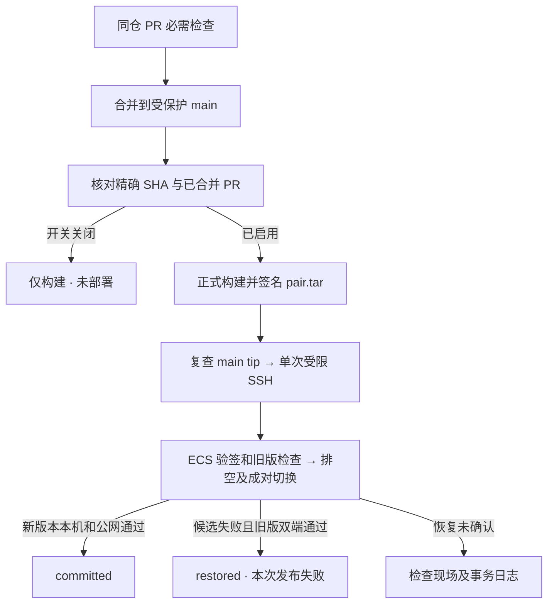

# PR 合并后发布到上海 ECS - Plan

## Goal Capsule

维护者合并 PR 后，用户应能在 `www.zimage.store` 访问该次合并对应的前后端；发布失败时，值班人能区分“没发”“已恢复”“需要接手”。最快路径是补齐现有 GitHub Actions → 受限 SSH → ECS 接收器，不在小内存生产机上构建，也不另建镜像仓库。

**当前不能直接开发布开关。** 2026-11-25 的核查发现：GitHub 合并构建可用，生产仍在提供旧版本；ECS 的 SSH 身份验证和执行发布是两个不同阶段，后者尚未就绪。下面的仓库修复可先通过一个 PR 交付。首次变更生产启动配置、批准数据库兼容性、业务排空和首发在维护窗口完成；后续普通应用合并无需逐次手动部署。

---

## Product Contract

### Summary

保留已有同 SHA 成对构建、整包签名、固定主机密钥、离线验签、排空、精确回退和公网复验。修复影响正常切换的文件身份问题，让 PR 必需检查和每次发布的真实结果可见。

### Problem Frame

以下为 `main@a0de637f8aa3d59ac873c8db6c9e3d7b1f7f08db` 的现场快照，不是未来配置的默认值。实例、密钥和云凭据不需复制到项目。

| 环节 | 实测证据 | 发布含义 |
| --- | --- | --- |
| GitHub 仓库和 `main` | 公开仓库；生效规则要求 PR、分支最新和 `zimage-release-pr-required`，禁止删除及非快进；所需批准数为 0 | 有合并门禁，但不等于有人独立复核运维代码；按团队人员情况设置审核人 |
| 最近的 main run | [PR #29](https://github.com/zhYAO/Image-web/pull/29) → [45539467107](https://github.com/zhYAO/Image-web/actions/runs/45539467107)：`merged-pr` 成功、`build-only` 成功（137 秒）、`publish` 跳过 | 仓库级 `ZIMAGE_PRODUCTION_DEPLOY_ENABLED` 不存在。绿色只证明匹配 Linux 工具链上的构建，没有签名或传包 |
| production 环境 | 分支策略仅允许 branch `main`；已配置发布私钥、裸 Ed25519 主机公钥、ECS 地址和生产专用 Turnstile 公开变量。后者通过现有非测试值格式检查 | 无须重建凭据；格式检查不证明 Cloudflare 域名绑定、后端密钥配对或真实登录 |
| SSH | [45534241885](https://github.com/zhYAO/Image-web/actions/runs/45534241885) 的 `authenticate` 成功；它用 `ssh -N`，不请求会话 | 2026-11-25 07:03 UTC 云助手检查：账户 shell 为 `nologin`，密钥有 `restrict`、无逐键 `command`；检查的 sshd 配置不是目标命令，未列出精确 sudo 许可 |
| 上海实例 | 阿里云控制面按已核对的地址匹配到一台 Running 的 Ubuntu 22.04。07:02 UTC 机内 `zimage.service` active，旧前后端指针与公网 HTTPS 一致，入口 open，没有首次发布事务日志 | `/api/health/ready`、`/api/meta`、`/version.json` 显示后端 `7a811b326aa4b344cee08bc5a33c04e44a780fd4`、前端 `release-7a811b326aa4`；`/api/public-config` 为正式 HTTP 模式 |
| 接收器 | 基线 Linux kit `feb228cd9adc85825716dc9d8b532b7dfc877859cbebb7cb95a84d1911e7abbf` 目录及入口已安装并核对。真实 `kit.py check` 退出 1，首个错误为缺 `/usr/bin/gh`；当时独立信任根、`production-target.json` 均缺，已加载单元未绑定该 kit 的 preload | 同一份旧 kit 再传一次没有用；应安装经过本次修复和 Linux 验证的新 kit，准备验签器和策略，再切换 preload |
| 构建和数据 | PR/main 构建使用 Node 24.19.0、ABI 137、glibc 2.35、pnpm 11.19.0，校验 62 张固定公共资源。数据库旧树 `04386967f003c2d6638558cd89fcdd722134e594`、候选树 `e5f52c2647048469bb929124b67eac0f33a6126e` | 两个 Git tree 只是复核索引；必须在同一生产 DB/Worker 合同下确认旧版、新版都可运行。应用发布不执行迁移、不改价格或 Worker |

### Requirements

- R1. 只有受保护 `main` 上与已合并 PR 匹配的提交可以发布；PR 验证不持有生产权限。
- R2. 发布单元是同一个 `pair.tar`：签名、传输、验签和日志相互对应，ECS 不拉分支、不执行仓库安装脚本。
- R3. 候选启动和恢复旧版时，发布器自身不得使已经核验的框架文件身份失效；真实内容或权限漂移仍须拒绝。
- R4. 关闭开关、过时代码、发送结果不明、已恢复、已提交有可区分的证据。不能用 Actions 顶层绿色或 SSH 登录成功代替生产验收。

---

## Planning Contract

- KTD1. **保留两次不同目的的构建。** PR 测试的是临时合并 SHA，发布的是最终 main SHA；允许取消同一 PR 的过期构建，不取消已经开始的生产事务。合并高峰按最新可发布版本收敛，不承诺每个中间 SHA 都上线。[事件语义](https://docs.github.com/en/actions/reference/workflows-and-actions/events-that-trigger-workflows) · [并发语义](https://docs.github.com/en/actions/how-tos/write-workflows/choose-when-workflows-run/control-workflow-concurrency)
- KTD2. **必需检查不能因条件跳过而变绿。** 保留已配置的检查名和同仓 PR 策略；外部 fork 要么由维护者引入同仓分支实际检查，要么明确失败。构建验证与 `production` 环境隔离。[GitHub 必需检查](https://docs.github.com/en/pull-requests/how-tos/merge-and-close-pull-requests/troubleshooting-required-status-checks#handling-skipped-but-required-checks)
- KTD3. **隔离会被检查文件身份的运行时文件。** 分层组装原先为 Next 文件创建并移除硬链接，会改变共享 inode 的 `ctime`；现有不可变性检查在启动及恢复时再次比较它。保留严格比较，在组装端避免这一副作用，其余运行时仍可复用。Linux 上同时验证既有硬链接版本与新版本。
- KTD4. **固定信任边界。** 发布继续使用 GitHub 托管 runner 对整包签名，SSH 私钥只交给实际发送步骤；`contents: read`、`id-token: write`、`attestations: write` 足够签普通文件。接收器固定仓库、工作流、分支、源码/签名提交、归档摘要及独立信任根。使用已修复相应策略匹配问题的 GitHub CLI（至少 2.102.0）。[文件签名](https://docs.github.com/en/actions/how-tos/secure-your-work/use-artifact-attestations/use-artifact-attestations) · [离线验签](https://docs.github.com/en/actions/how-tos/secure-your-work/use-artifact-attestations/verify-attestations-offline) · [版本公告](https://github.com/cli/cli/security/advisories/GHSA-4mq3-hpgx-9cx8)
- KTD5. **发布开关属于仓库，不属于 environment。** `jobs.<id>.if` 在获得环境变量之前求值。启用变量本身不会触发 push；启用后通过一次新的受保护合并首发。[GitHub 变量作用域](https://docs.github.com/en/actions/reference/workflows-and-actions/variables#configuration-variable-precedence)

---

## Implementation Units

### U1. Fix runtime identity drift

对应 R3。在 `ops/aliyun/three-layer-release.py` 的组装边界隔离 Next 文件，不刷新已经缓存的身份、不取消 `ctime` 检查。用 `ops/aliyun/test_release_three_layer.py` 的真实层、缓存和文件系统夹具验证：已有硬链接旧版、共享运行时的后续候选、原地验收、候选失败后的旧版验收均不改变被观察的 inode 身份；普通依赖仍复用。由 PR 在同一 Linux 文件系统执行。

### U2. Make PR and release outcomes explicit

对应 R1/R4，独立于 U1。调整 `.github/workflows/pr-build.yml`、`.github/workflows/production.yml` 和共享构建动作：实际执行原必需门禁、合并后仍查精确 PR、仅取消过期 PR 检查、分别显示仅构建和真正投递。给每次签发的包提供可对账摘要；发送前检查主分支、新旧运行和失败原因。`ops/aliyun/production/test_kit.py` 等覆盖正常合并、错误来源和失败路径；本机无 POSIX 语义时以真实 GitHub Ubuntu 作业为准。

### U3. First-release runbook and handoff

对应 R1–R4。更新 [`ops/aliyun/production/README.md`](../../ops/aliyun/production/README.md) 的变量、只读命令、首装次序、结果和止损动作；在 [`doc/project-progress.md`](../../doc/project-progress.md) 记录实际检查。发布方不安装它自己的信任根，管理员不从 Windows CRLF 工作树计算 Linux kit 标识。明确短暂停机和未证实的外部条件。

---

## Verification Contract

1. **PR：** 实际 `zimage-release-pr-required` 通过，运行生产测试、硬链接回归及精确 Linux 前后端构建。完整应用/数据库质量套件另见手动 `ci.yml`；发布构建通过不代表这些检查都通过。
2. **首次准备：** 在独立管理员通道安装审阅版本的接收器和 `gh`、可信根；核对实例、受限账户和生产公开配置。数据库负责人确认两棵树后才配置策略。阿里云云助手须检查实际 `ExitCode` 和输出，而非仅看命令已下发。[阿里云执行结果](https://help.aliyun.com/zh/ecs/user-guide/check-execution-results-and-troubleshoot-common-issues)
3. **维护窗口：** 保留旧单元、助手和可恢复版本，排空业务后切到固定 preload；实际启动原版本、运行管理员 `kit.py check`，核实公网身份和旧版恢复路径。若失败，恢复旧配置和进程，开关保持关闭。管理访问用既有可信通道，不临时对全网放行 SSH。[阿里云安全组](https://help.aliyun.com/zh/ecs/user-guide/start-using-security-groups) · [托管 runner 出口限制](https://docs.github.com/en/actions/reference/runners/github-hosted-runners#ip-addresses)
4. **首发：** 开仓库变量、合并一个新 PR。核对 Actions 的 SHA/签名包 SHA-256、ECS `production-release.json` 的相同 SHA/摘要及 `committed`、公网 `/api/health/ready`、`/api/meta`、`/version.json`、实际首页 JS。本地和外部检查都必须通过。拿到这组证据才记录“自动发布打通”。
5. **恢复：** `restored` 仍为失败；确认保留对的实际进程和公网结果后，用新的修复 PR 前进。断线、`switching`、`restoring`、`needs_attention` 不重放。关开关只影响后续运行，不会撤销已发送事务。事后业务回退走兼容的 revert PR 或经人工核对的成对恢复；不回放数据库、不回滚整盘。

## Definition of Done

仓库交付以新 PR 的 Linux 门禁和可复现的验证为准。生产交付另以第 4 步的同一笔事务为准；缺少外部证据时，进度账本必须保留具体阻塞，不能把构建结果写成上线结果。
