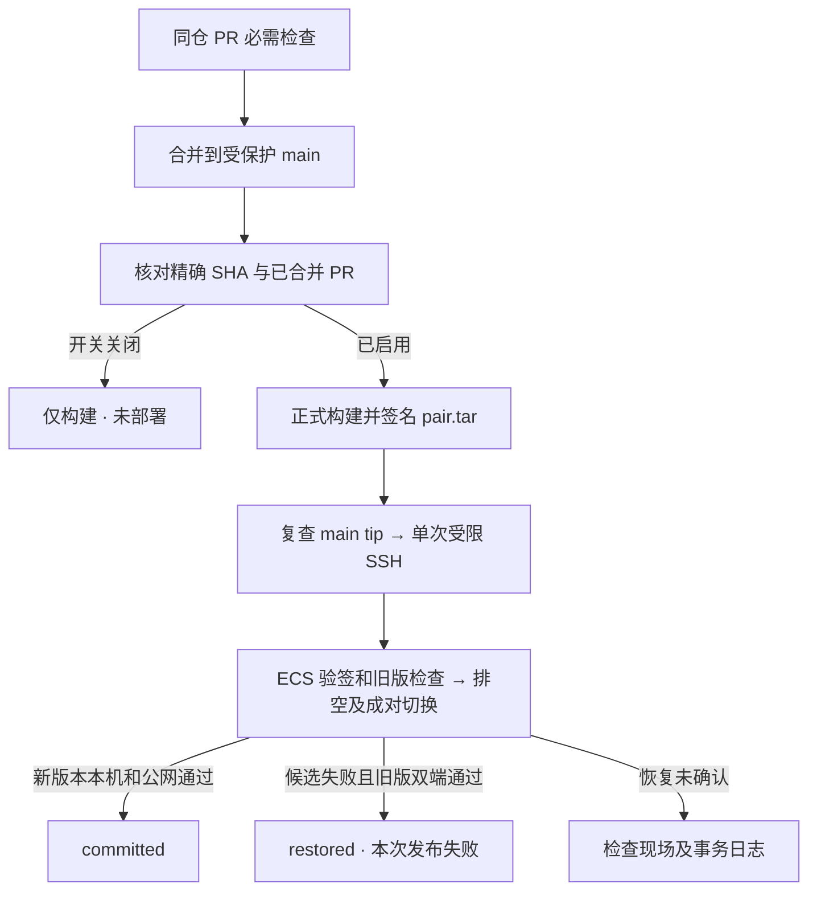

# PR 合并后发布到上海 ECS - Plan

## Goal Capsule

**面向小项目，`main` 上的工作流从 4 个收敛为 2 个：提 PR 看「检查」，合并后看「发布」。** 一台上海 ECS，一个生产环境，一个开关。复用已有接收器，不引入容器仓库、Kubernetes、另一套云流水线或常驻自托管 runner。

**当前不能直接开发布开关。** 最新合并构建成功，ECS 仍在运行旧版本。本文是经复核后供实施的方案；本轮交付文档，不删除现有工作流、不变更线上配置。实施时先在开关关闭状态合并修复，再完成一次性配置和首发。此后普通应用合并不需要手点部署。

| `main` 中现有文件 | 最终处理 | 保留什么、去掉什么 |
| --- | --- | --- |
| [`.github/workflows/pr-build.yml`](../../.github/workflows/pr-build.yml) | **保留：PR 检查** | 不改 GitHub 已要求的 `zimage-release-pr-required` 名字。PR 做无生产凭据的快检和配对构建。把仍有用的深度质量检查、本地数据库测试集中到此文件，不另建第三条流水线 |
| [`.github/workflows/production.yml`](../../.github/workflows/production.yml) | **保留：合并发布** | 路径也是 ECS 验签策略的一部分。只接受受保护 `main` 的合并 push，一次构建、一次签名、一次发送 |
| [`.github/workflows/ci.yml`（审计版本）](https://github.com/zhYAO/Image-web/blob/a0de637f8aa3d59ac873c8db6c9e3d7b1f7f08db/.github/workflows/ci.yml) | **迁移有效检查后删除** | 原 `quality`、`database` 的独有检查有用；旧 `candidate-build` 的 layers/full 选择、一天期 ZIP 和手工下载都不进入实际发布，退役这条制品通道 |
| [`.github/workflows/production-ssh-identity.yml`（审计版本）](https://github.com/zhYAO/Image-web/blob/a0de637f8aa3d59ac873c8db6c9e3d7b1f7f08db/.github/workflows/production-ssh-identity.yml) | **删除独立工作流** | 已有主机指纹和密钥认证证据，`ssh -N` 不会运行接收器。保留手册中的按需排障方法和发送端的严格主机校验，不再维护一条单独取生产密钥的流水线 |

[`.github/actions/build-production-pair/action.yml`](../../.github/actions/build-production-pair/action.yml) 是前两者复用的本地动作，不计作第三个工作流。历史 Actions run 保留作证据，清理范围是默认分支上的入口。

---

## Product Contract

### Summary

保留已有同 SHA 成对构建、整包签名、固定主机密钥、离线验签、排空、精确回退和公网复验。修复影响正常切换的文件身份问题，让 PR 必需检查和每次发布的真实结果可见。

### Problem Frame

以下为 `main@a0de637f8aa3d59ac873c8db6c9e3d7b1f7f08db` 的现场快照，不是未来配置的默认值。实例、密钥和云凭据不需复制到项目。

| 环节 | 实测证据 | 发布含义 |
| --- | --- | --- |
| GitHub 仓库和 `main` | 公开仓库；生效规则要求 PR、分支最新和 `zimage-release-pr-required`，禁止删除及非快进；所需批准数为 0 | 有合并门禁，但不等于有人独立复核运维代码；按团队人员情况设置审核人 |
| 最近的 main run | [PR #29](https://github.com/zhYAO/Image-web/pull/29) → [45539467107](https://github.com/zhYAO/Image-web/actions/runs/45539467107)：`merged-pr` 成功、`build-only` 成功（137 秒）、`publish` 跳过 | 仓库级 `ZIMAGE_PRODUCTION_DEPLOY_ENABLED` 不存在。绿色只证明匹配 Linux 工具链上的构建，没有签名或传包 |
| production 环境 | 分支策略仅允许 branch `main`；已配置发布私钥、裸 Ed25519 主机公钥、ECS 地址和生产专用 Turnstile 公开变量。后者通过现有非测试值格式检查 | 无须重建凭据；格式检查不证明 Cloudflare 域名绑定、后端密钥配对或真实登录 |
| SSH | [45534241885](https://github.com/zhYAO/Image-web/actions/runs/45534241885) 的 `authenticate` 成功；它用 `ssh -N`，不请求会话 | 07:03 UTC 云助手检查：账户 shell 为 `nologin`，密钥有 `restrict`、无逐键 `command`；以 localhost 参数展开的 sshd 配置不是目标命令，未列出精确 sudo 许可。不能据此推断所有来源地址的 Match 结果 |
| SSH 网络入口 | 阿里云控制面只读检查：主网卡绑定一个安全组，其中有两条覆盖 TCP 22 的入方向允许规则，IPv4 来源均为 `0.0.0.0/0` | 云侧没有把 SSH 限制到发布方，删掉其中一条也不够。这不是账户可任意登录的证据；主机防火墙及其他 SSH 账户的实际限制未在本轮核验 |
| 上海实例 | 阿里云控制面按已核对的地址匹配到一台 Running 的 Ubuntu 22.04。07:02 UTC 机内 `zimage.service` active，旧前后端指针与公网 HTTPS 一致，入口 open，没有首次发布事务日志 | 公网匿名实测 6 项通过：ready、meta、version、public-config、首页及该首页引用的版本化 JS。后端 `7a811b326aa4b344cee08bc5a33c04e44a780fd4`、前端 `release-7a811b326aa4`，不等于已验证真实登录 |
| 接收器 | 基线 Linux kit `feb228cd9adc85825716dc9d8b532b7dfc877859cbebb7cb95a84d1911e7abbf` 目录及入口已安装并核对。真实 `kit.py check` 退出 1，首个错误为缺 `/usr/bin/gh`；当时独立信任根、`production-target.json` 均缺，已加载单元未绑定该 kit 的 preload | 同一份旧 kit 再传一次没有用；应安装经过本次修复和 Linux 验证的新 kit，准备验签器和策略，再切换 preload |
| 构建和数据 | PR/main 构建使用 Node 24.19.0、ABI 137、glibc 2.35、pnpm 11.19.0，校验 62 张固定公共资源。数据库旧树 `04386967f003c2d6638558cd89fcdd722134e594`、候选树 `e5f52c2647048469bb929124b67eac0f33a6126e` | 两个 Git tree 只是复核索引；必须在同一生产 DB/Worker 合同下确认旧版、新版都可运行。应用发布不执行迁移、不改价格或 Worker |
| 公网证书 | 实际 HTTPS 握手中的证书到期时间为 **2026-12-16 14:41 UTC**。旧运维记录为手工 DNS，本轮没有续期成功证据 | 现证书有效；若过期，发布和恢复都会失去公网验收。到期前用已选挑战方式验证续期及 Nginx 加载新证书，不另加 GitHub 工作流。[Certbot 官方说明](https://eff-certbot.readthedocs.io/en/stable/using.html#renewal-with-the-manual-plugin) |

### Requirements

- R1. 只有受保护 `main` 上与已合并 PR 匹配的提交可以发布；PR 验证不持有生产权限。
- R2. 发布单元是同一个 `pair.tar`：签名、传输、验签和日志相互对应，ECS 不拉分支、不执行仓库安装脚本。
- R3. 候选启动和恢复旧版时，发布器自身不得使已经核验的框架文件身份失效；真实内容或权限漂移仍须拒绝。
- R4. 关闭开关、过时代码、发送结果不明、已恢复、已提交有可区分的证据。不能用 Actions 顶层绿色或 SSH 登录成功代替生产验收。
- R5. 最终只有上表的两个工作流；迁移后仍能运行关键应用测试与本地数据库检查，不接受为减少文件数而丢失验证。

---

## Planning Contract

- KTD1. **保留两次不同目的的构建。** PR 测试的是临时合并 SHA，发布的是最终 main SHA；允许取消同一 PR 的过期构建，不取消已经开始的生产事务。合并高峰按最新可发布版本收敛，不承诺每个中间 SHA 都上线。[事件语义](https://docs.github.com/en/actions/reference/workflows-and-actions/events-that-trigger-workflows) · [并发语义](https://docs.github.com/en/actions/how-tos/write-workflows/choose-when-workflows-run/control-workflow-concurrency)
- KTD2. **必需检查不能因条件跳过而变绿。** 保留已配置的检查名和同仓 PR 策略；外部 fork 要么由维护者引入同仓分支实际检查，要么明确失败。构建验证与 `production` 环境隔离。[GitHub 必需检查](https://docs.github.com/en/pull-requests/how-tos/merge-and-close-pull-requests/troubleshooting-required-status-checks#handling-skipped-but-required-checks)
- KTD3. **隔离会被检查文件身份的运行时文件。** 分层组装原先为 Next 文件创建并移除硬链接，会改变共享 inode 的 `ctime`；现有不可变性检查在启动及恢复时再次比较它。保留严格比较，在组装端避免这一副作用，其余运行时仍可复用。Linux 上同时验证既有硬链接版本与新版本。
- KTD4. **固定信任边界。** 发布继续使用 GitHub 托管 runner 对整包签名，SSH 私钥只交给实际发送步骤；`contents: read`、`id-token: write`、`attestations: write` 足够签普通文件。接收器固定工作流路径、分支、源码/签名提交和归档摘要。bundle 随包而来，按官方离线指引同时核对签名证书中的数字仓库 ID；该 ID 与信任根由管理员独立取得，不能取自包内元数据。使用已修复相应策略匹配问题的 GitHub CLI（至少 2.102.0）。[文件签名](https://docs.github.com/en/actions/how-tos/secure-your-work/use-artifact-attestations/use-artifact-attestations) · [离线验签](https://docs.github.com/en/actions/how-tos/secure-your-work/use-artifact-attestations/verify-attestations-offline) · [版本公告](https://github.com/cli/cli/security/advisories/GHSA-4mq3-hpgx-9cx8)
- KTD5. **发布开关属于仓库，不属于 environment。** `jobs.<id>.if` 在获得环境变量之前求值。启用变量本身不会触发 push；启用后通过一次新的受保护合并首发。[GitHub 变量作用域](https://docs.github.com/en/actions/reference/workflows-and-actions/variables#configuration-variable-precedence)



**配置放在哪里：**

| 位置 | 配置 | 用途 |
| --- | --- | --- |
| Repository → Settings → Secrets and variables → Actions → Variables | `ZIMAGE_PRODUCTION_DEPLOY_ENABLED` | 缺省/`0`：仅构建；`1`：允许下一个合格合并进入生产 |
| Repository → Actions variables | `NEXT_PUBLIC_SUPABASE_URL`、`NEXT_PUBLIC_SUPABASE_PUBLISHABLE_KEY`、`NEXT_PUBLIC_TURNSTILE_SITE_KEY` | PR 和未启用时的公开构建输入 |
| Settings → Environments → `production` → Variables | `NEXT_PUBLIC_SUPABASE_URL`、`NEXT_PUBLIC_SUPABASE_PUBLISHABLE_KEY`、`ZIMAGE_PRODUCTION_TURNSTILE_SITE_KEY` | 生产编译使用的公开值；专用 Turnstile 变量映射到应用的 `NEXT_PUBLIC_TURNSTILE_SITE_KEY` |
| 同一环境 → Variables / Secrets | 变量 `ZIMAGE_ECS_ADDRESS`、`ZIMAGE_ECS_HOST_KEY`；Secret `ZIMAGE_PRODUCTION_RELEASE_KEY` | 固定 IP、独立核验的裸 `ssh-ed25519 <公钥正文>`、受限发布私钥；不复用旧 `DEPLOY_*` 或管理员身份 |
| ECS 管理员通道 | 独立验签根、实例/兼容策略、固定版本的接收器及 systemd 配置 | 只安装一次，轮换或接收器有变更时再更新。业务运行密钥留在原位置 |

---

## Implementation Units

### U1. Fix runtime identity drift

对应 R3。在 `ops/aliyun/three-layer-release.py` 的永久组装和临时验收组装中，对 Next 包普通文件使用独立只读副本，保留 `0444`/`0555` 和其他运行时依赖的硬链接。不要刷新已缓存的身份或取消 `ctime` 检查。`ops/aliyun/test_release_three_layer.py` 用真实层和共享缓存创建**旧式已硬链接**的前任；对 pnpm 实际路径的 `next/package.json`、`dist/server/next.js` 和九个审阅文件，验证第二个 SHA 的准备、原地验收、候选失败后的旧版验收均不改变文件身份。用现有事务夹具同时覆盖正常新进程和恢复旧进程。实际内容/权限变化仍应被拒绝。由 Ubuntu CI 执行；这是从现有代码找到的缺陷路径，不是一次已经发生的生产回退。

### U2. Make PR and release outcomes explicit

对应 R1/R4/R5。用一个实施 PR 完成下列迁移，先保留开关关闭：

1. `pr-build.yml` 的同名必需检查在每个目标为 `main` 的 PR 真实执行，包括改目标分支。来源不符合策略时在 checkout 前明确失败。复用一次 frozen install，执行 lint、typecheck、domain/frontend 单测、接收器测试及配对构建；同一 PR 的新提交可取消旧检查。
2. 把 `ci.yml` 中未被快检覆盖的 Web/Worker 回归、字体准备、预算用例、本地 Supabase/pgTAP 和生成类型差异检查移到同一个 PR 工作流。在 `supabase/`、DB 类型、Worker 调用合同、CI 配置或依赖锁变更时，在该 PR 上执行相应深检；普通改动可从 `main` 用 `workflow_dispatch` 主动跑全量。按变更范围选中的检查必须成功；失败或意外跳过均不可使原必需检查变绿。范围不明跑全量，不在工作流顶层按路径跳过。生成类型写到 `$RUNNER_TEMP` 再 diff，避免 `build.sh` 的干净工作树校验失败。全量模式不签名、不读取 `production`、不生成可部署 ZIP。[Supabase 本地测试](https://supabase.com/docs/guides/local-development/testing/overview)
3. `production.yml` 继续从最终合并 SHA 构建；只开放首次 push attempt 投递，旧 run 重跑不得因为今天打开了开关而具备发布权。PR 关联同时匹配目标、来源仓库和合并 SHA。区分“读取 main 失败”“签名后 SHA 已过期、未发送”“发送后状态不明”。只有发送步骤读取 SSH 私钥；在步骤摘要标明 SHA、run 以及签名包 SHA-256，恢复成功仍使发布失败。签名前的测试/构建与投递共用受保护的 runner，合并的构建代码和依赖也是信任边界。
4. **同一改动中移除两个旧入口及失效引用。** `ops/aliyun/production/test_ssh_identity.py` 会直接读取待删 YAML；将需要长期保留的 pin/发送契约断言移到发送端测试。`ops/aliyun/candidate-artifact.py`、`ops/aliyun/lifecycle-smoke.py` 及对应测试依赖 `ci.yml`、`candidate-build`、旧 ZIP；退役远端选择/下载契约，保留能独立运行的本地包校验。`ops/aliyun/test_lifecycle_smoke.py` 还锁定旧 job 结构和旧组装器字节，`ops/aliyun/prepare-candidate-fonts.test.mjs` 断言旧 deploy/rollback job；把仍有意义的行为验证迁到新入口，而非整体跳过测试或盲目更新固定摘要。更新手册入口；不删历史 run 或顺带删除无关账号密钥。
5. 对 `ops/aliyun/production/receive.py` 的验签器版本和数字仓库 ID 实施 KTD4，在 `test_kit.py`、`test_production.py` 中验证缺失/不匹配时拒收。接收器文件变化会生成**新的** kit 摘要；不能让旧安装自动信任新入口。

### U3. First-release runbook and handoff

对应 R1–R5。实施时将验证过的结果回填 [`ops/aliyun/production/README.md`](../../ops/aliyun/production/README.md)，当前事实记录在 [`doc/project-progress.md`](../../doc/project-progress.md)。由工作台或云助手做一次性主机配置，GitHub 不获得阿里云管理凭据。具体顺序见下表。

---

## Verification Contract

| 次序 / 负责人 | 操作 | 放行条件 |
| --- | --- | --- |
| 1 · 仓库维护者：关开关合并实施 PR | 先跑 Ubuntu 必需检查、共享 inode 回归和成对恢复夹具，再合并。手动补跑一次迁移后的深检 | 只剩两份 workflow；原必需检查仍由 GitHub Actions 提供；main run 明确为“仅构建”，没有签名和投递 |
| 2 · ECS 管理员：不停服准备 | 从已审阅的 Linux/Git 原始字节执行 `python3 -I -B ops/aliyun/production/kit.py digest` 并按[接收器安装说明](../../ops/aliyun/production/README.md) stage 新版本；保留旧目录。从官方包安装 `gh`，从另一台可信机器导出 `gh attestation trusted-root` 并核对传入文件摘要 | 三层目标、工具链及可用磁盘满足包大小；启用的精确 `KIT_ID` 不来自 CRLF 工作树或传入包。云助手看实际状态和 `ExitCode`，不能只看 `InvokeId` |
| 3 · 数据库负责人 / 维护者 | 数据库负责人核对线上已应用修订、RPC/权限、Worker 及读写/回退兼容性。维护者另核实 Turnstile 域名、前后端密钥配对与登录 | 对同一个真实生产合同有新旧版本的兼容证据，再由管理员配置 `production-target.json` 的实例 ID 和批准树；不能把本地 SQL 绿灯或 Git tree 值当批准。合同未变的普通应用发布自动复用，涉及 DB/Worker 合同变化则重新复核 |
| 4 · ECS 管理员：维护窗口 | 保留原启动配置与独立管理通道。将 root 管理的 key、有效 sshd 强制命令、精确 sudoers、preload 同时绑定新 `KIT_ID`；验证强制命令及禁转发后才允许该账户 shell 执行固定入口。按下述冷启动顺序重启**原版本** | `sshd -t`、实际连接条件下的 `sshd -T -C` 和 `visudo -c` 通过；新 MainPID、cwd、私有 socket、preload、旧版本及公网契约均正确。失败则恢复原配置和旧进程，开关仍关 |
| 5 · 维护者：首次投递 | 前四项通过后在**仓库**设置 `ZIMAGE_PRODUCTION_DEPLOY_ENABLED=1`，正常合并一个新的小 PR。单机切换期间允许短暂 503 | Actions 的 commit 与 `pair.tar` 摘要匹配 ECS `/opt/zimage/production-release.json` 中的 `new[0]`、`pairSha256` 及 `phase=committed`，公网前后端和版本化 JS 匹配才算上线 |

[阿里云云助手执行结果](https://help.aliyun.com/zh/ecs/user-guide/check-execution-results-and-troubleshoot-common-issues) · [阿里云安全组](https://help.aliyun.com/zh/ecs/user-guide/start-using-security-groups) · [OpenSSH ForceCommand](https://man.openbsd.org/sshd_config#ForceCommand) · [GitHub 托管 runner 出口](https://docs.github.com/en/actions/reference/runners/github-hosted-runners#ip-addresses)。当前普通托管 runner 没有已验证的固定出口；不要直接删入站规则把管理员和发布器一起锁在外面。管理员应先从独立维护通道和受控发布出口验通，再收紧两条覆盖规则。没有受控出口时，首次开关前由所有者明确是否接受现状或推迟首发；不把整个 GitHub 地址列表当可信客户端，不给普通 CI 增加修改安全组的权限。

**首次换 preload 的顺序有要求：** 先记录在役 PID 和原配置，用现有门禁拒绝新业务，确认同一 PID 的 HTTP、后台和业务计数均排空；拿不到证据就不停止服务。通过既有 Nginx 维护机制封闭入口并实测 503，再重启旧版。入口继续封闭时核对新进程，在外层封闭保护下让应用门禁回到 `open`，运行管理员 `kit.py check`（它要求应用已 open）。通过后再恢复 Nginx 对外入口、从公网复查旧版。如果公网复查失败，重新封闭入口，并在停止**新的 MainPID** 前确认它已排空；不能证明排空就不停止。需回退时保持外层封闭、恢复原 drop-in 并启动原版本，重新核对后才开放。此顺序仅限首装或更换接收器，不是每个 PR 都需要人工操作。

**值班人只看三个结果：**

- `committed`：新版本运行，双方检查通过。发布完成。
- `restored`：旧版本的实际进程和公网检查通过，**本次发布失败**。修复后走新 PR；事后要撤回已成功的版本，可用数据库兼容的 revert PR 产生新的 SHA。
- 发送后断线、`switching`、`restoring`、`needs_attention`：先关后续发布。接收器会先准备文件再写 `switching`，所以日志不存在或仍是上一笔都**不能**证明未发送。管理员等现有事务放锁后，使用同一 `deploy.lock` 互斥对账 run/摘要、两端目录及 `current`、新旧 PID、门禁和本机/公网版本。即使现网健康，非终态或不匹配的日志仍会拒绝下一笔；在完成经复核的人工恢复和对账前保持停发，不清日志、不手改指针来解锁。关开关不会撤销在途事务。若已明确是发送前过期，则无需回滚。

**日常速度怎么量：** 137 秒是这次仅构建 job 的实测，不是端到端发布承诺。首发分别记录合并到 `committed`、入口 503 到恢复两个时长；前三次合并用 Actions 时间和 ECS 日志定位瓶颈。优先取消旧 PR 和消除重复安装；不同 SHA 的 PR 包不提升为生产包，不另设性能平台。

以下命令可复查 GitHub 侧证据，只输出规则类型、变量名及 job 状态：

```bash
gh api repos/zhYAO/Image-web/rules/branches/main --jq '.[].type'
gh variable list -R zhYAO/Image-web --json name --jq '.[].name'
gh variable list -R zhYAO/Image-web --env production --json name --jq '.[].name'
gh api repos/zhYAO/Image-web/actions/runs/45539467107/jobs --jq '.jobs[] | [.name,.conclusion] | @tsv'
```

---

## Definition of Done

本轮交付是这份精简方案及[复核记录](../reviews/2026-11-25-aliyun-merge-release-review.md)。后续仓库实施以第 1 步的 Linux 门禁为准；生产交付另以第 5 步的同一笔事务为准。上线前缺少任何一项外部证据，都继续记录为待办，不能把构建结果写成上线结果。
